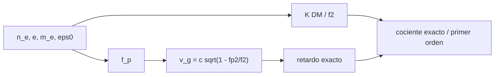

# B46-C02 — Propagación de ondas de radio

<!-- nav:top -->
<!-- /nav -->

## 1. Ubicación, nivel y alcance

Clase 2 del bloque B46. Nivel N3. Las ondas de radio atraviesan plasma, que las retrasa más a baja frecuencia. Aquí calculas la **frecuencia de plasma**, el **retardo por dispersión** de una columna uniforme (por integración exacta y por la fórmula de primer orden) y la pérdida en espacio libre. Usas [B05](../../../tronco-comun/B05-fisica-fundamental-para-el-espacio.md) y [B46-C01](../B46-C01-espectro-radioastronomico/CLASE.md). La columna de electrones es ilustrativa.

## 2. Por qué esta clase existe

El retardo `∝ ν⁻²` permite medir la medida de dispersión de un pulso y corregirlo, pero un error de aproximación se traslada a la fecha de llegada. La decisión central: **¿cuándo basta la fórmula de primer orden del retardo?**

## 3. Lo que podrás hacer al terminar

1. Calcular la frecuencia de plasma de una densidad dada.
2. Calcular el coeficiente de dispersión desde constantes.
3. Integrar el retardo exacto de grupo.
4. Comparar con el primer orden.
5. Calcular la pérdida en espacio libre.
6. Reconocer los límites de un plasma frío uniforme.

La evidencia es la **ficha de la propagación de radio** del ejercicio 12 (sección 20).

## 4. Con qué llegas y cómo comprobarlo

1. ¿Qué es una incertidumbre?
2. ¿Qué es una simulación Monte Carlo?
3. ¿Qué es una tabla de resultados?
4. ¿Qué es un valor ilustrativo?
5. ¿Qué es una verificación?

<details>
<summary>Ver respuestas</summary>

1. Un intervalo en que se espera el valor verdadero. 2. Repetir con números aleatorios de semilla fija. 3. Un resumen ordenado de cálculos. 4. Un valor propuesto para el ejemplo, no medido. 5. Comparar un cálculo con un caso independiente.
</details>

Con cuatro o cinco aciertos, sigue; si no, repasa los prerrequisitos.

## 5. Un caso de contexto y casos de referencia

Con `n_e = 0,03 cm⁻³` y `DM = 100 pc cm⁻³` (ilustrativos), el retardo a 1 GHz es `414,884 ms` por la integral exacta y `414,881 ms` por primer orden. Es el **ejemplo conductor**.

## 6. Vocabulario

La **frecuencia de plasma** `f_p`. La **dispersión**: la velocidad de grupo depende de la frecuencia. La **medida de dispersión** `DM = ∫ n_e dl` (pc cm⁻³). La **pérdida en espacio libre** `(4πd/λ)²`. El **retardo de grupo** es el tiempo extra respecto del vacío.

## 7. Modelo mental: una carrera con obstáculos

Es como una carrera en que los corredores lentos (baja frecuencia) pierden más tiempo en cada obstáculo; los más rápidos llegan antes.



*Descripción textual:* la densidad define la frecuencia de plasma, de la que salen el retardo exacto y su aproximación, que se comparan.

Analogía: una carrera con obstáculos. Límite: plasma frío, uniforme y sin campo magnético.

## 8. La explicación, paso a paso

### 8.1 Frecuencia de plasma y coeficiente

`f_p = √(n e²/(4π² ε₀ m_e))` da `1,555 kHz` para `0,03 cm⁻³` y `2,839 MHz` para `10⁵ cm⁻³`. El coeficiente `K = e²/(8π² ε₀ m_e c)` vale `4,1488 ms GHz² cm³ pc⁻¹` con constantes de NIST.

### 8.2 Retardo de una columna de 100 pc cm⁻³

| f (GHz) | primer orden (ms) | exacto (ms) |
|---|---|---|
| 0,4 | 2593,0040 | 2593,0617 |
| 1,0 | 414,8806 | 414,8838 |
| 1,4 | 211,6738 | 211,7080 |
| 5,0 | 16,5952 | 16,6075 |

El primer orden coincide con el exacto dentro del 0,1 % a 1 GHz porque `f_p ≪ f`.

### 8.3 Pérdida en espacio libre

A 1,4 GHz y 1000 km, `FSPL = 155,37 dB`.

### 8.4 Lectura

Dos señales de 0,4 y 5 GHz llegan separadas unos `2576 ms`: eso es lo que se corrige al desdispersar. El plasma real no es uniforme ni frío: el resultado es orientativo.

## 9. Magnitudes, símbolos y unidades

| Símbolo | Qué es | Unidad | Valor / nota |
|---|---|---|---|
| `f_p` | frecuencia de plasma | Hz | 1555 para 0,03 cm⁻³ |
| `K` | coeficiente de dispersión | ms GHz² cm³ pc⁻¹ | 4,1488 |
| `DM` | medida de dispersión | pc cm⁻³ | 100 (ilustrativa) |
| `FSPL` | pérdida en espacio libre | dB | 155,37 |

## 10. Convenciones y referencias

Constantes de NIST CODATA 2022 (`e`, `m_e`, `ε₀`, `c`); densidad, columna y distancia **ilustrativas**.

## 11. De dónde sale lo que afirmamos

| ID | Fuente | Localizador | Respalda | Estado |
|---|---|---|---|---|
| S1 | NIST, *Fundamental Physical Constants* (CODATA 2022) | https://physics.nist.gov/cuu/Constants/Table/allascii.txt | constantes citadas en la sección 9 | Consultada el 2026-11-09 |

Límites: no se consultó ninguna medida de dispersión real.

## 12. Cómo ver las cifras

| Magnitud | Valor |
|---|---|
| `f_p` (0,03 cm⁻³) | 1,555 kHz |
| `K` | 4,1488 ms GHz² cm³ pc⁻¹ |
| retardo exacto a 1 GHz | 414,884 ms |
| FSPL | 155,37 dB |

Descripción larga: el retardo cae como el cuadrado de la frecuencia.

## 13. Ejemplo trabajado: el retardo a 1,4 GHz

**Paso 1 · Fórmula.** `Δt = K·DM/f²` con `f = 1,4 GHz`.

**Paso 2 · Cálculo.** `4,1488·100/1,96 = 211,67 ms`.

**Paso 3 · Exacto.** El laboratorio da `211,71 ms`.

**Paso 4 · Diferencia.** `0,02 %`.

## 14. Distintas formas de describir un pulso

**Por fórmula:** `K·DM/f²`. **Por integral:** retardo de grupo. **Por tabla:** retardo frente a frecuencia. **Por pérdida:** decibelios.

## 15. Práctica guiada

**Ejercicio 1 · con los pasos indicados.** `f_p` para `n = 1 cm⁻³`. *Pasos:* `8,98 kHz·√n`.

<details><summary>Solución comentada</summary>

`8,98 kHz`.
</details>

**Ejercicio 2 · con una pista.** Retardo a 1 GHz con `DM = 100`. *Pasos:* `K·DM/f²`.

<details><summary>Solución comentada</summary>

`414,9 ms`.
</details>

**Ejercicio 3 · casi autónomo.** Retardo a 2 GHz (primer orden).

<details><summary>Solución comentada</summary>

`103,7 ms`.
</details>

## 16. Práctica autónoma, transferencia e integrador

**Ejercicio 4.** Retardo entre 0,4 y 1 GHz.

<details><summary>Solución comentada</summary>

`2178,1 ms`.
</details>

**Ejercicio 5.** Factor entre el retardo a 1 GHz y a 5 GHz.

<details><summary>Solución comentada</summary>

`25`, porque `(5/1)² = 25`.
</details>

**Ejercicio 6.** ¿Por qué el exacto supera al primer orden?

<details><summary>Solución comentada</summary>

Porque `(1 − f_p²/f²)^(−1/2) > 1 + f_p²/(2f²)`.
</details>

**Ejercicio 7.** FSPL al duplicar la distancia.

<details><summary>Solución comentada</summary>

Sube 6,02 dB.
</details>

**Ejercicio 8.** FSPL al duplicar la frecuencia.

<details><summary>Solución comentada</summary>

Sube 6,02 dB.
</details>

**Ejercicio 9 · transferencia.** **Transferencia.** ¿Qué frecuencia mínima atraviesa un plasma de `10⁵ cm⁻³`?

<details><summary>Solución comentada</summary>

Más de `2,84 MHz`.
</details>

**Ejercicio 10 · transferencia.** **Transferencia.** ¿Por qué se observa a varias frecuencias para medir `DM`?

<details><summary>Solución comentada</summary>

Porque el retardo diferencial depende de `1/f²` y separa la dispersión de otros retardos.
</details>

**Ejercicio 11 · transferencia.** **Transferencia.** ¿Qué ocurre con un plasma muy denso a 1 GHz?

<details><summary>Solución comentada</summary>

El primer orden falla y hay que integrar.
</details>

**Ejercicio 12.** **Integrador.** Elabora tu *ficha de la propagación de radio*: `f_p`, retardo exacto y de primer orden, y FSPL.

<details><summary>Solución comentada</summary>

Secciones 8.1–8.3.
</details>

**Ejercicio 12 · integrador.** **Integrador.** Elabora tu *ficha de la propagación de radio*: `f_p`, retardo exacto y de primer orden, y FSPL.

<details><summary>Solución modelo</summary>

Secciones 8.1–8.3.
</details>

## 17. Laboratorio: dispersión de un pulso

El script [propagacion.py](propagacion.py) calcula la frecuencia de plasma, el coeficiente de dispersión y el retardo exacto y aproximado (**comprueba** `K` y la coincidencia al 0,1 %).

**Datos:** constantes de NIST; densidad, columna y distancia **ilustrativas**. **Predice antes de ejecutar:** ¿cuánto valdrá `K`? (4,149 ms GHz² cm³ pc⁻¹.) **Ejecución del 2026-11-09 (Python 3.12.9):**

```text
Python 3.12.9 (biblioteca estandar)
f_p(0.03 cm^-3) = 1.555 kHz ; f_p(1e5 cm^-3) = 2.839 MHz
K = 4.1488 ms GHz^2 cm^3 pc^-1
 f [GHz]  primer orden [ms]  exacto [ms]
     0.4          2593.0040    2593.0617
     1.0           414.8806     414.8838
     1.4           211.6738     211.7080
     5.0            16.5952      16.6075
FSPL a 1.4 GHz y 1000 km = 155.37 dB
Pruebas superadas.
```

```bash
python programa/clases/B46/B46-C02-propagacion-de-ondas-de-radio/propagacion.py
```

**Límites:** plasma uniforme y frío, sin campo ni scattering.

## 18. Errores frecuentes y cómo corregirlos

**Usar GHz y MHz sin convertir.** Se corrige con la sección 9.

**Olvidar que `DM` es una columna.** Se corrige con 8.2.

**Aplicar el primer orden cerca de `f_p`.** Se corrige con 8.2.

**Presentar `DM` como medida real.** Se corrige con la sección 10.

## 19. Cómo sabrás que vas bien

Tras la sección 8: ¿qué resultado esperabas y cuál obtuviste? Si dudas, repasa el ejemplo 13. Tras el laboratorio: ¿qué comprueba? (ver la sección 17).

## 20. Qué entregas y cómo se evalúa

El producto es tu **ficha de la propagación de radio** (ejercicio 12).

| Criterio | Inicial | En desarrollo | Logrado | Destacado |
|---|---|---|---|---|
| Conceptos | Los confunde | Parciales | conceptos de la clase | Explica los límites |
| Cálculo | Sin unidades | Con errores | Tablas completas | Calcula casos nuevos |
| Numérico | Sin comprobar | Un caso | Contraste con el análisis | Interpreta las diferencias |
| Fuentes | Sin fuente | Sin fecha | fuentes con fecha | Declara lo ilustrativo |
| Límites | No los nombra | Uno | Tres | Discute qué falta del modelo |

**Condiciones críticas (no se compensan con promedio):** rotular lo ilustrativo; no inferir densidades reales; citar solo lo consultado.

## 21. Ética, seguridad y límites

Clase educativa: los modelos son simplificados. Accesibilidad: tablas equivalentes a las gráficas, fórmulas en texto, ejercicios sin conexión.

## 22. Para cerrar y seguir

La dispersión de 414,9 ms a 1 GHz con `DM = 100` se verifica por dos vías. Queda una pregunta: ¿cómo se recoge la señal con una antena parabólica?

**Glosario español–inglés.** dispersión · *dispersion*; medida de dispersión · *dispersion measure*; frecuencia de plasma · *plasma frequency*; pérdida en espacio libre · *free-space path loss*.

**Continuidad.** [B46-C03](../B46-C03-antenas-parabolicas/CLASE.md) estudia las antenas parabólicas.

**Referencias:** ver sección 11.

<!-- nav:bottom -->
---

<!-- /nav -->
