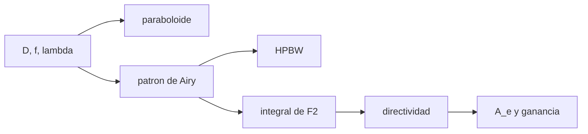

# B46-C03 — Antenas parabólicas

<!-- nav:top -->
[🏠 Programa](../../../../README.md) · [📚 Bloque B46](../../../tronco-comun/B46-radioastronomia-e-interferometria.md) · [← Anterior: B46-C02 — Propagación de ondas de radio](../B46-C02-propagacion-de-ondas-de-radio/CLASE.md) · [Siguiente: B46-C04 — Diagramas de radiación →](../B46-C04-diagramas-de-radiacion/CLASE.md)
<!-- /nav -->

## 1. Ubicación, nivel y alcance

Clase 3 del bloque B46. Nivel N3. Una antena parabólica concentra la señal en un foco. Aquí calculas la geometría de un paraboloide, el **patrón de Airy** de una apertura circular uniforme, su **ancho a media potencia** y su **directividad**, esta última por integración numérica y por `(πD/λ)²`. Usas [B46-C01](../B46-C01-espectro-radioastronomico/CLASE.md) y [B05](../../../tronco-comun/B05-fisica-fundamental-para-el-espacio.md). La antena es ilustrativa.

## 2. Por qué esta clase existe

El tamaño de la antena fija a la vez la resolución y la sensibilidad. La decisión central: **¿qué diámetro y qué razón focal dan el haz y la ganancia requeridos?**

## 3. Lo que podrás hacer al terminar

1. Calcular la profundidad de un paraboloide y su razón focal.
2. Evaluar el patrón de Airy.
3. Hallar el ancho a media potencia.
4. Integrar la directividad.
5. Calcular el área efectiva y la ganancia en dBi.
6. Reconocer los límites de la apertura uniforme.

La evidencia es la **ficha de la antena parabólica** del ejercicio 12 (sección 20).

## 4. Con qué llegas y cómo comprobarlo

1. ¿Qué es una incertidumbre?
2. ¿Qué es una simulación Monte Carlo?
3. ¿Qué es una tabla de resultados?
4. ¿Qué es un valor ilustrativo?
5. ¿Qué es una verificación?

<details>
<summary>Ver respuestas</summary>

1. Un intervalo en que se espera el valor verdadero. 2. Repetir con números aleatorios de semilla fija. 3. Un resumen ordenado de cálculos. 4. Un valor propuesto para el ejemplo, no medido. 5. Comparar un cálculo con un caso independiente.
</details>

Con cuatro o cinco aciertos, sigue; si no, repasa los prerrequisitos.

## 5. Un caso de contexto y casos de referencia

Una antena de `25 m` a `1,4 GHz` (`λ = 21,41 cm`) con `f = 9 m` tiene `f/D = 0,36`, un plato de `4,34 m` de profundidad, un ancho a media potencia de `30,3 arcmin` y una directividad de `134522`. Es el **ejemplo conductor**. Todos los valores son **ilustrativos**.

## 6. Vocabulario

El **paraboloide** `z = r²/(4f)`. La **razón focal** `f/D`. El **patrón de Airy** `2J₁(x)/x`. El **ancho a media potencia** (HPBW). La **directividad** compara con una antena isótropa. El **área efectiva** `A_e = η A`.

## 7. Modelo mental: una lupa para ondas

Como una lupa concentra la luz en un punto, el plato lleva todas las ondas paralelas al foco, y cuanto mayor es la lupa más fino es el punto.



*Descripción textual:* la geometría y la longitud de onda determinan el patrón, del cual salen el ancho y la directividad.

Analogía: una lupa para ondas. Límite: apertura uniforme, sin bloqueo ni errores de superficie.

## 8. La explicación, paso a paso

### 8.1 Geometría

Profundidad `D²/(16f) = 4,340 m`; `f/D = 0,360`.

### 8.2 Haz

El patrón de potencia vale 1/2 en `x = 1,61634`. Entonces `HPBW = 1,0290 λ/D = 30,30 arcmin`.

### 8.3 Directividad

La integral `∫F²x dx` converge a `2,00000` (valor exacto 2). La directividad numérica es `134522,2` y la analítica `(πD/λ)² = 134522,3`.

### 8.4 Ganancia y área

Con `η = 0,6`: `A_e = 294,5 m²` y `G = 49,07 dBi`.

### 8.5 Lectura

Duplicar el diámetro divide el haz por 2 y multiplica la directividad por 4. Una antena real tiene bloqueo, ilumina el borde con menos potencia y tiene errores de superficie.

## 9. Magnitudes, símbolos y unidades

| Símbolo | Qué es | Unidad | Valor / nota |
|---|---|---|---|
| `D` | diámetro | m | 25 (ilustrativo) |
| `f/D` | razón focal | — | 0,360 |
| `HPBW` | ancho a media potencia | rad | 1,0290 λ/D |
| `G` | ganancia | dBi | 49,07 |

## 10. Convenciones y referencias

Velocidad de la luz de NIST; diámetro, distancia focal, frecuencia y eficiencia **ilustrativos**.

## 11. De dónde sale lo que afirmamos

| ID | Fuente | Localizador | Respalda | Estado |
|---|---|---|---|---|
| S1 | NIST, *Fundamental Physical Constants* (CODATA 2022) | https://physics.nist.gov/cuu/Constants/Table/allascii.txt | constantes citadas en la sección 9 | Consultada el 2026-11-09 |

Límites: no se consultó ninguna antena real.

## 12. Cómo ver las cifras

| Magnitud | Valor |
|---|---|
| profundidad | 4,34 m |
| HPBW | 30,3 arcmin |
| directividad | 134522 |
| `G` con `η = 0,6` | 49,07 dBi |

Descripción larga: la directividad numérica coincide con la analítica.

## 13. Ejemplo trabajado: el ancho del haz

**Paso 1 · Longitud de onda.** `λ = c/ν = 21,41 cm`.

**Paso 2 · Cociente.** `λ/D = 0,00857 rad`.

**Paso 3 · Factor.** `1,029 × λ/D = 0,00881 rad`.

**Paso 4 · Conversión.** `30,30 arcmin`.

## 14. Distintas formas de describir una antena

**Por geometría:** paraboloide. **Por patrón:** Airy. **Por cifras:** HPBW y directividad. **Por ganancia:** dBi.

## 15. Práctica guiada

**Ejercicio 1 · con los pasos indicados.** Profundidad de un plato de `D = 12 m` y `f = 4 m`. *Pasos:* `D²/(16f)`.

<details><summary>Solución comentada</summary>

`2,25 m`.
</details>

**Ejercicio 2 · con una pista.** `f/D` del mismo plato. *Pasos:* `4/12`.

<details><summary>Solución comentada</summary>

`0,333`.
</details>

**Ejercicio 3 · casi autónomo.** HPBW de `D = 25 m` a 1,4 GHz en arcmin (usa 1,029).

<details><summary>Solución comentada</summary>

`30,3`.
</details>

## 16. Práctica autónoma, transferencia e integrador

**Ejercicio 4.** Directividad de `D = 25 m` a 1,4 GHz.

<details><summary>Solución comentada</summary>

`134522`.
</details>

**Ejercicio 5.** Ganancia ideal en dBi.

<details><summary>Solución comentada</summary>

`51,29 dBi`.
</details>

**Ejercicio 6.** `A_e` con `η = 0,6`.

<details><summary>Solución comentada</summary>

`294,5 m²`.
</details>

**Ejercicio 7.** ¿Qué pasa con el HPBW si `D` se duplica?

<details><summary>Solución comentada</summary>

Se reduce a la mitad.
</details>

**Ejercicio 8.** ¿Qué pasa con la directividad si `D` se duplica?

<details><summary>Solución comentada</summary>

Se multiplica por 4.
</details>

**Ejercicio 9 · transferencia.** **Transferencia.** ¿Por qué `G = ηD`?

<details><summary>Solución comentada</summary>

Porque la eficiencia pondera la directividad ideal.
</details>

**Ejercicio 10 · transferencia.** **Transferencia.** ¿Qué hace el bloqueo del subreflector?

<details><summary>Solución comentada</summary>

Reduce `η` y sube los lóbulos laterales.
</details>

**Ejercicio 11 · transferencia.** **Transferencia.** ¿Por qué observar a 21 cm con un plato de 25 m da un haz de medio grado?

<details><summary>Solución comentada</summary>

Porque `λ/D ≈ 0,0086 rad`.
</details>

**Ejercicio 12.** **Integrador.** Elabora tu *ficha de la antena parabólica*: geometría, HPBW, directividad y ganancia.

<details><summary>Solución comentada</summary>

Secciones 8.1–8.4.
</details>

**Ejercicio 12 · integrador.** **Integrador.** Elabora tu *ficha de la antena parabólica*: geometría, HPBW, directividad y ganancia.

<details><summary>Solución modelo</summary>

Secciones 8.1–8.4.
</details>

## 17. Laboratorio: haz de una antena

El script [antena.py](antena.py) calcula el patrón de Airy, el HPBW y la directividad (**comprueba** la directividad numérica y `1,029 λ/D`).

**Datos:** `c` de NIST; antena **ilustrativa**. **Predice antes de ejecutar:** ¿cuánto valdrá el HPBW en unidades de `λ/D`? (1,029.) **Ejecución del 2026-11-09 (Python 3.12.9):**

```text
Python 3.12.9 (biblioteca estandar)
lambda = 21.414 cm ; f/D = 0.360 ; profundidad del plato = 4.340 m
x_1/2 = 1.61634 ; HPBW = 30.30 arcmin = 1.0290 lambda/D
integral de F^2 x dx = 2.00000 (analitica 2.00000)
directividad numerica = 134522.2 ; analitica (pi D/lambda)^2 = 134522.3
con eta = 0.6: G = 49.07 dBi ; A_e = 294.5 m^2
Pruebas superadas.
```

```bash
python programa/clases/B46/B46-C03-antenas-parabolicas/antena.py
```

**Límites:** apertura uniforme, campo lejano, sin bloqueo.

## 18. Errores frecuentes y cómo corregirlos

**Confundir diámetro con radio.** Se corrige con 8.1.

**Olvidar `η`.** Se corrige con 8.4.

**Mezclar grados y radianes.** Se corrige con 8.2.

**Presentar la antena como real.** Se corrige con la sección 10.

## 19. Cómo sabrás que vas bien

Tras la sección 8: ¿qué resultado esperabas y cuál obtuviste? Si dudas, repasa el ejemplo 13. Tras el laboratorio: ¿qué comprueba? (ver la sección 17).

## 20. Qué entregas y cómo se evalúa

El producto es tu **ficha de la antena parabólica** (ejercicio 12).

| Criterio | Inicial | En desarrollo | Logrado | Destacado |
|---|---|---|---|---|
| Conceptos | Los confunde | Parciales | conceptos de la clase | Explica los límites |
| Cálculo | Sin unidades | Con errores | Tablas completas | Calcula casos nuevos |
| Numérico | Sin comprobar | Un caso | Contraste con el análisis | Interpreta las diferencias |
| Fuentes | Sin fuente | Sin fecha | fuentes con fecha | Declara lo ilustrativo |
| Límites | No los nombra | Uno | Tres | Discute qué falta del modelo |

**Condiciones críticas (no se compensan con promedio):** rotular lo ilustrativo; no atribuir cifras a una antena real; citar solo lo consultado.

## 21. Ética, seguridad y límites

Clase educativa: los modelos son simplificados. Accesibilidad: tablas equivalentes a las gráficas, fórmulas en texto, ejercicios sin conexión.

## 22. Para cerrar y seguir

La antena de 25 m a 1,4 GHz tiene un haz de 30,3 arcmin y una ganancia de 49,1 dBi. Queda una pregunta: ¿cómo cambian los lóbulos con la iluminación?

**Glosario español–inglés.** antena parabólica · *parabolic dish*; directividad · *directivity*; ancho a media potencia · *half-power beamwidth*; área efectiva · *effective area*.

**Continuidad.** [B46-C04](../B46-C04-diagramas-de-radiacion/CLASE.md) estudia los diagramas de radiación.

**Referencias:** ver sección 11.

<!-- nav:bottom -->
---

[← Anterior: B46-C02 — Propagación de ondas de radio](../B46-C02-propagacion-de-ondas-de-radio/CLASE.md) · [📚 Bloque B46](../../../tronco-comun/B46-radioastronomia-e-interferometria.md) · [Siguiente: B46-C04 — Diagramas de radiación →](../B46-C04-diagramas-de-radiacion/CLASE.md)
<!-- /nav -->
