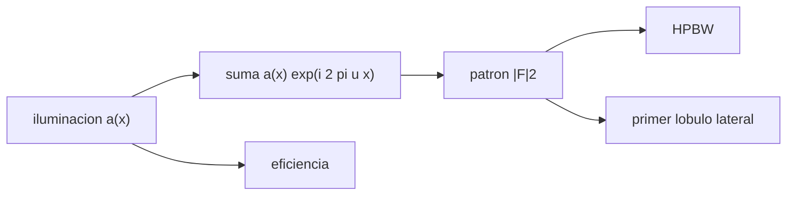

# B46-C04 — Diagramas de radiación

<!-- nav:top -->
<!-- /nav -->

## 1. Ubicación, nivel y alcance

Clase 4 del bloque B46. Nivel N3. El diagrama de radiación muestra la respuesta de una antena según la dirección. Aquí comparas tres leyes de **iluminación** de una apertura lineal (uniforme, coseno y coseno al cuadrado) por transformada de Fourier directa: su ancho a media potencia, su **primer lóbulo lateral** y su eficiencia. Usas [B46-C03](../B46-C03-antenas-parabolicas/CLASE.md). La apertura es ilustrativa.

## 2. Por qué esta clase existe

Bajar los lóbulos laterales evita captar emisión de direcciones no deseadas, pero ensancha el haz y reduce la eficiencia. La decisión central: **¿qué iluminación equilibra resolución y rechazo de lóbulos?**

## 3. Lo que podrás hacer al terminar

1. Calcular un patrón por suma de la apertura.
2. Medir el HPBW.
3. Localizar el primer lóbulo lateral.
4. Calcular la eficiencia de apertura.
5. Comparar tres iluminaciones.
6. Reconocer el compromiso entre ancho y lóbulos.

La evidencia es la **ficha del diagrama de radiación** del ejercicio 12 (sección 20).

## 4. Con qué llegas y cómo comprobarlo

1. ¿Qué es una incertidumbre?
2. ¿Qué es una simulación Monte Carlo?
3. ¿Qué es una tabla de resultados?
4. ¿Qué es un valor ilustrativo?
5. ¿Qué es una verificación?

<details>
<summary>Ver respuestas</summary>

1. Un intervalo en que se espera el valor verdadero. 2. Repetir con números aleatorios de semilla fija. 3. Un resumen ordenado de cálculos. 4. Un valor propuesto para el ejemplo, no medido. 5. Comparar un cálculo con un caso independiente.
</details>

Con cuatro o cinco aciertos, sigue; si no, repasa los prerrequisitos.

## 5. Un caso de contexto y casos de referencia

Con iluminación uniforme el HPBW es `0,886 λ/D` y el primer lóbulo `-13,26 dB`; con coseno al cuadrado, `1,441 λ/D` y `-31,47 dB`, con una eficiencia de `0,667`. Es el **ejemplo conductor**; la apertura es **ilustrativa**.

## 6. Vocabulario

El **diagrama de radiación** es la respuesta en potencia según la dirección. Un **lóbulo lateral** es un máximo secundario. La **iluminación** es la distribución del campo en la apertura. La **eficiencia de apertura** compara con la iluminación uniforme. Un **taper** reduce la iluminación hacia el borde.

## 7. Modelo mental: un foco con pantalla

Como una pantalla difumina el borde de un foco para evitar deslumbramientos laterales a costa de un haz más ancho.



*Descripción textual:* la iluminación se transforma en un patrón del que se miden ancho, lóbulo y eficiencia.

Analogía: un foco con pantalla. Límite: apertura 1D discretizada en 400 muestras.

## 8. La explicación, paso a paso

### 8.1 Resultados

| iluminación | HPBW (λ/D) | primer lóbulo (dB) | eficiencia |
|---|---|---|---|
| uniforme | 0,886 | -13,26 | 1,000 |
| coseno | 1,189 | -23,00 | 0,811 |
| coseno2 | 1,441 | -31,47 | 0,667 |

La iluminación uniforme reproduce los valores analíticos `0,886 λ/D` y `−13,26 dB`.

### 8.2 Compromiso

Al pasar de uniforme a coseno al cuadrado el HPBW crece un `63 %`, el lóbulo baja `18,2 dB` y la eficiencia cae a `0,667`.

### 8.3 Lectura

El HPBW del patrón unidimensional (`0,886`) difiere del circular (`1,029`) de [B46-C03](../B46-C03-antenas-parabolicas/CLASE.md): no se comparan directamente.

## 9. Magnitudes, símbolos y unidades

| Símbolo | Qué es | Unidad | Valor / nota |
|---|---|---|---|
| `u` | `sen θ` en unidades de λ/D | — | 0 a 6 |
| `a(x)` | iluminación | — | 1, coseno, coseno² |
| `SLL` | primer lóbulo lateral | dB | -13,26 (uniforme) |
| `η_a` | eficiencia de apertura | — | 0,667 (coseno²) |

## 10. Convenciones y referencias

Apertura de 400 muestras y tres leyes de iluminación **ilustrativas**; sin datos externos.

## 11. De dónde sale lo que afirmamos

| ID | Fuente | Localizador | Respalda | Estado |
|---|---|---|---|---|
| — | Estándar o texto de radioastronomía no consultado | — | relaciones habituales de la disciplina que el laboratorio verifica por cálculo | No se consultó para esta clase |

Límites: no se consultó ningún diagrama medido.

## 12. Cómo ver las cifras

| Iluminación | HPBW | Lóbulo |
|---|---|---|
| uniforme | 0,886 | -13,26 dB |
| coseno | 1,189 | -23,00 dB |
| coseno² | 1,441 | -31,47 dB |

Descripción larga: el lóbulo mejora a costa de un haz más ancho.

## 13. Ejemplo trabajado: el compromiso

**Paso 1 · Ancho uniforme.** `0,886 λ/D`.

**Paso 2 · Ancho coseno².** `1,441 λ/D`.

**Paso 3 · Cociente.** `1,626`.

**Paso 4 · Lóbulo.** Baja `18,21 dB`.

## 14. Distintas formas de describir un diagrama

**Por patrón:** curva de potencia. **Por tabla:** HPBW y lóbulo. **Por eficiencia:** `(Σa)²/(NΣa²)`. **Por analogía:** pantalla de un foco.

## 15. Práctica guiada

**Ejercicio 1 · con los pasos indicados.** Cociente de HPBW coseno / uniforme. *Pasos:* división.

<details><summary>Solución comentada</summary>

`1,342`.
</details>

**Ejercicio 2 · con una pista.** Caída del lóbulo del coseno frente al uniforme. *Pasos:* resta.

<details><summary>Solución comentada</summary>

`9,74 dB`.
</details>

**Ejercicio 3 · casi autónomo.** Eficiencia del uniforme.

<details><summary>Solución comentada</summary>

`1`.
</details>

## 16. Práctica autónoma, transferencia e integrador

**Ejercicio 4.** ¿Qué iluminación tiene el lóbulo más bajo?

<details><summary>Solución comentada</summary>

El coseno al cuadrado.
</details>

**Ejercicio 5.** Convierte −13,26 dB en razón de potencia.

<details><summary>Solución comentada</summary>

`0,0472`.
</details>

**Ejercicio 6.** ¿Qué eficiencia pierde el coseno?

<details><summary>Solución comentada</summary>

`18,9 %`.
</details>

**Ejercicio 7.** ¿Qué ocurre con el HPBW si `D` se duplica?

<details><summary>Solución comentada</summary>

Se reduce a la mitad en radianes.
</details>

**Ejercicio 8.** Razón de potencia del lóbulo del coseno².

<details><summary>Solución comentada</summary>

`0,00071`.
</details>

**Ejercicio 9 · transferencia.** **Transferencia.** ¿Por qué los radiotelescopios iluminan con taper?

<details><summary>Solución comentada</summary>

Para reducir los lóbulos laterales y el desbordamiento.
</details>

**Ejercicio 10 · transferencia.** **Transferencia.** ¿Qué pierde el taper?

<details><summary>Solución comentada</summary>

Resolución y eficiencia.
</details>

**Ejercicio 11 · transferencia.** **Transferencia.** ¿Por qué no se compara 0,886 con 1,029?

<details><summary>Solución comentada</summary>

Una es 1D y la otra circular.
</details>

**Ejercicio 12.** **Integrador.** Elabora tu *ficha del diagrama de radiación*: tabla de HPBW, lóbulo y eficiencia, con la elección justificada.

<details><summary>Solución comentada</summary>

Sección 8.1.
</details>

**Ejercicio 12 · integrador.** **Integrador.** Elabora tu *ficha del diagrama de radiación*: tabla de HPBW, lóbulo y eficiencia, con la elección justificada.

<details><summary>Solución modelo</summary>

Sección 8.1.
</details>

## 17. Laboratorio: iluminación y lóbulos

El script [diagrama.py](diagrama.py) calcula tres patrones (**comprueba** `0,886 λ/D` y `−13,26 dB`).

**Datos:** sin datos externos; apertura **ilustrativa**. **Predice antes de ejecutar:** ¿cuánto valdrá el primer lóbulo del uniforme? (−13,26 dB.) **Ejecución del 2026-11-09 (Python 3.12.9):**

```text
Python 3.12.9 (biblioteca estandar)
iluminacion  HPBW [lambda/D]  1er lobulo [dB]  eficiencia
uniforme               0.886           -13.26       1.000
coseno                 1.189           -23.00       0.811
coseno2                1.441           -31.47       0.667
Pruebas superadas.
```

```bash
python programa/clases/B46/B46-C04-diagramas-de-radiacion/diagrama.py
```

**Límites:** apertura 1D, sin acoplamiento.

## 18. Errores frecuentes y cómo corregirlos

**Comparar HPBW 1D con circular.** Se corrige con 8.3.

**Medir el lóbulo en el nulo.** Se corrige con 8.1.

**Olvidar la eficiencia.** Se corrige con 8.2.

**Presentar el patrón como medido.** Se corrige con la sección 10.

## 19. Cómo sabrás que vas bien

Tras la sección 8: ¿qué resultado esperabas y cuál obtuviste? Si dudas, repasa el ejemplo 13. Tras el laboratorio: ¿qué comprueba? (ver la sección 17).

## 20. Qué entregas y cómo se evalúa

El producto es tu **ficha del diagrama de radiación** (ejercicio 12).

| Criterio | Inicial | En desarrollo | Logrado | Destacado |
|---|---|---|---|---|
| Conceptos | Los confunde | Parciales | conceptos de la clase | Explica los límites |
| Cálculo | Sin unidades | Con errores | Tablas completas | Calcula casos nuevos |
| Numérico | Sin comprobar | Un caso | Contraste con el análisis | Interpreta las diferencias |
| Fuentes | Sin fuente | Sin fecha | fuentes con fecha | Declara lo ilustrativo |
| Límites | No los nombra | Uno | Tres | Discute qué falta del modelo |

**Condiciones críticas (no se compensan con promedio):** rotular lo ilustrativo; no presentar un diagrama como medido; citar solo lo consultado.

## 21. Ética, seguridad y límites

Clase educativa: los modelos son simplificados. Accesibilidad: tablas equivalentes a las gráficas, fórmulas en texto, ejercicios sin conexión.

## 22. Para cerrar y seguir

Pasar a coseno² baja el lóbulo a -31,5 dB y ensancha el haz a 1,44 λ/D. Queda una pregunta: ¿cómo se traduce el diagrama en ganancia y temperatura?

**Glosario español–inglés.** diagrama de radiación · *radiation pattern*; lóbulo lateral · *sidelobe*; iluminación · *illumination*; eficiencia de apertura · *aperture efficiency*.

**Continuidad.** [B46-C05](../B46-C05-ganancia-y-temperatura-de-antena/CLASE.md) estudia la ganancia y la temperatura de antena.

**Referencias:** ver sección 11.

<!-- nav:bottom -->
---

<!-- /nav -->
