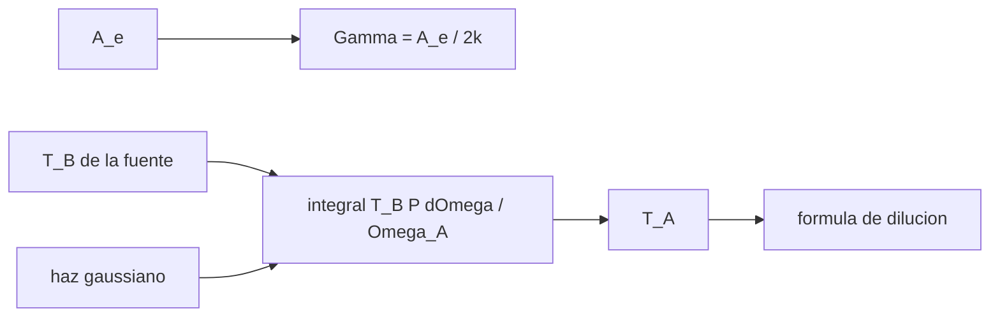

# B46-C05 — Ganancia y temperatura de antena

<!-- nav:top -->
[🏠 Programa](../../../../README.md) · [📚 Bloque B46](../../../tronco-comun/B46-radioastronomia-e-interferometria.md) · [← Anterior: B46-C04 — Diagramas de radiación](../B46-C04-diagramas-de-radiacion/CLASE.md) · [Siguiente: B46-C06 — Ruido de sistema y radiometría →](../B46-C06-ruido-de-sistema-y-radiometria/CLASE.md)
<!-- /nav -->

## 1. Ubicación, nivel y alcance

Clase 5 del bloque B46. Nivel N3. La antena convierte densidad de flujo en temperatura. Aquí calculas el **área efectiva**, la **sensibilidad en K/Jy** y la **dilución del haz** de una fuente extensa, comparando la integral numérica en dos dimensiones con la fórmula analítica gaussiana. Usas [B46-C03](../B46-C03-antenas-parabolicas/CLASE.md) y [B46-C01](../B46-C01-espectro-radioastronomico/CLASE.md). El plato y la fuente son ilustrativos.

## 2. Por qué esta clase existe

Para saber cuánto flujo hay en una fuente hay que conocer cuánta fracción del haz llena. La decisión central: **¿cuánto vale la temperatura de antena de una fuente extensa en un haz dado?**

## 3. Lo que podrás hacer al terminar

1. Calcular el área efectiva.
2. Convertir entre K y Jy.
3. Calcular el ángulo sólido del haz.
4. Integrar la temperatura de antena en dos dimensiones.
5. Aplicar la dilución del haz.
6. Reconocer cuándo falla la aproximación de fuente puntual.

La evidencia es la **ficha de la ganancia y la temperatura de antena** del ejercicio 12 (sección 20).

## 4. Con qué llegas y cómo comprobarlo

1. ¿Qué es una incertidumbre?
2. ¿Qué es una simulación Monte Carlo?
3. ¿Qué es una tabla de resultados?
4. ¿Qué es un valor ilustrativo?
5. ¿Qué es una verificación?

<details>
<summary>Ver respuestas</summary>

1. Un intervalo en que se espera el valor verdadero. 2. Repetir con números aleatorios de semilla fija. 3. Un resumen ordenado de cálculos. 4. Un valor propuesto para el ejemplo, no medido. 5. Comparar un cálculo con un caso independiente.
</details>

Con cuatro o cinco aciertos, sigue; si no, repasa los prerrequisitos.

## 5. Un caso de contexto y casos de referencia

Un plato de `25 m` con `η = 0,6` a `1,4 GHz` tiene `A_e = 294,5 m²` y `0,1067 K/Jy`. Una fuente gaussiana de `15 arcmin` y `50 K` en un haz de `30,3 arcmin` produce `T_A = 9,842 K`. Es el **ejemplo conductor**; la fuente es **ilustrativa**.

## 6. Vocabulario

La **temperatura de antena** `T_A` es la temperatura equivalente a la potencia recibida. El **área efectiva** `A_e`. La **sensibilidad** `Γ = A_e/(2k)` (K/Jy). El **ángulo sólido del haz** `Ω_A`. La **dilución del haz** es la fracción del haz llena por la fuente.

## 7. Modelo mental: una linterna sobre un cuadro

Si la linterna ilumina solo parte del cuadro, la lectura promedia la zona luminosa con la oscura; la dilución es esa fracción.



*Descripción textual:* el área efectiva da la sensibilidad y la integral de la fuente con el haz da la temperatura de antena, que se compara con la fórmula.

Analogía: una linterna sobre un cuadro. Límite: haz y fuente gaussianos, fuente centrada.

## 8. La explicación, paso a paso

### 8.1 Sensibilidad

`Γ = A_e/(2k)·10⁻²⁶ = 0,1067 K/Jy`; 1 K equivale a `9,38 Jy`.

### 8.2 Fuente extensa

El flujo de una fuente de `15 arcmin` con `50 K` es `64,95 Jy` (por Rayleigh–Jeans).

| cálculo | `T_A` (K) |
|---|---|
| integral numérica 2D | 9,8417 |
| dilución analítica `T_B θ_s²/(θ_s² + θ_b²)` | 9,8417 |
| fuente puntual `T_B Ω_s/Ω_haz` | 12,2537 |

### 8.3 Ángulos sólidos

`λ²/A_geom = 9,341 × 10⁻⁵ sr` y el haz gaussiano ocupa `8,802 × 10⁻⁵ sr`.

### 8.4 Lectura

La aproximación de fuente puntual da `12,25 K` y sobreestima la temperatura porque la fuente no es pequeña frente al haz.

## 9. Magnitudes, símbolos y unidades

| Símbolo | Qué es | Unidad | Valor / nota |
|---|---|---|---|
| `A_e` | área efectiva | m² | 294,52 |
| `Γ` | sensibilidad | K/Jy | 0,1067 |
| `T_A` | temperatura de antena | K | 9,842 |
| `Ω_A` | ángulo sólido del haz | sr | 8,802 × 10⁻⁵ |

## 10. Convenciones y referencias

`k` y `c` de NIST CODATA 2022; plato, eficiencia, fuente y haz **ilustrativos**.

## 11. De dónde sale lo que afirmamos

| ID | Fuente | Localizador | Respalda | Estado |
|---|---|---|---|---|
| S1 | NIST, *Fundamental Physical Constants* (CODATA 2022) | https://physics.nist.gov/cuu/Constants/Table/allascii.txt | constantes citadas en la sección 9 | Consultada el 2026-11-09 |

Límites: no se consultó ninguna calibración real.

## 12. Cómo ver las cifras

| Magnitud | Valor |
|---|---|
| `A_e` | 294,5 m² |
| `Γ` | 0,1067 K/Jy |
| `T_A` numérica | 9,8417 K |
| `T_A` analítica | 9,8417 K |

Descripción larga: la integral numérica coincide con la analítica.

## 13. Ejemplo trabajado: la dilución

**Paso 1 · Anchos.** `θ_s = 15`, `θ_b = 30,3` (arcmin).

**Paso 2 · Cuadrados.** `225` y `918,1`.

**Paso 3 · Fracción.** `225/(225 + 918,1) = 0,1968`.

**Paso 4 · Temperatura.** `50·0,1968 = 9,84 K`.

## 14. Distintas formas de describir una antena

**Por fórmula:** `A_e/(2k)`. **Por integral:** doble suma. **Por fracción:** dilución. **Por unidades:** K y Jy.

## 15. Práctica guiada

**Ejercicio 1 · con los pasos indicados.** `A_e` de `D = 25 m` con `η = 0,6`. *Pasos:* `ηπD²/4`.

<details><summary>Solución comentada</summary>

`294,5 m²`.
</details>

**Ejercicio 2 · con una pista.** `Γ` en K/Jy. *Pasos:* `A_e/(2k)·10⁻²⁶`.

<details><summary>Solución comentada</summary>

`0,1067 K/Jy`.
</details>

**Ejercicio 3 · casi autónomo.** Jy que produce 1 K.

<details><summary>Solución comentada</summary>

`9,38 Jy`.
</details>

## 16. Práctica autónoma, transferencia e integrador

**Ejercicio 4.** `T_A` de una fuente de 1 Jy.

<details><summary>Solución comentada</summary>

`0,1067 K`.
</details>

**Ejercicio 5.** Flujo de 0,5 K de antena.

<details><summary>Solución comentada</summary>

`4,69 Jy`.
</details>

**Ejercicio 6.** Dilución si `θ_s = θ_b`.

<details><summary>Solución comentada</summary>

`1/2`.
</details>

**Ejercicio 7.** `T_A` si la fuente llena el haz.

<details><summary>Solución comentada</summary>

`T_B`.
</details>

**Ejercicio 8.** ¿Por qué `T_A` crece con `A_e`?

<details><summary>Solución comentada</summary>

Porque se recoge más potencia por unidad de flujo.
</details>

**Ejercicio 9 · transferencia.** **Transferencia.** ¿Qué pasa con `Γ` al duplicar `D`?

<details><summary>Solución comentada</summary>

Se multiplica por 4.
</details>

**Ejercicio 10 · transferencia.** **Transferencia.** ¿Qué sesgo da suponer la fuente puntual?

<details><summary>Solución comentada</summary>

Sobreestima: `12,25 K` frente a `9,84 K`.
</details>

**Ejercicio 11 · transferencia.** **Transferencia.** ¿Por qué se calibra con fuentes de flujo conocido?

<details><summary>Solución comentada</summary>

Para fijar `Γ` incluyendo `η`.
</details>

**Ejercicio 12.** **Integrador.** Elabora tu *ficha de la ganancia y la temperatura de antena*: `A_e`, `Γ` y `T_A` con su dilución.

<details><summary>Solución comentada</summary>

Secciones 8.1–8.2.
</details>

**Ejercicio 12 · integrador.** **Integrador.** Elabora tu *ficha de la ganancia y la temperatura de antena*: `A_e`, `Γ` y `T_A` con su dilución.

<details><summary>Solución modelo</summary>

Secciones 8.1–8.2.
</details>

## 17. Laboratorio: dilución del haz

El script [ganancia.py](ganancia.py) integra la fuente en el haz y compara con la dilución analítica (**comprueba** el acuerdo al 0,1 %).

**Datos:** constantes de NIST; fuente y haz **ilustrativos**. **Predice antes de ejecutar:** ¿cuánto valdrá `T_A`? (≈9,84 K.) **Ejecución del 2026-11-09 (Python 3.12.9):**

```text
Python 3.12.9 (biblioteca estandar)
A_e = 294.52 m^2 ; Gamma = 0.1067 K/Jy ; 1 K equivale a 9.38 Jy
flujo de la fuente de 15 arcmin con 50 K = 64.95 Jy
T_A numerica = 9.8417 K ; analitica (dilucion) = 9.8417 K ; aproximacion de fuente puntual = 12.2537 K
Omega_A = lambda^2/A_geom = 9.341e-5 sr ; Omega gaussiano del haz = 8.802e-5 sr
Pruebas superadas.
```

```bash
python programa/clases/B46/B46-C05-ganancia-y-temperatura-de-antena/ganancia.py
```

**Límites:** haz y fuente gaussianos, sin lóbulos laterales.

## 18. Errores frecuentes y cómo corregirlos

**Confundir `T_A` con `T_B`.** Se corrige con 8.2.

**Olvidar el factor 2 de `2k`.** Se corrige con 8.1.

**Usar la fuente puntual con una fuente grande.** Se corrige con 8.4.

**Presentar la fuente como real.** Se corrige con la sección 10.

## 19. Cómo sabrás que vas bien

Tras la sección 8: ¿qué resultado esperabas y cuál obtuviste? Si dudas, repasa el ejemplo 13. Tras el laboratorio: ¿qué comprueba? (ver la sección 17).

## 20. Qué entregas y cómo se evalúa

El producto es tu **ficha de la ganancia y la temperatura de antena** (ejercicio 12).

| Criterio | Inicial | En desarrollo | Logrado | Destacado |
|---|---|---|---|---|
| Conceptos | Los confunde | Parciales | conceptos de la clase | Explica los límites |
| Cálculo | Sin unidades | Con errores | Tablas completas | Calcula casos nuevos |
| Numérico | Sin comprobar | Un caso | Contraste con el análisis | Interpreta las diferencias |
| Fuentes | Sin fuente | Sin fecha | fuentes con fecha | Declara lo ilustrativo |
| Límites | No los nombra | Uno | Tres | Discute qué falta del modelo |

**Condiciones críticas (no se compensan con promedio):** rotular lo ilustrativo; no reportar flujos de fuentes reales; citar solo lo consultado.

## 21. Ética, seguridad y límites

Clase educativa: los modelos son simplificados. Accesibilidad: tablas equivalentes a las gráficas, fórmulas en texto, ejercicios sin conexión.

## 22. Para cerrar y seguir

El plato da 0,1067 K/Jy y la fuente de 15 arcmin produce 9,84 K de antena. Queda una pregunta: ¿qué ruido acompaña a la señal?

**Glosario español–inglés.** temperatura de antena · *antenna temperature*; sensibilidad · *sensitivity*; dilución del haz · *beam dilution*; ángulo sólido · *solid angle*.

**Continuidad.** [B46-C06](../B46-C06-ruido-de-sistema-y-radiometria/CLASE.md) estudia el ruido de sistema y la radiometría.

**Referencias:** ver sección 11.

<!-- nav:bottom -->
---

[← Anterior: B46-C04 — Diagramas de radiación](../B46-C04-diagramas-de-radiacion/CLASE.md) · [📚 Bloque B46](../../../tronco-comun/B46-radioastronomia-e-interferometria.md) · [Siguiente: B46-C06 — Ruido de sistema y radiometría →](../B46-C06-ruido-de-sistema-y-radiometria/CLASE.md)
<!-- /nav -->
