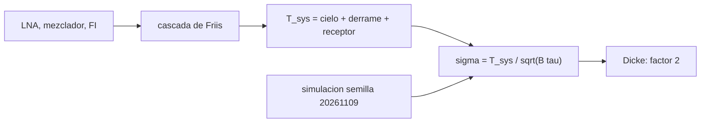

# B46-C06 — Ruido de sistema y radiometría

<!-- nav:top -->
<!-- /nav -->

## 1. Ubicación, nivel y alcance

Clase 6 del bloque B46. Nivel N3. La sensibilidad de un radiotelescopio la fija el ruido del sistema. Aquí sumas las temperaturas de ruido de una cadena en **cascada (Friis)**, aplicas la **ecuación del radiómetro** y la verificas con una simulación de ruido gaussiano de semilla fija, incluida la conmutación de Dicke. Usas [B12](../../../tronco-comun/B12-probabilidad-estadistica-e-incertidumbre.md), [B46-C05](../B46-C05-ganancia-y-temperatura-de-antena/CLASE.md) y [B46-C01](../B46-C01-espectro-radioastronomico/CLASE.md). La cadena es ilustrativa.

## 2. Por qué esta clase existe

La señal de una fuente astronómica es mucho menor que el ruido, y solo el promedio la hace visible. La decisión central: **¿cuánto tiempo y ancho de banda se necesitan para alcanzar una sensibilidad dada?**

## 3. Lo que podrás hacer al terminar

1. Calcular la temperatura de ruido de una cascada.
2. Sumar cielo, derrame y receptor en `T_sys`.
3. Aplicar `σ = T_sys/√(Bτ)`.
4. Simular el radiómetro con semilla fija.
5. Explicar la penalización de la conmutación de Dicke.
6. Reconocer los límites del ruido blanco.

La evidencia es la **ficha del ruido y el radiómetro** del ejercicio 12 (sección 20).

## 4. Con qué llegas y cómo comprobarlo

1. ¿Qué es una incertidumbre?
2. ¿Qué es una simulación Monte Carlo?
3. ¿Qué es una tabla de resultados?
4. ¿Qué es un valor ilustrativo?
5. ¿Qué es una verificación?

<details>
<summary>Ver respuestas</summary>

1. Un intervalo en que se espera el valor verdadero. 2. Repetir con números aleatorios de semilla fija. 3. Un resumen ordenado de cálculos. 4. Un valor propuesto para el ejemplo, no medido. 5. Comparar un cálculo con un caso independiente.
</details>

Con cuatro o cinco aciertos, sigue; si no, repasa los prerrequisitos.

## 5. Un caso de contexto y casos de referencia

Una cadena ilustrativa (LNA de 25 K y 30 dB, mezclador de 800 K y −6 dB, FI de 400 K) tiene `T_rx = 27,39 K` en vez de los `1225 K` de la suma simple; con 25 K de cielo y derrame, `T_sys = 52,39 K` y `σ_T = 16,57 mK` en 1 MHz y 10 s. Es el **ejemplo conductor**.

## 6. Vocabulario

La **temperatura de ruido** de un componente. La **cascada de Friis**: `T = T₁ + T₂/G₁ + T₃/(G₁G₂)`. La **temperatura de sistema** `T_sys`. La **ecuación del radiómetro** `σ_T = T_sys/√(Bτ)`. La **conmutación de Dicke** alterna fuente y referencia.

## 7. Modelo mental: una balanza muy ruidosa

Es como pesar un grano con una balanza que tiembla: repites la medida muchas veces y el promedio mejora con la raíz del número de repeticiones.



*Descripción textual:* las temperaturas de la cadena se combinan en `T_sys`, de la que sale la sensibilidad, comprobada por simulación.

Analogía: una balanza muy ruidosa. Límite: ruido blanco gaussiano y ganancia constante.

## 8. La explicación, paso a paso

### 8.1 Cascada

`T_rx = 25 + 800/1000 + 400/(1000·0,251) = 27,392 K`. La primera etapa domina: el amplificador de bajo ruido y su ganancia protegen de los ruidos posteriores. `T_sys = 20 + 5 + T_rx = 52,392 K`.

### 8.2 Sensibilidad

`σ_T = 52,39/√(10⁶·10) = 16,568 mK`.

### 8.3 Simulación

Se promedia la potencia de ruido gaussiano real muestreado a Nyquist (`2Bτ` muestras):

| `Bτ` | media | `σ/media` simulada | `1/√(Bτ)` |
|---|---|---|---|
| 50 | 1,0014 | 0,1407 | 0,1414 |
| 200 | 0,9992 | 0,0716 | 0,0707 |
| 800 | 0,9986 | 0,0347 | 0,0354 |

### 8.4 Dicke

Con `Bτ = 400`, la desviación de la diferencia de dos mitades es `0,1017` y la teórica `2/√(Bτ) = 0,1000`: dos veces la del total, porque cada estado ve la mitad del tiempo y se restan.

### 8.5 Lectura

Cuadruplicar el tiempo solo reduce el ruido a la mitad. La ganancia inestable y las interferencias añaden ruido que no se promedia.

## 9. Magnitudes, símbolos y unidades

| Símbolo | Qué es | Unidad | Valor / nota |
|---|---|---|---|
| `T_sys` | temperatura de sistema | K | 52,39 |
| `B` | ancho de banda | Hz | 10⁶ (ilustrativo) |
| `τ` | tiempo de integración | s | 10 (ilustrativo) |
| `σ_T` | sensibilidad | mK | 16,57 |

## 10. Convenciones y referencias

Cadena, ganancias, cielo, ancho de banda y tiempos **ilustrativos**; simulación con semilla `20261109`.

## 11. De dónde sale lo que afirmamos

| ID | Fuente | Localizador | Respalda | Estado |
|---|---|---|---|---|
| — | Estándar o texto de radioastronomía no consultado | — | relaciones habituales de la disciplina que el laboratorio verifica por cálculo | No se consultó para esta clase |

Límites: no se consultó ningún receptor real.

## 12. Cómo ver las cifras

| Magnitud | Valor |
|---|---|
| `T_rx` en cascada | 27,39 K |
| `T_sys` | 52,39 K |
| `σ_T` (1 MHz, 10 s) | 16,57 mK |
| factor de Dicke | 2 |

Descripción larga: la desviación simulada sigue a la teórica.

## 13. Ejemplo trabajado: la sensibilidad

**Paso 1 · Producto.** `Bτ = 10⁷`.

**Paso 2 · Raíz.** `√(10⁷) = 3162,3`.

**Paso 3 · Cociente.** `52,39/3162,3`.

**Paso 4 · Resultado.** `16,57 mK`.

## 14. Distintas formas de describir una cadena de ruido

**Por fórmula:** Friis y el radiómetro. **Por tabla:** simulación. **Por cociente:** `1/√(Bτ)`. **Por esquema:** cadena de etapas.

## 15. Práctica guiada

**Ejercicio 1 · con los pasos indicados.** `σ_T` con `T_sys = 50 K`, `B = 1 MHz`, `τ = 1 s`. *Pasos:* `T_sys/√(Bτ)`.

<details><summary>Solución comentada</summary>

`50 mK`.
</details>

**Ejercicio 2 · con una pista.** `τ` para `σ = 5 mK` con `T_sys = 50 K`, `B = 1 MHz`. *Pasos:* `(T_sys/(σ√B))²`.

<details><summary>Solución comentada</summary>

`100 s`.
</details>

**Ejercicio 3 · casi autónomo.** `T` de una cascada de 25 K y 30 dB seguida de 800 K. *Pasos:* `25 + 800/1000`.

<details><summary>Solución comentada</summary>

`25,8 K`.
</details>

## 16. Práctica autónoma, transferencia e integrador

**Ejercicio 4.** `σ` si se cuadruplica el tiempo.

<details><summary>Solución comentada</summary>

Se divide por 2.
</details>

**Ejercicio 5.** `σ` si el ancho de banda pasa de 1 a 4 MHz.

<details><summary>Solución comentada</summary>

Se divide por 2.
</details>

**Ejercicio 6.** `σ` de la diferencia de Dicke frente al total.

<details><summary>Solución comentada</summary>

El doble.
</details>

**Ejercicio 7.** `T_sys` si el cielo sube de 20 a 40 K.

<details><summary>Solución comentada</summary>

`72,39 K`.
</details>

**Ejercicio 8.** Desviación relativa de `Bτ = 800`.

<details><summary>Solución comentada</summary>

`0,0354`.
</details>

**Ejercicio 9 · transferencia.** **Transferencia.** ¿Por qué un LNA con alta ganancia al principio?

<details><summary>Solución comentada</summary>

Porque reduce la contribución de las etapas siguientes.
</details>

**Ejercicio 10 · transferencia.** **Transferencia.** ¿Qué limita integrar horas?

<details><summary>Solución comentada</summary>

La estabilidad de la ganancia y las interferencias.
</details>

**Ejercicio 11 · transferencia.** **Transferencia.** ¿Por qué se conmuta con Dicke?

<details><summary>Solución comentada</summary>

Para cancelar las variaciones lentas de la ganancia, a costa de un factor 2.
</details>

**Ejercicio 12.** **Integrador.** Elabora tu *ficha del ruido y el radiómetro*: cascada, `T_sys`, `σ_T` y verificación por simulación.

<details><summary>Solución comentada</summary>

Secciones 8.1–8.4.
</details>

**Ejercicio 12 · integrador.** **Integrador.** Elabora tu *ficha del ruido y el radiómetro*: cascada, `T_sys`, `σ_T` y verificación por simulación.

<details><summary>Solución modelo</summary>

Secciones 8.1–8.4.
</details>

## 17. Laboratorio: radiómetro con ruido

El script [radiometro.py](radiometro.py) calcula la cascada y simula el radiómetro y la conmutación de Dicke (**comprueba** `1/√(Bτ)` y el factor 2).

**Datos:** sin constantes; cadena **ilustrativa**; semilla `20261109`. **Predice antes de ejecutar:** ¿cuánto valdrá `σ/media` con `Bτ = 200`? (0,0707.) **Ejecución del 2026-11-09 (Python 3.12.9):**

```text
Python 3.12.9 (biblioteca estandar)
T_receptor en cascada = 27.392 K (suma sin ganancias seria 1225 K)
T_sys = 52.392 K ; sigma_T(1 MHz, 10 s) = 16.5679 mK
 B*tau    media  sigma/media simulada  1/sqrt(B tau)
    50   1.0014                0.1407         0.1414
   200   0.9992                0.0716         0.0707
   800   0.9986                0.0347         0.0354
Dicke con B*tau = 400: sigma(diferencia) = 0.1017 ; teorica 2/sqrt(B tau) = 0.1000
Pruebas superadas.
```

```bash
python programa/clases/B46/B46-C06-ruido-de-sistema-y-radiometria/radiometro.py
```

**Límites:** ruido blanco, ganancia constante.

## 18. Errores frecuentes y cómo corregirlos

**Sumar temperaturas sin dividir por la ganancia.** Se corrige con 8.1.

**Creer que integrar 4 veces da 4 veces menos ruido.** Se corrige con 8.5.

**Olvidar el factor de Dicke.** Se corrige con 8.4.

**Presentar la cadena como real.** Se corrige con la sección 10.

## 19. Cómo sabrás que vas bien

Tras la sección 8: ¿qué resultado esperabas y cuál obtuviste? Si dudas, repasa el ejemplo 13. Tras el laboratorio: ¿qué comprueba? (ver la sección 17).

## 20. Qué entregas y cómo se evalúa

El producto es tu **ficha del ruido y el radiómetro** (ejercicio 12).

| Criterio | Inicial | En desarrollo | Logrado | Destacado |
|---|---|---|---|---|
| Conceptos | Los confunde | Parciales | conceptos de la clase | Explica los límites |
| Cálculo | Sin unidades | Con errores | Tablas completas | Calcula casos nuevos |
| Numérico | Sin comprobar | Un caso | Contraste con el análisis | Interpreta las diferencias |
| Fuentes | Sin fuente | Sin fecha | fuentes con fecha | Declara lo ilustrativo |
| Límites | No los nombra | Uno | Tres | Discute qué falta del modelo |

**Condiciones críticas (no se compensan con promedio):** rotular lo ilustrativo; no dar la sensibilidad de un receptor real; citar solo lo consultado.

## 21. Ética, seguridad y límites

Clase educativa: los modelos son simplificados. Accesibilidad: tablas equivalentes a las gráficas, fórmulas en texto, ejercicios sin conexión.

## 22. Para cerrar y seguir

La cadena ilustrativa tiene 52,4 K de sistema y 16,6 mK de sensibilidad en 10 s. Queda una pregunta: ¿cómo se traslada la señal a una frecuencia manejable?

**Glosario español–inglés.** ruido de sistema · *system noise*; radiómetro · *radiometer*; cascada · *cascade*; conmutación · *switching*.

**Continuidad.** [B46-C07](../B46-C07-receptores-superheterodinos/CLASE.md) estudia los receptores superheterodinos.

**Referencias:** ver sección 11.

<!-- nav:bottom -->
---

<!-- /nav -->
