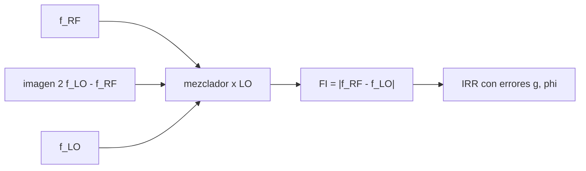

# B46-C07 — Receptores superheterodinos

<!-- nav:top -->
[🏠 Programa](../../../../README.md) · [📚 Bloque B46](../../../tronco-comun/B46-radioastronomia-e-interferometria.md) · [← Anterior: B46-C06 — Ruido de sistema y radiometría](../B46-C06-ruido-de-sistema-y-radiometria/CLASE.md) · [Siguiente: B46-C08 — Osciladores y estabilidad →](../B46-C08-osciladores-y-estabilidad/CLASE.md)
<!-- /nav -->

## 1. Ubicación, nivel y alcance

Clase 7 del bloque B46. Nivel N3. El receptor superheterodino traslada la señal a una frecuencia intermedia. Aquí mezclas tonos con un oscilador local en una simulación muestreada, mides la amplitud en la FI con el algoritmo de Goertzel, localizas la **frecuencia imagen** y calculas el **rechazo de imagen** de un mezclador con errores de fase y amplitud por dos vías. Usas [B46-C06](../B46-C06-ruido-de-sistema-y-radiometria/CLASE.md). Las frecuencias son ilustrativas.

## 2. Por qué esta clase existe

La mezcla es lo que permite procesar en una banda cómoda, pero trae consigo una segunda frecuencia que cae en la misma FI. La decisión central: **¿qué rechazo de imagen exige el receptor y cómo se logra?**

## 3. Lo que podrás hacer al terminar

1. Mezclar dos tonos y medir la FI.
2. Hallar la frecuencia imagen.
3. Reconocer que señal e imagen dan la misma FI.
4. Calcular el rechazo de imagen con errores.
5. Comparar fórmula y suma fasorial.
6. Reconocer los límites del mezclador ideal.

La evidencia es la **ficha del receptor superheterodino** del ejercicio 12 (sección 20).

## 4. Con qué llegas y cómo comprobarlo

1. ¿Qué es una incertidumbre?
2. ¿Qué es una simulación Monte Carlo?
3. ¿Qué es una tabla de resultados?
4. ¿Qué es un valor ilustrativo?
5. ¿Qué es una verificación?

<details>
<summary>Ver respuestas</summary>

1. Un intervalo en que se espera el valor verdadero. 2. Repetir con números aleatorios de semilla fija. 3. Un resumen ordenado de cálculos. 4. Un valor propuesto para el ejemplo, no medido. 5. Comparar un cálculo con un caso independiente.
</details>

Con cuatro o cinco aciertos, sigue; si no, repasa los prerrequisitos.

## 5. Un caso de contexto y casos de referencia

Con un oscilador local de 100 y una FI de 20 (unidades arbitrarias), el tono de 120 y su imagen de 80 aparecen ambos en la FI con amplitud `0,500` y un tono de 250 no aparece (`0,000`). Con errores de 5 % y 3 grados el rechazo es de `28,93 dB`. Es el **ejemplo conductor**; las unidades son **ilustrativas**.

## 6. Vocabulario

El **mezclador** multiplica la señal por el **oscilador local** (LO). La **frecuencia intermedia** (FI) es `|f_RF − f_LO|`. La **frecuencia imagen** es `2f_LO − f_RF`. El **rechazo de imagen** (IRR) compara señal y imagen. El **algoritmo de Goertzel** mide una sola frecuencia.

## 7. Modelo mental: un espejo en el espectro

Como un espejo que refleja el espectro alrededor del oscilador local: lo que está a un lado y a otro a la misma distancia cae en el mismo sitio.



*Descripción textual:* señal e imagen se mezclan con el oscilador local y caen en la misma FI, que un mezclador de rechazo separa con errores finitos.

Analogía: un espejo en el espectro. Límite: mezclador multiplicativo ideal y filtro de FI ideal.

## 8. La explicación, paso a paso

### 8.1 Mezcla

`cos(2πf_RF t)·cos(2πf_LO t) = ½[cos(2π(f_RF − f_LO)t) + cos(2π(f_RF + f_LO)t)]`. La amplitud en la FI es 0,5.

| tono | f_RF | amplitud en FI | amplitud en la suma |
|---|---|---|---|
| senal | 120 | 0,5000 | 0,5000 |
| imagen | 80 | 0,5000 | 0,5000 |
| fuera | 250 | 0,0000 | 0,5000 |

### 8.2 Rechazo de imagen

`IRR = (1 + 2g cosφ + g²)/(1 − 2g cosφ + g²)`.

| `g` | `φ` (grados) | IRR (fórmula) | IRR (fasores) | IRR (dB) | aprox. `4/(δg² + φ²)` (dB) |
|---|---|---|---|---|---|
| 1,02 | 1,0 | 5740,93 | 5740,93 | 37,59 | 37,54 |
| 1,05 | 3,0 | 780,89 | 780,89 | 28,93 | 28,83 |
| 1,20 | 10,0 | 62,82 | 62,82 | 17,98 | 17,54 |

### 8.3 Lectura

Señal e imagen son indistinguibles tras la mezcla: hay que filtrarlas antes o rechazarlas con la estructura del mezclador. La aproximación `4/(δg² + φ²)` es útil para errores pequeños. Un mezclador real tiene ruido, pérdidas y espurios.

## 9. Magnitudes, símbolos y unidades

| Símbolo | Qué es | Unidad | Valor / nota |
|---|---|---|---|
| `f_LO` | oscilador local | unidades arbitrarias | 100 |
| `f_FI` | frecuencia intermedia | ídem | 20 |
| `g` | razón de amplitudes | — | 1,02 a 1,2 |
| `φ` | error de fase | grados | 1 a 10 |

## 10. Convenciones y referencias

Frecuencias y errores **ilustrativos**; sin datos externos.

## 11. De dónde sale lo que afirmamos

| ID | Fuente | Localizador | Respalda | Estado |
|---|---|---|---|---|
| — | Estándar o texto de radioastronomía no consultado | — | relaciones habituales de la disciplina que el laboratorio verifica por cálculo | No se consultó para esta clase |

Límites: no se consultó ningún receptor real.

## 12. Cómo ver las cifras

| Magnitud | Valor |
|---|---|
| amplitud en la FI | 0,500 |
| imagen de 120 | 80 |
| IRR (g = 1,05, 3 grados) | 28,93 dB |

Descripción larga: señal e imagen aparecen con la misma amplitud.

## 13. Ejemplo trabajado: la frecuencia imagen

**Paso 1 · Fórmula.** `f_im = 2f_LO − f_RF`.

**Paso 2 · Valores.** `200 − 120`.

**Paso 3 · Resultado.** `80`.

**Paso 4 · Comprobación.** `|80 − 100| = 20 = f_FI`.

## 14. Distintas formas de describir un mezclador

**Por trigonometría:** producto de cosenos. **Por tabla:** amplitudes. **Por fasores:** suma de contribuciones. **Por decibelios:** IRR.

## 15. Práctica guiada

**Ejercicio 1 · con los pasos indicados.** Imagen de `f_RF = 150` con `f_LO = 100`. *Pasos:* `2·100 − 150`.

<details><summary>Solución comentada</summary>

`50`.
</details>

**Ejercicio 2 · con una pista.** FI de ese tono. *Pasos:* `|150 − 100|`.

<details><summary>Solución comentada</summary>

`50`.
</details>

**Ejercicio 3 · casi autónomo.** Amplitud de la FI de un tono unitario. *Pasos:* producto de cosenos.

<details><summary>Solución comentada</summary>

`0,5`.
</details>

## 16. Práctica autónoma, transferencia e integrador

**Ejercicio 4.** IRR en dB de `g = 1,02` y `φ = 1°`.

<details><summary>Solución comentada</summary>

`37,59 dB`.
</details>

**Ejercicio 5.** IRR en razón de potencia de `g = 1,05` y 3°.

<details><summary>Solución comentada</summary>

`780,9`.
</details>

**Ejercicio 6.** ¿Qué IRR tiene un mezclador perfecto?

<details><summary>Solución comentada</summary>

Infinito.
</details>

**Ejercicio 7.** Aproximación en dB de `g = 1,2` y 10°.

<details><summary>Solución comentada</summary>

`17,54 dB`.
</details>

**Ejercicio 8.** ¿Por qué falla la aproximación con errores grandes?

<details><summary>Solución comentada</summary>

Porque es de primer orden en `δg` y `φ`.
</details>

**Ejercicio 9 · transferencia.** **Transferencia.** ¿Por qué se prefiere una FI alta para filtrar la imagen?

<details><summary>Solución comentada</summary>

Porque separa más la señal de la imagen.
</details>

**Ejercicio 10 · transferencia.** **Transferencia.** ¿Por qué un receptor de línea espectral necesita rechazar la imagen?

<details><summary>Solución comentada</summary>

Porque el ruido de la banda imagen se suma.
</details>

**Ejercicio 11 · transferencia.** **Transferencia.** ¿Qué diferencia hay entre banda lateral única y doble?

<details><summary>Solución comentada</summary>

En la doble las dos bandas contribuyen.
</details>

**Ejercicio 12.** **Integrador.** Elabora tu *ficha del receptor superheterodino*: FI, imagen y rechazo con dos vías.

<details><summary>Solución comentada</summary>

Secciones 8.1–8.2.
</details>

**Ejercicio 12 · integrador.** **Integrador.** Elabora tu *ficha del receptor superheterodino*: FI, imagen y rechazo con dos vías.

<details><summary>Solución modelo</summary>

Secciones 8.1–8.2.
</details>

## 17. Laboratorio: mezcla e imagen

El script [superheterodino.py](superheterodino.py) mezcla tonos, mide la FI con Goertzel y calcula el IRR (**comprueba** la amplitud 0,5 y la igualdad entre fórmula y fasores).

**Datos:** sin datos externos; frecuencias **ilustrativas**. **Predice antes de ejecutar:** ¿qué amplitud tendrá la FI? (0,5.) **Ejecución del 2026-11-09 (Python 3.12.9):**

```text
Python 3.12.9 (biblioteca estandar)
tono      f_RF  amplitud en FI (20)  amplitud en suma
senal    120.0               0.5000            0.5000
imagen    80.0               0.5000            0.5000
fuera    250.0               0.0000            0.5000
    g  phi [grados]  IRR formula  IRR fasores  IRR [dB]  aprox. 4/(dg^2+phi^2) [dB]
 1.02           1.0      5740.93      5740.93     37.59                       37.54
 1.05           3.0       780.89       780.89     28.93                       28.83
 1.20          10.0        62.82        62.82     17.98                       17.54
Pruebas superadas.
```

```bash
python programa/clases/B46/B46-C07-receptores-superheterodinos/superheterodino.py
```

**Límites:** mezclador ideal, sin ruido.

## 18. Errores frecuentes y cómo corregirlos

**Olvidar la imagen.** Se corrige con 8.1.

**Confundir razón de potencia y dB.** Se corrige con 8.2.

**Aplicar la aproximación con errores grandes.** Se corrige con 8.2.

**Presentar los números como de un receptor real.** Se corrige con la sección 10.

## 19. Cómo sabrás que vas bien

Tras la sección 8: ¿qué resultado esperabas y cuál obtuviste? Si dudas, repasa el ejemplo 13. Tras el laboratorio: ¿qué comprueba? (ver la sección 17).

## 20. Qué entregas y cómo se evalúa

El producto es tu **ficha del receptor superheterodino** (ejercicio 12).

| Criterio | Inicial | En desarrollo | Logrado | Destacado |
|---|---|---|---|---|
| Conceptos | Los confunde | Parciales | conceptos de la clase | Explica los límites |
| Cálculo | Sin unidades | Con errores | Tablas completas | Calcula casos nuevos |
| Numérico | Sin comprobar | Un caso | Contraste con el análisis | Interpreta las diferencias |
| Fuentes | Sin fuente | Sin fecha | fuentes con fecha | Declara lo ilustrativo |
| Límites | No los nombra | Uno | Tres | Discute qué falta del modelo |

**Condiciones críticas (no se compensan con promedio):** rotular lo ilustrativo; no describir un receptor real; citar solo lo consultado.

## 21. Ética, seguridad y límites

Clase educativa: los modelos son simplificados. Accesibilidad: tablas equivalentes a las gráficas, fórmulas en texto, ejercicios sin conexión.

## 22. Para cerrar y seguir

Señal e imagen aparecen con amplitud 0,50 en la FI; el rechazo de 5 % y 3 grados es de 28,9 dB. Queda una pregunta: ¿qué tan estable debe ser el oscilador local?

**Glosario español–inglés.** receptor superheterodino · *superheterodyne receiver*; frecuencia imagen · *image frequency*; oscilador local · *local oscillator*; mezclador · *mixer*.

**Continuidad.** [B46-C08](../B46-C08-osciladores-y-estabilidad/CLASE.md) estudia los osciladores y la estabilidad.

**Referencias:** ver sección 11.

<!-- nav:bottom -->
---

[← Anterior: B46-C06 — Ruido de sistema y radiometría](../B46-C06-ruido-de-sistema-y-radiometria/CLASE.md) · [📚 Bloque B46](../../../tronco-comun/B46-radioastronomia-e-interferometria.md) · [Siguiente: B46-C08 — Osciladores y estabilidad →](../B46-C08-osciladores-y-estabilidad/CLASE.md)
<!-- /nav -->
