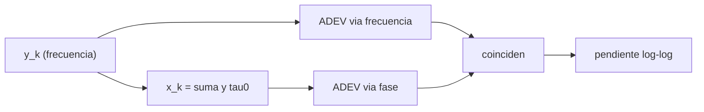

# B46-C08 — Osciladores y estabilidad

<!-- nav:top -->
<!-- /nav -->

## 1. Ubicación, nivel y alcance

Clase 8 del bloque B46. Nivel N3. La estabilidad del oscilador local limita la coherencia de un interferómetro. Aquí generas series sintéticas de frecuencia fraccional (ruido blanco y marcha aleatoria) y calculas la **desviación de Allan** por dos vías: con la frecuencia y con la fase. Usas [B12](../../../tronco-comun/B12-probabilidad-estadistica-e-incertidumbre.md) y [B46-C07](../B46-C07-receptores-superheterodinos/CLASE.md). Las series son sintéticas.

## 2. Por qué esta clase existe

El tiempo de coherencia de un instrumento depende de cómo se acumula el error de un oscilador. La decisión central: **¿a qué escala de tiempo domina cada tipo de ruido y cuánto se puede integrar?**

## 3. Lo que podrás hacer al terminar

1. Definir la varianza de Allan.
2. Calcularla con datos de frecuencia.
3. Calcularla con datos de fase.
4. Comprobar que coinciden.
5. Medir la pendiente log-log.
6. Identificar el tipo de ruido por la pendiente.

La evidencia es la **ficha de la estabilidad del oscilador** del ejercicio 12 (sección 20).

## 4. Con qué llegas y cómo comprobarlo

1. ¿Qué es una incertidumbre?
2. ¿Qué es una simulación Monte Carlo?
3. ¿Qué es una tabla de resultados?
4. ¿Qué es un valor ilustrativo?
5. ¿Qué es una verificación?

<details>
<summary>Ver respuestas</summary>

1. Un intervalo en que se espera el valor verdadero. 2. Repetir con números aleatorios de semilla fija. 3. Un resumen ordenado de cálculos. 4. Un valor propuesto para el ejemplo, no medido. 5. Comparar un cálculo con un caso independiente.
</details>

Con cuatro o cinco aciertos, sigue; si no, repasa los prerrequisitos.

## 5. Un caso de contexto y casos de referencia

Con 65 536 muestras sintéticas, el ruido blanco de frecuencia tiene pendiente `-0,498` y la marcha aleatoria `0,459`; ambas vías coinciden a 10⁻⁹. A `τ = 1 s` la desviación vale `1,006 × 10^-12`. Es el **ejemplo conductor**; las series son **sintéticas**.

## 6. Vocabulario

La **frecuencia fraccional** `y`. El **error de tiempo** (fase) `x`. La **varianza de Allan** `σ_y²(τ) = ½⟨(ȳ_{k+1} − ȳ_k)²⟩`. El **ruido blanco de frecuencia** (pendiente −1/2). La **marcha aleatoria de frecuencia** (pendiente +1/2).

## 7. Modelo mental: un reloj que se atrasa

Como un reloj cuyo error diario varía: mirando horas, domina el ruido rápido; mirando meses, la deriva lenta.



*Descripción textual:* la serie de frecuencia da dos estimadores de Allan idénticos y su pendiente identifica el ruido.

Analogía: un reloj que se atrasa. Límite: estimador sin tiempo muerto y sin solapamiento.

## 8. La explicación, paso a paso

### 8.1 Definiciones (consultadas)

Según la página consultada, `σ_y²(τ) = ½⟨(ȳ_{k+1} − ȳ_k)²⟩` y con datos de fase `σ_y²(τ) = ⟨(x_{k+2} − 2x_{k+1} + x_k)²⟩/(2τ²)`; el ruido blanco de frecuencia tiene pendiente −1/2.

### 8.2 Resultados

| τ (s) | ADEV blanco | ADEV marcha |
|---|---|---|
| 1 | 1,006 × 10^-12 | 7,063 × 10^-13 |
| 2 | 7,073 × 10^-13 | 8,635 × 10^-13 |
| 4 | 5,000 × 10^-13 | 1,170 × 10^-12 |
| 8 | 3,504 × 10^-13 | 1,647 × 10^-12 |
| 16 | 2,504 × 10^-13 | 2,297 × 10^-12 |
| 32 | 1,835 × 10^-13 | 3,211 × 10^-12 |
| 64 | 1,242 × 10^-13 | 4,571 × 10^-12 |

Cociente frecuencia/fase: entre `0,999999999` y `1,000000001` en todas las filas.

### 8.3 Pendientes

Ruido blanco: `-0,498` (−0,5). Marcha aleatoria: `0,459` (+0,5).

### 8.4 Lectura

Con ruido blanco conviene integrar más; con marcha aleatoria, no. En un oscilador real hay ruido de fase, parpadeo y deriva a la vez, y la gráfica tiene un mínimo.

## 9. Magnitudes, símbolos y unidades

| Símbolo | Qué es | Unidad | Valor / nota |
|---|---|---|---|
| `y` | frecuencia fraccional | — | 10⁻¹² (ilustrativa) |
| `x` | error de tiempo | s | suma de `y τ₀` |
| `σ_y(τ)` | desviación de Allan | — | 1,006 × 10^-12 a 1 s |
| pendiente | log-log | — | -0,498 |

## 10. Convenciones y referencias

Series gaussianas de amplitud 10⁻¹² (**sintéticas**, semilla `20261109`); definición de Allan de Wikipedia.

## 11. De dónde sale lo que afirmamos

| ID | Fuente | Localizador | Respalda | Estado |
|---|---|---|---|---|
| S2 | Wikipedia, *Allan variance* | https://en.wikipedia.org/wiki/Allan_variance | definición de la varianza de Allan con datos de frecuencia y de fase; pendiente −1/2 del ruido blanco de frecuencia | Solo la página, consultada el 2026-11-09 |

Límites: no se midió ningún oscilador real.

## 12. Cómo ver las cifras

| Magnitud | Valor |
|---|---|
| pendiente blanco | -0,498 |
| pendiente marcha | 0,459 |
| ADEV(1 s) blanco | 1,006 × 10^-12 |

Descripción larga: el ruido blanco decrece con `τ` y la marcha aleatoria crece.

## 13. Ejemplo trabajado: las dos vías

**Paso 1 · Promedios.** Se promedia `y` en bloques de `τ`.

**Paso 2 · Diferencias.** Entre bloques consecutivos.

**Paso 3 · Media.** La mitad de la media de los cuadrados.

**Paso 4 · Fase.** La segunda diferencia de `x` da el mismo resultado: cociente `1,000000`.

## 14. Distintas formas de describir la estabilidad

**Por frecuencia:** diferencias de promedios. **Por fase:** segunda diferencia. **Por gráfica:** pendiente. **Por tipo de ruido:** −1/2 o +1/2.

## 15. Práctica guiada

**Ejercicio 1 · con los pasos indicados.** ADEV de ruido blanco a `τ = 4 s` si a 1 s es `σ₁`. *Pasos:* `σ₁/√4`.

<details><summary>Solución comentada</summary>

`σ₁/2`.
</details>

**Ejercicio 2 · con una pista.** Pendiente del ruido blanco.

<details><summary>Solución comentada</summary>

`−1/2`.
</details>

**Ejercicio 3 · casi autónomo.** Razón entre el ADEV a 64 s y a 1 s del ruido blanco.

<details><summary>Solución comentada</summary>

`0,123`.
</details>

## 16. Práctica autónoma, transferencia e integrador

**Ejercicio 4.** Razón entre el ADEV a 64 s y a 1 s de la marcha aleatoria.

<details><summary>Solución comentada</summary>

`6,47`.
</details>

**Ejercicio 5.** ¿Qué mide la segunda diferencia de la fase?

<details><summary>Solución comentada</summary>

El cambio de frecuencia entre dos intervalos.
</details>

**Ejercicio 6.** ¿Por qué coinciden las dos vías?

<details><summary>Solución comentada</summary>

Porque `x` es la integral de `y` y la segunda diferencia es la diferencia de promedios.
</details>

**Ejercicio 7.** ¿Qué escala de `τ` conviene con ruido blanco?

<details><summary>Solución comentada</summary>

La más larga posible.
</details>

**Ejercicio 8.** ¿Y con marcha aleatoria?

<details><summary>Solución comentada</summary>

La más corta que permita la señal.
</details>

**Ejercicio 9 · transferencia.** **Transferencia.** ¿Por qué el tiempo de coherencia limita un interferómetro?

<details><summary>Solución comentada</summary>

Porque la fase del oscilador local se pierde si `τ` es mayor.
</details>

**Ejercicio 10 · transferencia.** **Transferencia.** ¿Por qué se usan relojes atómicos en VLBI?

<details><summary>Solución comentada</summary>

Para mantener la fase estable durante minutos.
</details>

**Ejercicio 11 · transferencia.** **Transferencia.** ¿Qué indica un mínimo en la gráfica?

<details><summary>Solución comentada</summary>

El cambio de ruido blanco a deriva.
</details>

**Ejercicio 12.** **Integrador.** Elabora tu *ficha de la estabilidad del oscilador*: ADEV por dos vías y pendientes.

<details><summary>Solución comentada</summary>

Secciones 8.2–8.3.
</details>

**Ejercicio 12 · integrador.** **Integrador.** Elabora tu *ficha de la estabilidad del oscilador*: ADEV por dos vías y pendientes.

<details><summary>Solución modelo</summary>

Secciones 8.2–8.3.
</details>

## 17. Laboratorio: estabilidad de Allan

El script [osciladores.py](osciladores.py) calcula la desviación de Allan por frecuencia y por fase y sus pendientes (**comprueba** la coincidencia y las pendientes ∓1/2).

**Datos:** series **sintéticas**, semilla `20261109`; definición consultada. **Predice antes de ejecutar:** ¿qué pendiente tendrá el ruido blanco? (−1/2.) **Ejecución del 2026-11-09 (Python 3.12.9):**

```text
Python 3.12.9 (biblioteca estandar)
ruido blanco: pendiente log-log = -0.498
 tau [s]   ADEV (frecuencia)   ADEV (fase)  cociente
       1          1.0060e-12    1.0060e-12  1.000000
       2          7.0727e-13    7.0727e-13  1.000000
       4          5.0001e-13    5.0001e-13  1.000000
       8          3.5041e-13    3.5041e-13  1.000000
      16          2.5043e-13    2.5043e-13  1.000000
      32          1.8350e-13    1.8350e-13  1.000000
      64          1.2422e-13    1.2422e-13  1.000000
ruido marcha: pendiente log-log = 0.459
 tau [s]   ADEV (frecuencia)   ADEV (fase)  cociente
       1          7.0634e-13    7.0634e-13  1.000000
       2          8.6352e-13    8.6352e-13  1.000000
       4          1.1698e-12    1.1698e-12  1.000000
       8          1.6472e-12    1.6472e-12  1.000000
      16          2.2974e-12    2.2974e-12  1.000000
      32          3.2105e-12    3.2105e-12  1.000000
      64          4.5711e-12    4.5711e-12  1.000000
Pruebas superadas.
```

```bash
python programa/clases/B46/B46-C08-osciladores-y-estabilidad/osciladores.py
```

**Límites:** estimador sin solapamiento, ruidos puros.

## 18. Errores frecuentes y cómo corregirlos

**Usar la desviación estándar clásica.** Se corrige con 8.1.

**Confundir `x` con `y`.** Se corrige con 8.2.

**Esperar una pendiente sin ajuste.** Se corrige con 8.3.

**Presentar las series como medidas.** Se corrige con la sección 10.

## 19. Cómo sabrás que vas bien

Tras la sección 8: ¿qué resultado esperabas y cuál obtuviste? Si dudas, repasa el ejemplo 13. Tras el laboratorio: ¿qué comprueba? (ver la sección 17).

## 20. Qué entregas y cómo se evalúa

El producto es tu **ficha de la estabilidad del oscilador** (ejercicio 12).

| Criterio | Inicial | En desarrollo | Logrado | Destacado |
|---|---|---|---|---|
| Conceptos | Los confunde | Parciales | conceptos de la clase | Explica los límites |
| Cálculo | Sin unidades | Con errores | Tablas completas | Calcula casos nuevos |
| Numérico | Sin comprobar | Un caso | Contraste con el análisis | Interpreta las diferencias |
| Fuentes | Sin fuente | Sin fecha | fuentes con fecha | Declara lo ilustrativo |
| Límites | No los nombra | Uno | Tres | Discute qué falta del modelo |

**Condiciones críticas (no se compensan con promedio):** rotular lo sintético; no atribuir estabilidades a un reloj real; citar solo lo consultado.

## 21. Ética, seguridad y límites

Clase educativa: los modelos son simplificados. Accesibilidad: tablas equivalentes a las gráficas, fórmulas en texto, ejercicios sin conexión.

## 22. Para cerrar y seguir

Las dos vías coinciden y las pendientes son -0,50 y 0,46. Queda una pregunta: ¿cómo se digitaliza la señal sin perder información?

**Glosario español–inglés.** varianza de Allan · *Allan variance*; ruido blanco de frecuencia · *white frequency noise*; error de tiempo · *time error*; deriva · *drift*.

**Continuidad.** [B46-C09](../B46-C09-conversion-analogica-digital/CLASE.md) estudia la conversión analógica digital.

**Referencias:** ver sección 11.

<!-- nav:bottom -->
---

<!-- /nav -->
