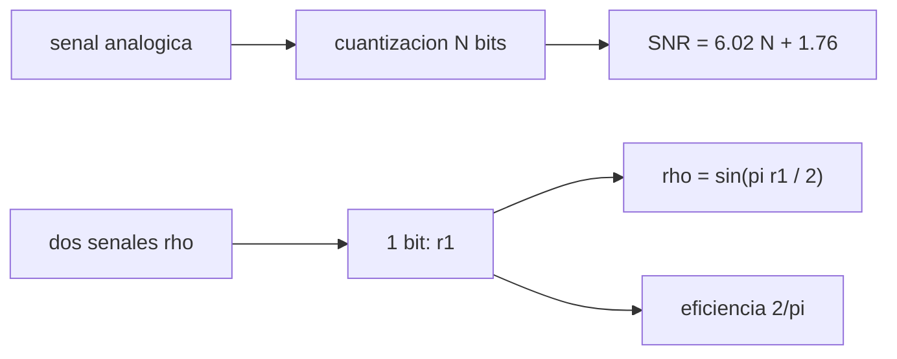

# B46-C09 — Conversión analógica digital

<!-- nav:top -->
[🏠 Programa](../../../../README.md) · [📚 Bloque B46](../../../tronco-comun/B46-radioastronomia-e-interferometria.md) · [← Anterior: B46-C08 — Osciladores y estabilidad](../B46-C08-osciladores-y-estabilidad/CLASE.md) · [Siguiente: B46-C10 — Radioastronomía mediante SDR →](../B46-C10-radioastronomia-mediante-sdr/CLASE.md)
<!-- /nav -->

## 1. Ubicación, nivel y alcance

Clase 9 del bloque B46. Nivel N3. El convertidor analógico digital limita la dinámica y la sensibilidad. Aquí cuantizas un tono a distintos bits y comparas la relación señal–ruido con `6,02N + 1,76 dB`, y digitalizas a **1 bit** dos señales gaussianas correlacionadas para aplicar la **corrección de Van Vleck**. Usas [B12](../../../tronco-comun/B12-probabilidad-estadistica-e-incertidumbre.md) y [B46-C06](../B46-C06-ruido-de-sistema-y-radiometria/CLASE.md). Las señales son sintéticas.

## 2. Por qué esta clase existe

Muchos correladores usan pocos bits para ahorrar recursos, y eso cambia la correlación medida. La decisión central: **¿cuántos bits hacen falta y cómo se corrige la pérdida de sensibilidad?**

## 3. Lo que podrás hacer al terminar

1. Cuantizar un tono y medir la SNR.
2. Comparar con `6,02N + 1,76 dB`.
3. Digitalizar a 1 bit.
4. Aplicar la relación de Van Vleck.
5. Medir la eficiencia del 1 bit.
6. Reconocer los límites del modelo gaussiano.

La evidencia es la **ficha de la digitalización** del ejercicio 12 (sección 20).

## 4. Con qué llegas y cómo comprobarlo

1. ¿Qué es una incertidumbre?
2. ¿Qué es una simulación Monte Carlo?
3. ¿Qué es una tabla de resultados?
4. ¿Qué es un valor ilustrativo?
5. ¿Qué es una verificación?

<details>
<summary>Ver respuestas</summary>

1. Un intervalo en que se espera el valor verdadero. 2. Repetir con números aleatorios de semilla fija. 3. Un resumen ordenado de cálculos. 4. Un valor propuesto para el ejemplo, no medido. 5. Comparar un cálculo con un caso independiente.
</details>

Con cuatro o cinco aciertos, sigue; si no, repasa los prerrequisitos.

## 5. Un caso de contexto y casos de referencia

A 8 bits la SNR simulada es `50,10 dB` (`49,92` teórica). A 1 bit, dos señales con `ρ = 0,5` dan `r₁ = 0,3352` y la corrección `sen(π r₁/2)` devuelve `0,5025`; la eficiencia en S/N es `0,626` frente a `2/π = 0,637`. Es el **ejemplo conductor**; las señales son **sintéticas**.

## 6. Vocabulario

La **cuantización** reemplaza el valor por el nivel más cercano. La **SNR de cuantización** crece 6,02 dB por bit. El **muestreo de Nyquist** exige `f_s ≥ 2B`. La **relación de Van Vleck** vincula la correlación de 1 bit y la analógica: `ρ = sen(π r₁/2)`.

## 7. Modelo mental: una regla con pocas marcas

Con pocas marcas se pierde detalle, pero con muchas medidas el promedio recupera la forma, si se corrige el sesgo conocido.



*Descripción textual:* el número de bits fija la SNR y, con 1 bit, la correlación medida se corrige con Van Vleck.

Analogía: una regla con pocas marcas. Límite: señales gaussianas estacionarias con umbral en cero.

## 8. La explicación, paso a paso

### 8.1 SNR de cuantización

| bits | SNR simulada (dB) | `6,02N + 1,76` (dB) |
|---|---|---|
| 2 | 12,82 | 13,80 |
| 4 | 25,32 | 25,84 |
| 6 | 37,12 | 37,88 |
| 8 | 50,10 | 49,92 |
| 10 | 61,84 | 61,96 |

La diferencia es menor que 1 dB.

### 8.2 Van Vleck

| `ρ` | analógica | `r₁` (1 bit) | `ρ` corregida | `(2/π) arcsen ρ` |
|---|---|---|---|---|
| 0,10 | 0,0987 | 0,0640 | 0,1004 | 0,0638 |
| 0,50 | 0,5028 | 0,3352 | 0,5025 | 0,3333 |
| 0,90 | 0,8995 | 0,7125 | 0,8997 | 0,7129 |

### 8.3 Eficiencia

Con 200 muestras, `σ` de la correlación vale `0,0708` en analógico y `0,0720` a 1 bit; como la pendiente de `r₁` respecto de `ρ` es `2/π`, la eficiencia en S/N es `0,626`.

### 8.4 Lectura

A 1 bit se pierde el 36 % de la sensibilidad, que se compensa con más tiempo o más ancho de banda. La corrección supone señales gaussianas; con interferencias no impulsivas deja de valer.

## 9. Magnitudes, símbolos y unidades

| Símbolo | Qué es | Unidad | Valor / nota |
|---|---|---|---|
| `N` | bits | — | 2 a 10 |
| `ρ` | correlación verdadera | — | 0,1; 0,5; 0,9 |
| `r₁` | correlación de 1 bit | — | 0,3352 (ρ = 0,5) |
| `η_q` | eficiencia del 1 bit | — | 0,626 |

## 10. Convenciones y referencias

Tono, bits y señales gaussianas **sintéticas** (semilla `20261109`); sin datos externos.

## 11. De dónde sale lo que afirmamos

| ID | Fuente | Localizador | Respalda | Estado |
|---|---|---|---|---|
| — | Estándar o texto de radioastronomía no consultado | — | relaciones habituales de la disciplina que el laboratorio verifica por cálculo | No se consultó para esta clase |

Límites: no se consultó ningún convertidor ni correlador real.

## 12. Cómo ver las cifras

| Magnitud | Valor |
|---|---|
| SNR a 8 bits | 50,10 dB |
| `r₁` con ρ = 0,5 | 0,3352 |
| ρ corregida | 0,5025 |
| eficiencia | 0,626 |

Descripción larga: la corrección recupera la correlación analógica.

## 13. Ejemplo trabajado: Van Vleck

**Paso 1 · Medida.** `r₁ = 0,3352`.

**Paso 2 · Argumento.** `π r₁/2 = 0,5265`.

**Paso 3 · Seno.** `sen(...) = 0,5025`.

**Paso 4 · Comparación.** La verdadera vale `0,5`.

## 14. Distintas formas de describir la cuantización

**Por fórmula:** 6,02 dB por bit. **Por tabla:** simulación. **Por relación:** Van Vleck. **Por eficiencia:** `2/π`.

## 15. Práctica guiada

**Ejercicio 1 · con los pasos indicados.** SNR teórica de 6 bits. *Pasos:* `6,02·6 + 1,76`.

<details><summary>Solución comentada</summary>

`37,88 dB`.
</details>

**Ejercicio 2 · con una pista.** Bits para 60 dB. *Pasos:* `(60 − 1,76)/6,02`.

<details><summary>Solución comentada</summary>

`9,7`, es decir 10.
</details>

**Ejercicio 3 · casi autónomo.** `r₁` esperado para `ρ = 0,9`. *Pasos:* `(2/π) arcsen 0,9`.

<details><summary>Solución comentada</summary>

`0,7129`.
</details>

## 16. Práctica autónoma, transferencia e integrador

**Ejercicio 4.** `ρ` si `r₁ = 0,3333`.

<details><summary>Solución comentada</summary>

`0,500`.
</details>

**Ejercicio 5.** Pérdida de sensibilidad del 1 bit en %.

<details><summary>Solución comentada</summary>

`36 %`.
</details>

**Ejercicio 6.** Tiempo extra para compensar la pérdida.

<details><summary>Solución comentada</summary>

`2,47` veces.
</details>

**Ejercicio 7.** ¿Qué frecuencia de muestreo exige 100 MHz de ancho de banda?

<details><summary>Solución comentada</summary>

200 MHz como mínimo.
</details>

**Ejercicio 8.** ¿Qué hace el aliasing a un tono de 130 con `f_s = 100`?

<details><summary>Solución comentada</summary>

Aparece a 30.
</details>

**Ejercicio 9 · transferencia.** **Transferencia.** ¿Por qué cuesta caro cada bit extra en un correlador?

<details><summary>Solución comentada</summary>

Porque los multiplicadores crecen con los bits al cuadrado.
</details>

**Ejercicio 10 · transferencia.** **Transferencia.** ¿Qué pasa con una interferencia fuerte en 1 bit?

<details><summary>Solución comentada</summary>

Domina el umbral y degrada toda la banda.
</details>

**Ejercicio 11 · transferencia.** **Transferencia.** ¿Por qué se usan 2 o 3 bits en muchos instrumentos?

<details><summary>Solución comentada</summary>

Porque recuperan casi toda la eficiencia.
</details>

**Ejercicio 12.** **Integrador.** Elabora tu *ficha de la digitalización*: SNR por bit y corrección de Van Vleck.

<details><summary>Solución comentada</summary>

Secciones 8.1–8.3.
</details>

**Ejercicio 12 · integrador.** **Integrador.** Elabora tu *ficha de la digitalización*: SNR por bit y corrección de Van Vleck.

<details><summary>Solución modelo</summary>

Secciones 8.1–8.3.
</details>

## 17. Laboratorio: digitalización

El script [adc.py](adc.py) cuantiza un tono y digitaliza a 1 bit dos señales correlacionadas (**comprueba** la SNR y la recuperación de `ρ`).

**Datos:** señales **sintéticas**, semilla `20261109`. **Predice antes de ejecutar:** ¿qué `ρ` recuperará la corrección? (≈0,5.) **Ejecución del 2026-11-09 (Python 3.12.9):**

```text
Python 3.12.9 (biblioteca estandar)
 bits  SNR simulada [dB]  6.02N+1.76 [dB]
    2              12.82            13.80
    4              25.32            25.84
    6              37.12            37.88
    8              50.10            49.92
   10              61.84            61.96
  rho  analogica  1 bit r1  rho (Van Vleck)  (2/pi)asin(rho)
 0.10     0.0987    0.0640           0.1004           0.0638
 0.50     0.5028    0.3352           0.5025           0.3333
 0.90     0.8995    0.7125           0.8997           0.7129
sigma de r (200 muestras): analogico 0.0708 ; 1 bit 0.0720
eficiencia en S/N del 1 bit con rho = 0: 0.626 (2/pi = 0.637)
Pruebas superadas.
```

```bash
python programa/clases/B46/B46-C09-conversion-analogica-digital/adc.py
```

**Límites:** señales gaussianas, umbral en cero.

## 18. Errores frecuentes y cómo corregirlos

**Creer que 1 bit mide la correlación directa.** Se corrige con 8.2.

**Olvidar el Nyquist.** Se corrige con la sección 9.

**Confundir bits con decibelios.** Se corrige con 8.1.

**Presentar las señales como reales.** Se corrige con la sección 10.

## 19. Cómo sabrás que vas bien

Tras la sección 8: ¿qué resultado esperabas y cuál obtuviste? Si dudas, repasa el ejemplo 13. Tras el laboratorio: ¿qué comprueba? (ver la sección 17).

## 20. Qué entregas y cómo se evalúa

El producto es tu **ficha de la digitalización** (ejercicio 12).

| Criterio | Inicial | En desarrollo | Logrado | Destacado |
|---|---|---|---|---|
| Conceptos | Los confunde | Parciales | conceptos de la clase | Explica los límites |
| Cálculo | Sin unidades | Con errores | Tablas completas | Calcula casos nuevos |
| Numérico | Sin comprobar | Un caso | Contraste con el análisis | Interpreta las diferencias |
| Fuentes | Sin fuente | Sin fecha | fuentes con fecha | Declara lo ilustrativo |
| Límites | No los nombra | Uno | Tres | Discute qué falta del modelo |

**Condiciones críticas (no se compensan con promedio):** rotular lo sintético; no atribuir cifras a un instrumento real; citar solo lo consultado.

## 21. Ética, seguridad y límites

Clase educativa: los modelos son simplificados. Accesibilidad: tablas equivalentes a las gráficas, fórmulas en texto, ejercicios sin conexión.

## 22. Para cerrar y seguir

Cada bit añade 6,02 dB y el bit único tiene una eficiencia de 0,63. Queda una pregunta: ¿cómo se monta un espectrómetro con una radio definida por software?

**Glosario español–inglés.** cuantización · *quantization*; relación de Van Vleck · *Van Vleck relation*; muestreo · *sampling*; aliasing · *aliasing*.

**Continuidad.** [B46-C10](../B46-C10-radioastronomia-mediante-sdr/CLASE.md) estudia la radioastronomía mediante SDR.

**Referencias:** ver sección 11.

<!-- nav:bottom -->
---

[← Anterior: B46-C08 — Osciladores y estabilidad](../B46-C08-osciladores-y-estabilidad/CLASE.md) · [📚 Bloque B46](../../../tronco-comun/B46-radioastronomia-e-interferometria.md) · [Siguiente: B46-C10 — Radioastronomía mediante SDR →](../B46-C10-radioastronomia-mediante-sdr/CLASE.md)
<!-- /nav -->
