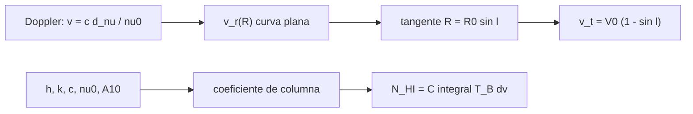

# B46-C11 — Observación de hidrógeno a 21 centímetros

<!-- nav:top -->
<!-- /nav -->

## 1. Ubicación, nivel y alcance

Clase 11 del bloque B46. Nivel N3. La línea de 21 cm del hidrógeno neutro mapea el gas de la Galaxia. Aquí calculas la **velocidad terminal** en la dirección de longitud `l` con una curva de rotación plana, derivas el **coeficiente de densidad de columna** `N_HI/∫T_B dv` desde `h`, `k`, `c`, la frecuencia y la tasa de transición, y lo comparas con el valor habitual `1,8224 × 10¹⁸ cm⁻² por K km/s`. Usas [B46-C01](../B46-C01-espectro-radioastronomico/CLASE.md) y [B46-C10](../B46-C10-radioastronomia-mediante-sdr/CLASE.md). La curva de rotación es ilustrativa.

## 2. Por qué esta clase existe

La velocidad de cada componente del perfil indica dónde está el gas, y su integral cuánto hay. La decisión central: **¿qué velocidad de la línea corresponde a cada distancia y qué columna implica una intensidad?**

## 3. Lo que podrás hacer al terminar

1. Convertir un desplazamiento Doppler en velocidad.
2. Calcular `v_r(R)` para una curva plana.
3. Hallar el punto tangente y la velocidad terminal.
4. Derivar el coeficiente de columna.
5. Integrar un perfil gaussiano.
6. Reconocer los límites de la óptica delgada.

La evidencia es la **ficha de la observación de HI** del ejercicio 12 (sección 20).

## 4. Con qué llegas y cómo comprobarlo

1. ¿Qué es una incertidumbre?
2. ¿Qué es una simulación Monte Carlo?
3. ¿Qué es una tabla de resultados?
4. ¿Qué es un valor ilustrativo?
5. ¿Qué es una verificación?

<details>
<summary>Ver respuestas</summary>

1. Un intervalo en que se espera el valor verdadero. 2. Repetir con números aleatorios de semilla fija. 3. Un resumen ordenado de cálculos. 4. Un valor propuesto para el ejemplo, no medido. 5. Comparar un cálculo con un caso independiente.
</details>

Con cuatro o cinco aciertos, sigue; si no, repasa los prerrequisitos.

## 5. Un caso de contexto y casos de referencia

Con `R₀ = 8,5 kpc` y `V₀ = 220 km/s` (ilustrativos), en `l = 30°` la velocidad radial máxima es `110,0 km/s` en `R = 4,25 kpc`. El coeficiente de columna vale `1,8127 × 10^18 cm⁻²` por K km/s y un perfil de 50 K con `σ = 8 km/s` integra `1002,7 K km/s`, o `N_HI = 1,818 × 10^21 cm⁻²`. Es el **ejemplo conductor**.

## 6. Vocabulario

La **velocidad radial** `v_r = c Δν/ν₀`. La **curva de rotación**. El **punto tangente** es donde la línea de visión es tangente a un círculo. La **velocidad terminal** es la máxima en cada `l`. La **densidad de columna** `N_HI` y la **óptica delgada**.

## 7. Modelo mental: una calle con coches a distintas velocidades

Mirando hacia un lado de una avenida circular, los coches más rápidos respecto a ti son los que van tangentes a tu línea de visión.



*Descripción textual:* el corrimiento Doppler ubica el gas en la Galaxia y la integral del perfil da su columna.

Analogía: una calle con coches a distintas velocidades. Límite: movimiento circular, curva plana y óptica delgada.

## 8. La explicación, paso a paso

### 8.1 Velocidad en cada longitud

`v_r(R) = V₀ R₀ sen l (1/R − 1/R₀)`, decreciente en `R`; en la línea de visión `R ≥ R₀ sen l`, de modo que el máximo es el punto tangente.

| `l` (°) | `R` del máximo (kpc) | `v_r` máxima (km/s) | `V₀(1 − sen l)` (km/s) | `R₀ sen l` (kpc) |
|---|---|---|---|---|
| 15 | 2,200 | 163,060 | 163,060 | 2,200 |
| 30 | 4,250 | 110,000 | 110,000 | 4,250 |
| 45 | 6,010 | 64,437 | 64,437 | 6,010 |
| 60 | 7,361 | 29,474 | 29,474 | 7,361 |

### 8.2 Columna

`N_HI = 32π k ν² ∫T_B dv/(3 h c³ A₁₀)` con `A₁₀ = 2,8843 × 10⁻¹⁵ s⁻¹` (de la literatura; la página consultada da 2,9 × 10⁻¹⁵) da `1,8127 × 10^18 cm⁻²` por K km/s, un `0,5 %` menos que el coeficiente habitual `1,8224 × 10¹⁸` (que se obtiene con `A₁₀ ≈ 2,87 × 10⁻¹⁵`).

### 8.3 Perfil gaussiano

La suma numérica da `1002,65 K km/s` y la analítica `1002,65`. Entonces `N_HI = 1,818 × 10^21 cm⁻²`.

### 8.4 Lectura

1 km/s equivale a `4,738 kHz` a 1420,405752 MHz. La óptica delgada subestima la columna en nubes frías y densas. La curva plana ignora el movimiento no circular.

## 9. Magnitudes, símbolos y unidades

| Símbolo | Qué es | Unidad | Valor / nota |
|---|---|---|---|
| `ν₀` | frecuencia de la línea | Hz | 1420,405751768 × 10⁶ (consultada) |
| `A₁₀` | tasa de emisión espontánea | s⁻¹ | 2,8843 × 10⁻¹⁵ (no consultada) |
| `V₀`, `R₀` | curva plana y radio solar | km/s, kpc | 220; 8,5 (ilustrativos) |
| `N_HI` | densidad de columna | cm⁻² | 1,818 × 10^21 |

## 10. Convenciones y referencias

`h`, `k`, `c` de NIST CODATA 2022; frecuencia y longitud de onda de Wikipedia (*Hydrogen line*); `A₁₀`, `R₀`, `V₀` y el perfil **ilustrativos** o de la literatura **no consultada**.

## 11. De dónde sale lo que afirmamos

| ID | Fuente | Localizador | Respalda | Estado |
|---|---|---|---|---|
| S1 | NIST, *Fundamental Physical Constants* (CODATA 2022) | https://physics.nist.gov/cuu/Constants/Table/allascii.txt | constantes citadas en la sección 9 | Consultada el 2026-11-09 |
| S2 | Wikipedia, *Hydrogen line* | https://en.wikipedia.org/wiki/Hydrogen_line | frecuencia 1420.405751768 MHz y longitud de onda de 21.106 cm | Solo la página, consultada el 2026-11-09 |

Límites: no se consultó ningún perfil ni curva de rotación reales, ni el valor de `A₁₀`.

## 12. Cómo ver las cifras

| Magnitud | Valor |
|---|---|
| `v_t` en 30° | 110,0 km/s |
| `R` tangente | 4,25 kpc |
| coeficiente | 1,8127 × 10^18 cm⁻² por K km/s |
| `N_HI` del perfil | 1,818 × 10^21 cm⁻² |

Descripción larga: la velocidad terminal cae al aumentar la longitud.

## 13. Ejemplo trabajado: la velocidad terminal

**Paso 1 · Seno.** `sen 30° = 0,5`.

**Paso 2 · Factor.** `1 − 0,5 = 0,5`.

**Paso 3 · Velocidad.** `220·0,5 = 110 km/s`.

**Paso 4 · Radio.** `R₀ sen l = 4,25 kpc`.

## 14. Distintas formas de describir una línea

**Por fórmula:** Doppler y rotación. **Por tabla:** velocidad terminal. **Por integral:** columna. **Por frecuencia:** kHz por km/s.

## 15. Práctica guiada

**Ejercicio 1 · con los pasos indicados.** `v_t` en `l = 45°`. *Pasos:* `V₀(1 − sen l)`.

<details><summary>Solución comentada</summary>

`64,4 km/s`.
</details>

**Ejercicio 2 · con una pista.** `R` tangente en `l = 45°`. *Pasos:* `R₀ sen l`.

<details><summary>Solución comentada</summary>

`6,01 kpc`.
</details>

**Ejercicio 3 · casi autónomo.** Frecuencia observada de una nube a +100 km/s.

<details><summary>Solución comentada</summary>

`1419,9320 MHz`.
</details>

## 16. Práctica autónoma, transferencia e integrador

**Ejercicio 4.** `∫T dv` de 20 K con ancho total de 30 km/s (rectángulo).

<details><summary>Solución comentada</summary>

`600 K km/s`.
</details>

**Ejercicio 5.** `N_HI` de ese perfil con el coeficiente calculado.

<details><summary>Solución comentada</summary>

`1,09 × 10^21 cm⁻²`.
</details>

**Ejercicio 6.** Ancho en kHz de 30 km/s.

<details><summary>Solución comentada</summary>

`142,1 kHz`.
</details>

**Ejercicio 7.** ¿Por qué el máximo está en el punto tangente?

<details><summary>Solución comentada</summary>

Porque `v_r` decrece con `R` y la línea de visión no baja de `R₀ sen l`.
</details>

**Ejercicio 8.** Longitud de onda de la línea.

<details><summary>Solución comentada</summary>

`21,106 cm`.
</details>

**Ejercicio 9 · transferencia.** **Transferencia.** ¿Qué falla si la nube es ópticamente gruesa?

<details><summary>Solución comentada</summary>

La columna real es mayor que la de la óptica delgada.
</details>

**Ejercicio 10 · transferencia.** **Transferencia.** ¿Por qué hay ambigüedad de distancia en el segundo cuadrante?

<details><summary>Solución comentada</summary>

Porque a una velocidad corresponden dos puntos de la línea de visión.
</details>

**Ejercicio 11 · transferencia.** **Transferencia.** ¿Por qué `A₁₀` es tan pequeña?

<details><summary>Solución comentada</summary>

Porque la transición hiperfina está muy prohibida.
</details>

**Ejercicio 12.** **Integrador.** Elabora tu *ficha de la observación de HI*: velocidad terminal, coeficiente de columna y columna de un perfil.

<details><summary>Solución comentada</summary>

Secciones 8.1–8.3.
</details>

**Ejercicio 12 · integrador.** **Integrador.** Elabora tu *ficha de la observación de HI*: velocidad terminal, coeficiente de columna y columna de un perfil.

<details><summary>Solución modelo</summary>

Secciones 8.1–8.3.
</details>

## 17. Laboratorio: velocidad y columna de HI

El script [hi21.py](hi21.py) calcula la velocidad terminal, el coeficiente de columna y la integral de un perfil (**comprueba** `v_t = V₀(1 − sen l)` y el coeficiente al 1,5 %).

**Datos:** constantes de NIST; frecuencia consultada; curva y perfil **ilustrativos**. **Predice antes de ejecutar:** ¿cuánto valdrá el coeficiente? (≈1,81 × 10¹⁸.) **Ejecución del 2026-11-09 (Python 3.12.9):**

```text
Python 3.12.9 (biblioteca estandar)
l [grados]  R max [kpc]  v_r max [km/s]  V0(1-sin l)  R0 sin l
        15        2.200         163.060      163.060     2.200
        30        4.250         110.000      110.000     4.250
        45        6.010          64.437       64.437     6.010
        60        7.361          29.474       29.474     7.361
coeficiente de columna = 1.8127e+18 cm^-2 por K km/s (referencia 1.8224e18)
integral T dv: numerica = 1002.65 K km/s ; analitica = 1002.65 K km/s ; N_HI = 1.818e+21 cm^-2
1 km/s equivale a 4.738 kHz a 1420.405752 MHz
Pruebas superadas.
```

```bash
python programa/clases/B46/B46-C11-observacion-de-hidrogeno-a-21-centimetros/hi21.py
```

**Límites:** óptica delgada, curva plana, perfil gaussiano.

## 18. Errores frecuentes y cómo corregirlos

**Confundir MHz con km/s.** Se corrige con 8.4.

**Usar la columna con óptica gruesa.** Se corrige con 8.4.

**Tomar la curva ilustrativa como la real.** Se corrige con la sección 10.

**Olvidar la tangente.** Se corrige con 8.1.

## 19. Cómo sabrás que vas bien

Tras la sección 8: ¿qué resultado esperabas y cuál obtuviste? Si dudas, repasa el ejemplo 13. Tras el laboratorio: ¿qué comprueba? (ver la sección 17).

## 20. Qué entregas y cómo se evalúa

El producto es tu **ficha de la observación de HI** (ejercicio 12).

| Criterio | Inicial | En desarrollo | Logrado | Destacado |
|---|---|---|---|---|
| Conceptos | Los confunde | Parciales | conceptos de la clase | Explica los límites |
| Cálculo | Sin unidades | Con errores | Tablas completas | Calcula casos nuevos |
| Numérico | Sin comprobar | Un caso | Contraste con el análisis | Interpreta las diferencias |
| Fuentes | Sin fuente | Sin fecha | fuentes con fecha | Declara lo ilustrativo |
| Límites | No los nombra | Uno | Tres | Discute qué falta del modelo |

**Condiciones críticas (no se compensan con promedio):** rotular lo ilustrativo; no reportar columnas ni curvas reales; citar solo lo consultado.

## 21. Ética, seguridad y límites

Clase educativa: los modelos son simplificados. Accesibilidad: tablas equivalentes a las gráficas, fórmulas en texto, ejercicios sin conexión.

## 22. Para cerrar y seguir

La velocidad terminal en 30° es 110 km/s y el coeficiente de columna es 1,813 × 10^18 cm⁻² por K km/s. Queda una pregunta: ¿qué dicen las moléculas?

**Glosario español–inglés.** hidrógeno neutro · *neutral hydrogen*; velocidad terminal · *terminal velocity*; densidad de columna · *column density*; óptica delgada · *optically thin*.

**Continuidad.** [B46-C12](../B46-C12-emisiones-moleculares/CLASE.md) estudia las emisiones moleculares.

**Referencias:** ver sección 11.

<!-- nav:bottom -->
---

<!-- /nav -->
