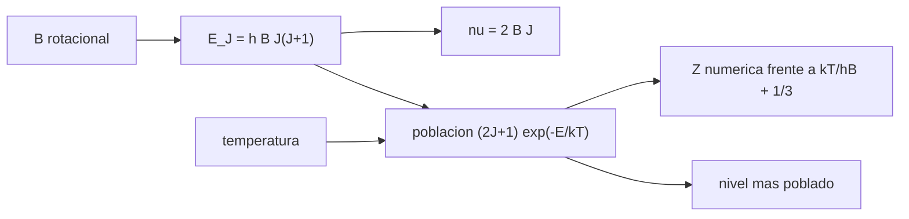

# B46-C12 — Emisiones moleculares

<!-- nav:top -->
[🏠 Programa](../../../../README.md) · [📚 Bloque B46](../../../tronco-comun/B46-radioastronomia-e-interferometria.md) · [← Anterior: B46-C11 — Observación de hidrógeno a 21 centímetros](../B46-C11-observacion-de-hidrogeno-a-21-centimetros/CLASE.md) · [Siguiente: B46-C13 — Polarimetría de radio →](../B46-C13-polarimetria-de-radio/CLASE.md)
<!-- /nav -->

## 1. Ubicación, nivel y alcance

Clase 12 del bloque B46. Nivel N3. Las moléculas emiten líneas de rotación en el milimétrico. Aquí calculas la escalera de un **rotor rígido** del tipo CO, las **poblaciones en equilibrio térmico local** a 10, 30 y 100 K, la función de partición (numérica frente a aproximada) y el nivel más poblado. Usas [B46-C11](../B46-C11-observacion-de-hidrogeno-a-21-centimetros/CLASE.md) y [B05](../../../tronco-comun/B05-fisica-fundamental-para-el-espacio.md). La constante rotacional es un valor ilustrativo.

## 2. Por qué esta clase existe

Qué transición observar depende de la temperatura del gas, porque la población de cada nivel cambia. La decisión central: **¿qué línea es la más intensa a una temperatura dada?**

## 3. Lo que podrás hacer al terminar

1. Calcular las frecuencias de la escalera rotacional.
2. Calcular poblaciones en ETL.
3. Sumar la función de partición.
4. Hallar el nivel más poblado.
5. Relacionar el Doppler con la frecuencia.
6. Reconocer los límites del rotor rígido.

La evidencia es la **ficha de las emisiones moleculares** del ejercicio 12 (sección 20).

## 4. Con qué llegas y cómo comprobarlo

1. ¿Qué es una incertidumbre?
2. ¿Qué es una simulación Monte Carlo?
3. ¿Qué es una tabla de resultados?
4. ¿Qué es un valor ilustrativo?
5. ¿Qué es una verificación?

<details>
<summary>Ver respuestas</summary>

1. Un intervalo en que se espera el valor verdadero. 2. Repetir con números aleatorios de semilla fija. 3. Un resumen ordenado de cálculos. 4. Un valor propuesto para el ejemplo, no medido. 5. Comparar un cálculo con un caso independiente.
</details>

Con cuatro o cinco aciertos, sigue; si no, repasa los prerrequisitos.

## 5. Un caso de contexto y casos de referencia

Con `B = 57,636 GHz` la línea `1→0` está en `115,272 GHz` (`2,601 mm`). A 30 K la función de partición vale `11,185` (aproximada `11,179`) y el nivel más poblado es `J = 2`. Es el **ejemplo conductor**; `B` es **ilustrativa**.

## 6. Vocabulario

El **rotor rígido**: `E_J = hB J(J+1)`. La **transición** `J → J−1` emite a `2BJ`. El **ETL** reparte la población con `(2J+1) exp(−E_J/kT)`. La **función de partición** `Z`. La **temperatura de excitación** de la línea.

## 7. Modelo mental: una escalera con peldaños cada vez más altos

Cada peldaño es un nivel de rotación; a baja temperatura el gas ocupa los bajos, y al subir la temperatura sube también el peldaño más ocupado.



*Descripción textual:* la constante rotacional fija la escalera y la temperatura reparte la población entre sus niveles.

Analogía: una escalera con peldaños cada vez más altos. Límite: rotor rígido, ETL y sin profundidad óptica.

## 8. La explicación, paso a paso

### 8.1 Escalera

| transición | ν (GHz) | λ (mm) | `E_J/k` (K) |
|---|---|---|---|
| 1→0 | 115,272 | 2,6007 | 5,53 |
| 2→1 | 230,544 | 1,3004 | 16,60 |
| 3→2 | 345,816 | 0,8669 | 33,19 |
| 4→3 | 461,088 | 0,6502 | 55,32 |

### 8.2 Poblaciones

| `T` (K) | `Z` numérica | `kT/hB + 1/3` | `J` pico | `√(kT/2hB) − ½` |
|---|---|---|---|---|
| 10 | 3,968 | 3,949 | 1 | 0,84 |
| 30 | 11,185 | 11,179 | 2 | 1,83 |
| 100 | 36,487 | 36,485 | 4 | 3,75 |

A 30 K las poblaciones de `J = 0…5` son 0,089, 0,223, 0,257, 0,207, 0,127, 0,062.

### 8.3 Doppler

1 km/s desplaza la línea `1→0` en `0,3845 MHz`. Además `hν/k = 5,532 K` para esa línea.

### 8.4 Lectura

La línea `1→0` es la más brillante en gas frío; en gas caliente conviene `3→2` o `4→3`. La aproximación de `Z` mejora al subir `T`. Un gas real puede no estar en ETL (densidad crítica) y las líneas se saturan por profundidad óptica.

## 9. Magnitudes, símbolos y unidades

| Símbolo | Qué es | Unidad | Valor / nota |
|---|---|---|---|
| `B` | constante rotacional | Hz | 57,636 × 10⁹ (ilustrativa) |
| `J` | número cuántico | — | 0, 1, 2… |
| `Z` | función de partición | — | 11,185 a 30 K |
| `T_ex` | temperatura de excitación | K | 10, 30, 100 |

## 10. Convenciones y referencias

`h`, `k`, `c` de NIST CODATA 2022; `B` y las temperaturas **ilustrativas**; `B` es un valor conocido de CO **no consultado**.

## 11. De dónde sale lo que afirmamos

| ID | Fuente | Localizador | Respalda | Estado |
|---|---|---|---|---|
| S1 | NIST, *Fundamental Physical Constants* (CODATA 2022) | https://physics.nist.gov/cuu/Constants/Table/allascii.txt | constantes citadas en la sección 9 | Consultada el 2026-11-09 |

Límites: no se consultó ningún espectro molecular ni la constante rotacional.

## 12. Cómo ver las cifras

| Magnitud | Valor |
|---|---|
| ν(1→0) | 115,272 GHz |
| Z (30 K) | 11,185 |
| J pico (30 K) | 2 |
| Doppler 1 km/s | 0,3845 MHz |

Descripción larga: el nivel más poblado sube con la temperatura.

## 13. Ejemplo trabajado: la partición

**Paso 1 · Parámetro.** `kT/(hB)` a 30 K: `10,846`.

**Paso 2 · Corrección.** `+1/3`.

**Paso 3 · Aproximación.** `11,179`.

**Paso 4 · Comparación.** La suma numérica da `11,185`.

## 14. Distintas formas de describir una molécula

**Por fórmula:** niveles y frecuencias. **Por tabla:** poblaciones. **Por suma:** partición. **Por temperatura:** nivel pico.

## 15. Práctica guiada

**Ejercicio 1 · con los pasos indicados.** ν de la transición `2→1`. *Pasos:* `2B·2`.

<details><summary>Solución comentada</summary>

`230,544 GHz`.
</details>

**Ejercicio 2 · con una pista.** `E₁/k`. *Pasos:* `hB·2/k`.

<details><summary>Solución comentada</summary>

`5,53 K`.
</details>

**Ejercicio 3 · casi autónomo.** `λ` de `1→0`. *Pasos:* `c/ν`.

<details><summary>Solución comentada</summary>

`2,601 mm`.
</details>

## 16. Práctica autónoma, transferencia e integrador

**Ejercicio 4.** `J` pico aproximado a 100 K.

<details><summary>Solución comentada</summary>

`3,75`, es decir `J = 4`.
</details>

**Ejercicio 5.** `Z` a 10 K.

<details><summary>Solución comentada</summary>

`3,968`.
</details>

**Ejercicio 6.** Fracción en `J = 0` a 10 K.

<details><summary>Solución comentada</summary>

`0,252`.
</details>

**Ejercicio 7.** Corrimiento Doppler de 5 km/s en `1→0`.

<details><summary>Solución comentada</summary>

`1,923 MHz`.
</details>

**Ejercicio 8.** ¿Qué sube más rápido con `T`, el nivel pico o `Z`?

<details><summary>Solución comentada</summary>

`Z`, que crece casi lineal con `T`.
</details>

**Ejercicio 9 · transferencia.** **Transferencia.** ¿Por qué se observan isotopólogos más raros?

<details><summary>Solución comentada</summary>

Porque son ópticamente delgados.
</details>

**Ejercicio 10 · transferencia.** **Transferencia.** ¿Qué es la densidad crítica?

<details><summary>Solución comentada</summary>

La densidad a la que las colisiones igualan la emisión espontánea.
</details>

**Ejercicio 11 · transferencia.** **Transferencia.** ¿Por qué el CO traza el H₂?

<details><summary>Solución comentada</summary>

Porque el H₂ frío no emite en radio y el CO sí.
</details>

**Ejercicio 12.** **Integrador.** Elabora tu *ficha de las emisiones moleculares*: escalera, poblaciones y nivel pico.

<details><summary>Solución comentada</summary>

Secciones 8.1–8.2.
</details>

**Ejercicio 12 · integrador.** **Integrador.** Elabora tu *ficha de las emisiones moleculares*: escalera, poblaciones y nivel pico.

<details><summary>Solución modelo</summary>

Secciones 8.1–8.2.
</details>

## 17. Laboratorio: escalera y poblaciones

El script [moleculas.py](moleculas.py) calcula la escalera, las poblaciones en ETL y la partición (**comprueba** `ν(1→0) = 115,272 GHz` y `Z`).

**Datos:** constantes de NIST; `B` **ilustrativa**. **Predice antes de ejecutar:** ¿qué `J` será el pico a 30 K? (2.) **Ejecución del 2026-11-09 (Python 3.12.9):**

```text
Python 3.12.9 (biblioteca estandar)
 J->J-1  nu [GHz]  lambda [mm]  E_J/k [K]
  1->0    115.272       2.6007       5.53
  2->1    230.544       1.3004      16.60
  3->2    345.816       0.8669      33.19
  4->3    461.088       0.6502      55.32
 T [K]  Z numerica  kT/hB+1/3  J pico  J analitico
    10       3.968      3.949       1         0.84  p(J=0..5) = 0.252 0.435 0.240 0.064 0.009 0.001
    30      11.185     11.179       2         1.83  p(J=0..5) = 0.089 0.223 0.257 0.207 0.127 0.062
   100      36.487     36.485       4         3.75  p(J=0..5) = 0.027 0.078 0.116 0.138 0.142 0.131
1 km/s en la transicion 1-0 desplaza 0.3845 MHz ; h nu/k (1-0) = 5.532 K
Pruebas superadas.
```

```bash
python programa/clases/B46/B46-C12-emisiones-moleculares/moleculas.py
```

**Límites:** rotor rígido, ETL, sin opacidad.

## 18. Errores frecuentes y cómo corregirlos

**Usar `B` en MHz sin convertir.** Se corrige con la sección 9.

**Olvidar el factor `2J+1`.** Se corrige con 8.2.

**Creer que ETL siempre vale.** Se corrige con 8.4.

**Presentar `B` como medida.** Se corrige con la sección 10.

## 19. Cómo sabrás que vas bien

Tras la sección 8: ¿qué resultado esperabas y cuál obtuviste? Si dudas, repasa el ejemplo 13. Tras el laboratorio: ¿qué comprueba? (ver la sección 17).

## 20. Qué entregas y cómo se evalúa

El producto es tu **ficha de las emisiones moleculares** (ejercicio 12).

| Criterio | Inicial | En desarrollo | Logrado | Destacado |
|---|---|---|---|---|
| Conceptos | Los confunde | Parciales | conceptos de la clase | Explica los límites |
| Cálculo | Sin unidades | Con errores | Tablas completas | Calcula casos nuevos |
| Numérico | Sin comprobar | Un caso | Contraste con el análisis | Interpreta las diferencias |
| Fuentes | Sin fuente | Sin fecha | fuentes con fecha | Declara lo ilustrativo |
| Límites | No los nombra | Uno | Tres | Discute qué falta del modelo |

**Condiciones críticas (no se compensan con promedio):** rotular lo ilustrativo; no reportar abundancias ni temperaturas reales; citar solo lo consultado.

## 21. Ética, seguridad y límites

Clase educativa: los modelos son simplificados. Accesibilidad: tablas equivalentes a las gráficas, fórmulas en texto, ejercicios sin conexión.

## 22. Para cerrar y seguir

La línea 1→0 está en 115,3 GHz y a 30 K el nivel más poblado es J = 2. Queda una pregunta: ¿qué dice la polarización?

**Glosario español–inglés.** rotor rígido · *rigid rotor*; función de partición · *partition function*; ETL · *LTE*; temperatura de excitación · *excitation temperature*.

**Continuidad.** [B46-C13](../B46-C13-polarimetria-de-radio/CLASE.md) estudia la polarimetría de radio.

**Referencias:** ver sección 11.

<!-- nav:bottom -->
---

[← Anterior: B46-C11 — Observación de hidrógeno a 21 centímetros](../B46-C11-observacion-de-hidrogeno-a-21-centimetros/CLASE.md) · [📚 Bloque B46](../../../tronco-comun/B46-radioastronomia-e-interferometria.md) · [Siguiente: B46-C13 — Polarimetría de radio →](../B46-C13-polarimetria-de-radio/CLASE.md)
<!-- /nav -->
