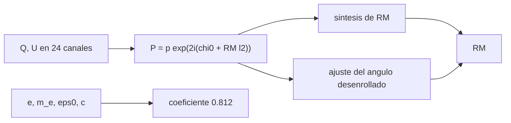

# B46-C13 — Polarimetría de radio

<!-- nav:top -->
[🏠 Programa](../../../../README.md) · [📚 Bloque B46](../../../tronco-comun/B46-radioastronomia-e-interferometria.md) · [← Anterior: B46-C12 — Emisiones moleculares](../B46-C12-emisiones-moleculares/CLASE.md) · [Siguiente: B46-C14 — Líneas de base interferométricas →](../B46-C14-lineas-de-base-interferometricas/CLASE.md)
<!-- /nav -->

## 1. Ubicación, nivel y alcance

Clase 13 del bloque B46. Nivel N3. La polarización lineal del radio revela campos magnéticos y plasma. Aquí calculas el **coeficiente de la medida de rotación** con constantes de NIST, simulas `Q` y `U` de una fuente con `RM = +60 rad/m²` en 24 canales, recuperas la `RM` por **síntesis de RM** y por ajuste del ángulo, y miras el **sesgo** de la polarización lineal con baja S/N. Usas [B46-C02](../B46-C02-propagacion-de-ondas-de-radio/CLASE.md) y [B12](../../../tronco-comun/B12-probabilidad-estadistica-e-incertidumbre.md). La fuente es sintética.

## 2. Por qué esta clase existe

El ángulo de polarización gira con `λ²`, y hay que medirlo en varias frecuencias para saber cuánto. La decisión central: **¿cómo se obtiene la medida de rotación sin ambigüedad de `nπ`?**

## 3. Lo que podrás hacer al terminar

1. Definir los parámetros de Stokes.
2. Derivar el coeficiente 0,812 de las constantes.
3. Simular `Q(λ²)` y `U(λ²)`.
4. Aplicar la síntesis de RM.
5. Comparar con el ajuste del ángulo desenrollado.
6. Reconocer el sesgo de `P` con baja S/N.

La evidencia es la **ficha de la polarimetría** del ejercicio 12 (sección 20).

## 4. Con qué llegas y cómo comprobarlo

1. ¿Qué es una incertidumbre?
2. ¿Qué es una simulación Monte Carlo?
3. ¿Qué es una tabla de resultados?
4. ¿Qué es un valor ilustrativo?
5. ¿Qué es una verificación?

<details>
<summary>Ver respuestas</summary>

1. Un intervalo en que se espera el valor verdadero. 2. Repetir con números aleatorios de semilla fija. 3. Un resumen ordenado de cálculos. 4. Un valor propuesto para el ejemplo, no medido. 5. Comparar un cálculo con un caso independiente.
</details>

Con cuatro o cinco aciertos, sigue; si no, repasa los prerrequisitos.

## 5. Un caso de contexto y casos de referencia

El coeficiente vale `0,8119 rad m⁻² por cm⁻³ µG pc`. Con una fuente sintética de `RM = 60 rad/m²` y `p = 0,3`, la síntesis da el pico en `59,5 rad/m²` (amplitud `0,297`) y el ajuste `59,54 rad/m²`; la RMSF mide `61,3 rad/m²`. Es el **ejemplo conductor**; la fuente es **sintética**.

## 6. Vocabulario

Los **parámetros de Stokes** `I, Q, U, V`. La **polarización lineal** `P = Q + iU`, con ángulo `χ = ½ arg P`. La **rotación de Faraday** `χ = χ₀ + RM λ²`. La **síntesis de RM** transforma `P(λ²)` en la **función de dispersión de Faraday**. La **RMSF** es su respuesta a una fuente puntual.

## 7. Modelo mental: una veleta que gira con la longitud de onda

El ángulo de la veleta depende del cuadrado de la longitud de onda; mirando a muchas longitudes, se ve cuántas vueltas ha dado.



*Descripción textual:* la polarización compleja medida en varias longitudes de onda se transforma en RM por dos vías.

Analogía: una veleta que gira con la longitud de onda. Límite: una sola componente de Faraday y pantalla delgada.

## 8. La explicación, paso a paso

### 8.1 Coeficiente

`e³/(8π² ε₀ m_e² c³)` en SI, convertido a cm⁻³, µG y pc, da `0,8119`; el valor habitual es 0,812 (diferencia menor que 0,2 %).

### 8.2 Recuperación

| método | RM (rad/m²) |
|---|---|
| verdadera | 60,0 |
| síntesis de RM (rejilla 0,5) | 59,5 |
| ajuste del ángulo | 59,54 |

La RMSF mide `2√3/Δλ² = 61,3 rad/m²`. Con el ruido simulado, ambas vías están a menos de 1 rad/m² de la verdad.

### 8.3 Sesgo de la polarización lineal

| S/N verdadera | media de `√(Q² + U²)` |
|---|---|
| 1,0 | 1,552 |
| 3,0 | 3,154 |
| 10,0 | 10,043 |

Con S/N = 1 la media (`1,55`) supera a la verdadera: el módulo de un ruido bidimensional es siempre positivo.

### 8.4 Lectura

La síntesis no necesita desenrollar, pero su resolución está limitada por la cobertura en `λ²`. Con varias componentes a lo largo de la línea de visión la síntesis las separa y el ajuste no.

## 9. Magnitudes, símbolos y unidades

| Símbolo | Qué es | Unidad | Valor / nota |
|---|---|---|---|
| `Q, U` | parámetros de Stokes | Jy o K | sintéticos |
| `RM` | medida de rotación | rad/m² | 60 (ilustrativa) |
| `χ` | ángulo de polarización | rad | ½ arg P |
| coeficiente | RM por columna | rad m⁻² | 0,8119 |

## 10. Convenciones y referencias

`e`, `m_e`, `ε₀`, `c` de NIST CODATA 2022; definición de RM de Wikipedia (*Rotation measure*); fuente, ruido y canales **sintéticos** (semilla `20261109`).

## 11. De dónde sale lo que afirmamos

| ID | Fuente | Localizador | Respalda | Estado |
|---|---|---|---|---|
| S1 | NIST, *Fundamental Physical Constants* (CODATA 2022) | https://physics.nist.gov/cuu/Constants/Table/allascii.txt | constantes citadas en la sección 9 | Consultada el 2026-11-09 |
| S2 | Wikipedia, *Rotation measure* | https://en.wikipedia.org/wiki/Rotation_measure | definición de la medida de rotación (beta = RM lambda²) | Solo la página, consultada el 2026-11-09 |

Límites: no se consultó ninguna observación polarimétrica real.

## 12. Cómo ver las cifras

| Magnitud | Valor |
|---|---|
| coeficiente | 0,8119 |
| RM por síntesis | 59,5 rad/m² |
| RM por ajuste | 59,54 rad/m² |
| RMSF | 61,3 rad/m² |

Descripción larga: ambas vías recuperan la RM verdadera.

## 13. Ejemplo trabajado: la rotación

**Paso 1 · Longitud.** `λ = 0,2 m`, `λ² = 0,04 m²`.

**Paso 2 · Rotación.** `RM λ² = 60·0,04 = 2,4 rad`.

**Paso 3 · En grados.** `137,5°`.

**Paso 4 · Ambigüedad.** El ángulo observado repite cada `180°`.

## 14. Distintas formas de describir una veleta

**Por Stokes:** `Q` y `U`. **Por fase compleja:** `P`. **Por transformada:** síntesis. **Por ajuste:** pendiente del ángulo.

## 15. Práctica guiada

**Ejercicio 1 · con los pasos indicados.** Ángulo de rotación de `RM = 60` a `λ = 0,2 m`. *Pasos:* `RM λ²`.

<details><summary>Solución comentada</summary>

`137,5°`.
</details>

**Ejercicio 2 · con una pista.** `P` de `Q = 0,1` y `U = 0,2`. *Pasos:* `√(Q² + U²)`.

<details><summary>Solución comentada</summary>

`0,2236`.
</details>

**Ejercicio 3 · casi autónomo.** `χ` de esos valores. *Pasos:* `½ atan2(U, Q)`.

<details><summary>Solución comentada</summary>

`31,72°`.
</details>

## 16. Práctica autónoma, transferencia e integrador

**Ejercicio 4.** Fracción lineal `P/I` con `I = 1`.

<details><summary>Solución comentada</summary>

`0,224`.
</details>

**Ejercicio 5.** `RM` de `n = 0,03 cm⁻³`, `B = 2 µG`, `L = 1000 pc`.

<details><summary>Solución comentada</summary>

`48,7 rad/m²`.
</details>

**Ejercicio 6.** ¿Cuánto vale la RMSF para `Δλ² = 0,113 m²`?

<details><summary>Solución comentada</summary>

`30,7 rad/m²`.
</details>

**Ejercicio 7.** ¿Por qué el ángulo tiene ambigüedad de `π`?

<details><summary>Solución comentada</summary>

Porque `Q, U` dependen de `2χ`.
</details>

**Ejercicio 8.** ¿Por qué conviene un ancho de `λ²` grande?

<details><summary>Solución comentada</summary>

Para una RMSF estrecha.
</details>

**Ejercicio 9 · transferencia.** **Transferencia.** ¿Qué sesgo tiene `P` con S/N = 1?

<details><summary>Solución comentada</summary>

Media `1,55` frente a 1.
</details>

**Ejercicio 10 · transferencia.** **Transferencia.** ¿Por qué la síntesis sirve con varias componentes?

<details><summary>Solución comentada</summary>

Separa picos en `φ`.
</details>

**Ejercicio 11 · transferencia.** **Transferencia.** ¿Qué es la despolarización?

<details><summary>Solución comentada</summary>

Pérdida de `P` por mezcla de ángulos.
</details>

**Ejercicio 12.** **Integrador.** Elabora tu *ficha de la polarimetría*: coeficiente, RM por dos vías y sesgo de `P`.

<details><summary>Solución comentada</summary>

Secciones 8.1–8.3.
</details>

**Ejercicio 12 · integrador.** **Integrador.** Elabora tu *ficha de la polarimetría*: coeficiente, RM por dos vías y sesgo de `P`.

<details><summary>Solución modelo</summary>

Secciones 8.1–8.3.
</details>

## 17. Laboratorio: síntesis de RM

El script [polarimetria.py](polarimetria.py) simula `Q` y `U`, aplica síntesis y ajuste y calcula el sesgo (**comprueba** `RM` dentro de 1 rad/m² y el coeficiente 0,812).

**Datos:** constantes de NIST; fuente **sintética**, semilla `20261109`. **Predice antes de ejecutar:** ¿qué RM recuperará la síntesis? (≈60 rad/m².) **Ejecución del 2026-11-09 (Python 3.12.9):**

```text
Python 3.12.9 (biblioteca estandar)
coeficiente RM = 0.8119 rad m^-2 por (cm^-3 microgauss pc)
RM verdadero = 60.0 ; sintesis de RM: pico en 59.5 rad/m^2 (amplitud 0.297) ; ajuste del angulo: 59.54 rad/m^2
anchura de la RMSF = 61.3 rad/m^2
S/N verdadera  media de sqrt(Q^2+U^2)
          1.0                   1.552
          3.0                   3.154
         10.0                  10.043
Pruebas superadas.
```

```bash
python programa/clases/B46/B46-C13-polarimetria-de-radio/polarimetria.py
```

**Límites:** una componente, pantalla delgada, ruido blanco.

## 18. Errores frecuentes y cómo corregirlos

**Medir `P` sin corregir el sesgo.** Se corrige con 8.3.

**Ignorar la ambigüedad de `π`.** Se corrige con 8.2.

**Confundir `λ` con `λ²`.** Se corrige con la sección 9.

**Presentar la fuente como real.** Se corrige con la sección 10.

## 19. Cómo sabrás que vas bien

Tras la sección 8: ¿qué resultado esperabas y cuál obtuviste? Si dudas, repasa el ejemplo 13. Tras el laboratorio: ¿qué comprueba? (ver la sección 17).

## 20. Qué entregas y cómo se evalúa

El producto es tu **ficha de la polarimetría** (ejercicio 12).

| Criterio | Inicial | En desarrollo | Logrado | Destacado |
|---|---|---|---|---|
| Conceptos | Los confunde | Parciales | conceptos de la clase | Explica los límites |
| Cálculo | Sin unidades | Con errores | Tablas completas | Calcula casos nuevos |
| Numérico | Sin comprobar | Un caso | Contraste con el análisis | Interpreta las diferencias |
| Fuentes | Sin fuente | Sin fecha | fuentes con fecha | Declara lo ilustrativo |
| Límites | No los nombra | Uno | Tres | Discute qué falta del modelo |

**Condiciones críticas (no se compensan con promedio):** rotular lo sintético; no reportar RM ni campos reales; citar solo lo consultado.

## 21. Ética, seguridad y límites

Clase educativa: los modelos son simplificados. Accesibilidad: tablas equivalentes a las gráficas, fórmulas en texto, ejercicios sin conexión.

## 22. Para cerrar y seguir

Ambas vías recuperan RM = 60 rad/m² con error menor que 1 y el coeficiente es 0,812. Queda una pregunta: ¿cómo se combinan antenas para ver más fino?

**Glosario español–inglés.** medida de rotación · *rotation measure*; parámetros de Stokes · *Stokes parameters*; rotación de Faraday · *Faraday rotation*; síntesis de RM · *RM synthesis*.

**Continuidad.** [B46-C14](../B46-C14-lineas-de-base-interferometricas/CLASE.md) abre el tramo de interferometría con las líneas de base.

**Referencias:** ver sección 11.

<!-- nav:bottom -->
---

[← Anterior: B46-C12 — Emisiones moleculares](../B46-C12-emisiones-moleculares/CLASE.md) · [📚 Bloque B46](../../../tronco-comun/B46-radioastronomia-e-interferometria.md) · [Siguiente: B46-C14 — Líneas de base interferométricas →](../B46-C14-lineas-de-base-interferometricas/CLASE.md)
<!-- /nav -->
