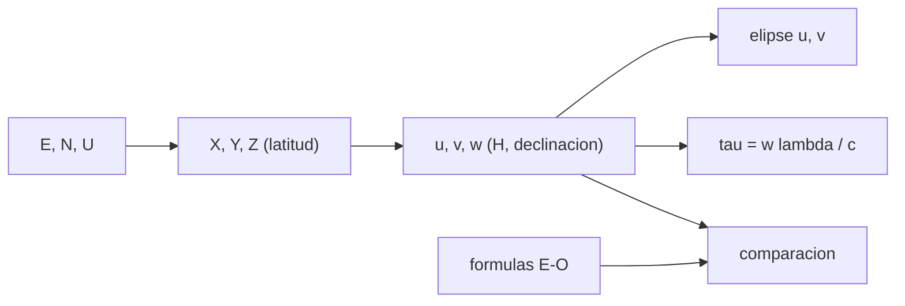

# B46-C14 — Líneas de base interferométricas

<!-- nav:top -->
<!-- /nav -->

## 1. Ubicación, nivel y alcance

Clase 14 del bloque B46. Nivel N3. Un interferómetro mide componentes de Fourier del cielo, y cada par de antenas elige una. Aquí pasas de coordenadas locales (este, norte, arriba) a `(u, v, w)` con una matriz de rotación y el ángulo horario, lo comparas con las fórmulas explícitas de una línea este–oeste, compruebas que la pista es una elipse y calculas el **retardo geométrico**. Usas [B05](../../../tronco-comun/B05-fisica-fundamental-para-el-espacio.md) y [B46-C03](../B46-C03-antenas-parabolicas/CLASE.md). La geometría es ilustrativa.

## 2. Por qué esta clase existe

La línea de base fija la escala angular que se ve y el retardo que hay que compensar. La decisión central: **¿qué punto del plano `uv` y qué retardo corresponden a una línea de base y a una dirección?**

## 3. Lo que podrás hacer al terminar

1. Convertir `(E, N, U)` en `(X, Y, Z)`.
2. Calcular `(u, v, w)` con el ángulo horario.
3. Reconocer la elipse de una línea este–oeste.
4. Calcular el retardo geométrico.
5. Calcular la separación de franjas.
6. Comprobar por dos vías.

La evidencia es la **ficha de la línea de base** del ejercicio 12 (sección 20).

## 4. Con qué llegas y cómo comprobarlo

1. ¿Qué es una incertidumbre?
2. ¿Qué es una simulación Monte Carlo?
3. ¿Qué es una tabla de resultados?
4. ¿Qué es un valor ilustrativo?
5. ¿Qué es una verificación?

<details>
<summary>Ver respuestas</summary>

1. Un intervalo en que se espera el valor verdadero. 2. Repetir con números aleatorios de semilla fija. 3. Un resumen ordenado de cálculos. 4. Un valor propuesto para el ejemplo, no medido. 5. Comparar un cálculo con un caso independiente.
</details>

Con cuatro o cinco aciertos, sigue; si no, repasa los prerrequisitos.

## 5. Un caso de contexto y casos de referencia

Una línea de `300 m` este–oeste a `λ = 0,21 m` y declinación `+20°` (latitud `−30°`) recorre una elipse de semiejes `1428,6` y `488,6` longitudes de onda; las franjas se separan `2,41 arcmin` y el retardo máximo es `-940,3 ns`. Es el **ejemplo conductor**; la geometría es **ilustrativa**.

## 6. Vocabulario

La **línea de base** es el vector entre dos antenas. Las **coordenadas `(u, v, w)`** están en longitudes de onda y miran a la fuente (`w` hacia ella). El **ángulo horario** `H`. El **retardo geométrico** `τ = B·ŝ/c`. La **separación de franjas** es `λ/B`.

## 7. Modelo mental: la sombra de un palo que gira

Como la sombra de un palo cambia con la hora, la línea de base 'vista' desde la fuente cambia con la rotación de la Tierra y traza una elipse.



*Descripción textual:* la línea de base local se proyecta con la latitud, la declinación y el ángulo horario para dar el punto `uv` y el retardo.

Analogía: la sombra de un palo que gira. Límite: Tierra rígida, sin refracción.

## 8. La explicación, paso a paso

### 8.1 Pista este–oeste

| `H` (h) | `u` (λ) | `v` (λ) | `w` (λ) | retardo (ns) |
|---|---|---|---|---|
| -6 | 0,00 | -488,60 | 1342,42 | 940,34 |
| -3 | 1010,15 | -345,49 | 949,23 | 664,92 |
| 0 | 1428,57 | 0,00 | 0,00 | 0,00 |
| 3 | 1010,15 | 345,49 | -949,23 | -664,92 |
| 6 | 0,00 | 488,60 | -1342,42 | -940,34 |

### 8.2 Dos vías

La diferencia máxima entre la matriz y las fórmulas `u = (B/λ) cos H`, `v = (B/λ) sen δ sen H`, `w = −(B/λ) cos δ sen H` es `1,14 × 10^-13` longitudes de onda; la elipse `(u/a)² + (v/b)² = 1` cierra a `3,3 × 10^-16`.

### 8.3 Con componente norte

Con `300 m` al este y `200 m` al norte, `|B| = 360,555 m` y `|(u, v, w)|λ = 360,555 m`: la rotación conserva el módulo.

### 8.4 Lectura

El retardo máximo es `B cos δ/c`. A `H = 0` la línea es perpendicular a la fuente (`w = 0`). Una línea este–oeste a baja declinación da una elipse muy aplastada.

## 9. Magnitudes, símbolos y unidades

| Símbolo | Qué es | Unidad | Valor / nota |
|---|---|---|---|
| `B` | longitud de la línea de base | m | 300 (ilustrativa) |
| `(u, v, w)` | coordenadas | λ | ver tabla |
| `H` | ángulo horario | h | −6 a +6 |
| `τ` | retardo geométrico | ns | -940,3 máximo |

## 10. Convenciones y referencias

`c` de NIST CODATA 2022; línea de base, latitud, declinación y longitud de onda **ilustrativas**.

## 11. De dónde sale lo que afirmamos

| ID | Fuente | Localizador | Respalda | Estado |
|---|---|---|---|---|
| S1 | NIST, *Fundamental Physical Constants* (CODATA 2022) | https://physics.nist.gov/cuu/Constants/Table/allascii.txt | constantes citadas en la sección 9 | Consultada el 2026-11-09 |

Límites: no se consultó ninguna posición de antenas real.

## 12. Cómo ver las cifras

| Magnitud | Valor |
|---|---|
| semieje `a` | 1428,6 λ |
| semieje `b` | 488,6 λ |
| franjas | 2,41 arcmin |
| retardo máximo | -940,3 ns |

Descripción larga: la pista es una elipse centrada en el origen.

## 13. Ejemplo trabajado: los semiejes

**Paso 1 · Longitud en λ.** `300/0,21 = 1428,6`.

**Paso 2 · Seno.** `sen 20° = 0,3420`.

**Paso 3 · Semieje menor.** `488,6`.

**Paso 4 · Retardo.** `300·cos 20°/c = 940,3 ns`.

## 14. Distintas formas de describir una línea de base

**Por matriz:** rotaciones. **Por fórmula:** elipse. **Por tabla:** valores por hora. **Por retardo:** metros a nanosegundos.

## 15. Práctica guiada

**Ejercicio 1 · con los pasos indicados.** `B/λ` de 300 m a 0,21 m. *Pasos:* división.

<details><summary>Solución comentada</summary>

`1428,6`.
</details>

**Ejercicio 2 · con una pista.** Separación de franjas `λ/B` en arcmin. *Pasos:* `0,21/300` a arcmin.

<details><summary>Solución comentada</summary>

`2,41`.
</details>

**Ejercicio 3 · casi autónomo.** Retardo de 100 m a 90° de la fuente. *Pasos:* `100/c`.

<details><summary>Solución comentada</summary>

`333,6 ns`.
</details>

## 16. Práctica autónoma, transferencia e integrador

**Ejercicio 4.** `v` máximo a `δ = 90°`.

<details><summary>Solución comentada</summary>

Igual a `a`: la elipse es un círculo.
</details>

**Ejercicio 5.** `w` a `H = 0`.

<details><summary>Solución comentada</summary>

`0`.
</details>

**Ejercicio 6.** Retardo a `H = 3 h`.

<details><summary>Solución comentada</summary>

`-664,9 ns`.
</details>

**Ejercicio 7.** `|B|` de 300 m E y 200 m N.

<details><summary>Solución comentada</summary>

`360,56 m`.
</details>

**Ejercicio 8.** ¿Por qué el módulo se conserva?

<details><summary>Solución comentada</summary>

Porque la transformación es una rotación.
</details>

**Ejercicio 9 · transferencia.** **Transferencia.** ¿Por qué se compensa el retardo?

<details><summary>Solución comentada</summary>

Para que las señales lleguen alineadas al correlador.
</details>

**Ejercicio 10 · transferencia.** **Transferencia.** ¿Qué pasa con la elipse en el polo?

<details><summary>Solución comentada</summary>

Se vuelve circular.
</details>

**Ejercicio 11 · transferencia.** **Transferencia.** ¿Qué resolución da una línea más larga?

<details><summary>Solución comentada</summary>

Mejor: `λ/B` menor.
</details>

**Ejercicio 12.** **Integrador.** Elabora tu *ficha de la línea de base*: `(u, v, w)`, elipse y retardo.

<details><summary>Solución comentada</summary>

Secciones 8.1–8.3.
</details>

**Ejercicio 12 · integrador.** **Integrador.** Elabora tu *ficha de la línea de base*: `(u, v, w)`, elipse y retardo.

<details><summary>Solución modelo</summary>

Secciones 8.1–8.3.
</details>

## 17. Laboratorio: pista uv

El script [lineas_base.py](lineas_base.py) convierte la línea de base y compara la matriz con las fórmulas (**comprueba** la elipse y la conservación del módulo).

**Datos:** constantes de NIST; geometría **ilustrativa**. **Predice antes de ejecutar:** ¿qué diferencia habrá entre las dos vías? (<10⁻⁶ λ.) **Ejecución del 2026-11-09 (Python 3.12.9):**

```text
Python 3.12.9 (biblioteca estandar)
semiejes de la elipse: a = 1428.57 lambda ; b = 488.60 lambda ; separacion de franjas = 2.41 arcmin
 H [h]  u [lambda]  v [lambda]  w [lambda]  retardo [ns]
    -6        0.00     -488.60     1342.42        940.34
    -3     1010.15     -345.49      949.23        664.92
     0     1428.57        0.00        0.00          0.00
     3     1010.15      345.49     -949.23       -664.92
     6        0.00      488.60    -1342.42       -940.34
diferencia maxima entre vias = 1.14e-13 lambda ; cierre de la elipse = 3.33e-16
|B| con componente norte (300 m E + 200 m N) = 360.555 m ; |(u,v,w)| lambda = 360.555 m
Pruebas superadas.
```

```bash
python programa/clases/B46/B46-C14-lineas-de-base-interferometricas/lineas_base.py
```

**Límites:** Tierra rígida, sin refracción.

## 18. Errores frecuentes y cómo corregirlos

**Mezclar metros con longitudes de onda.** Se corrige con 8.1.

**Olvidar el signo de `w`.** Se corrige con 8.2.

**Usar la declinación como latitud.** Se corrige con 8.2.

**Presentar la geometría como real.** Se corrige con la sección 10.

## 19. Cómo sabrás que vas bien

Tras la sección 8: ¿qué resultado esperabas y cuál obtuviste? Si dudas, repasa el ejemplo 13. Tras el laboratorio: ¿qué comprueba? (ver la sección 17).

## 20. Qué entregas y cómo se evalúa

El producto es tu **ficha de la línea de base** (ejercicio 12).

| Criterio | Inicial | En desarrollo | Logrado | Destacado |
|---|---|---|---|---|
| Conceptos | Los confunde | Parciales | conceptos de la clase | Explica los límites |
| Cálculo | Sin unidades | Con errores | Tablas completas | Calcula casos nuevos |
| Numérico | Sin comprobar | Un caso | Contraste con el análisis | Interpreta las diferencias |
| Fuentes | Sin fuente | Sin fecha | fuentes con fecha | Declara lo ilustrativo |
| Límites | No los nombra | Uno | Tres | Discute qué falta del modelo |

**Condiciones críticas (no se compensan con promedio):** rotular lo ilustrativo; no atribuir posiciones a un conjunto real; citar solo lo consultado.

## 21. Ética, seguridad y límites

Clase educativa: los modelos son simplificados. Accesibilidad: tablas equivalentes a las gráficas, fórmulas en texto, ejercicios sin conexión.

## 22. Para cerrar y seguir

La línea de 300 m traza una elipse de 1429 y 489 λ y un retardo de hasta -940 ns. Queda una pregunta: ¿cómo se miden las visibilidades?

**Glosario español–inglés.** línea de base · *baseline*; ángulo horario · *hour angle*; retardo geométrico · *geometric delay*; franjas · *fringes*.

**Continuidad.** [B46-C15](../B46-C15-correladores-y-visibilidades/CLASE.md) estudia los correladores y las visibilidades.

**Referencias:** ver sección 11.

<!-- nav:bottom -->
---

<!-- /nav -->
