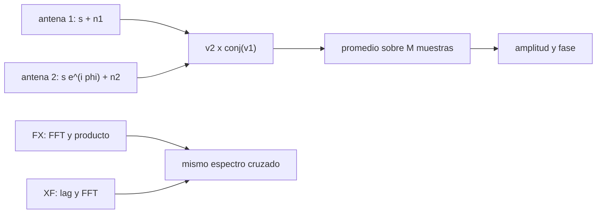

# B46-C15 — Correladores y visibilidades

<!-- nav:top -->
[🏠 Programa](../../../../README.md) · [📚 Bloque B46](../../../tronco-comun/B46-radioastronomia-e-interferometria.md) · [← Anterior: B46-C14 — Líneas de base interferométricas](../B46-C14-lineas-de-base-interferometricas/CLASE.md) · [Siguiente: B46-C16 — Síntesis de apertura →](../B46-C16-sintesis-de-apertura/CLASE.md)
<!-- /nav -->

## 1. Ubicación, nivel y alcance

Clase 15 del bloque B46. Nivel N3. El correlador multiplica las señales de dos antenas y promedia: el resultado es la **visibilidad**. Aquí simulas dos antenas con una señal común y ruido independiente, estimas amplitud y fase de la visibilidad, verificas que el ruido baja como `1/√M` y compruebas que un correlador **FX** y uno **XF** dan el mismo espectro cruzado, con el retardo recuperado en el pico. Usas [B46-C14](../B46-C14-lineas-de-base-interferometricas/CLASE.md) y [B46-C10](../B46-C10-radioastronomia-mediante-sdr/CLASE.md). Los datos son sintéticos.

## 2. Por qué esta clase existe

La visibilidad es el dato básico de la imagen, y su ruido determina la sensibilidad. La decisión central: **¿cuántas muestras hay que correlacionar para fijar amplitud y fase con la precisión requerida?**

## 3. Lo que podrás hacer al terminar

1. Definir la visibilidad como correlación cruzada.
2. Estimar amplitud y fase de una visibilidad ruidosa.
3. Verificar el ruido `(S+N)/√(2M)` por componente.
4. Distinguir correlador FX y XF.
5. Comprobar el teorema de correlación.
6. Recuperar un retardo por el pico del lag.

La evidencia es la **ficha del correlador** del ejercicio 12 (sección 20).

## 4. Con qué llegas y cómo comprobarlo

1. ¿Qué es una incertidumbre?
2. ¿Qué es una simulación Monte Carlo?
3. ¿Qué es una tabla de resultados?
4. ¿Qué es un valor ilustrativo?
5. ¿Qué es una verificación?

<details>
<summary>Ver respuestas</summary>

1. Un intervalo en que se espera el valor verdadero. 2. Repetir con números aleatorios de semilla fija. 3. Un resumen ordenado de cálculos. 4. Un valor propuesto para el ejemplo, no medido. 5. Comparar un cálculo con un caso independiente.
</details>

Con cuatro o cinco aciertos, sigue; si no, repasa los prerrequisitos.

## 5. Un caso de contexto y casos de referencia

Con `S = 0,5`, `N = 4` y fase de 40° (sintéticos), `M = 16 000` muestras dan `|V| = 0,5030` y fase `39,48°`, con un error por parte de `0,0267` frente a `0,0252` teórico. FX y XF difieren `5,6 × 10^-16` y el retardo de 5 muestras se recupera. Es el **ejemplo conductor**.

## 6. Vocabulario

La **visibilidad** `V = ⟨v₂ v₁*⟩`. El **ruido de correlación**: por parte `(S+N)/√(2M)`. El correlador **XF** correlaciona en el tiempo y luego transforma; el **FX** transforma y luego multiplica. El **lag** es el retardo de la correlación.

## 7. Modelo mental: dos oídos que escuchan la misma voz

Dos oídos separados reciben la misma voz con un pequeño retraso; comparando ambas se obtiene la voz común y el retraso, aunque cada uno oiga ruido propio.



*Descripción textual:* la correlación cruzada de dos flujos con una señal común da la visibilidad, con un ruido que baja con el número de muestras.

Analogía: dos oídos que escuchan la misma voz. Límite: ruido gaussiano blanco y correlador ideal.

## 8. La explicación, paso a paso

### 8.1 Visibilidad con ruido

El valor esperado es `S e^{iφ} = 0,5 e^{i·40°}`.

| `M` | amplitud de `V` | fase (°) | error por parte (simulado) | `(S+N)/√(2M)` |
|---|---|---|---|---|
| 1000 | 0,6188 | 29,91 | 0,1018 | 0,1006 |
| 4000 | 0,5637 | 36,99 | 0,0460 | 0,0503 |
| 16000 | 0,5030 | 39,48 | 0,0267 | 0,0252 |

### 8.2 FX frente a XF

La diferencia máxima relativa entre el espectro cruzado FX y la FFT de la correlación XF es `5,6 × 10^-16` (error de redondeo). El pico de la correlación está en el lag `5`, igual al retardo impuesto.

### 8.3 Lectura

La señal es mucho menor que el ruido (`S/N_antena = 0,125`), pero con `M` grande la visibilidad emerge. La sensibilidad por visibilidad sale de la ecuación del radiómetro. Un correlador real tiene cuantización, retardo fraccionario y correcciones que no se simulan.

## 9. Magnitudes, símbolos y unidades

| Símbolo | Qué es | Unidad | Valor / nota |
|---|---|---|---|
| `V` | visibilidad | unidades de potencia | 0,5 e^{i·40°} esperada |
| `M` | muestras | — | 1000 a 16 000 |
| `φ` | fase de franja | ° | 40 (sintética) |
| lag | retardo de pico | muestras | 5 |

## 10. Convenciones y referencias

Señales **sintéticas** (semilla `20261109`); sin datos externos.

## 11. De dónde sale lo que afirmamos

| ID | Fuente | Localizador | Respalda | Estado |
|---|---|---|---|---|
| — | Estándar o texto de radioastronomía no consultado | — | relaciones habituales de la disciplina que el laboratorio verifica por cálculo | No se consultó para esta clase |

Límites: no se usó ningún correlador ni datos reales.

## 12. Cómo ver las cifras

| Magnitud | Valor |
|---|---|
| amplitud de V (M = 16 000) | 0,5030 |
| fase | 39,48° |
| error por parte | 0,0267 |
| FX − XF | 5,6 × 10^-16 |

Descripción larga: el error baja con la raíz de las muestras.

## 13. Ejemplo trabajado: el ruido

**Paso 1 · Suma.** `S + N = 4,5`.

**Paso 2 · Raíz.** `√(2·16 000) = 178,9`.

**Paso 3 · Cociente.** `4,5/178,9 = 0,0252`.

**Paso 4 · Simulación.** `0,0267`.

## 14. Distintas formas de describir una correlación

**Por promedio:** `⟨v₂ v₁*⟩`. **Por tabla:** amplitud, fase y error. **Por frecuencia:** FX. **Por lag:** XF.

## 15. Práctica guiada

**Ejercicio 1 · con los pasos indicados.** Error por parte con `M = 4000`. *Pasos:* `(S+N)/√(2M)`.

<details><summary>Solución comentada</summary>

`0,0503`.
</details>

**Ejercicio 2 · con una pista.** `M` para error de 0,01. *Pasos:* `(4,5/0,01)²/2`.

<details><summary>Solución comentada</summary>

`101 250`.
</details>

**Ejercicio 3 · casi autónomo.** Error de fase en grados con `M = 16 000`. *Pasos:* error/`S`.

<details><summary>Solución comentada</summary>

`2,88°`.
</details>

## 16. Práctica autónoma, transferencia e integrador

**Ejercicio 4.** S/N de la visibilidad con `M = 16 000`.

<details><summary>Solución comentada</summary>

`19,9` por parte.
</details>

**Ejercicio 5.** ¿Qué pasa con el error al cuadruplicar `M`?

<details><summary>Solución comentada</summary>

Se reduce a la mitad.
</details>

**Ejercicio 6.** ¿Qué retardo corresponde a un lag de 5 muestras a 2,4 MHz?

<details><summary>Solución comentada</summary>

`2,08 µs`.
</details>

**Ejercicio 7.** ¿Por qué FX y XF coinciden?

<details><summary>Solución comentada</summary>

Por el teorema de correlación circular.
</details>

**Ejercicio 8.** ¿Qué ventaja da FX?

<details><summary>Solución comentada</summary>

Corrige por canal y escala mejor con muchas antenas.
</details>

**Ejercicio 9 · transferencia.** **Transferencia.** ¿Por qué se promedia la correlación y no la señal?

<details><summary>Solución comentada</summary>

Porque el promedio de la señal es cero y el de la correlación no.
</details>

**Ejercicio 10 · transferencia.** **Transferencia.** ¿Qué limita integrar mucho tiempo?

<details><summary>Solución comentada</summary>

Que la fase de la franja gira y debe compensarse.
</details>

**Ejercicio 11 · transferencia.** **Transferencia.** ¿Qué hace el ruido de cada antena en la visibilidad?

<details><summary>Solución comentada</summary>

Se promedia a cero, pero deja una incertidumbre.
</details>

**Ejercicio 12.** **Integrador.** Elabora tu *ficha del correlador*: visibilidad con error, FX frente a XF y retardo.

<details><summary>Solución comentada</summary>

Secciones 8.1–8.2.
</details>

**Ejercicio 12 · integrador.** **Integrador.** Elabora tu *ficha del correlador*: visibilidad con error, FX frente a XF y retardo.

<details><summary>Solución modelo</summary>

Secciones 8.1–8.2.
</details>

## 17. Laboratorio: correlador

El script [correlador.py](correlador.py) simula la correlación, estima la visibilidad y compara FX con XF (**comprueba** el ruido y la coincidencia).

**Datos:** señales **sintéticas**, semilla `20261109`. **Predice antes de ejecutar:** ¿qué error por parte tendrá `M = 16 000`? (≈0,025.) **Ejecución del 2026-11-09 (Python 3.12.9):**

```text
Python 3.12.9 (biblioteca estandar)
     M  |V| medido  fase [grados]  rms error por parte  (S+N)/sqrt(2M)
  1000      0.6188          29.91               0.1018          0.1006
  4000      0.5637          36.99               0.0460          0.0503
 16000      0.5030          39.48               0.0267          0.0252
FX frente a XF: diferencia maxima relativa = 5.58e-16 ; retardo recuperado (lag de pico) = 5 muestras
Pruebas superadas.
```

```bash
python programa/clases/B46/B46-C15-correladores-y-visibilidades/correlador.py
```

**Límites:** ruido blanco, correlador ideal.

## 18. Errores frecuentes y cómo corregirlos

**Promediar la señal en vez de la correlación.** Se corrige con 8.1.

**Olvidar la conjugación.** Se corrige con la sección 9.

**Creer que FX y XF difieren.** Se corrige con 8.2.

**Presentar los datos como de un correlador real.** Se corrige con la sección 10.

## 19. Cómo sabrás que vas bien

Tras la sección 8: ¿qué resultado esperabas y cuál obtuviste? Si dudas, repasa el ejemplo 13. Tras el laboratorio: ¿qué comprueba? (ver la sección 17).

## 20. Qué entregas y cómo se evalúa

El producto es tu **ficha del correlador** (ejercicio 12).

| Criterio | Inicial | En desarrollo | Logrado | Destacado |
|---|---|---|---|---|
| Conceptos | Los confunde | Parciales | conceptos de la clase | Explica los límites |
| Cálculo | Sin unidades | Con errores | Tablas completas | Calcula casos nuevos |
| Numérico | Sin comprobar | Un caso | Contraste con el análisis | Interpreta las diferencias |
| Fuentes | Sin fuente | Sin fecha | fuentes con fecha | Declara lo ilustrativo |
| Límites | No los nombra | Uno | Tres | Discute qué falta del modelo |

**Condiciones críticas (no se compensan con promedio):** rotular lo sintético; no atribuir sensibilidades a un correlador real; citar solo lo consultado.

## 21. Ética, seguridad y límites

Clase educativa: los modelos son simplificados. Accesibilidad: tablas equivalentes a las gráficas, fórmulas en texto, ejercicios sin conexión.

## 22. Para cerrar y seguir

Con 16 000 muestras la visibilidad tiene un error de 0,027 por parte y FX y XF coinciden. Queda una pregunta: ¿cómo se arma una imagen con muchas visibilidades?

**Glosario español–inglés.** visibilidad · *visibility*; correlador · *correlator*; retardo · *lag*; teorema de correlación · *correlation theorem*.

**Continuidad.** [B46-C16](../B46-C16-sintesis-de-apertura/CLASE.md) estudia la síntesis de apertura.

**Referencias:** ver sección 11.

<!-- nav:bottom -->
---

[← Anterior: B46-C14 — Líneas de base interferométricas](../B46-C14-lineas-de-base-interferometricas/CLASE.md) · [📚 Bloque B46](../../../tronco-comun/B46-radioastronomia-e-interferometria.md) · [Siguiente: B46-C16 — Síntesis de apertura →](../B46-C16-sintesis-de-apertura/CLASE.md)
<!-- /nav -->
