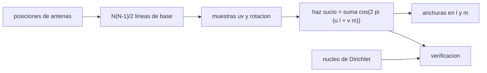

# B46-C16 — Síntesis de apertura

<!-- nav:top -->
[🏠 Programa](../../../../README.md) · [📚 Bloque B46](../../../tronco-comun/B46-radioastronomia-e-interferometria.md) · [← Anterior: B46-C15 — Correladores y visibilidades](../B46-C15-correladores-y-visibilidades/CLASE.md) · [Siguiente: B46-C17 — Calibración de fase →](../B46-C17-calibracion-de-fase/CLASE.md)
<!-- /nav -->

## 1. Ubicación, nivel y alcance

Clase 16 del bloque B46. Nivel N3. La síntesis de apertura reúne muchas visibilidades para formar una imagen de resolución `λ/B_max`. Aquí construyes la **cobertura uv** de un conjunto de 6 antenas este–oeste en una instantánea y en 12 h de rotación de la Tierra, calculas el **haz sucio** por suma directa y lo verificas con el núcleo de Dirichlet de un caso uniforme. Usas [B46-C14](../B46-C14-lineas-de-base-interferometricas/CLASE.md) y [B46-C15](../B46-C15-correladores-y-visibilidades/CLASE.md). El conjunto es ilustrativo.

## 2. Por qué esta clase existe

Un interferómetro con pocas antenas solo muestrea unos puntos del plano `uv`; la rotación de la Tierra los multiplica. La decisión central: **¿qué cobertura `uv` y qué haz sucio da una disposición de antenas?**

## 3. Lo que podrás hacer al terminar

1. Calcular el número de líneas de base.
2. Generar muestras `uv` con la rotación.
3. Calcular el haz sucio.
4. Verificar con el núcleo de Dirichlet.
5. Medir las anchuras del haz en dos ejes.
6. Reconocer los límites del plano del cielo.

La evidencia es la **ficha de la síntesis de apertura** del ejercicio 12 (sección 20).

## 4. Con qué llegas y cómo comprobarlo

1. ¿Qué es una incertidumbre?
2. ¿Qué es una simulación Monte Carlo?
3. ¿Qué es una tabla de resultados?
4. ¿Qué es un valor ilustrativo?
5. ¿Qué es una verificación?

<details>
<summary>Ver respuestas</summary>

1. Un intervalo en que se espera el valor verdadero. 2. Repetir con números aleatorios de semilla fija. 3. Un resumen ordenado de cálculos. 4. Un valor propuesto para el ejemplo, no medido. 5. Comparar un cálculo con un caso independiente.
</details>

Con cuatro o cinco aciertos, sigue; si no, repasa los prerrequisitos.

## 5. Un caso de contexto y casos de referencia

Seis antenas este–oeste (0 a 600 m, `λ = 0,21 m`, declinación +40°) dan `15` líneas de base y `30` muestras `uv` instantáneas (con conjugadas); en 12 h hay `2190`, con `1548` celdas ocupadas frente a `26`. El haz mide `72,7` arcsec en `l` y `111,0` en `m`. Es el **ejemplo conductor**; el conjunto es **ilustrativo**.

## 6. Vocabulario

El **plano `uv`**. La **síntesis de rotación**: la Tierra gira y cada línea de base barre un arco. El **haz sucio** `b(l, m)` es la transformada de la función de muestreo. Un **lóbulo lateral** del haz sucio. La **resolución** `≈ λ/B_max`.

## 7. Modelo mental: pintar con pocas brochas

Con pocas brochas se cubre poco del lienzo, pero girando el lienzo cada brocha pinta un arco entero y la cobertura se llena.



*Descripción textual:* las posiciones de las antenas y la rotación definen el muestreo del plano `uv`, cuya transformada es el haz sucio.

Analogía: pintar con pocas brochas. Límite: plano del cielo, ancho de banda cero y ponderación uniforme.

## 8. La explicación, paso a paso

### 8.1 Verificación analítica

Para muestras uniformes `u = k d` el haz es el núcleo de Dirichlet `sen((2M+1)π d l)/((2M+1) sen(π d l))`. La suma directa y la forma cerrada difieren `5,6 × 10^-16`.

### 8.2 Cobertura

| cobertura | muestras `uv` | celdas de 40 λ ocupadas |
|---|---|---|
| instantánea | 30 | 26 |
| 12 h | 2190 | 1548 |

### 8.3 Haz sucio

La anchura a media altura es `72,69` arcsec en `l` y `111,04` arcsec en `m`; el cociente es `1,527` y `1/sen δ = 1,556`. Además `λ/B_max = 72,2` arcsec y el mayor lóbulo lateral a más de 80 arcsec vale `0,140`.

### 8.4 Lectura

Una línea este–oeste da un haz alargado en `m` por el factor `1/sen δ`. Los lóbulos laterales del haz sucio son el motivo de la deconvolución. La aproximación de plano del cielo falla en campos grandes.

## 9. Magnitudes, símbolos y unidades

| Símbolo | Qué es | Unidad | Valor / nota |
|---|---|---|---|
| `N_bl` | líneas de base | — | 15 |
| `u_max` | máxima frecuencia espacial | λ | 2857,1 |
| `b(l, m)` | haz sucio | — | pico 1 |
| `θ` | resolución | arcsec | 72,2 |

## 10. Convenciones y referencias

Posiciones, longitud de onda, declinación y horas **ilustrativas**; sin datos externos.

## 11. De dónde sale lo que afirmamos

| ID | Fuente | Localizador | Respalda | Estado |
|---|---|---|---|---|
| — | Estándar o texto de radioastronomía no consultado | — | relaciones habituales de la disciplina que el laboratorio verifica por cálculo | No se consultó para esta clase |

Límites: no se consultó ningún conjunto de antenas real.

## 12. Cómo ver las cifras

| Magnitud | Valor |
|---|---|
| líneas de base | 15 |
| celdas (12 h) | 1548 |
| FWHM en l | 72,7 arcsec |
| FWHM en m | 111,0 arcsec |

Descripción larga: la cobertura crece unas sesenta veces con la rotación.

## 13. Ejemplo trabajado: la cobertura

**Paso 1 · Pares.** `6·5/2 = 15`.

**Paso 2 · Con conjugadas.** `30` muestras instantáneas.

**Paso 3 · 12 h.** `73` instantes cada 10 min dan `2190`.

**Paso 4 · Cociente.** `59,5` veces más celdas.

## 14. Distintas formas de describir un conjunto

**Por pares:** `N(N−1)/2`. **Por tabla:** cobertura. **Por transformada:** haz sucio. **Por analogía:** pintar con brochas.

## 15. Práctica guiada

**Ejercicio 1 · con los pasos indicados.** Líneas de base de 27 antenas. *Pasos:* `N(N−1)/2`.

<details><summary>Solución comentada</summary>

`351`.
</details>

**Ejercicio 2 · con una pista.** Resolución `λ/B` de 0,21 m y 600 m en arcsec. *Pasos:* `0,21/600` a arcsec.

<details><summary>Solución comentada</summary>

`72,2`.
</details>

**Ejercicio 3 · casi autónomo.** Muestras con conjugadas de 15 líneas en 73 instantes.

<details><summary>Solución comentada</summary>

`2190`.
</details>

## 16. Práctica autónoma, transferencia e integrador

**Ejercicio 4.** Cociente de anchuras para `δ = 40°`.

<details><summary>Solución comentada</summary>

`1,556`.
</details>

**Ejercicio 5.** `u_max` en λ de 600 m.

<details><summary>Solución comentada</summary>

`2857,1`.
</details>

**Ejercicio 6.** Valor del haz en el centro.

<details><summary>Solución comentada</summary>

`1`.
</details>

**Ejercicio 7.** ¿Por qué el haz es simétrico respecto del origen?

<details><summary>Solución comentada</summary>

Por las muestras conjugadas.
</details>

**Ejercicio 8.** ¿Qué pasa con la cobertura si se observa 6 h?

<details><summary>Solución comentada</summary>

Se reduce a la mitad del arco.
</details>

**Ejercicio 9 · transferencia.** **Transferencia.** ¿Por qué se observa a varias declinaciones distintas con una línea este–oeste?

<details><summary>Solución comentada</summary>

Porque a baja declinación la elipse se aplasta y el haz se alarga.
</details>

**Ejercicio 10 · transferencia.** **Transferencia.** ¿Qué ventaja da una configuración no redundante?

<details><summary>Solución comentada</summary>

Más puntos `uv` distintos.
</details>

**Ejercicio 11 · transferencia.** **Transferencia.** ¿Por qué la rotación sustituye a más antenas?

<details><summary>Solución comentada</summary>

Porque cambia la proyección de la línea de base.
</details>

**Ejercicio 12.** **Integrador.** Elabora tu *ficha de la síntesis de apertura*: cobertura, haz sucio y verificación de Dirichlet.

<details><summary>Solución comentada</summary>

Secciones 8.1–8.3.
</details>

**Ejercicio 12 · integrador.** **Integrador.** Elabora tu *ficha de la síntesis de apertura*: cobertura, haz sucio y verificación de Dirichlet.

<details><summary>Solución modelo</summary>

Secciones 8.1–8.3.
</details>

## 17. Laboratorio: cobertura y haz sucio

El script [sintesis.py](sintesis.py) construye la cobertura y el haz sucio y los verifica con Dirichlet (**comprueba** la forma cerrada a 10⁻¹² y la relación `1/sen δ`).

**Datos:** sin datos externos; conjunto **ilustrativo**. **Predice antes de ejecutar:** ¿cuánto valdrá el cociente de anchuras? (≈1,5.) **Ejecución del 2026-11-09 (Python 3.12.9):**

```text
Python 3.12.9 (biblioteca estandar)
nucleo de Dirichlet: diferencia maxima haz directo - forma cerrada = 5.55e-16
15 lineas de base ; muestras uv (con conjugadas): instantanea 30, 12 h 2190
celdas uv de 40 lambda ocupadas: instantanea 26, 12 h 1548 ; u_max = 2857.1 lambda
FWHM del haz sucio: en l 72.69 arcsec, en m 111.04 arcsec ; cociente 1.527 (1/sen delta = 1.556)
lambda/B_max = 72.2 arcsec ; lobulo lateral maximo (eje l, 80-800 arcsec) = 0.140
Pruebas superadas.
```

```bash
python programa/clases/B46/B46-C16-sintesis-de-apertura/sintesis.py
```

**Límites:** plano del cielo, ancho de banda cero.

## 18. Errores frecuentes y cómo corregirlos

**Contar líneas de base sin el factor ½.** Se corrige con 8.2.

**Olvidar las conjugadas.** Se corrige con 8.3.

**Confundir resolución con tamaño del haz.** Se corrige con la sección 9.

**Presentar el conjunto como real.** Se corrige con la sección 10.

## 19. Cómo sabrás que vas bien

Tras la sección 8: ¿qué resultado esperabas y cuál obtuviste? Si dudas, repasa el ejemplo 13. Tras el laboratorio: ¿qué comprueba? (ver la sección 17).

## 20. Qué entregas y cómo se evalúa

El producto es tu **ficha de la síntesis de apertura** (ejercicio 12).

| Criterio | Inicial | En desarrollo | Logrado | Destacado |
|---|---|---|---|---|
| Conceptos | Los confunde | Parciales | conceptos de la clase | Explica los límites |
| Cálculo | Sin unidades | Con errores | Tablas completas | Calcula casos nuevos |
| Numérico | Sin comprobar | Un caso | Contraste con el análisis | Interpreta las diferencias |
| Fuentes | Sin fuente | Sin fecha | fuentes con fecha | Declara lo ilustrativo |
| Límites | No los nombra | Uno | Tres | Discute qué falta del modelo |

**Condiciones críticas (no se compensan con promedio):** rotular lo ilustrativo; no atribuir cobertura a un conjunto real; citar solo lo consultado.

## 21. Ética, seguridad y límites

Clase educativa: los modelos son simplificados. Accesibilidad: tablas equivalentes a las gráficas, fórmulas en texto, ejercicios sin conexión.

## 22. Para cerrar y seguir

La rotación multiplica la cobertura por 60 y el haz sucio tiene 73 × 111 arcsec. Queda una pregunta: ¿cómo se corrigen las fases antes de formar la imagen?

**Glosario español–inglés.** síntesis de apertura · *aperture synthesis*; plano uv · *uv plane*; haz sucio · *dirty beam*; cobertura · *coverage*.

**Continuidad.** [B46-C17](../B46-C17-calibracion-de-fase/CLASE.md) estudia la calibración de fase.

**Referencias:** ver sección 11.

<!-- nav:bottom -->
---

[← Anterior: B46-C15 — Correladores y visibilidades](../B46-C15-correladores-y-visibilidades/CLASE.md) · [📚 Bloque B46](../../../tronco-comun/B46-radioastronomia-e-interferometria.md) · [Siguiente: B46-C17 — Calibración de fase →](../B46-C17-calibracion-de-fase/CLASE.md)
<!-- /nav -->
