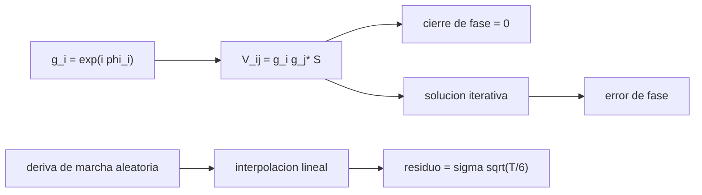

# B46-C17 — Calibración de fase

<!-- nav:top -->
[🏠 Programa](../../../../README.md) · [📚 Bloque B46](../../../tronco-comun/B46-radioastronomia-e-interferometria.md) · [← Anterior: B46-C16 — Síntesis de apertura](../B46-C16-sintesis-de-apertura/CLASE.md) · [Siguiente: B46-C18 — VLBI y geodesia →](../B46-C18-vlbi-y-geodesia/CLASE.md)
<!-- /nav -->

## 1. Ubicación, nivel y alcance

Clase 17 del bloque B46. Nivel N3. La atmósfera y los equipos alteran la fase de cada antena. Aquí compruebas que la **fase de cierre** de un triángulo no depende de esos errores, resuelves las fases de 6 antenas con un calibrador puntual por iteración y estimas el residuo de la **referencia de fase** (alternar calibrador y blanco) para una deriva de marcha aleatoria. Usas [B46-C15](../B46-C15-correladores-y-visibilidades/CLASE.md) y [B12](../../../tronco-comun/B12-probabilidad-estadistica-e-incertidumbre.md). Los errores son sintéticos.

## 2. Por qué esta clase existe

Sin calibrar, la fase de la visibilidad no contiene el cielo. La decisión central: **¿cada cuánto hay que observar el calibrador para que el residuo no destruya la coherencia?**

## 3. Lo que podrás hacer al terminar

1. Escribir la visibilidad con ganancias de antena.
2. Comprobar el cierre de fase.
3. Resolver fases de antena.
4. Medir el error de la solución.
5. Interpolar entre calibradores.
6. Comparar el residuo con `σ√(T/6)`.

La evidencia es la **ficha de la calibración de fase** del ejercicio 12 (sección 20).

## 4. Con qué llegas y cómo comprobarlo

1. ¿Qué es una incertidumbre?
2. ¿Qué es una simulación Monte Carlo?
3. ¿Qué es una tabla de resultados?
4. ¿Qué es un valor ilustrativo?
5. ¿Qué es una verificación?

<details>
<summary>Ver respuestas</summary>

1. Un intervalo en que se espera el valor verdadero. 2. Repetir con números aleatorios de semilla fija. 3. Un resumen ordenado de cálculos. 4. Un valor propuesto para el ejemplo, no medido. 5. Comparar un cálculo con un caso independiente.
</details>

Con cuatro o cinco aciertos, sigue; si no, repasa los prerrequisitos.

## 5. Un caso de contexto y casos de referencia

Con errores de fase de 60° rms y un calibrador de 1 Jy, el cierre sin ruido es `1,7 × 10^-16 rad`; la solución recupera las fases con un error máximo de `2,65°`. Para una deriva de `0,5°/√s` y ciclos de `T = 120 s`, el residuo es `2,24°` (teoría `2,24°`). Es el **ejemplo conductor**; los errores son **sintéticos**.

## 6. Vocabulario

La **ganancia compleja** `g_i`. La **fase de cierre** `arg(V_ij V_jk V_ki)`. La **solución de ganancias** estima `g_i` de un calibrador. La **referencia de fase** alterna calibrador y blanco. La **marcha aleatoria** de fase y el **puente browniano**.

## 7. Modelo mental: afinar una orquesta

Cada músico desafina un poco; afinando con una nota de referencia cada cierto tiempo, el desajuste queda acotado por cuánto se desafina entre afinaciones.



*Descripción textual:* las ganancias de antena se estiman de un calibrador y se interpolan en el tiempo; el cierre de fase es el invariante de comprobación.

Analogía: afinar una orquesta. Límite: fuente puntual en el centro y ganancias constantes en la integración.

## 8. La explicación, paso a paso

### 8.1 Cierre

Sin ruido, el máximo de `|arg(V_ij V_jk V_ki)|` es `1,7 × 10^-16 rad`. Con ruido de 0,03 Jy por parte, los cierres de los triángulos 012, 123, 234 y 345 son 1,02°, -0,56°, 1,42°, 1,08°: pequeños y ajenos a las fases de antena.

### 8.2 Solución

| antena | fase verdadera (°) | recuperada (°) | error (°) |
|---|---|---|---|
| 0 | 0,00 | 0,00 | 0,00 |
| 1 | 35,47 | 38,12 | 2,65 |
| 2 | -74,37 | -73,49 | 0,88 |
| 3 | -71,07 | -69,90 | 1,17 |
| 4 | 21,83 | 22,37 | 0,54 |
| 5 | 82,31 | 82,62 | 0,31 |

La antena 0 es la referencia (fase 0).

### 8.3 Referencia de fase

| `T` (s) | residuo simulado (°) | `σ√(T/6)` (°) |
|---|---|---|
| 30 | 1,143 | 1,118 |
| 60 | 1,597 | 1,581 |
| 120 | 2,243 | 2,236 |
| 240 | 3,179 | 3,162 |

### 8.4 Lectura

Un ciclo más corto reduce el residuo con la raíz de `T`. La atmósfera real tiene una estructura distinta de la marcha aleatoria simple.

## 9. Magnitudes, símbolos y unidades

| Símbolo | Qué es | Unidad | Valor / nota |
|---|---|---|---|
| `g_i` | ganancia de antena | — | exp(iφ) |
| `φ_i` | fase de antena | ° | σ = 60 (sintético) |
| cierre | fase de cierre | rad | 1,7 × 10^-16 |
| `T` | ciclo de calibración | s | 30 a 240 |

## 10. Convenciones y referencias

Fases, calibrador, ruido y deriva **sintéticos** (semilla `20261109`); sin datos externos.

## 11. De dónde sale lo que afirmamos

| ID | Fuente | Localizador | Respalda | Estado |
|---|---|---|---|---|
| — | Estándar o texto de radioastronomía no consultado | — | relaciones habituales de la disciplina que el laboratorio verifica por cálculo | No se consultó para esta clase |

Límites: no se calibró ningún dato real.

## 12. Cómo ver las cifras

| Magnitud | Valor |
|---|---|
| cierre sin ruido | 1,7 × 10^-16 rad |
| error máximo de fase | 2,65° |
| residuo T = 120 s | 2,24° |
| teoría T = 120 s | 2,24° |

Descripción larga: el residuo crece con la raíz del ciclo.

## 13. Ejemplo trabajado: el residuo

**Paso 1 · Deriva.** `σ = 0,5°/√s`.

**Paso 2 · Ciclo.** `T/6 = 20 s`.

**Paso 3 · Raíz.** `√20 = 4,472`.

**Paso 4 · Residuo.** `0,5·4,472 = 2,24°`.

## 14. Distintas formas de describir una calibración

**Por invariante:** cierre. **Por solución:** fases recuperadas. **Por tiempo:** residuo. **Por analogía:** afinar una orquesta.

## 15. Práctica guiada

**Ejercicio 1 · con los pasos indicados.** Residuo para `T = 60 s` con `σ = 0,5°/√s`. *Pasos:* `σ√(T/6)`.

<details><summary>Solución comentada</summary>

`1,58°`.
</details>

**Ejercicio 2 · con una pista.** `T` para un residuo de 1°. *Pasos:* `6(1/0,5)²`.

<details><summary>Solución comentada</summary>

`24 s`.
</details>

**Ejercicio 3 · casi autónomo.** Triángulos de 6 antenas. *Pasos:* `C(6, 3)`.

<details><summary>Solución comentada</summary>

`20`.
</details>

## 16. Práctica autónoma, transferencia e integrador

**Ejercicio 4.** Cierre de fase si todas las fases de antena valen 10°.

<details><summary>Solución comentada</summary>

`0`.
</details>

**Ejercicio 5.** Cuántas fases independientes hay en 6 antenas.

<details><summary>Solución comentada</summary>

`5`, porque una es la referencia.
</details>

**Ejercicio 6.** Cuántas fases de cierre independientes hay.

<details><summary>Solución comentada</summary>

`10`: `C(5, 2)`.
</details>

**Ejercicio 7.** ¿Qué ocurre con el residuo al cuadruplicar `T`?

<details><summary>Solución comentada</summary>

Se duplica.
</details>

**Ejercicio 8.** Error de la solución de fases, mayor valor.

<details><summary>Solución comentada</summary>

`2,65°`.
</details>

**Ejercicio 9 · transferencia.** **Transferencia.** ¿Por qué el cierre no corrige las fases?

<details><summary>Solución comentada</summary>

Porque solo es invariante; no da las fases de antena.
</details>

**Ejercicio 10 · transferencia.** **Transferencia.** ¿Qué hace la autocalibración?

<details><summary>Solución comentada</summary>

Usa el propio modelo del blanco para resolver las ganancias.
</details>

**Ejercicio 11 · transferencia.** **Transferencia.** ¿Por qué el calibrador debe estar cerca del blanco?

<details><summary>Solución comentada</summary>

Porque la atmósfera es parecida en direcciones próximas.
</details>

**Ejercicio 12.** **Integrador.** Elabora tu *ficha de la calibración de fase*: cierre, solución y residuo frente a `T`.

<details><summary>Solución comentada</summary>

Secciones 8.1–8.3.
</details>

**Ejercicio 12 · integrador.** **Integrador.** Elabora tu *ficha de la calibración de fase*: cierre, solución y residuo frente a `T`.

<details><summary>Solución modelo</summary>

Secciones 8.1–8.3.
</details>

## 17. Laboratorio: cierre y calibración

El script [fases.py](fases.py) comprueba el cierre, resuelve las fases y simula la referencia de fase (**comprueba** el cierre a 10⁻¹² y el residuo al 8 %).

**Datos:** datos **sintéticos**, semilla `20261109`. **Predice antes de ejecutar:** ¿cuánto valdrá el residuo con `T = 120 s`? (≈2,2°.) **Ejecución del 2026-11-09 (Python 3.12.9):**

```text
Python 3.12.9 (biblioteca estandar)
cierre de fase sin ruido: maximo |c| = 1.67e-16 rad
cierre de fase con ruido (grados), triangulos 012 123 234 345: 1.02 -0.56 1.42 1.08
 antena  fase verdadera [grados]  recuperada [grados]   error
      0                     0.00                 0.00    0.00
      1                    35.47                38.12    2.65
      2                   -74.37               -73.49    0.88
      3                   -71.07               -69.90    1.17
      4                    21.83                22.37    0.54
      5                    82.31                82.62    0.31
 T [s]  residuo simulado [grados]  sigma sqrt(T/6)
    30                      1.143            1.118
    60                      1.597            1.581
   120                      2.243            2.236
   240                      3.179            3.162
Pruebas superadas.
```

```bash
python programa/clases/B46/B46-C17-calibracion-de-fase/fases.py
```

**Límites:** calibrador puntual en el centro, deriva de marcha aleatoria.

## 18. Errores frecuentes y cómo corregirlos

**Creer que el cierre calibra las antenas.** Se corrige con 8.1.

**Olvidar la antena de referencia.** Se corrige con 8.2.

**Aplicar la deriva de marcha aleatoria a toda atmósfera.** Se corrige con 8.4.

**Presentar los datos como reales.** Se corrige con la sección 10.

## 19. Cómo sabrás que vas bien

Tras la sección 8: ¿qué resultado esperabas y cuál obtuviste? Si dudas, repasa el ejemplo 13. Tras el laboratorio: ¿qué comprueba? (ver la sección 17).

## 20. Qué entregas y cómo se evalúa

El producto es tu **ficha de la calibración de fase** (ejercicio 12).

| Criterio | Inicial | En desarrollo | Logrado | Destacado |
|---|---|---|---|---|
| Conceptos | Los confunde | Parciales | conceptos de la clase | Explica los límites |
| Cálculo | Sin unidades | Con errores | Tablas completas | Calcula casos nuevos |
| Numérico | Sin comprobar | Un caso | Contraste con el análisis | Interpreta las diferencias |
| Fuentes | Sin fuente | Sin fecha | fuentes con fecha | Declara lo ilustrativo |
| Límites | No los nombra | Uno | Tres | Discute qué falta del modelo |

**Condiciones críticas (no se compensan con promedio):** rotular lo sintético; no atribuir fases a un instrumento real; citar solo lo consultado.

## 21. Ética, seguridad y límites

Clase educativa: los modelos son simplificados. Accesibilidad: tablas equivalentes a las gráficas, fórmulas en texto, ejercicios sin conexión.

## 22. Para cerrar y seguir

El cierre es invariante (1,7 × 10^-16 rad) y el residuo de la referencia de fase es 2,2° a T = 120 s. Queda una pregunta: ¿qué pasa cuando las antenas están a miles de kilómetros?

**Glosario español–inglés.** calibración · *calibration*; fase de cierre · *closure phase*; referencia de fase · *phase referencing*; ganancia · *gain*.

**Continuidad.** [B46-C18](../B46-C18-vlbi-y-geodesia/CLASE.md) estudia VLBI y geodesia.

**Referencias:** ver sección 11.

<!-- nav:bottom -->
---

[← Anterior: B46-C16 — Síntesis de apertura](../B46-C16-sintesis-de-apertura/CLASE.md) · [📚 Bloque B46](../../../tronco-comun/B46-radioastronomia-e-interferometria.md) · [Siguiente: B46-C18 — VLBI y geodesia →](../B46-C18-vlbi-y-geodesia/CLASE.md)
<!-- /nav -->
