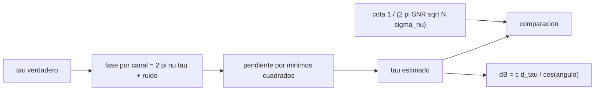

# B46-C18 — VLBI y geodesia

<!-- nav:top -->
[🏠 Programa](../../../../README.md) · [📚 Bloque B46](../../../tronco-comun/B46-radioastronomia-e-interferometria.md) · [← Anterior: B46-C17 — Calibración de fase](../B46-C17-calibracion-de-fase/CLASE.md) · [Siguiente: B46-C19 — Imágenes de radio y CLEAN →](../B46-C19-imagenes-de-radio-y-clean/CLASE.md)
<!-- /nav -->

## 1. Ubicación, nivel y alcance

Clase 18 del bloque B46. Nivel N3. En VLBI las antenas están a miles de kilómetros y la medida clave es el **retardo** de llegada. Aquí estimas el retardo por la pendiente de la fase en 16 canales entre 8,0 y 8,5 GHz con ruido sintético, comparas la dispersión con la cota teórica y conviertes la precisión en error de la **línea de base**. Usas [B46-C14](../B46-C14-lineas-de-base-interferometricas/CLASE.md) y [B46-C15](../B46-C15-correladores-y-visibilidades/CLASE.md). Los números son ilustrativos.

## 2. Por qué esta clase existe

La precisión del retardo es lo que permite la geodesia por VLBI: milímetros de línea de base. La decisión central: **¿cuánta banda y S/N se necesitan para fijar el retardo a una precisión dada?**

## 3. Lo que podrás hacer al terminar

1. Relacionar fase por canal y retardo.
2. Estimar el retardo por mínimos cuadrados.
3. Calcular la cota `1/(2π SNR √N σ_ν)`.
4. Comparar con la simulación.
5. Convertir retardo en longitud.
6. Reconocer las ambigüedades de ciclo.

La evidencia es la **ficha del retardo VLBI** del ejercicio 12 (sección 20).

## 4. Con qué llegas y cómo comprobarlo

1. ¿Qué es una incertidumbre?
2. ¿Qué es una simulación Monte Carlo?
3. ¿Qué es una tabla de resultados?
4. ¿Qué es un valor ilustrativo?
5. ¿Qué es una verificación?

<details>
<summary>Ver respuestas</summary>

1. Un intervalo en que se espera el valor verdadero. 2. Repetir con números aleatorios de semilla fija. 3. Un resumen ordenado de cálculos. 4. Un valor propuesto para el ejemplo, no medido. 5. Comparar un cálculo con un caso independiente.
</details>

Con cuatro o cinco aciertos, sigue; si no, repasa los prerrequisitos.

## 5. Un caso de contexto y casos de referencia

Con 16 canales de 8,0 a 8,5 GHz (`σ_ν = 153,66 MHz`) y S/N = 10 por canal, la desviación del retardo es `25,70 ps` frente a `25,89 ps` de la cota; un picosegundo equivale a `0,300 mm`. Con una fuente a 60° de la línea de base, el error es de `15,4 mm`. Es el **ejemplo conductor**; es **ilustrativo**.

## 6. Vocabulario

El **retardo de grupo** `τ`. La **síntesis de ancho de banda** usa varios canales. La **pendiente de fase** `dφ/dν = 2πτ`. La **cota de Cramér–Rao** simple `σ_τ`. La **ambigüedad de ciclo** es un salto de `1/Δν_canal`. La **geodesia** por VLBI mide líneas de base de la Tierra.

## 7. Modelo mental: medir un eco con varias voces

Si varias voces de tonos distintos llegan con un mismo retraso, la diferencia de fase entre voces delata el retraso mejor que cualquier voz sola.



*Descripción textual:* la fase medida en varios canales es una recta de pendiente `2πτ`, cuyo ajuste da el retardo con una precisión acotada por la banda y la S/N.

Analogía: medir un eco con varias voces. Límite: fase sin ambigüedades, ruido blanco y sin ionosfera.

## 8. La explicación, paso a paso

### 8.1 Precisión

`σ_τ = (1/SNR)/(2π √N σ_ν)` con `N = 16` y `σ_ν = 153,66 MHz`.

| S/N por canal | `τ` medio (ns) | `σ` simulada (ps) | cota (ps) |
|---|---|---|---|
| 10 | 1234,499786 | 25,696 | 25,894 |
| 20 | 1234,500157 | 12,865 | 12,947 |
| 40 | 1234,499997 | 6,461 | 6,474 |

La simulación coincide con la cota dentro del 1 % y el sesgo es despreciable.

### 8.2 De retardo a longitud

`1 ps × c = 0,2998 mm`. Con S/N = 10 el error de la línea de base es `σ_τ c / cos 60° = 15,41 mm`.

### 8.3 Lectura

Duplicar la S/N o el ancho de banda divide el error por 2; multiplicar los canales por 4 lo divide por 2. El laboratorio supone que se conoce el ciclo; en la práctica se resuelve con canales muy espaciados. La ionosfera, la troposfera y los relojes añaden retardos que el modelo no incluye.

## 9. Magnitudes, símbolos y unidades

| Símbolo | Qué es | Unidad | Valor / nota |
|---|---|---|---|
| `τ` | retardo | ns | 1234,5 (ilustrativo) |
| `σ_ν` | dispersión de frecuencias | MHz | 153,66 |
| `σ_τ` | precisión del retardo | ps | 25,70 (S/N 10) |
| `c·1 ps` | camino de 1 ps | mm | 0,2998 |

## 10. Convenciones y referencias

`c` de NIST CODATA 2022; banda, retardo, S/N y línea de base **ilustrativos** (semilla `20261109`).

## 11. De dónde sale lo que afirmamos

| ID | Fuente | Localizador | Respalda | Estado |
|---|---|---|---|---|
| S1 | NIST, *Fundamental Physical Constants* (CODATA 2022) | https://physics.nist.gov/cuu/Constants/Table/allascii.txt | constantes citadas en la sección 9 | Consultada el 2026-11-09 |

Límites: no se consultó ninguna red VLBI real.

## 12. Cómo ver las cifras

| Magnitud | Valor |
|---|---|
| `σ_ν` | 153,66 MHz |
| `σ_τ` (S/N 10) | 25,70 ps |
| cota (S/N 10) | 25,89 ps |
| error de línea | 15,4 mm |

Descripción larga: la simulación sigue a la cota.

## 13. Ejemplo trabajado: la cota

**Paso 1 · Fase por canal.** `1/10 = 0,1 rad`.

**Paso 2 · Banda.** `2π√16·153,66 MHz = 3861,9 rad/µs`.

**Paso 3 · Cociente.** `0,1/3861,9 µs`.

**Paso 4 · Resultado.** `25,89 ps`.

## 14. Distintas formas de describir un retardo

**Por pendiente:** `dφ/dν`. **Por cota:** `σ_τ`. **Por tabla:** S/N. **Por longitud:** `c δτ`.

## 15. Práctica guiada

**Ejercicio 1 · con los pasos indicados.** Camino de 10 ps. *Pasos:* `c·10⁻¹¹`.

<details><summary>Solución comentada</summary>

`3,00 mm`.
</details>

**Ejercicio 2 · con una pista.** Retardo de 3 m de camino. *Pasos:* `3/c`.

<details><summary>Solución comentada</summary>

`10,01 ns`.
</details>

**Ejercicio 3 · casi autónomo.** `σ_τ` con S/N = 20.

<details><summary>Solución comentada</summary>

`12,95 ps`.
</details>

## 16. Práctica autónoma, transferencia e integrador

**Ejercicio 4.** `σ_τ` con S/N = 40.

<details><summary>Solución comentada</summary>

`6,47 ps`.
</details>

**Ejercicio 5.** Error de línea con `σ_τ = 6,5 ps` y fuente en 0°.

<details><summary>Solución comentada</summary>

`1,95 mm`.
</details>

**Ejercicio 6.** ¿Qué pasa con `σ_τ` si se cuadruplican los canales?

<details><summary>Solución comentada</summary>

Se reduce a la mitad.
</details>

**Ejercicio 7.** Salto de ciclo con canales separados 32 MHz.

<details><summary>Solución comentada</summary>

`31,25 ns`.
</details>

**Ejercicio 8.** Deriva tectónica de 20 mm/año en ps.

<details><summary>Solución comentada</summary>

`66,7 ps/año`.
</details>

**Ejercicio 9 · transferencia.** **Transferencia.** ¿Por qué se observan cuásares y no estrellas?

<details><summary>Solución comentada</summary>

Porque son compactos y de posición muy estable.
</details>

**Ejercicio 10 · transferencia.** **Transferencia.** ¿Por qué se mide a dos frecuencias?

<details><summary>Solución comentada</summary>

Para separar el retardo ionosférico.
</details>

**Ejercicio 11 · transferencia.** **Transferencia.** ¿Qué papel juega el reloj atómico?

<details><summary>Solución comentada</summary>

Mantiene la coherencia entre estaciones.
</details>

**Ejercicio 12.** **Integrador.** Elabora tu *ficha del retardo VLBI*: precisión simulada, cota y error de línea.

<details><summary>Solución comentada</summary>

Secciones 8.1–8.2.
</details>

**Ejercicio 12 · integrador.** **Integrador.** Elabora tu *ficha del retardo VLBI*: precisión simulada, cota y error de línea.

<details><summary>Solución modelo</summary>

Secciones 8.1–8.2.
</details>

## 17. Laboratorio: retardo VLBI

El script [vlbi.py](vlbi.py) estima el retardo por la pendiente de fase y compara con la cota (**comprueba** la dispersión al 10 %).

**Datos:** constante de NIST; datos **ilustrativos**, semilla `20261109`. **Predice antes de ejecutar:** ¿cuánto valdrá `σ_τ` con S/N = 10? (≈26 ps.) **Ejecución del 2026-11-09 (Python 3.12.9):**

```text
Python 3.12.9 (biblioteca estandar)
dispersion rms de las frecuencias = 153.66 MHz ; 1 ps equivale a 0.2998 mm de camino
 S/N por canal  tau medio [ns]  sigma simulada [ps]  cota [ps]
            10     1234.499786               25.696     25.894
            20     1234.500157               12.865     12.947
            40     1234.499997                6.461      6.474
con S/N = 10: error de la linea de base (fuente a 60 grados) = 15.41 mm
Pruebas superadas.
```

```bash
python programa/clases/B46/B46-C18-vlbi-y-geodesia/vlbi.py
```

**Límites:** fase sin ambigüedades, ruido blanco, sin medio.

## 18. Errores frecuentes y cómo corregirlos

**Olvidar la ambigüedad de ciclo.** Se corrige con 8.3.

**Usar la banda total en vez de `σ_ν`.** Se corrige con 8.1.

**Ignorar la ionosfera.** Se corrige con 8.3.

**Presentar los números como de una red real.** Se corrige con la sección 10.

## 19. Cómo sabrás que vas bien

Tras la sección 8: ¿qué resultado esperabas y cuál obtuviste? Si dudas, repasa el ejemplo 13. Tras el laboratorio: ¿qué comprueba? (ver la sección 17).

## 20. Qué entregas y cómo se evalúa

El producto es tu **ficha del retardo VLBI** (ejercicio 12).

| Criterio | Inicial | En desarrollo | Logrado | Destacado |
|---|---|---|---|---|
| Conceptos | Los confunde | Parciales | conceptos de la clase | Explica los límites |
| Cálculo | Sin unidades | Con errores | Tablas completas | Calcula casos nuevos |
| Numérico | Sin comprobar | Un caso | Contraste con el análisis | Interpreta las diferencias |
| Fuentes | Sin fuente | Sin fecha | fuentes con fecha | Declara lo ilustrativo |
| Límites | No los nombra | Uno | Tres | Discute qué falta del modelo |

**Condiciones críticas (no se compensan con promedio):** rotular lo ilustrativo; no atribuir precisiones a una red real; citar solo lo consultado.

## 21. Ética, seguridad y límites

Clase educativa: los modelos son simplificados. Accesibilidad: tablas equivalentes a las gráficas, fórmulas en texto, ejercicios sin conexión.

## 22. Para cerrar y seguir

Con S/N = 10 el retardo tiene 26 ps de precisión, equivalente a 15 mm de línea de base. Queda una pregunta: ¿cómo se convierte todo esto en una imagen limpia?

**Glosario español–inglés.** retardo · *delay*; síntesis de ancho de banda · *bandwidth synthesis*; geodesia · *geodesy*; ambigüedad de ciclo · *cycle ambiguity*.

**Continuidad.** [B46-C19](../B46-C19-imagenes-de-radio-y-clean/CLASE.md) estudia las imágenes de radio y el algoritmo CLEAN.

**Referencias:** ver sección 11.

<!-- nav:bottom -->
---

[← Anterior: B46-C17 — Calibración de fase](../B46-C17-calibracion-de-fase/CLASE.md) · [📚 Bloque B46](../../../tronco-comun/B46-radioastronomia-e-interferometria.md) · [Siguiente: B46-C19 — Imágenes de radio y CLEAN →](../B46-C19-imagenes-de-radio-y-clean/CLASE.md)
<!-- /nav -->
