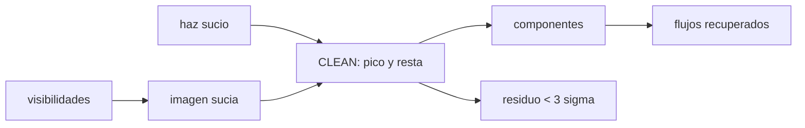

# B46-C19 — Imágenes de radio y CLEAN

<!-- nav:top -->
[🏠 Programa](../../../../README.md) · [📚 Bloque B46](../../../tronco-comun/B46-radioastronomia-e-interferometria.md) · [← Anterior: B46-C18 — VLBI y geodesia](../B46-C18-vlbi-y-geodesia/CLASE.md) · [Siguiente: B46-C20 — Proyecto de observación radioastronómica →](../B46-C20-proyecto-de-observacion-radioastronomica/CLASE.md)
<!-- /nav -->

## 1. Ubicación, nivel y alcance

Clase 19 del bloque B46. Nivel N3. Con visibilidades calibradas se forma la **imagen sucia**, que es el cielo convolucionado con el haz sucio. Aquí la calculas por transformada directa, verificas que equivale a la suma de haces desplazados y aplicas la **deconvolución CLEAN de Högbom** a tres fuentes puntuales sintéticas, midiendo el flujo recuperado. Usas [B46-C16](../B46-C16-sintesis-de-apertura/CLASE.md) y [B46-C17](../B46-C17-calibracion-de-fase/CLASE.md). Las fuentes y el ruido son sintéticos.

## 2. Por qué esta clase existe

La imagen sucia no se puede interpretar por los lóbulos del haz. La decisión central: **¿cuándo detener la deconvolución para no ajustar ruido?**

## 3. Lo que podrás hacer al terminar

1. Formar la imagen sucia desde las visibilidades.
2. Comprobarla como suma de haces.
3. Implementar CLEAN de Högbom.
4. Detener en `3σ`.
5. Medir los flujos recuperados.
6. Reconocer sesgos y límites de CLEAN.

La evidencia es la **ficha de la imagen CLEAN** del ejercicio 12 (sección 20).

## 4. Con qué llegas y cómo comprobarlo

1. ¿Qué es una incertidumbre?
2. ¿Qué es una simulación Monte Carlo?
3. ¿Qué es una tabla de resultados?
4. ¿Qué es un valor ilustrativo?
5. ¿Qué es una verificación?

<details>
<summary>Ver respuestas</summary>

1. Un intervalo en que se espera el valor verdadero. 2. Repetir con números aleatorios de semilla fija. 3. Un resumen ordenado de cálculos. 4. Un valor propuesto para el ejemplo, no medido. 5. Comparar un cálculo con un caso independiente.
</details>

Con cuatro o cinco aciertos, sigue; si no, repasa los prerrequisitos.

## 5. Un caso de contexto y casos de referencia

Con `1110` muestras `uv`, tres fuentes de 1,0, 0,5 y 0,3 Jy y ruido de `1,50 mJy/haz`, CLEAN converge en `146` iteraciones y recupera `0,994`, `0,494` y `0,295 Jy`. El pico residual es `3,00σ`. Es el **ejemplo conductor**; todo es **sintético**.

## 6. Vocabulario

La **imagen sucia** `I_D`. El **CLEAN** de Högbom resta el haz sucio desplazado, con ganancia, en el pico del residuo. Un **componente CLEAN**. La **ganancia del lazo**. El **residuo** y su criterio de parada.

## 7. Modelo mental: borrar una huella

Se borra la huella del haz pico a pico, con trazos suaves, hasta que lo que queda es solo ruido.



*Descripción textual:* la imagen sucia se limpia restando haces escalados en los picos hasta alcanzar el ruido.

Analogía: borrar una huella. Límite: plano del cielo y fuentes en centros de píxel.

## 8. La explicación, paso a paso

### 8.1 Verificación

La imagen sucia calculada desde las visibilidades coincide con la suma de haces desplazados: diferencia máxima `1,4 × 10^-16 Jy/haz`. El pico de la imagen sucia es `0,984 Jy/haz`.

### 8.2 CLEAN

Ruido teórico `σ_vis/√N = 1,50 mJy/haz`; ganancia 0,1; parada en `3σ`. Tras `146` iteraciones hay `10` píxeles con componentes y un flujo total de `1,780 Jy` (verdadero 1,800).

| S verdadero (Jy) | píxel | S recuperado (Jy) | error (%) |
|---|---|---|---|
| 1,000 | (24, 24) | 0,994 | -0,64 |
| 0,500 | (30, 20) | 0,494 | -1,23 |
| 0,300 | (16, 32) | 0,295 | -1,72 |

### 8.3 Residuo

El pico residual es `4,50 mJy/haz`, `3,00σ`.

### 8.4 Lectura

El flujo recuperado queda por debajo del verdadero por el residuo no limpiado (unos pocos %). CLEAN supone fuentes puntuales; las extensas requieren escalas múltiples. Parar demasiado tarde convierte ruido en componentes.

## 9. Magnitudes, símbolos y unidades

| Símbolo | Qué es | Unidad | Valor / nota |
|---|---|---|---|
| `I_D` | imagen sucia | Jy/haz | pico 0,984 |
| `g` | ganancia del lazo | — | 0,1 |
| `σ` | ruido de la imagen | mJy/haz | 1,50 |
| iteraciones | pasos de CLEAN | — | 146 |

## 10. Convenciones y referencias

Conjunto, fuentes y ruido **sintéticos** (semilla `20261109`); sin datos externos.

## 11. De dónde sale lo que afirmamos

| ID | Fuente | Localizador | Respalda | Estado |
|---|---|---|---|---|
| — | Estándar o texto de radioastronomía no consultado | — | relaciones habituales de la disciplina que el laboratorio verifica por cálculo | No se consultó para esta clase |

Límites: no se procesó ninguna observación real.

## 12. Cómo ver las cifras

| Magnitud | Valor |
|---|---|
| iteraciones | 146 |
| flujo total | 1,780 Jy |
| recuperado (fuente 1) | 0,994 Jy |
| pico residual | 3,00σ |

Descripción larga: los tres flujos quedan a menos del 2 % del verdadero.

## 13. Ejemplo trabajado: el flujo recuperado

**Paso 1 · Verdadero.** `1,0 Jy`.

**Paso 2 · Recuperado.** `0,994 Jy`.

**Paso 3 · Cociente.** `0,994/1,0`.

**Paso 4 · Error.** `-0,64 %`.

## 14. Distintas formas de describir una imagen

**Por visibilidades:** transformada. **Por haz:** convolución. **Por iteración:** CLEAN. **Por tabla:** flujos.

## 15. Práctica guiada

**Ejercicio 1 · con los pasos indicados.** Ruido de la imagen con `σ_vis = 0,05` y `N = 1110`. *Pasos:* `σ/√N`.

<details><summary>Solución comentada</summary>

`1,50 mJy`.
</details>

**Ejercicio 2 · con una pista.** Umbral de parada `3σ`. *Pasos:* producto.

<details><summary>Solución comentada</summary>

`4,50 mJy`.
</details>

**Ejercicio 3 · casi autónomo.** Flujo que resta una iteración en un pico de 1 Jy con ganancia 0,1.

<details><summary>Solución comentada</summary>

`0,1 Jy`.
</details>

## 16. Práctica autónoma, transferencia e integrador

**Ejercicio 4.** Iteraciones mínimas para recuperar 1 Jy con ganancia 0,1.

<details><summary>Solución comentada</summary>

Más de 20: cada una resta 10 % del residuo.
</details>

**Ejercicio 5.** Fracción restante tras 10 iteraciones sobre un pico aislado.

<details><summary>Solución comentada</summary>

`0,349`.
</details>

**Ejercicio 6.** Error de la fuente 3.

<details><summary>Solución comentada</summary>

`-1,72 %`.
</details>

**Ejercicio 7.** ¿Por qué una ganancia pequeña?

<details><summary>Solución comentada</summary>

Para no restar de más y propagar errores de los lóbulos.
</details>

**Ejercicio 8.** ¿Qué pasa si se para a `1σ`?

<details><summary>Solución comentada</summary>

Se limpia ruido.
</details>

**Ejercicio 9 · transferencia.** **Transferencia.** ¿Por qué la imagen restaurada usa un haz gaussiano?

<details><summary>Solución comentada</summary>

Para no mostrar los lóbulos del haz sucio.
</details>

**Ejercicio 10 · transferencia.** **Transferencia.** ¿Qué limita CLEAN con emisión extensa?

<details><summary>Solución comentada</summary>

Supone fuentes puntuales.
</details>

**Ejercicio 11 · transferencia.** **Transferencia.** ¿Por qué los residuos se miden en Jy/haz?

<details><summary>Solución comentada</summary>

Porque los píxeles son menores que el haz.
</details>

**Ejercicio 12.** **Integrador.** Elabora tu *ficha de la imagen CLEAN*: verificación, flujos recuperados y residuo.

<details><summary>Solución comentada</summary>

Secciones 8.1–8.3.
</details>

**Ejercicio 12 · integrador.** **Integrador.** Elabora tu *ficha de la imagen CLEAN*: verificación, flujos recuperados y residuo.

<details><summary>Solución modelo</summary>

Secciones 8.1–8.3.
</details>

## 17. Laboratorio: deconvolución de Högbom

El script [clean.py](clean.py) forma la imagen sucia y aplica CLEAN (**comprueba** la suma de haces y los flujos al 5 %).

**Datos:** datos **sintéticos**, semilla `20261109`. **Predice antes de ejecutar:** ¿qué error tendrá la fuente de 1 Jy? (≈−0,6 %.) **Ejecución del 2026-11-09 (Python 3.12.9):**

```text
Python 3.12.9 (biblioteca estandar)
1110 muestras uv ; imagen sucia por visibilidades frente a suma de haces: diferencia maxima = 1.39e-16 Jy/haz
ruido teorico de la imagen = 1.50 mJy/haz ; pico de la imagen sucia = 0.984 Jy/haz
CLEAN: 146 iteraciones, 10 pixeles con componentes, flujo total = 1.780 Jy (verdadero 1.800)
 S verdadero [Jy]     pixel  S recuperado [Jy]  error [%]
            1.000 (24,24)              0.994      -0.64
            0.500 (30,20)              0.494      -1.23
            0.300 (16,32)              0.295      -1.72
pico residual = 4.50 mJy/haz = 3.00 sigma
Pruebas superadas.
```

```bash
python programa/clases/B46/B46-C19-imagenes-de-radio-y-clean/clean.py
```

**Límites:** plano del cielo, fuentes puntuales.

## 18. Errores frecuentes y cómo corregirlos

**Parar en el primer residuo bajo.** Se corrige con 8.2.

**Confundir Jy y Jy/haz.** Se corrige con 8.3.

**Usar ganancia 1.** Se corrige con 8.2.

**Presentar la imagen como una observación.** Se corrige con la sección 10.

## 19. Cómo sabrás que vas bien

Tras la sección 8: ¿qué resultado esperabas y cuál obtuviste? Si dudas, repasa el ejemplo 13. Tras el laboratorio: ¿qué comprueba? (ver la sección 17).

## 20. Qué entregas y cómo se evalúa

El producto es tu **ficha de la imagen CLEAN** (ejercicio 12).

| Criterio | Inicial | En desarrollo | Logrado | Destacado |
|---|---|---|---|---|
| Conceptos | Los confunde | Parciales | conceptos de la clase | Explica los límites |
| Cálculo | Sin unidades | Con errores | Tablas completas | Calcula casos nuevos |
| Numérico | Sin comprobar | Un caso | Contraste con el análisis | Interpreta las diferencias |
| Fuentes | Sin fuente | Sin fecha | fuentes con fecha | Declara lo ilustrativo |
| Límites | No los nombra | Uno | Tres | Discute qué falta del modelo |

**Condiciones críticas (no se compensan con promedio):** rotular lo sintético; no atribuir imágenes a un instrumento real; citar solo lo consultado.

## 21. Ética, seguridad y límites

Clase educativa: los modelos son simplificados. Accesibilidad: tablas equivalentes a las gráficas, fórmulas en texto, ejercicios sin conexión.

## 22. Para cerrar y seguir

CLEAN recupera 1,0, 0,5 y 0,3 Jy con errores de -0,6 %, -1,2 % y -1,7 %. Queda una pregunta: ¿cómo se planifica una observación completa?

**Glosario español–inglés.** imagen sucia · *dirty image*; CLEAN · *CLEAN*; componente · *component*; residuo · *residual*.

**Continuidad.** [B46-C20](../B46-C20-proyecto-de-observacion-radioastronomica/CLASE.md) estudia el proyecto de observación radioastronómica.

**Referencias:** ver sección 11.

<!-- nav:bottom -->
---

[← Anterior: B46-C18 — VLBI y geodesia](../B46-C18-vlbi-y-geodesia/CLASE.md) · [📚 Bloque B46](../../../tronco-comun/B46-radioastronomia-e-interferometria.md) · [Siguiente: B46-C20 — Proyecto de observación radioastronómica →](../B46-C20-proyecto-de-observacion-radioastronomica/CLASE.md)
<!-- /nav -->
