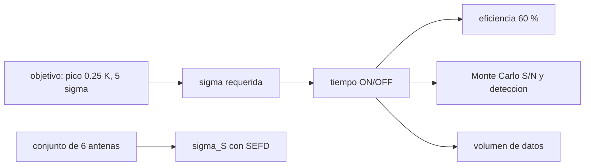

# B46-C20 — Proyecto de observación radioastronómica

<!-- nav:top -->
[🏠 Programa](../../../../README.md) · [📚 Bloque B46](../../../tronco-comun/B46-radioastronomia-e-interferometria.md) · [← Anterior: B46-C19 — Imágenes de radio y CLEAN](../B46-C19-imagenes-de-radio-y-clean/CLASE.md) · [Siguiente: B47-C01 — Ventajas de observación fuera de atmósfera →](../../../tronco-comun/B47-instrumentacion-y-observatorios-espaciales.md#b47-c01)
<!-- /nav -->

## 1. Ubicación, nivel y alcance

Clase 20 del bloque B46. Nivel N3. Un proyecto de observación convierte un objetivo científico en tiempo de telescopio. Aquí calculas el tiempo ON/OFF de una detección de HI de 5σ con un plato único, lo validas con un Monte Carlo (S/N medida y fracción de detección a 3σ), estimas la sensibilidad de un conjunto de 6 antenas y el volumen de datos. Usas todo el bloque: [B46-C05](../B46-C05-ganancia-y-temperatura-de-antena/CLASE.md), [B46-C06](../B46-C06-ruido-de-sistema-y-radiometria/CLASE.md), [B46-C11](../B46-C11-observacion-de-hidrogeno-a-21-centimetros/CLASE.md) y [B46-C16](../B46-C16-sintesis-de-apertura/CLASE.md). Todo el instrumento es ilustrativo.

## 2. Por qué esta clase existe

Un proyecto viable cuadra objetivo, sensibilidad, tiempo y datos. La decisión central: **¿cuánto tiempo de observación pide el objetivo y con qué margen?**

## 3. Lo que podrás hacer al terminar

1. Traducir un objetivo en una `σ` requerida.
2. Calcular el tiempo ON/OFF.
3. Añadir la eficiencia de observación.
4. Validar con Monte Carlo.
5. Estimar la sensibilidad de un conjunto.
6. Estimar el volumen de datos.

La evidencia es la **ficha del proyecto de observación** del ejercicio 12 (sección 20).

## 4. Con qué llegas y cómo comprobarlo

1. ¿Qué es una incertidumbre?
2. ¿Qué es una simulación Monte Carlo?
3. ¿Qué es una tabla de resultados?
4. ¿Qué es un valor ilustrativo?
5. ¿Qué es una verificación?

<details>
<summary>Ver respuestas</summary>

1. Un intervalo en que se espera el valor verdadero. 2. Repetir con números aleatorios de semilla fija. 3. Un resumen ordenado de cálculos. 4. Un valor propuesto para el ejemplo, no medido. 5. Comparar un cálculo con un caso independiente.
</details>

Con cuatro o cinco aciertos, sigue; si no, repasa los prerrequisitos.

## 5. Un caso de contexto y casos de referencia

Detectar con 5σ un pico de 0,25 K con canal de 2 km/s (`Δν = 9,476 kHz`) y `T_sys = 35 K` exige `σ = 50 mK`, `103,4 s` por estado, `206,8 s` ON+OFF y `345 s` de reloj con eficiencia del 60 %. El Monte Carlo da S/N `4,988` y `97,6 %` de detecciones sobre 3σ. Es el **ejemplo conductor**; todo es **ilustrativo**.

## 6. Vocabulario

El **objetivo científico** y el **criterio de detección** (5σ). El **presupuesto de sensibilidad**. La **conmutación en posición** ON/OFF. La **eficiencia de observación**. El **SEFD** `2kT_sys/A_e`. El **volumen de datos**.

## 7. Modelo mental: calcular el combustible de un viaje

Se parte del destino (la sensibilidad), se calcula el consumo (el tiempo) y se añade reserva (la eficiencia) antes de partir.



*Descripción textual:* el objetivo fija la sensibilidad, de la que salen el tiempo, la reserva y la verificación Monte Carlo.

Analogía: calcular el combustible de un viaje. Límite: ruido blanco gaussiano, sin interferencias ni líneas de base estructuradas.

## 8. La explicación, paso a paso

### 8.1 Presupuesto de un plato

Canal de 2 km/s: `Δν = 9,476 kHz`. Objetivo `σ = 0,25/5 = 50 mK`. Con ON/OFF, `σ = T_sys√(2/(Δν t))`, de modo que `t = 2(5·35/0,25)²/Δν = 103,4 s` por estado.

| concepto | valor |
|---|---|
| tiempo por estado | 103,4 s |
| ON + OFF | 206,8 s |
| con eficiencia 60 % | 344,7 s |

### 8.2 Monte Carlo

20 000 repeticiones: S/N media `4,988` (esperada 5), desviación `1,007` (1) y fracción sobre 3σ `0,9756` frente a `0,9772` analítica.

### 8.3 Conjunto de 6 antenas

`SEFD = 2kT_sys/A_e = 328 Jy`; con 15 líneas de base y 600 s, `σ_S = SEFD/√(N_bl Δν t) = 35,53 mJy` por canal de 2 km/s (una polarización).

### 8.4 Datos

4096 canales de 8 bytes cada segundo suman `2,83 GB` por día.

### 8.5 Lectura

El presupuesto es una cota inferior: no incluye interferencias, calibración de flujo ni pérdidas por forma de la línea. Un proyecto real pasa por la revisión técnica del observatorio.

## 9. Magnitudes, símbolos y unidades

| Símbolo | Qué es | Unidad | Valor / nota |
|---|---|---|---|
| `Δν` | ancho del canal | kHz | 9,476 |
| `σ` | sensibilidad requerida | mK | 50 |
| `t` | tiempo por estado | s | 103,4 |
| SEFD | flujo equivalente del sistema | Jy | 328 |

## 10. Convenciones y referencias

`k` y `c` de NIST CODATA 2022; frecuencia de 21 cm de Wikipedia (*Hydrogen line*); plato, `T_sys`, línea, eficiencia, conjunto y datos **ilustrativos**.

## 11. De dónde sale lo que afirmamos

| ID | Fuente | Localizador | Respalda | Estado |
|---|---|---|---|---|
| S1 | NIST, *Fundamental Physical Constants* (CODATA 2022) | https://physics.nist.gov/cuu/Constants/Table/allascii.txt | constantes citadas en la sección 9 | Consultada el 2026-11-09 |
| S2 | Wikipedia, *Hydrogen line* | https://en.wikipedia.org/wiki/Hydrogen_line | frecuencia 1420.405751768 MHz y longitud de onda de 21.106 cm | Solo la página, consultada el 2026-11-09 |

Límites: no se consultó ningún observatorio ni propuesta reales.

## 12. Cómo ver las cifras

| Magnitud | Valor |
|---|---|
| σ requerida | 50 mK |
| ON + OFF | 206,8 s |
| tiempo de reloj | 345 s |
| detección sobre 3σ | 97,6 % |

Descripción larga: la simulación confirma la S/N de diseño.

## 13. Ejemplo trabajado: el presupuesto

**Paso 1 · Canal.** `Δν = 9,476 kHz`.

**Paso 2 · Cociente.** `5·35/0,25 = 700`; `700² = 490 000`.

**Paso 3 · Tiempo.** `2·490 000/9476 = 103,4 s`.

**Paso 4 · Total.** `2·103,4 = 206,8 s`, y con 60 %, `345 s`.

## 14. Distintas formas de describir un proyecto

**Por objetivo:** σ requerida. **Por fórmula:** tiempo. **Por simulación:** S/N y detección. **Por conjunto:** SEFD.

## 15. Práctica guiada

**Ejercicio 1 · con los pasos indicados.** `σ` requerida para un pico de 0,3 K a 5σ. *Pasos:* `0,3/5`.

<details><summary>Solución comentada</summary>

`60 mK`.
</details>

**Ejercicio 2 · con una pista.** Tiempo por estado con ese objetivo, `T_sys = 35 K` y `Δν = 9,476 kHz`. *Pasos:* `2(T_sys/σ)²/Δν`.

<details><summary>Solución comentada</summary>

`71,8 s`.
</details>

**Ejercicio 3 · casi autónomo.** Tiempo de reloj con eficiencia 50 %. *Pasos:* `ON+OFF/0,5`.

<details><summary>Solución comentada</summary>

`287,3 s`.
</details>

## 16. Práctica autónoma, transferencia e integrador

**Ejercicio 4.** S/N media esperada del Monte Carlo.

<details><summary>Solución comentada</summary>

5.
</details>

**Ejercicio 5.** Fracción analítica sobre 3σ para S/N = 5.

<details><summary>Solución comentada</summary>

`0,9772`.
</details>

**Ejercicio 6.** `σ_S` del conjunto si se cuadruplica el tiempo.

<details><summary>Solución comentada</summary>

`17,77 mJy`.
</details>

**Ejercicio 7.** Volumen en una semana.

<details><summary>Solución comentada</summary>

`19,8 GB`.
</details>

**Ejercicio 8.** SEFD si `T_sys` sube de 35 a 70 K.

<details><summary>Solución comentada</summary>

`656 Jy`.
</details>

**Ejercicio 9 · transferencia.** **Transferencia.** ¿Por qué se pide 5σ y no 3σ?

<details><summary>Solución comentada</summary>

Para controlar las falsas detecciones.
</details>

**Ejercicio 10 · transferencia.** **Transferencia.** ¿Qué añade la interferencia a un proyecto real?

<details><summary>Solución comentada</summary>

Datos descartados y tiempo extra.
</details>

**Ejercicio 11 · transferencia.** **Transferencia.** ¿Por qué se calibra el flujo con una fuente conocida?

<details><summary>Solución comentada</summary>

Para fijar la escala en Jy.
</details>

**Ejercicio 12.** **Integrador.** Elabora tu *ficha del proyecto de observación*: objetivo, σ, tiempo con reserva, verificación Monte Carlo y volumen de datos.

<details><summary>Solución comentada</summary>

Secciones 8.1–8.4.
</details>

**Ejercicio 12 · integrador.** **Integrador.** Elabora tu *ficha del proyecto de observación*: objetivo, σ, tiempo con reserva, verificación Monte Carlo y volumen de datos.

<details><summary>Solución modelo</summary>

Secciones 8.1–8.4.
</details>

## 17. Laboratorio: presupuesto de observación

El script [proyecto.py](proyecto.py) calcula el tiempo y lo valida con Monte Carlo (**comprueba** la S/N media 5 y la fracción de detección).

**Datos:** constantes de NIST; instrumento **ilustrativo**; semilla `20261109`. **Predice antes de ejecutar:** ¿cuánto valdrá la S/N media? (≈5.) **Ejecución del 2026-11-09 (Python 3.12.9):**

```text
Python 3.12.9 (biblioteca estandar)
canal de 2 km/s = 9.476 kHz ; sigma objetivo = 50.0 mK (pico 250 mK / 5)
tiempo por estado = 103.4 s ; ON+OFF = 206.8 s ; con eficiencia 60 % = 344.7 s de reloj
Monte Carlo (20000): S/N media = 4.988 ; desviacion = 1.007 ; fraccion sobre 3 sigma = 0.9756 (analitica 0.9772)
SEFD = 328 Jy ; conjunto de 15 lineas de base, 600 s: sigma_S = 35.53 mJy por canal de 2 km/s
volumen de datos = 2.83 GB por dia (4096 canales, 8 bytes, 1 s)
Pruebas superadas.
```

```bash
python programa/clases/B46/B46-C20-proyecto-de-observacion-radioastronomica/proyecto.py
```

**Límites:** ruido blanco, sin interferencias.

## 18. Errores frecuentes y cómo corregirlos

**Olvidar que ON/OFF duplica el ruido.** Se corrige con 8.1.

**Olvidar la eficiencia.** Se corrige con 8.1.

**Tomar el presupuesto por definitivo.** Se corrige con 8.5.

**Presentar el instrumento como real.** Se corrige con la sección 10.

## 19. Cómo sabrás que vas bien

Tras la sección 8: ¿qué resultado esperabas y cuál obtuviste? Si dudas, repasa el ejemplo 13. Tras el laboratorio: ¿qué comprueba? (ver la sección 17).

## 20. Qué entregas y cómo se evalúa

El producto es tu **ficha del proyecto de observación** (ejercicio 12).

| Criterio | Inicial | En desarrollo | Logrado | Destacado |
|---|---|---|---|---|
| Conceptos | Los confunde | Parciales | conceptos de la clase | Explica los límites |
| Cálculo | Sin unidades | Con errores | Tablas completas | Calcula casos nuevos |
| Numérico | Sin comprobar | Un caso | Contraste con el análisis | Interpreta las diferencias |
| Fuentes | Sin fuente | Sin fecha | fuentes con fecha | Declara lo ilustrativo |
| Límites | No los nombra | Uno | Tres | Discute qué falta del modelo |

**Condiciones críticas (no se compensan con promedio):** rotular lo ilustrativo; no presentar el proyecto como una propuesta aceptada; citar solo lo consultado.

## 21. Ética, seguridad y límites

Clase educativa: los modelos son simplificados. Accesibilidad: tablas equivalentes a las gráficas, fórmulas en texto, ejercicios sin conexión.

## 22. Para cerrar y seguir

El objetivo exige 207 s ON+OFF y 345 s de reloj, y el Monte Carlo confirma una S/N de 4,99. Con esto se cierra el bloque.

**Glosario español–inglés.** presupuesto de sensibilidad · *sensitivity budget*; ON/OFF · *position switching*; eficiencia · *efficiency*; SEFD · *SEFD*.

**Continuidad.** cierra el bloque de radioastronomía e interferometría.

**Referencias:** ver sección 11.

<!-- nav:bottom -->
---

[← Anterior: B46-C19 — Imágenes de radio y CLEAN](../B46-C19-imagenes-de-radio-y-clean/CLASE.md) · [📚 Bloque B46](../../../tronco-comun/B46-radioastronomia-e-interferometria.md) · [Siguiente: B47-C01 — Ventajas de observación fuera de atmósfera →](../../../tronco-comun/B47-instrumentacion-y-observatorios-espaciales.md#b47-c01)
<!-- /nav -->
