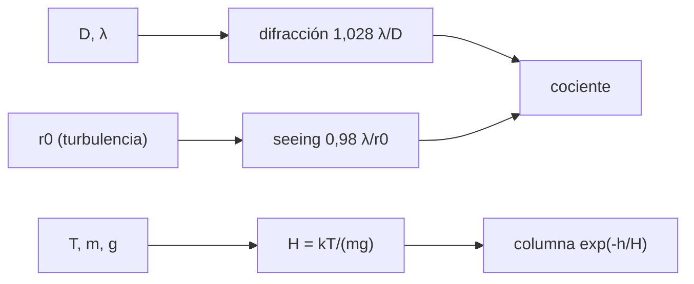

# B47-C01 — Ventajas de observación fuera de atmósfera

<!-- nav:top -->
[🏠 Programa](../../../../README.md) · [📚 Bloque B47](../../../tronco-comun/B47-instrumentacion-y-observatorios-espaciales.md) · [← Anterior: B46-C20 — Proyecto de observación radioastronómica](../../B46/B46-C20-proyecto-de-observacion-radioastronomica/CLASE.md) · [Siguiente: B47-C02 — Requisitos de instrumentos orbitales →](../B47-C02-requisitos-de-instrumentos-orbitales/CLASE.md)
<!-- /nav -->

## 1. Ubicación, nivel y alcance

Clase 1 del bloque B47. Nivel N3. Observar desde el espacio no es solo «ver sin nubes»: cambia la resolución alcanzable, la transmisión y la cantidad de aire que hay entre el objeto y el detector. Aquí comparas el límite de difracción con el *seeing*, calculas la altura de escala de una atmósfera isoterma y estimas qué fracción del aire queda por encima de una altura. Usas [B05](../../../tronco-comun/B05-fisica-fundamental-para-el-espacio.md) y [B42](../../../tronco-comun/B42-optica-fisica-y-optica-adaptativa.md). Todos los parámetros del telescopio y del cielo son ilustrativos.

## 2. Por qué esta clase existe

Un instrumento orbital cuesta mucho más que uno en tierra; la decisión de ir al espacio debe poder defenderse con números. La decisión central: **¿qué parte del rendimiento se pierde por la atmósfera y cuánto cuesta recuperarla?**

## 3. Lo que podrás hacer al terminar

1. Calcular el límite de difracción de una apertura circular.
2. Estimar el *seeing* y su dependencia con la longitud de onda.
3. Hallar la apertura a partir de la cual el *seeing* domina.
4. Obtener la altura de escala `H = kT/(mg)` con constantes de NIST.
5. Calcular la columna de aire por encima de una altura con dos vías.
6. Aplicar Beer-Lambert y reconocer los límites del modelo isotermo.

La evidencia es la **ficha de las ventajas orbitales** del ejercicio 12 (sección 20).

## 4. Con qué llegas y cómo comprobarlo

1. ¿Qué es una incertidumbre?
2. ¿Qué es una simulación Monte Carlo?
3. ¿Qué es una tabla de resultados?
4. ¿Qué es un valor ilustrativo?
5. ¿Qué es una verificación?

<details>
<summary>Ver respuestas</summary>

1. Un intervalo en que se espera el valor verdadero. 2. Repetir con números aleatorios de semilla fija. 3. Un resumen ordenado de cálculos. 4. Un valor propuesto para el ejemplo, no medido. 5. Comparar un cálculo con un caso independiente.
</details>

Con cuatro o cinco aciertos, sigue; si no, repasa los prerrequisitos.

## 5. Un caso de contexto y casos de referencia

Un telescopio de `D = 0,5 m` a `550 nm` tiene un FWHM de difracción de `0,233 arcsec`; con `r₀ = 0,1121 m` (ilustrativo) el *seeing* da `0,992 arcsec`, `4,25` veces peor. Es el **ejemplo conductor**; no mide ningún sitio real.

## 6. Vocabulario

La **resolución limitada por difracción** `1,028 λ/D`. El **parámetro de Fried** `r₀`. El **seeing**: ensanchamiento por turbulencia, `0,98 λ/r₀`. La **altura de escala** `H`. La **masa de aire** `sec z`. La **profundidad óptica** `τ`. La **transmisión** `exp(−τ sec z)`.

## 7. Modelo mental: una mirada a través del agua

Mirar una estrella desde el suelo es como mirar una moneda en el fondo de una piscina con olas: el tamaño del ojo (la apertura) deja de importar y manda el movimiento del agua (la turbulencia).



*Descripción textual:* la apertura y la longitud de onda dan el límite de difracción, la turbulencia da el *seeing*, y una atmósfera isoterma da la altura de escala y la columna de aire sobre cada altura.

Analogía: una mirada a través del agua. Límite: isoterma y plana.

## 8. La explicación, paso a paso

### 8.1 Resolución

| Magnitud | Valor |
|---|---|
| FWHM de difracción (`D = 0,5 m`, 550 nm) | 0,233 arcsec |
| `r₀` a 550 nm (desde 0,10 m a 500 nm) | 0,1121 m |
| FWHM de *seeing* | 0,992 arcsec |
| Cociente *seeing*/difracción | 4,25 |
| Apertura donde ambos coinciden | 0,1176 m |

Con `D > r₀` el *seeing* manda: una apertura mayor recoge más luz pero no resuelve más desde el suelo (sin óptica adaptativa, ver [B42](../../../tronco-comun/B42-optica-fisica-y-optica-adaptativa.md)).

### 8.2 Columna de aire

La altura de escala es `H = 7317,8 m`. La fracción de la masa de aire por encima de `h` es `exp(−h/H)`; la integral numérica de la densidad coincide:

| h (km) | exp(−h/H) | integral numérica |
|---|---|---|
| 10 | 2,5499 × 10⁻¹ | 2,5499 × 10⁻¹ |
| 36 | 7,3027 × 10⁻³ | 7,3027 × 10⁻³ |
| 100 | 1,1620 × 10⁻⁶ | 1,1620 × 10⁻⁶ |
| 400 | 1,8235 × 10⁻²⁴ | 1,8235 × 10⁻²⁴ |

### 8.3 Transmisión

Con `τ = 0,2` cenital (ilustrativo): `0,8187` en el cenit, `0,7938` a 30° y `0,6703` a 60°; en el espacio, `1`.

### 8.4 Lectura

A 36 km ya queda menos del 1 % del aire, pero para el ultravioleta y los rayos X hace falta estar muy por encima; la ventaja no es solo la transmisión sino también la ausencia de turbulencia y de emisión del cielo. Todo esto es un modelo isotermo, no la atmósfera real.

## 9. Magnitudes, símbolos y unidades

| Símbolo | Qué es | Unidad | Valor / nota |
|---|---|---|---|
| `D` | apertura | m | 0,5 (ilustrativo) |
| `λ` | longitud de onda | nm | 550 |
| `r₀` | parámetro de Fried | m | 0,1121 a 550 nm (ilustrativo) |
| `H` | altura de escala | m | 7317,8 |
| `k_B` | constante de Boltzmann | J/K | 1,380649 × 10⁻²³ (NIST) |
| `g₀` | gravedad estándar | m/s² | 9,80665 (NIST) |

## 10. Convenciones y referencias

SI; ángulos en arcsec (`1 arcsec = π/648000 rad`); atmósfera isoterma a 250 K y masa molar media 28,965 g/mol (valor estándar no consultado).

## 11. De dónde sale lo que afirmamos

| ID | Fuente | Localizador | Respalda | Estado |
|---|---|---|---|---|
| S1 | NIST, *Fundamental Physical Constants* (CODATA 2022) | https://physics.nist.gov/cuu/Constants/Table/allascii.txt | constantes citadas en la sección 9 | Consultada el 2026-11-09 |

Límites: solo la constante de Boltzmann, `u` y `g₀` provienen de NIST. `r₀`, `τ`, `T` y la masa molar son ilustrativos; no se consultó ninguna fuente sobre sitios astronómicos.

## 12. Cómo ver la comparación de resoluciones

| Telescopio | FWHM (arcsec) |
|---|---|
| Difracción, `D = 0,5 m` | 0,233 |
| Seeing, suelo | 0,992 |

Descripción larga: la turbulencia ensancha la imagen unas 4,3 veces.

## 13. Ejemplo trabajado: la apertura crítica

**Paso 1 · `r₀`.** `r₀(550) = 0,10 × (550/500)^1,2 = 0,1121 m`.

**Paso 2 · Igualar.** `1,028 λ/D = 0,98 λ/r₀` da `D = 1,028 r₀/0,98`.

**Paso 3 · Valor.** `D = 1,028 × 0,1121/0,98 = 0,1176 m`.

**Lectura.** Por encima de unos 12 cm el suelo no mejora el detalle.

## 14. Distintas formas de describir el resultado

**Por fórmula:** `1,028 λ/D`. **Por tabla:** columna de aire. **Por integral:** densidad. **Por código:** `ventajas_orbita.py`.

## 15. Práctica guiada

**Ejercicio 1 · con los pasos indicados.** FWHM de difracción para `D = 1 m` a 550 nm. *Pasos:* `1,028 λ/D` en arcsec.

<details><summary>Solución comentada</summary>

`0,1166 arcsec` (la mitad de la de 0,5 m).
</details>

**Ejercicio 2 · con una pista.** `r₀` a 700 nm si vale 0,10 m a 500 nm. *Pasos:* `0,10 × 1,4^1,2`.

<details><summary>Solución comentada</summary>

`0,1497 m`.
</details>

**Ejercicio 3 · casi autónomo.** Cociente de *seeing* entre 500 y 1000 nm (`FWHM ∝ λ^(−1/5)`).

<details><summary>Solución comentada</summary>

`0,871`: mejora un 12,9 % en el infrarrojo.
</details>

## 16. Práctica autónoma, transferencia e integrador

**Ejercicio 4.** `H` si la temperatura fuera 300 K (`H ∝ T`).

<details><summary>Solución comentada</summary>

`8781,3 m`.
</details>

**Ejercicio 5.** Fracción de aire por encima de 10 km.

<details><summary>Solución comentada</summary>

`0,2550`.
</details>

**Ejercicio 6.** Fracción por encima de 100 km.

<details><summary>Solución comentada</summary>

`1,162 × 10⁻⁶`.
</details>

**Ejercicio 7.** Transmisión a 60° de ángulo cenital con `τ = 0,2`.

<details><summary>Solución comentada</summary>

`0,6703`.
</details>

**Ejercicio 8.** Masa de aire a 60°.

<details><summary>Solución comentada</summary>

`sec 60° = 2`.
</details>

**Ejercicio 9 · transferencia.** **Transferencia.** Un compañero afirma que un telescopio de 8 m en tierra resuelve 16 veces mejor que uno de 0,5 m. Responde.

<details><summary>Solución comentada</summary>

Solo con óptica adaptativa; sin ella el *seeing* iguala ambas imágenes.
</details>

**Ejercicio 10 · transferencia.** **Transferencia.** ¿Por qué el ultravioleta lejano exige estar fuera de la atmósfera aunque `h = 36 km` deje menos del 1 % del aire?

<details><summary>Solución comentada</summary>

El ozono y el oxígeno absorben con coeficientes enormes; ese 1 % restante aún es opaco.
</details>

**Ejercicio 11 · transferencia.** **Transferencia.** ¿Qué cambia si la atmósfera real tiene un gradiente de temperatura?

<details><summary>Solución comentada</summary>

`H` varía con la altura y la fórmula `exp(−h/H)` deja de ser exacta.
</details>

**Ejercicio 12.** **Integrador.** Elabora tu *ficha de las ventajas orbitales*: resolución, apertura crítica, columna de aire y límites.

<details><summary>Solución comentada</summary>

Secciones 8.1–8.4.
</details>

**Ejercicio 12 · integrador.** **Integrador.** Elabora tu *ficha de las ventajas orbitales*: resolución, apertura crítica, columna de aire y límites.

<details><summary>Solución modelo</summary>

Secciones 8.1–8.4.
</details>

## 17. Laboratorio: ventajas de observar fuera de la atmósfera

El script [ventajas_orbita.py](ventajas_orbita.py) calcula difracción, *seeing*, altura de escala y columna de aire (**comprueba** la columna a `10⁻³` y la altura de escala).

**Datos:** constantes de NIST; apertura, `r₀`, `τ` y `T` **ilustrativos**. **Predice antes de ejecutar:** ¿cuántas veces peor es el suelo? (≈ 4.) **Ejecución del 2026-11-09 (Python 3.12.9):**

```text
Python 3.12.9 (biblioteca estandar)
difraccion D = 0.5 m a 550 nm: FWHM = 0.233 arcsec
seeing con r0(550 nm) = 0.1121 m: FWHM = 0.992 arcsec ; cociente seeing/difraccion = 4.25
apertura donde seeing = difraccion: D = 0.1176 m
altura de escala H = kT/(mg) = 7317.8 m
  h [km]      exp(-h/H)       integral
      10     2.5499e-01     2.5499e-01
      36     7.3027e-03     7.3027e-03
     100     1.1620e-06     1.1620e-06
     400     1.8235e-24     1.8235e-24
transmision cenital a z = 0 grados: 0.8187 (espacio: 1.0000)
transmision cenital a z = 30 grados: 0.7938 (espacio: 1.0000)
transmision cenital a z = 60 grados: 0.6703 (espacio: 1.0000)
Pruebas superadas.
```

```bash
python programa/clases/B47/B47-C01-ventajas-de-observacion-fuera-de-atmosfera/ventajas_orbita.py
```

**Límites:** atmósfera isoterma y plana; sitio sin identificar.

## 18. Errores frecuentes y cómo corregirlos

**Creer que más apertura siempre mejora la resolución en tierra.** Se corrige con 8.1.

**Usar `H` de una temperatura equivocada.** Se corrige con la sección 9.

**Tomar `r₀` como dato de un observatorio.** Se corrige con la sección 10.

**Olvidar que `FWHM` y primer cero no son lo mismo.** Se corrige con 8.1.

## 19. Cómo sabrás que vas bien

Tras la sección 8: ¿qué resultado esperabas y cuál obtuviste? Si dudas, repasa el ejemplo 13. Tras el laboratorio: ¿qué comprueba? (ver la sección 17).

## 20. Qué entregas y cómo se evalúa

El producto es tu **ficha de las ventajas orbitales** (ejercicio 12).

| Criterio | Inicial | En desarrollo | Logrado | Destacado |
|---|---|---|---|---|
| Conceptos | Los confunde | Parciales | conceptos de la clase | Explica los límites |
| Cálculo | Sin unidades | Con errores | Tablas completas | Calcula casos nuevos |
| Numérico | Sin comprobar | Un caso | Contraste con el análisis | Interpreta las diferencias |
| Fuentes | Sin fuente | Sin fecha | fuentes con fecha | Declara lo ilustrativo |
| Límites | No los nombra | Uno | Tres | Discute qué falta del modelo |

**Condiciones críticas (no se compensan con promedio):** rotular los parámetros como ilustrativos; no atribuir el *seeing* a un sitio real; citar solo lo consultado.

## 21. Ética, seguridad y límites

Clase educativa: los modelos son simplificados. Accesibilidad: tablas equivalentes a las gráficas, fórmulas en texto, ejercicios sin conexión.

## 22. Para cerrar y seguir

El suelo empeora la imagen 4,3 veces para una apertura de 0,5 m y la columna de aire cae a `1,16 × 10⁻⁶` a 100 km. Queda una pregunta: ¿qué exigencias concretas impone la órbita al instrumento?

**Glosario español–inglés.** difracción · *diffraction*; seeing · *seeing*; parámetro de Fried · *Fried parameter*; altura de escala · *scale height*; masa de aire · *airmass*.

**Continuidad.** [B47-C02](../B47-C02-requisitos-de-instrumentos-orbitales/CLASE.md) estudia los requisitos de instrumentos orbitales.

**Referencias:** ver sección 11.

<!-- nav:bottom -->
---

[← Anterior: B46-C20 — Proyecto de observación radioastronómica](../../B46/B46-C20-proyecto-de-observacion-radioastronomica/CLASE.md) · [📚 Bloque B47](../../../tronco-comun/B47-instrumentacion-y-observatorios-espaciales.md) · [Siguiente: B47-C02 — Requisitos de instrumentos orbitales →](../B47-C02-requisitos-de-instrumentos-orbitales/CLASE.md)
<!-- /nav -->
