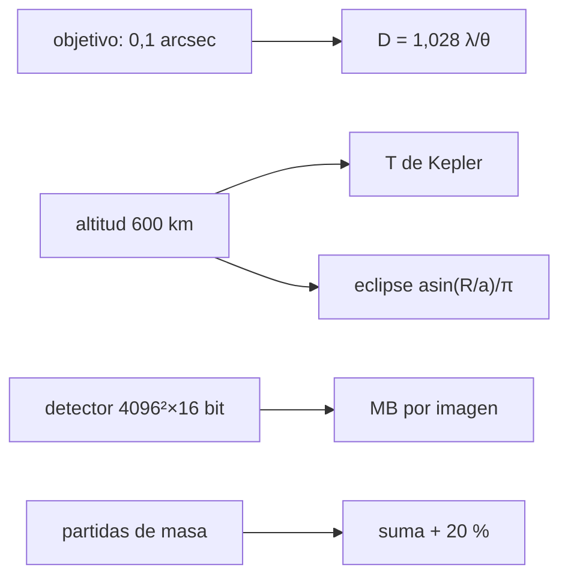

# B47-C02 — Requisitos de instrumentos orbitales

<!-- nav:top -->
<!-- /nav -->

## 1. Ubicación, nivel y alcance

Clase 2 del bloque B47. Nivel N3. Un requisito es una frase verificable que traduce un objetivo científico en una cifra. Aquí partes de una resolución objetivo, obtienes la apertura mínima, el período y la fracción de eclipse de la órbita, el volumen de datos de una imagen y un presupuesto de masa con margen. Usas [B05](../../../tronco-comun/B05-fisica-fundamental-para-el-espacio.md) y [B42](../../../tronco-comun/B42-optica-fisica-y-optica-adaptativa.md). Los números de la misión son ilustrativos.

## 2. Por qué esta clase existe

Un instrumento sin requisitos cuantificados no se puede diseñar ni verificar. La decisión central: **¿qué cifras de apertura, órbita, datos y masa se derivan de lo que se quiere medir?**

## 3. Lo que podrás hacer al terminar

1. Derivar una apertura mínima desde una resolución objetivo.
2. Calcular el período kepleriano y verificarlo con una integración.
3. Obtener la fracción de eclipse y los ciclos térmicos anuales.
4. Calcular el volumen de datos de una imagen.
5. Sumar un presupuesto de masa y aplicar un margen.
6. Reconocer qué requisitos faltan en un dimensionamiento preliminar.

La evidencia es la **ficha de requisitos del instrumento** del ejercicio 12 (sección 20).

## 4. Con qué llegas y cómo comprobarlo

1. ¿Qué es una incertidumbre?
2. ¿Qué es una simulación Monte Carlo?
3. ¿Qué es una tabla de resultados?
4. ¿Qué es un valor ilustrativo?
5. ¿Qué es una verificación?

<details>
<summary>Ver respuestas</summary>

1. Un intervalo en que se espera el valor verdadero. 2. Repetir con números aleatorios de semilla fija. 3. Un resumen ordenado de cálculos. 4. Un valor propuesto para el ejemplo, no medido. 5. Comparar un cálculo con un caso independiente.
</details>

Con cuatro o cinco aciertos, sigue; si no, repasa los prerrequisitos.

## 5. Un caso de contexto y casos de referencia

Para ver `0,1 arcsec` a 500 nm hace falta `D ≥ 1,060 m`. En una órbita circular a 600 km el período es `5801,2 s` (96,69 min), el eclipse dura `2129,24 min` por órbita y cada imagen de `4096 × 4096 × 16 bit` pesa `33,554 MB`. Es el **ejemplo conductor**; no es una misión real.

## 6. Vocabulario

El **requisito**: enunciado verificable. La **órbita circular**. El **período** `T = 2π√(a³/GM)`. El **eclipse**: tramo en la sombra de la Tierra. El **ciclo térmico**. El **presupuesto** (de masa, potencia, datos). El **margen**: reserva sobre el valor estimado.

## 7. Modelo mental: una receta con raciones

Es como cocinar para invitados: el número de platos (objetivo) fija cuánta harina, tiempo y horno necesitas, y se compra algo de más (margen) por si algo sale mal.



*Descripción textual:* un objetivo científico y una altitud producen cifras de apertura, período, eclipse, datos y masa que luego se verifican.

Analogía: una receta con raciones. Límite: dimensionamiento preliminar.

## 8. La explicación, paso a paso

### 8.1 Cifras derivadas

| Magnitud | Valor |
|---|---|
| Apertura mínima (0,1 arcsec, 500 nm) | 1,060 m |
| Semieje `a` | 6978,1 km |
| Período kepleriano | 5801,186 s |
| Período por RK4 | 5801,186 s |
| Semiángulo de la Tierra `ρ` | 66,066° |
| Fracción de eclipse (β = 0) | 0,3670 (2129,24 min) |
| Ciclos térmicos por año | 5440 |
| Una imagen | 33,554 MB |

### 8.2 Presupuesto de masa

| Partida | Masa (kg) |
|---|---|
| estructura | 38,0 |
| óptica | 22,0 |
| detector y electrónica | 9,5 |
| control de actitud | 14,0 |
| energía | 21,0 |
| comunicaciones | 6,5 |
| **Suma** | **111,0** |
| Con margen del 20 % | 133,2 |

### 8.3 Comprobación

El período integrado con Runge-Kutta de cuarto orden coincide con el kepleriano a `10⁻⁶` en valor relativo. La suma de masas es exacta.

### 8.4 Lectura

Casi 5440 ciclos térmicos al año fatigan estructura y pegamentos. La apertura de 1,06 m es solo el requisito por difracción: la masa, el coste y el apuntamiento (C10) aparecen después. Los valores de masa son del ejemplo, no de un instrumento.

## 9. Magnitudes, símbolos y unidades

| Símbolo | Qué es | Unidad | Valor / nota |
|---|---|---|---|
| `GM` | parámetro gravitacional de la Tierra | m³/s² | 3,986004 × 10¹⁴ (UAI) |
| `R` | radio ecuatorial | m | 6,3781 × 10⁶ (UAI) |
| `D` | apertura | m | 1,060 |
| `T` | período | s | 5801,2 |
| `ρ` | semiángulo de la Tierra | ° | 66,066 |

## 10. Convenciones y referencias

SI; órbita circular y Tierra esférica; resolución en arcsec; margen del 20 % como convención del ejemplo.

## 11. De dónde sale lo que afirmamos

| ID | Fuente | Localizador | Respalda | Estado |
|---|---|---|---|---|
| S1 | UAI, Resolución B3 de 2015 | https://arxiv.org/abs/1510.07674 | `GM` y radio ecuatorial de la Tierra | Consultada el 2026-11-09 |

Límites: solo `GM` y `R` provienen de la UAI. La resolución, la altitud, el detector, las masas y el margen son ilustrativos; no se consultó ningún estándar de ingeniería de sistemas.

## 12. Cómo ver los resultados

| Magnitud | Valor |
|---|---|
| `D` mínima | 1,060 m |
| Período | 5801,2 s |
| Eclipse | 2129,24 min |
| Masa con margen | 133,2 kg |

Descripción larga: la difracción fija la apertura y la órbita fija el tiempo en sombra.

## 13. Ejemplo trabajado: la apertura mínima

**Paso 1 · Resolución en radianes.** `0,1 arcsec = 4,848 × 10⁻⁷ rad`.

**Paso 2 · Fórmula.** `D = 1,028 λ/θ = 1,028 × 5 × 10⁻⁷/4,848 × 10⁻⁷`.

**Paso 3 · Valor.** `D = 1,060 m`.

**Lectura.** Con menos apertura la difracción impide el requisito.

## 14. Distintas formas de describir el resultado

**Por fórmula:** `D = 1,028 λ/θ`. **Por tabla:** presupuesto. **Por simulación:** RK4 de la órbita. **Por código:** `requisitos_instrumento.py`.

## 15. Práctica guiada

**Ejercicio 1 · con los pasos indicados.** Apertura para `θ = 0,2 arcsec`. *Pasos:* `D ∝ 1/θ`.

<details><summary>Solución comentada</summary>

`0,530 m`.
</details>

**Ejercicio 2 · con una pista.** Semieje a 600 km. *Pasos:* `R + h`.

<details><summary>Solución comentada</summary>

`6978,1 km`.
</details>

**Ejercicio 3 · casi autónomo.** Período en minutos.

<details><summary>Solución comentada</summary>

`96,69 min`.
</details>

## 16. Práctica autónoma, transferencia e integrador

**Ejercicio 4.** Ciclos térmicos por año.

<details><summary>Solución comentada</summary>

`5440`.
</details>

**Ejercicio 5.** Duración del eclipse.

<details><summary>Solución comentada</summary>

`2129,24 min`.
</details>

**Ejercicio 6.** Margen de masa añadido.

<details><summary>Solución comentada</summary>

`22,2 kg`.
</details>

**Ejercicio 7.** Peso de diez imágenes.

<details><summary>Solución comentada</summary>

`335,5 MB`.
</details>

**Ejercicio 8.** Fracción de la masa que es óptica.

<details><summary>Solución comentada</summary>

`22/111 = 19,8 %`.
</details>

**Ejercicio 9 · transferencia.** **Transferencia.** ¿Qué cambia si la órbita sube a 800 km?

<details><summary>Solución comentada</summary>

El período pasa a `100,87 min` y el eclipse a `34,83 %` (de `36,70 %`).
</details>

**Ejercicio 10 · transferencia.** **Transferencia.** Un compañero afirma que 1,06 m de apertura es el requisito del telescopio. Responde.

<details><summary>Solución comentada</summary>

Es solo el requisito por difracción; faltan apuntamiento, masa, coste y datos.
</details>

**Ejercicio 11 · transferencia.** **Transferencia.** ¿Por qué se aplica un margen del 20 % a la masa?

<details><summary>Solución comentada</summary>

Porque las partidas se estiman con incertidumbre y crecen en el desarrollo.
</details>

**Ejercicio 12.** **Integrador.** Elabora tu *ficha de requisitos del instrumento*: cuatro requisitos con cifra, método de verificación y límite del modelo.

<details><summary>Solución comentada</summary>

Secciones 8.1–8.4.
</details>

**Ejercicio 12 · integrador.** **Integrador.** Elabora tu *ficha de requisitos del instrumento*: cuatro requisitos con cifra, método de verificación y límite del modelo.

<details><summary>Solución modelo</summary>

Secciones 8.1–8.4.
</details>

## 17. Laboratorio: requisitos de un instrumento orbital

El script [requisitos_instrumento.py](requisitos_instrumento.py) calcula apertura, período (con RK4), eclipse, datos por imagen y masa con margen (**comprueba** el período a `10⁻⁶` y la suma de masas).

**Datos:** `GM` y radio de la UAI; el resto **ilustrativo**. **Predice antes de ejecutar:** ¿qué apertura hace falta? (≈ 1,06 m.) **Ejecución del 2026-11-09 (Python 3.12.9):**

```text
Python 3.12.9 (biblioteca estandar)
apertura minima para 0.1 arcsec a 500 nm: D = 1.060 m
a = 6978.1 km ; periodo kepleriano = 5801.186 s ; periodo numerico RK4 = 5801.186 s
semiangulo de la Tierra rho = 66.066 grados ; fraccion de eclipse (beta = 0) = 0.3670 (35.49 min)
ciclos termicos por anio = 5440
imagen de 4096 x 4096 x 16 bit = 268435456 bit = 33.554 MB
  estructura                 38.0 kg
  optica                     22.0 kg
  detector y electronica      9.5 kg
  control de actitud         14.0 kg
  energia                    21.0 kg
  comunicaciones              6.5 kg
suma = 111.0 kg ; con margen del 20 % = 133.2 kg
Pruebas superadas.
```

```bash
python programa/clases/B47/B47-C02-requisitos-de-instrumentos-orbitales/requisitos_instrumento.py
```

**Límites:** órbita circular, Tierra esférica, sin atmósfera residual.

## 18. Errores frecuentes y cómo corregirlos

**Dar la masa sin margen.** Se corrige con 8.2.

**Confundir `h` con el semieje.** Se corrige con el ejemplo 13.

**Tomar los requisitos como definitivos.** Se corrige con la sección 10.

**Olvidar la fracción de eclipse al estimar potencia.** Se corrige con 8.1.

## 19. Cómo sabrás que vas bien

Tras la sección 8: ¿qué resultado esperabas y cuál obtuviste? Si dudas, repasa el ejemplo 13. Tras el laboratorio: ¿qué comprueba? (ver la sección 17).

## 20. Qué entregas y cómo se evalúa

El producto es tu **ficha de requisitos del instrumento** (ejercicio 12).

| Criterio | Inicial | En desarrollo | Logrado | Destacado |
|---|---|---|---|---|
| Conceptos | Los confunde | Parciales | conceptos de la clase | Explica los límites |
| Cálculo | Sin unidades | Con errores | Tablas completas | Calcula casos nuevos |
| Numérico | Sin comprobar | Un caso | Contraste con el análisis | Interpreta las diferencias |
| Fuentes | Sin fuente | Sin fecha | fuentes con fecha | Declara lo ilustrativo |
| Límites | No los nombra | Uno | Tres | Discute qué falta del modelo |

**Condiciones críticas (no se compensan con promedio):** rotular lo ilustrativo; no presentar el modelo como diseño de una misión real; citar solo lo consultado.

## 21. Ética, seguridad y límites

Clase educativa: los modelos son simplificados. Accesibilidad: tablas equivalentes a las gráficas, fórmulas en texto, ejercicios sin conexión.

## 22. Para cerrar y seguir

La resolución objetivo pide `1,06 m` de apertura; la órbita de 600 km da `96,7 min` de período y `2129,2 min` de eclipse. Queda una pregunta: ¿cómo cambia el diseño según la banda observada?

**Glosario español–inglés.** requisito · *requirement*; margen · *margin*; presupuesto · *budget*; eclipse · *eclipse*; período orbital · *orbital period*.

**Continuidad.** [B47-C03](../B47-C03-telescopios-ultravioleta/CLASE.md) estudia los telescopios ultravioleta.

**Referencias:** ver sección 11.

<!-- nav:bottom -->
---

<!-- /nav -->
