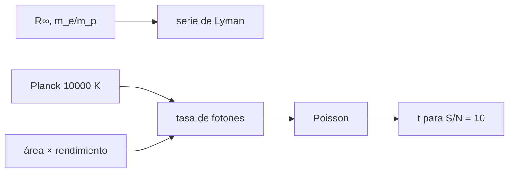

# B47-C03 — Telescopios ultravioleta

<!-- nav:top -->
[🏠 Programa](../../../../README.md) · [📚 Bloque B47](../../../tronco-comun/B47-instrumentacion-y-observatorios-espaciales.md) · [← Anterior: B47-C02 — Requisitos de instrumentos orbitales](../B47-C02-requisitos-de-instrumentos-orbitales/CLASE.md) · [Siguiente: B47-C04 — Telescopios infrarrojos →](../B47-C04-telescopios-infrarrojos/CLASE.md)
<!-- /nav -->

## 1. Ubicación, nivel y alcance

Clase 3 del bloque B47. Nivel N3. El ultravioleta lejano no atraviesa la atmósfera, de modo que su estudio es casi exclusivo del espacio. Aquí obtienes la serie de Lyman desde la constante de Rydberg, estimas cuántos fotones cuenta un telescopio ultravioleta de una estrella ilustrativa, y simulas la estadística de Poisson para decidir el tiempo de exposición. Usas [B05](../../../tronco-comun/B05-fisica-fundamental-para-el-espacio.md), [B31](../../../tronco-comun/B31-fisica-cuantica-nuclear-y-astroparticulas.md) y [B15](../../../tronco-comun/B15-senales-imagenes-y-estimacion-cientifica.md). La estrella y el instrumento son ilustrativos.

## 2. Por qué esta clase existe

En el ultravioleta cada fotón es valioso: las tasas son bajas y el ruido es de Poisson. La decisión central: **¿cuánto hay que exponer para llegar a una relación señal/ruido de 10?**

## 3. Lo que podrás hacer al terminar

1. Calcular las longitudes de onda de la serie de Lyman con `R_H`.
2. Convertir longitud de onda en energía de fotón.
3. Integrar una tasa de fotones con la regla de Simpson.
4. Simular la estadística de Poisson con semilla fija.
5. Despejar el tiempo de exposición para una relación señal/ruido.
6. Reconocer lo que omite el modelo de cuerpo negro.

La evidencia es la **ficha del telescopio ultravioleta** del ejercicio 12 (sección 20).

## 4. Con qué llegas y cómo comprobarlo

1. ¿Qué es una incertidumbre?
2. ¿Qué es una simulación Monte Carlo?
3. ¿Qué es una tabla de resultados?
4. ¿Qué es un valor ilustrativo?
5. ¿Qué es una verificación?

<details>
<summary>Ver respuestas</summary>

1. Un intervalo en que se espera el valor verdadero. 2. Repetir con números aleatorios de semilla fija. 3. Un resumen ordenado de cálculos. 4. Un valor propuesto para el ejemplo, no medido. 5. Comparar un cálculo con un caso independiente.
</details>

Con cuatro o cinco aciertos, sigue; si no, repasa los prerrequisitos.

## 5. Un caso de contexto y casos de referencia

La línea Lyman-α sale en `121,5684 nm` (10,1987 eV). Una estrella ilustrativa de `10000 K` y `1 R☉` a `1000 pc` da `107,80 fotones/s` con un telescopio de `0,25 m` de radio y rendimiento `0,15` en 150–170 nm; con fondo de `0,5 /s` basta `0,93 s` para `S/N = 10`. Es el **ejemplo conductor**; no es una estrella real.

## 6. Vocabulario

El **ultravioleta** (aquí 91–300 nm). La **serie de Lyman**: transiciones al nivel 1 del hidrógeno. La **constante de Rydberg**. El **fotón detectado**. La **estadística de Poisson**: media igual a varianza. La **relación señal/ruido** `S/N`. El **fondo** `B`.

## 7. Modelo mental: contar gotas de lluvia

Detectar fotones UV es como contar gotas que caen en un vaso: llegan al azar, y solo la raíz del número de gotas mide cuánto puedes fiarte del conteo.



*Descripción textual:* la física atómica fija las líneas, el cuerpo negro y la óptica fijan la tasa, y Poisson fija la incertidumbre y el tiempo de exposición.

Analogía: contar gotas de lluvia. Límite: cuerpo negro sin extinción.

## 8. La explicación, paso a paso

### 8.1 Serie de Lyman

Con `R_H = R∞/(1 + mₑ/mₚ) = 10 967 758,340 m⁻¹`:

| Transición | λ (nm) |
|---|---|
| 2 → 1 (Lyman-α) | 121,5684 |
| 3 → 1 (Lyman-β) | 102,5734 |
| 4 → 1 | 97,2548 |
| límite de la serie | 91,1763 |

La energía de Lyman-α es `10,1987 eV`.

### 8.2 Tasa de fotones

La integral de Simpson da `107,799573 fotones/s` con 2000 pasos y `107,799573` con 4000: coinciden a `10⁻⁹`.

### 8.3 Estadística de Poisson

En 100 s se esperan `10 779,96` cuentas. En 2000 simulaciones: media `10 781,69`, desviación `103,485`, frente a `√N = 103,827`. El tiempo para `S/N = 10` es `t = SN²(S + B)/S² = 0,93 s` y la simulación da `S/N = 9,68` (dispersión de 2000 pruebas).

### 8.4 Lectura

Con una estrella brillante bastan segundos; con una diez mil veces más débil harían falta horas. El modelo ignora la extinción interestelar, los bordes de los filtros y los detectores reales.

## 9. Magnitudes, símbolos y unidades

| Símbolo | Qué es | Unidad | Valor / nota |
|---|---|---|---|
| `R∞` | constante de Rydberg | m⁻¹ | 10 973 731,568157 (NIST) |
| `λ` | longitud de onda | nm | 121,5684 (Lyman-α) |
| `S` | tasa de señal | s⁻¹ | 107,80 |
| `B` | fondo | s⁻¹ | 0,5 (ilustrativo) |
| `h`, `c`, `k_B` | constantes | SI | NIST |

## 10. Convenciones y referencias

SI y nm; vacío; fotones por segundo; tasa por integral de `π B_λ (R/d)²` en 150–170 nm.

## 11. De dónde sale lo que afirmamos

| ID | Fuente | Localizador | Respalda | Estado |
|---|---|---|---|---|
| S1 | NIST, *Fundamental Physical Constants* (CODATA 2022) | https://physics.nist.gov/cuu/Constants/Table/allascii.txt | constantes citadas en la sección 9 | Consultada el 2026-11-09 |
| S2 | UAI, Resolución B3 de 2015 | https://arxiv.org/abs/1510.07674 | `R☉` | Consultada el 2026-11-09 |
| S3 | Martin et al., *The Galaxy Evolution Explorer: A Space Ultraviolet Survey Mission* | https://arxiv.org/abs/astro-ph/0411302 | GALEX observa en dos bandas: 1350–1750 Å y 1750–2750 Å (resumen) | Solo resumen, consultado el 2026-11-09 |

Límites: S3 es solo el resumen; no se usa ningún rendimiento de GALEX. La estrella, el área, el rendimiento y el fondo son ilustrativos.

## 12. Cómo ver los resultados

| Magnitud | Valor |
|---|---|
| Lyman-α | 121,5684 nm |
| Tasa de señal | 107,80 /s |
| Cuentas en 100 s | 10 780 |
| t para S/N = 10 | 0,93 s |

Descripción larga: la tasa fija la exposición.

## 13. Ejemplo trabajado: las líneas de Lyman

**Paso 1 · `R_H`.** `10 967 758,340 m⁻¹`.

**Paso 2 · Factor.** `1 − 1/4 = 0,75`.

**Paso 3 · Inverso.** `λ = 1/(0,75 R_H) = 121,5684 nm`.

**Lectura.** Cae en el ultravioleta lejano, absorbido por el aire.

## 14. Distintas formas de describir el resultado

**Por fórmula:** `1/λ = R_H(1 − 1/n²)`. **Por tabla:** Lyman. **Por simulación:** Poisson. **Por código:** `ultravioleta.py`.

## 15. Práctica guiada

**Ejercicio 1 · con los pasos indicados.** Lyman-β. *Pasos:* `1 − 1/9`.

<details><summary>Solución comentada</summary>

`102,5734 nm`.
</details>

**Ejercicio 2 · con una pista.** Límite de la serie.

<details><summary>Solución comentada</summary>

`91,1763 nm`.
</details>

**Ejercicio 3 · casi autónomo.** Energía de Lyman-α.

<details><summary>Solución comentada</summary>

`10,1987 eV`.
</details>

## 16. Práctica autónoma, transferencia e integrador

**Ejercicio 4.** Cuentas esperadas en 100 s.

<details><summary>Solución comentada</summary>

`10 780`.
</details>

**Ejercicio 5.** `√N` de ese conteo.

<details><summary>Solución comentada</summary>

`103,8`.
</details>

**Ejercicio 6.** Error relativo de Poisson con 100 cuentas.

<details><summary>Solución comentada</summary>

`1/√100 = 10 %`.
</details>

**Ejercicio 7.** Tiempo para `S/N = 10` sin fondo.

<details><summary>Solución comentada</summary>

`100/S = 0,93 s`.
</details>

**Ejercicio 8.** Tiempo para `S/N = 10` con `B = 0,5 /s`.

<details><summary>Solución comentada</summary>

`0,93 s`.
</details>

**Ejercicio 9 · transferencia.** **Transferencia.** ¿Por qué el aire impide observar Lyman-α desde el suelo?

<details><summary>Solución comentada</summary>

El oxígeno y el ozono absorben el ultravioleta lejano (modelo: C01).
</details>

**Ejercicio 10 · transferencia.** **Transferencia.** Un compañero afirma que la tasa calculada es la de una estrella real. Responde.

<details><summary>Solución comentada</summary>

Es una estrella ilustrativa: temperatura, radio y distancia fueron elegidos.
</details>

**Ejercicio 11 · transferencia.** **Transferencia.** ¿Qué pasa con el tiempo de exposición si la estrella es 100 veces más débil?

<details><summary>Solución comentada</summary>

`t ∝ 1/S` sin fondo: 100 veces más, y más aún si domina el fondo.
</details>

**Ejercicio 12.** **Integrador.** Elabora tu *ficha del telescopio ultravioleta*: líneas, tasa, tiempo de exposición y límites.

<details><summary>Solución comentada</summary>

Secciones 8.1–8.4.
</details>

**Ejercicio 12 · integrador.** **Integrador.** Elabora tu *ficha del telescopio ultravioleta*: líneas, tasa, tiempo de exposición y límites.

<details><summary>Solución modelo</summary>

Secciones 8.1–8.4.
</details>

## 17. Laboratorio: tasa de fotones y exposición en el ultravioleta

El script [ultravioleta.py](ultravioleta.py) calcula Lyman, integra la tasa y simula Poisson (**comprueba** Simpson a `10⁻⁹`, la media a 1 % y la desviación a 5 %).

**Datos:** constantes de NIST y `R☉` de la UAI; estrella e instrumento **ilustrativos**. **Predice antes de ejecutar:** ¿cuánto hay que exponer? (≈ 1 s.) **Ejecución del 2026-11-09 (Python 3.12.9):**

```text
Python 3.12.9 (biblioteca estandar)
R_H = 10967758.340 1/m
Lyman n=2->1: 121.5684 nm
Lyman n=3->1: 102.5734 nm
Lyman n=4->1: 97.2548 nm
limite de la serie: 91.1763 nm ; energia de Lyman-alfa = 10.1987 eV
tasa de fotones detectados (2000 pasos) = 107.799573 /s ; (4000 pasos) = 107.799573 /s
esperado en 100 s: 10779.96 ; Monte Carlo: media = 10781.69, desviacion = 103.485 (sqrt = 103.827)
tiempo para S/N = 10 con fondo 0.5 /s: t = 0.93 s ; S/N simulada = 9.68
Pruebas superadas.
```

```bash
python programa/clases/B47/B47-C03-telescopios-ultravioleta/ultravioleta.py
```

**Límites:** cuerpo negro, sin extinción, rendimiento plano.

## 18. Errores frecuentes y cómo corregirlos

**Confundir Lyman-α con Hα.** Se corrige con 8.1.

**Olvidar el fondo en el tiempo de exposición.** Se corrige con el ejemplo 13.

**Tomar la estrella como real.** Se corrige con la sección 10.

**Usar la aproximación normal con pocas cuentas.** Se corrige con 8.3.

## 19. Cómo sabrás que vas bien

Tras la sección 8: ¿qué resultado esperabas y cuál obtuviste? Si dudas, repasa el ejemplo 13. Tras el laboratorio: ¿qué comprueba? (ver la sección 17).

## 20. Qué entregas y cómo se evalúa

El producto es tu **ficha del telescopio ultravioleta** (ejercicio 12).

| Criterio | Inicial | En desarrollo | Logrado | Destacado |
|---|---|---|---|---|
| Conceptos | Los confunde | Parciales | conceptos de la clase | Explica los límites |
| Cálculo | Sin unidades | Con errores | Tablas completas | Calcula casos nuevos |
| Numérico | Sin comprobar | Un caso | Contraste con el análisis | Interpreta las diferencias |
| Fuentes | Sin fuente | Sin fecha | fuentes con fecha | Declara lo ilustrativo |
| Límites | No los nombra | Uno | Tres | Discute qué falta del modelo |

**Condiciones críticas (no se compensan con promedio):** rotular lo ilustrativo; no presentar el modelo como diseño de una misión real; citar solo lo consultado.

## 21. Ética, seguridad y límites

Clase educativa: los modelos son simplificados. Accesibilidad: tablas equivalentes a las gráficas, fórmulas en texto, ejercicios sin conexión.

## 22. Para cerrar y seguir

Lyman-α está en `121,57 nm` y una estrella ilustrativa exige `0,9 s` para `S/N = 10`. Queda una pregunta: ¿qué cambia al pasar al infrarrojo, donde el telescopio mismo emite?

**Glosario español–inglés.** ultravioleta · *ultraviolet*; serie de Lyman · *Lyman series*; relación señal/ruido · *signal-to-noise ratio*; fondo · *background*; exposición · *exposure*.

**Continuidad.** [B47-C04](../B47-C04-telescopios-infrarrojos/CLASE.md) estudia los telescopios infrarrojos.

**Referencias:** ver sección 11.

<!-- nav:bottom -->
---

[← Anterior: B47-C02 — Requisitos de instrumentos orbitales](../B47-C02-requisitos-de-instrumentos-orbitales/CLASE.md) · [📚 Bloque B47](../../../tronco-comun/B47-instrumentacion-y-observatorios-espaciales.md) · [Siguiente: B47-C04 — Telescopios infrarrojos →](../B47-C04-telescopios-infrarrojos/CLASE.md)
<!-- /nav -->
