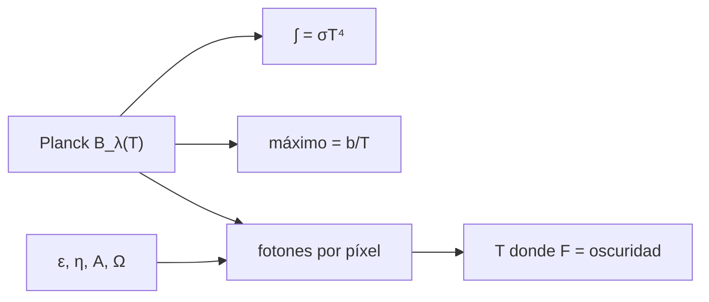

# B47-C04 — Telescopios infrarrojos

<!-- nav:top -->
<!-- /nav -->

## 1. Ubicación, nivel y alcance

Clase 4 del bloque B47. Nivel N3. En el infrarrojo térmico el propio telescopio brilla: un espejo a 290 K emite justo donde se quiere observar. Aquí verificas la ley de Planck, el desplazamiento de Wien y calculas el fondo térmico por píxel para varias temperaturas hasta hallar la temperatura de operación. Usas [B05](../../../tronco-comun/B05-fisica-fundamental-para-el-espacio.md) y [B42](../../../tronco-comun/B42-optica-fisica-y-optica-adaptativa.md). Los parámetros del instrumento son ilustrativos.

## 2. Por qué esta clase existe

Enfriar un telescopio cuesta masa, potencia y complejidad. La decisión central: **¿a qué temperatura el fondo propio deja de dominar sobre el detector?**

## 3. Lo que podrás hacer al terminar

1. Integrar la ley de Planck y compararla con `σT⁴`.
2. Hallar el máximo de `B_λ` y compararlo con la ley de Wien.
3. Calcular la tasa de fotones térmicos por píxel.
4. Resolver por bisección la temperatura de operación.
5. Relacionar enfriamiento con la banda observada.
6. Reconocer lo que omite el cuerpo gris.

La evidencia es la **ficha del telescopio infrarrojo** del ejercicio 12 (sección 20).

## 4. Con qué llegas y cómo comprobarlo

1. ¿Qué es una incertidumbre?
2. ¿Qué es una simulación Monte Carlo?
3. ¿Qué es una tabla de resultados?
4. ¿Qué es un valor ilustrativo?
5. ¿Qué es una verificación?

<details>
<summary>Ver respuestas</summary>

1. Un intervalo en que se espera el valor verdadero. 2. Repetir con números aleatorios de semilla fija. 3. Un resumen ordenado de cálculos. 4. Un valor propuesto para el ejemplo, no medido. 5. Comparar un cálculo con un caso independiente.
</details>

Con cuatro o cinco aciertos, sigue; si no, repasa los prerrequisitos.

## 5. Un caso de contexto y casos de referencia

Un telescopio ilustrativo con emisividad `0,05` aporta `3,872 × 10⁶ fotones/s` por píxel a 290 K en 9–11 µm, `1,096 × 10¹` a 80 K y `4,248 × 10⁻⁷` a 40 K; el fondo iguala `1 e⁻/s` a `70,27 K`. Es el **ejemplo conductor**; no es un instrumento real.

## 6. Vocabulario

La **ley de Planck** `B_λ(T)`. La **ley de Wien**: `λ_max T = b`. La **ley de Stefan-Boltzmann**. La **emisividad** `ε`. El **fondo térmico**. La **corriente de oscuridad**. El **cuerpo gris**.

## 7. Modelo mental: una estufa en el cuarto oscuro

Es como intentar ver una vela con una estufa encendida detrás de la lente: mientras la estufa brille en tu color, no importa cuán buena sea la cámara.



*Descripción textual:* la ley de Planck se verifica con dos relaciones y se usa para el fondo térmico y la temperatura de operación.

Analogía: una estufa en el cuarto oscuro. Límite: cuerpo gris.

## 8. La explicación, paso a paso

### 8.1 Verificaciones de la ley de Planck

`σ` obtenida desde `h`, `c` y `k_B` es `5,670374419 × 10⁻⁸ W m⁻² K⁻⁴`, igual a la de NIST.

| T (K) | ∫ π B_λ dλ | σ T⁴ |
|---|---|---|
| 3 | 4,593003 × 10⁻⁶ | 4,593003 × 10⁻⁶ |
| 40 | 1,451616 × 10⁻¹ | 1,451616 × 10⁻¹ |
| 290 | 4,010548 × 10² | 4,010548 × 10² |
| 5772 | 6,293859 × 10⁷ | 6,293859 × 10⁷ |

El máximo de `B_λ` está en `9,9923 µm` a 290 K, `36,2221 µm` a 80 K y `72,4443 µm` a 40 K: igual a `b/T` (a `10⁻⁵`).

### 8.2 Fondo térmico por píxel (9–11 µm)

| T (K) | Fotones/s por píxel |
|---|---|
| 290 | 3,8722 × 10⁶ |
| 150 | 3,8798 × 10⁴ |
| 80 | 1,0956 × 10¹ |
| 40 | 4,2482 × 10⁻⁷ |

El fondo iguala una corriente de oscuridad de `1 e⁻/s` a `70,27 K`.

### 8.3 Lectura

Pasar de 290 K a 80 K reduce el fondo en un factor `3,53 × 10⁵`. Un resumen de JWST describe un observatorio de 6,6 m que opera a 50 K entre 0,6 y 29 µm; las cifras del laboratorio no pretenden representarlo.

### 8.4 Límites

Cuerpo gris con emisividad constante, sin fondo zodiacal ni emisión del cielo residual.

## 9. Magnitudes, símbolos y unidades

| Símbolo | Qué es | Unidad | Valor / nota |
|---|---|---|---|
| `B_λ` | radiancia espectral | W m⁻³ sr⁻¹ | ver 8.1 |
| `σ` | Stefan-Boltzmann | W m⁻² K⁻⁴ | 5,670374419 × 10⁻⁸ (NIST) |
| `b` | constante de Wien | m K | 2,897771955 × 10⁻³ (NIST) |
| `ε` | emisividad | — | 0,05 (ilustrativo) |
| `T` | temperatura | K | 70,27 (operación) |

## 10. Convenciones y referencias

SI; fotones por segundo por píxel de 0,1 arcsec; banda 9–11 µm; emisividad y rendimiento constantes.

## 11. De dónde sale lo que afirmamos

| ID | Fuente | Localizador | Respalda | Estado |
|---|---|---|---|---|
| S1 | NIST, *Fundamental Physical Constants* (CODATA 2022) | https://physics.nist.gov/cuu/Constants/Table/allascii.txt | constantes citadas en la sección 9 | Consultada el 2026-11-09 |
| S2 | Gardner et al., *The James Webb Space Telescope* | https://arxiv.org/abs/astro-ph/0606175 | observatorio de 6,6 m, 50 K, 0,6–29 µm con segmentos de berilio (resumen) | Solo resumen, consultado el 2026-11-09 |

Límites: S2 es solo el resumen: 6,6 m, 50 K y el intervalo de 0,6 a 29 µm. Ningún número del laboratorio proviene de JWST.

## 12. Cómo ver los resultados

| T (K) | Fotones/s por píxel |
|---|---|
| 290 | 3,872 × 10⁶ |
| 150 | 3,880 × 10⁴ |
| 80 | 1,096 × 10¹ |
| 40 | 4,248 × 10⁻⁷ |

Descripción larga: el fondo cae en seis órdenes de magnitud entre 290 y 40 K.

## 13. Ejemplo trabajado: el máximo de Planck

**Paso 1 · Constante.** `b = 2,897771955 × 10⁻³ m K`.

**Paso 2 · Temperatura.** `T = 290 K`.

**Paso 3 · Cociente.** `λ = b/T = 9,9923 µm`.

**Lectura.** El máximo cae en 10 µm: la banda del infrarrojo térmico.

## 14. Distintas formas de describir el resultado

**Por fórmula:** Planck. **Por integral:** `σT⁴`. **Por búsqueda:** máximo de `B_λ`. **Por código:** `infrarrojo.py`.

## 15. Práctica guiada

**Ejercicio 1 · con los pasos indicados.** `λ_max` a 80 K. *Pasos:* `b/T`.

<details><summary>Solución comentada</summary>

`36,2221 µm`.
</details>

**Ejercicio 2 · con una pista.** `σT⁴` a 290 K.

<details><summary>Solución comentada</summary>

`401,05 W/m²`.
</details>

**Ejercicio 3 · casi autónomo.** Cociente de fondo 290 K/80 K.

<details><summary>Solución comentada</summary>

`3,53 × 10⁵`.
</details>

## 16. Práctica autónoma, transferencia e integrador

**Ejercicio 4.** Cociente de `σT⁴` entre 290 K y 80 K.

<details><summary>Solución comentada</summary>

`(290/80)⁴ = 172,7`.
</details>

**Ejercicio 5.** ¿Fondo a 150 K frente a 80 K?

<details><summary>Solución comentada</summary>

`3541` veces mayor.
</details>

**Ejercicio 6.** Temperatura de equilibrio de operación.

<details><summary>Solución comentada</summary>

`70,27 K`.
</details>

**Ejercicio 7.** `λ_max` a 40 K.

<details><summary>Solución comentada</summary>

`72,44 µm`.
</details>

**Ejercicio 8.** Fotones/s a 40 K, orden de magnitud.

<details><summary>Solución comentada</summary>

`4,25 × 10⁻⁷`: despreciable.
</details>

**Ejercicio 9 · transferencia.** **Transferencia.** ¿Por qué el fondo térmico cae mucho más rápido que `σT⁴`?

<details><summary>Solución comentada</summary>

Porque la banda de 9–11 µm queda en la cola de Wien para temperaturas bajas.
</details>

**Ejercicio 10 · transferencia.** **Transferencia.** Un compañero afirma que 70 K es la temperatura de cualquier telescopio infrarrojo. Responde.

<details><summary>Solución comentada</summary>

Es un resultado de este ejemplo: depende de banda, emisividad, píxel y detector.
</details>

**Ejercicio 11 · transferencia.** **Transferencia.** ¿Qué cambia si la banda observada es 2–2,5 µm?

<details><summary>Solución comentada</summary>

El fondo térmico es mucho menor a la misma temperatura (cola de Wien) y se puede operar más caliente.
</details>

**Ejercicio 12.** **Integrador.** Elabora tu *ficha del telescopio infrarrojo*: verificaciones de Planck, fondo por temperatura y temperatura de operación.

<details><summary>Solución comentada</summary>

Secciones 8.1–8.4.
</details>

**Ejercicio 12 · integrador.** **Integrador.** Elabora tu *ficha del telescopio infrarrojo*: verificaciones de Planck, fondo por temperatura y temperatura de operación.

<details><summary>Solución modelo</summary>

Secciones 8.1–8.4.
</details>

## 17. Laboratorio: fondo térmico de un telescopio infrarrojo

El script [infrarrojo.py](infrarrojo.py) integra Planck, halla el máximo y calcula el fondo por píxel (**comprueba** `σ` a `10⁻⁶` y el pico a `10⁻⁵`).

**Datos:** constantes de NIST; emisividad, píxel, banda y oscuridad **ilustrativos**. **Predice antes de ejecutar:** ¿a qué temperatura el fondo iguala la oscuridad? (≈ 70 K.) **Ejecución del 2026-11-09 (Python 3.12.9):**

```text
Python 3.12.9 (biblioteca estandar)
sigma desde h, c, k_B = 5.670374419e-08 W m-2 K-4 ; NIST = 5.670374419e-08
   T [K]    integral pi*B        sigma T^4
       3     4.593003e-06     4.593003e-06
      40     1.451616e-01     1.451616e-01
     290     4.010548e+02     4.010548e+02
    5772     6.293859e+07     6.293859e+07
T = 40 K: maximo de B_lambda en 72.4443 um ; Wien b/T = 72.4443 um
T = 80 K: maximo de B_lambda en 36.2221 um ; Wien b/T = 36.2221 um
T = 290 K: maximo de B_lambda en 9.9923 um ; Wien b/T = 9.9923 um
fondo termico 9-11 um por pixel a 290 K: 3.8722e+06 fotones/s
fondo termico 9-11 um por pixel a 150 K: 3.8798e+04 fotones/s
fondo termico 9-11 um por pixel a 80 K: 1.0956e+01 fotones/s
fondo termico 9-11 um por pixel a 40 K: 4.2482e-07 fotones/s
temperatura donde el fondo iguala 1 e-/s: 70.27 K
Pruebas superadas.
```

```bash
python programa/clases/B47/B47-C04-telescopios-infrarrojos/infrarrojo.py
```

**Límites:** cuerpo gris, sin fondo zodiacal.

## 18. Errores frecuentes y cómo corregirlos

**Confundir `λ_max` de `B_λ` con el de `B_ν`.** Se corrige con 8.1.

**Suponer `ε = 1`.** Se corrige con la sección 9.

**Tomar los 70 K como universales.** Se corrige con la sección 10.

**Integrar en la banda equivocada.** Se corrige con 8.2.

## 19. Cómo sabrás que vas bien

Tras la sección 8: ¿qué resultado esperabas y cuál obtuviste? Si dudas, repasa el ejemplo 13. Tras el laboratorio: ¿qué comprueba? (ver la sección 17).

## 20. Qué entregas y cómo se evalúa

El producto es tu **ficha del telescopio infrarrojo** (ejercicio 12).

| Criterio | Inicial | En desarrollo | Logrado | Destacado |
|---|---|---|---|---|
| Conceptos | Los confunde | Parciales | conceptos de la clase | Explica los límites |
| Cálculo | Sin unidades | Con errores | Tablas completas | Calcula casos nuevos |
| Numérico | Sin comprobar | Un caso | Contraste con el análisis | Interpreta las diferencias |
| Fuentes | Sin fuente | Sin fecha | fuentes con fecha | Declara lo ilustrativo |
| Límites | No los nombra | Uno | Tres | Discute qué falta del modelo |

**Condiciones críticas (no se compensan con promedio):** rotular lo ilustrativo; no presentar el modelo como diseño de una misión real; citar solo lo consultado.

## 21. Ética, seguridad y límites

Clase educativa: los modelos son simplificados. Accesibilidad: tablas equivalentes a las gráficas, fórmulas en texto, ejercicios sin conexión.

## 22. Para cerrar y seguir

La integral de Planck reproduce `σT⁴` y el fondo del telescopio cae de `3,87 × 10⁶` a `4,25 × 10⁻⁷` fotones/s entre 290 y 40 K. Queda una pregunta: ¿cómo se enfoca la luz de longitudes de onda diez mil veces menores?

**Glosario español–inglés.** ley de Planck · *Planck's law*; ley de Wien · *Wien's law*; emisividad · *emissivity*; fondo térmico · *thermal background*; corriente de oscuridad · *dark current*.

**Continuidad.** [B47-C05](../B47-C05-instrumentos-de-rayos-x/CLASE.md) estudia los instrumentos de rayos X.

**Referencias:** ver sección 11.

<!-- nav:bottom -->
---

<!-- /nav -->
