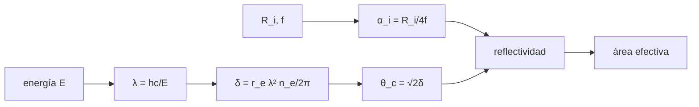

# B47-C05 — Instrumentos de rayos X

<!-- nav:top -->
<!-- /nav -->

## 1. Ubicación, nivel y alcance

Clase 5 del bloque B47. Nivel N3. Los rayos X no se enfocan con lentes ni con espejos de incidencia normal: solo se reflejan a ángulos rasantes. Aquí calculas el ángulo crítico con un modelo de electrones libres, la geometría de conchas Wolter I y el área efectiva por dos métodos. Usas [B05](../../../tronco-comun/B05-fisica-fundamental-para-el-espacio.md), [B31](../../../tronco-comun/B31-fisica-cuantica-nuclear-y-astroparticulas.md) y [B42](../../../tronco-comun/B42-optica-fisica-y-optica-adaptativa.md). Los parámetros de las conchas son ilustrativos.

## 2. Por qué esta clase existe

La reflexión rasante limita la energía y el área útil. La decisión central: **¿cuántas conchas y qué ángulos dan el área efectiva que se necesita a cada energía?**

## 3. Lo que podrás hacer al terminar

1. Calcular el decremento del índice `δ` y el ángulo crítico.
2. Relacionar el ángulo rasante con `R/(4f)`.
3. Calcular la reflectividad de Fresnel sin absorción.
4. Sumar el área efectiva de conchas anidadas.
5. Reproducir la suma con trazado de rayos Monte Carlo.
6. Reconocer los límites del modelo de electrones libres.

La evidencia es la **ficha del telescopio de rayos X** del ejercicio 12 (sección 20).

## 4. Con qué llegas y cómo comprobarlo

1. ¿Qué es una incertidumbre?
2. ¿Qué es una simulación Monte Carlo?
3. ¿Qué es una tabla de resultados?
4. ¿Qué es un valor ilustrativo?
5. ¿Qué es una verificación?

<details>
<summary>Ver respuestas</summary>

1. Un intervalo en que se espera el valor verdadero. 2. Repetir con números aleatorios de semilla fija. 3. Un resumen ordenado de cálculos. 4. Un valor propuesto para el ejemplo, no medido. 5. Comparar un cálculo con un caso independiente.
</details>

Con cuatro o cinco aciertos, sigue; si no, repasa los prerrequisitos.

## 5. Un caso de contexto y casos de referencia

A 1 keV el ángulo crítico del modelo vale `4,957°` y a 20 keV `0,248°`. Con 20 conchas de `0,8 m`, `f = 10 m` y radios de 0,15 a 0,45 m el área geométrica es `2124,2 cm²` y el área efectiva cae a `103,6 cm²` a 20 keV. Es el **ejemplo conductor**; no es un telescopio real.

## 6. Vocabulario

La **reflexión rasante**. El **ángulo crítico** `θ_c = √(2δ)`. La **geometría Wolter I**: parábola seguida de hipérbola. El **área efectiva**. La **concha anidada**. La **reflectividad de Fresnel**. El **modelo de electrones libres**.

## 7. Modelo mental: una piedra que rebota en el agua

Como una piedra plana que rebota si entra con ángulo muy bajo y se hunde si entra con ángulo alto, el fotón X solo se refleja si incide casi paralelo a la superficie.



*Descripción textual:* la energía fija `δ` y el ángulo crítico, la geometría fija el ángulo de cada concha, y la reflectividad pondera el área.

Analogía: una piedra que rebota en el agua. Límite: electrones libres, sin absorción.

## 8. La explicación, paso a paso

### 8.1 Ángulo crítico (iridio ilustrativo)

| E (keV) | λ (nm) | δ | θ_c √ (°) | θ_c acos (°) |
|---|---|---|---|---|
| 1 | 1,23984 | 3,7424 × 10⁻³ | 4,956959 | 4,958506 |
| 5 | 0,24797 | 1,4970 × 10⁻⁴ | 0,991392 | 0,991404 |
| 10 | 0,12398 | 3,7424 × 10⁻⁵ | 0,495696 | 0,495697 |
| 20 | 0,06199 | 9,3561 × 10⁻⁶ | 0,247848 | 0,247848 |

Las dos vías coinciden a `10⁻³` (la diferencia es de segundo orden en `δ`).

### 8.2 Conchas y área

Los ángulos rasantes van de `0,2149°` a `0,6501°`. El área geométrica es `2124,17 cm²`.

| E (keV) | A efectiva suma (cm²) | A efectiva Monte Carlo (cm²) |
|---|---|---|
| 1 | 2124,17 | 2143,46 |
| 5 | 2124,17 | 2143,46 |
| 10 | 1111,60 | 1119,35 |
| 20 | 103,63 | 103,20 |

### 8.3 Lectura

A 10 keV solo las conchas con `α < θ_c` reflejan bien y el área cae a la mitad; a 20 keV queda el 5 %. Por eso un telescopio de rayos X duros necesita ángulos menores, mayor distancia focal o multicapas. El Monte Carlo coincide con la suma a 2 %.

### 8.4 Límites

Se ignoran los bordes de absorción, la rugosidad, el vignetting y la dispersión; el modelo de electrones libres sobrestima `δ` a baja energía.

## 9. Magnitudes, símbolos y unidades

| Símbolo | Qué es | Unidad | Valor / nota |
|---|---|---|---|
| `δ` | decremento del índice | — | 3,742 × 10⁻⁵ a 10 keV |
| `θ_c` | ángulo crítico | ° | 0,496 a 10 keV |
| `α` | ángulo rasante | ° | 0,215 a 0,650 |
| `f` | distancia focal | m | 10 (ilustrativo) |
| `r_e` | radio clásico del electrón | m | 2,8179403205 × 10⁻¹⁵ (NIST) |

## 10. Convenciones y referencias

SI; energía en keV con `1 eV = 1,602176634 × 10⁻¹⁹ J`; material y geometría ilustrativos; incidencia en el plano meridional.

## 11. De dónde sale lo que afirmamos

| ID | Fuente | Localizador | Respalda | Estado |
|---|---|---|---|---|
| S1 | NIST, *Fundamental Physical Constants* (CODATA 2022) | https://physics.nist.gov/cuu/Constants/Table/allascii.txt | constantes citadas en la sección 9 | Consultada el 2026-11-09 |
| S2 | Harrison et al., *The Nuclear Spectroscopic Telescope Array (NuSTAR) Mission* | https://arxiv.org/abs/1301.7307 | banda de 3–79 keV, órbita de unos 600 km con inclinación de 6° (resumen) | Solo resumen, consultado el 2026-11-09 |
| S3 | Extracto de búsqueda sobre Chandra (arXiv astro-ph/0110308 y astro-ph/9912097) | https://arxiv.org/abs/astro-ph/9912097 | espejos de incidencia rasante anidados con distancia focal de 10 m (solo fragmento de buscador; no se leyó el resumen) | Fragmento de búsqueda, 2026-11-09 |

Límites: S2 es solo el resumen (3–79 keV, 600 km, 6°). S3 es un fragmento de buscador sobre espejos anidados de 10 m focales; no se leyó. Ninguna cifra del laboratorio proviene de esos instrumentos.

## 12. Cómo ver los resultados

| E (keV) | A efectiva (cm²) |
|---|---|
| 1 | 2124,2 |
| 5 | 2124,2 |
| 10 | 1111,6 |
| 20 | 103,6 |

Descripción larga: el área efectiva se mantiene hasta 5 keV y cae rápidamente a mayor energía.

## 13. Ejemplo trabajado: el ángulo crítico a 10 keV

**Paso 1 · Longitud de onda.** `λ = hc/E = 0,12398 nm`.

**Paso 2 · δ.** `δ = r_e λ² n_e/(2π) = 3,742 × 10⁻⁵`.

**Paso 3 · Ángulo.** `θ_c = √(2δ) = 0,496°`.

**Lectura.** Mayor que la concha interna (`0,215°`) y menor que la externa (`0,650°`).

## 14. Distintas formas de describir el resultado

**Por fórmula:** `θ_c = √2δ`. **Por tabla:** área por energía. **Por simulación:** rayos. **Por código:** `rayos_x.py`.

## 15. Práctica guiada

**Ejercicio 1 · con los pasos indicados.** `λ` a 5 keV. *Pasos:* `1,23984/E` nm.

<details><summary>Solución comentada</summary>

`0,24797 nm`.
</details>

**Ejercicio 2 · con una pista.** `θ_c` a 5 keV.

<details><summary>Solución comentada</summary>

`0,991°`.
</details>

**Ejercicio 3 · casi autónomo.** Cociente de `θ_c` entre 5 y 20 keV.

<details><summary>Solución comentada</summary>

`4,00` (`∝ 1/E`).
</details>

## 16. Práctica autónoma, transferencia e integrador

**Ejercicio 4.** `α` de la concha de 0,3 m, en grados. *Pasos:* `R/(4f)`.

<details><summary>Solución comentada</summary>

`0,4297°`.
</details>

**Ejercicio 5.** Área geométrica de las 20 conchas.

<details><summary>Solución comentada</summary>

`2124,2 cm²`.
</details>

**Ejercicio 6.** Fracción del área efectiva a 10 keV.

<details><summary>Solución comentada</summary>

`52,3 %`.
</details>

**Ejercicio 7.** Fracción a 20 keV.

<details><summary>Solución comentada</summary>

`4,9 %`.
</details>

**Ejercicio 8.** Diferencia Monte Carlo − suma a 20 keV.

<details><summary>Solución comentada</summary>

`-0,42 cm²`.
</details>

**Ejercicio 9 · transferencia.** **Transferencia.** ¿Por qué se anidan muchas conchas?

<details><summary>Solución comentada</summary>

Cada concha aporta un anillo de área pequeña; el área efectiva crece con el número de conchas.
</details>

**Ejercicio 10 · transferencia.** **Transferencia.** Un compañero afirma que el área calculada es la de un telescopio real. Responde.

<details><summary>Solución comentada</summary>

El modelo es ilustrativo, sin absorción ni rugosidad.
</details>

**Ejercicio 11 · transferencia.** **Transferencia.** ¿Qué haría falta para observar a 79 keV?

<details><summary>Solución comentada</summary>

Ángulos rasantes menores (más focal) o recubrimientos multicapa.
</details>

**Ejercicio 12.** **Integrador.** Elabora tu *ficha del telescopio de rayos X*: ángulo crítico, área efectiva por energía y límites.

<details><summary>Solución comentada</summary>

Secciones 8.1–8.4.
</details>

**Ejercicio 12 · integrador.** **Integrador.** Elabora tu *ficha del telescopio de rayos X*: ángulo crítico, área efectiva por energía y límites.

<details><summary>Solución modelo</summary>

Secciones 8.1–8.4.
</details>

## 17. Laboratorio: reflexión rasante y área efectiva

El script [rayos_x.py](rayos_x.py) calcula `θ_c`, reflectividad y área efectiva por suma y por Monte Carlo (**comprueba** `θ_c` a `10⁻³` y el área a 2 %).

**Datos:** constantes de NIST; recubrimiento y conchas **ilustrativos**. **Predice antes de ejecutar:** ¿cómo cae el área efectiva con la energía? (a la mitad a 10 keV.) **Ejecución del 2026-11-09 (Python 3.12.9):**

```text
Python 3.12.9 (biblioteca estandar)
alpha de la concha interna = 0.2149 grados ; externa = 0.6501 grados
area geometrica de las 20 conchas = 2124.17 cm2
 E [keV]  lambda [nm]        delta   theta_c [deg] sqrt   theta_c [deg] acos
       1      1.23984   3.7424e-03             4.956959             4.958506
       5      0.24797   1.4970e-04             0.991392             0.991404
      10      0.12398   3.7424e-05             0.495696             0.495697
      20      0.06199   9.3561e-06             0.247848             0.247848
 E [keV]   A_eff suma [cm2]   A_eff MC [cm2]
       1            2124.17          2143.46
       5            2124.17          2143.46
      10            1111.60          1119.35
      20             103.63           103.20
Pruebas superadas.
```

```bash
python programa/clases/B47/B47-C05-instrumentos-de-rayos-x/rayos_x.py
```

**Límites:** conchas cónicas, sin rugosidad ni absorción.

## 18. Errores frecuentes y cómo corregirlos

**Usar incidencia normal.** Se corrige con 8.1.

**Olvidar la doble reflexión.** Se corrige con 8.2.

**Tomar el iridio como dato medido.** Se corrige con la sección 10.

**Ignorar los bordes de absorción.** Se corrige con 8.4.

## 19. Cómo sabrás que vas bien

Tras la sección 8: ¿qué resultado esperabas y cuál obtuviste? Si dudas, repasa el ejemplo 13. Tras el laboratorio: ¿qué comprueba? (ver la sección 17).

## 20. Qué entregas y cómo se evalúa

El producto es tu **ficha del telescopio de rayos X** (ejercicio 12).

| Criterio | Inicial | En desarrollo | Logrado | Destacado |
|---|---|---|---|---|
| Conceptos | Los confunde | Parciales | conceptos de la clase | Explica los límites |
| Cálculo | Sin unidades | Con errores | Tablas completas | Calcula casos nuevos |
| Numérico | Sin comprobar | Un caso | Contraste con el análisis | Interpreta las diferencias |
| Fuentes | Sin fuente | Sin fecha | fuentes con fecha | Declara lo ilustrativo |
| Límites | No los nombra | Uno | Tres | Discute qué falta del modelo |

**Condiciones críticas (no se compensan con promedio):** rotular lo ilustrativo; no presentar el modelo como diseño de una misión real; citar solo lo consultado.

## 21. Ética, seguridad y límites

Clase educativa: los modelos son simplificados. Accesibilidad: tablas equivalentes a las gráficas, fórmulas en texto, ejercicios sin conexión.

## 22. Para cerrar y seguir

El ángulo crítico baja de `4,96°` a `0,25°` entre 1 y 20 keV y el área efectiva se reduce a `5 %`. Queda una pregunta: ¿qué ocurre cuando la energía es tan alta que ya no se puede enfocar?

**Glosario español–inglés.** reflexión rasante · *grazing reflection*; ángulo crítico · *critical angle*; área efectiva · *effective area*; concha anidada · *nested shell*; Wolter · *Wolter*.

**Continuidad.** [B47-C06](../B47-C06-instrumentos-de-rayos-gamma/CLASE.md) estudia los instrumentos de rayos gamma.

**Referencias:** ver sección 11.

<!-- nav:bottom -->
---

<!-- /nav -->
