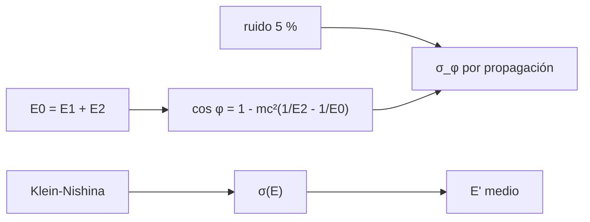

# B47-C06 — Instrumentos de rayos gamma

<!-- nav:top -->
[🏠 Programa](../../../../README.md) · [📚 Bloque B47](../../../tronco-comun/B47-instrumentacion-y-observatorios-espaciales.md) · [← Anterior: B47-C05 — Instrumentos de rayos X](../B47-C05-instrumentos-de-rayos-x/CLASE.md) · [Siguiente: B47-C07 — Coronógrafos espaciales →](../B47-C07-coronografos-espaciales/CLASE.md)
<!-- /nav -->

## 1. Ubicación, nivel y alcance

Clase 6 del bloque B47. Nivel N3. Los rayos gamma no se enfocan: se detectan por su interacción con la materia. Aquí calculas la sección eficaz de Klein-Nishina, verificas que a baja energía tiende a la de Thomson, ubicas el umbral de producción de pares y reconstruyes el ángulo de dispersión de un telescopio Compton, con su incertidumbre por la resolución en energía. Usas [B05](../../../tronco-comun/B05-fisica-fundamental-para-el-espacio.md) y [B31](../../../tronco-comun/B31-fisica-cuantica-nuclear-y-astroparticulas.md). Las energías y resoluciones son ilustrativas.

## 2. Por qué esta clase existe

Cada proceso (Compton, pares) domina a una energía distinta y fija el tipo de instrumento. La decisión central: **¿qué proceso usa el detector y con qué incertidumbre angular reconstruye la dirección?**

## 3. Lo que podrás hacer al terminar

1. Calcular `σ_KN` en forma cerrada y por integración numérica.
2. Verificar el límite de Thomson.
3. Ubicar el umbral de pares `2mₑc²`.
4. Muestrear la dispersión Compton por rechazo (semilla fija).
5. Reconstruir el ángulo a partir de dos depósitos de energía.
6. Propagar la resolución en energía a una incertidumbre angular.

La evidencia es la **ficha del instrumento de rayos gamma** del ejercicio 12 (sección 20).

## 4. Con qué llegas y cómo comprobarlo

1. ¿Qué es una incertidumbre?
2. ¿Qué es una simulación Monte Carlo?
3. ¿Qué es una tabla de resultados?
4. ¿Qué es un valor ilustrativo?
5. ¿Qué es una verificación?

<details>
<summary>Ver respuestas</summary>

1. Un intervalo en que se espera el valor verdadero. 2. Repetir con números aleatorios de semilla fija. 3. Un resumen ordenado de cálculos. 4. Un valor propuesto para el ejemplo, no medido. 5. Comparar un cálculo con un caso independiente.
</details>

Con cuatro o cinco aciertos, sigue; si no, repasa los prerrequisitos.

## 5. Un caso de contexto y casos de referencia

A 1 MeV la sección eficaz Compton es `2,112 × 10⁻²⁹ m²` (`0,3175` de Thomson) y un fotón dispersado conserva en promedio `56,00 %` de su energía. Con depósitos de `0,4946` y `0,5054 MeV` el ángulo reconstruido es `60,0°`; un ruido del 5 % lo ensancha en `2,65°`. Es el **ejemplo conductor**; no es un instrumento real.

## 6. Vocabulario

La **dispersión Compton**. La **sección eficaz de Klein-Nishina**. La **sección eficaz de Thomson**. La **producción de pares** `γ → e⁺e⁻` (umbral `2mₑc²`). El **telescopio Compton**: dispersor y absorbedor. El **anillo de eventos**. La **resolución angular de medida** (ARM).

## 7. Modelo mental: un choque de bolas de billar

Un fotón Compton es una bola de billar que golpea otra en reposo: la energía que pierde fija el ángulo del choque, y al medir las dos energías se despeja de dónde venía.



*Descripción textual:* la cinemática del choque permite reconstruir el ángulo, la sección eficaz decide cuánto ocurre y el ruido en energía fija la precisión angular.

Analogía: un choque de bolas de billar. Límite: electrón libre en reposo.

## 8. La explicación, paso a paso

### 8.1 Sección eficaz de Klein-Nishina

| E (MeV) | σ forma cerrada (m²) | σ integral numérica (m²) | σ/σ_T |
|---|---|---|---|
| 0,001 | 6,6266 × 10⁻²⁹ | 6,6266 × 10⁻²⁹ | 0,99611 |
| 0,1 | 4,9275 × 10⁻²⁹ | 4,9275 × 10⁻²⁹ | 0,74070 |
| 1 | 2,1121 × 10⁻²⁹ | 2,1121 × 10⁻²⁹ | 0,31749 |
| 10 | 5,0988 × 10⁻³⁰ | 5,0988 × 10⁻³⁰ | 0,07665 |

La forma cerrada y la integral coinciden a `10⁻⁶`. Para `k → 0` el cociente con Thomson es `0,999998`. El umbral de pares es `2mₑc² = 1,021998 MeV`.

### 8.2 Dispersión de 1 MeV

La energía media del fotón dispersado, `E'/E₀`, es `0,55996` por integración exacta y `0,56052` con 100 000 muestras (semilla 20261109).

### 8.3 Reconstrucción angular

Con `E₁ = 0,4946 MeV` y `E₂ = 0,5054 MeV`, `cos φ = 1 − mₑc²(1/E₂ − 1/(E₁+E₂))` da `φ = 60,000°`. Sin ruido el error es menor que `7,5 × 10⁻¹⁴ rad`. Con ruido del 5 % en cada depósito la dispersión de `φ` es `2,653°` por Monte Carlo y `2,627°` por propagación de errores.

### 8.4 Lectura

La resolución en energía es la causa principal del ARM. El modelo supone electrón libre en reposo: omite el efecto Doppler de los electrones ligados y la absorción incompleta.

## 9. Magnitudes, símbolos y unidades

| Símbolo | Qué es | Unidad | Valor / nota |
|---|---|---|---|
| `k` | `E/(mₑc²)` | — | 1,9570 a 1 MeV |
| `σ_KN` | sección eficaz Compton | m² | 2,112 × 10⁻²⁹ |
| `σ_T` | Thomson | m² | 6,6524587051 × 10⁻²⁹ (NIST) |
| `mₑc²` | energía del electrón | MeV | 0,51099895069 (NIST) |
| `φ` | ángulo de dispersión | ° | 60,0 |

## 10. Convenciones y referencias

SI y MeV; electrón libre; fotón no polarizado; la sección eficaz total incluye todos los ángulos.

## 11. De dónde sale lo que afirmamos

| ID | Fuente | Localizador | Respalda | Estado |
|---|---|---|---|---|
| S1 | NIST, *Fundamental Physical Constants* (CODATA 2022) | https://physics.nist.gov/cuu/Constants/Table/allascii.txt | constantes citadas en la sección 9 | Consultada el 2026-11-09 |
| S2 | Atwood et al., *The Large Area Telescope on the Fermi Gamma-ray Space Telescope Mission* | https://arxiv.org/abs/0902.1089 | telescopio de conversión de pares de menos de 20 MeV a más de 300 GeV y campo de 2,4 sr (resumen) | Solo resumen, consultado el 2026-11-09 |

Límites: S2 es solo el resumen del Fermi LAT (de menos de 20 MeV a más de 300 GeV; conversión de pares): no se usa ninguna cifra de ese instrumento. La fórmula de Klein-Nishina es la del libro, no se contrastó con un artículo.

## 12. Cómo ver los resultados

| Magnitud | Valor |
|---|---|
| σ(1 MeV) | 2,112 × 10⁻²⁹ m² |
| `E'/E₀` medio | 0,5600 |
| `φ` | 60,0° |
| σ_φ (5 %) | 2,63° |

Descripción larga: el ruido en energía fija la precisión angular.

## 13. Ejemplo trabajado: la energía del fotón dispersado a 180°

**Paso 1 · `k`.** `k = 1/0,511 = 1,9570`.

**Paso 2 · Fórmula.** `E' = E₀/(1 + k(1 − cos θ))`; con `θ = 180°`, `E' = E₀/(1 + 2k)`.

**Paso 3 · Valor.** `E' = 1/4,914 = 0,2035 MeV`.

**Lectura.** El electrón recibe `0,7965 MeV`: la máxima energía depositable.

## 14. Distintas formas de describir el resultado

**Por fórmula:** `cos φ = 1 − mₑc²(1/E₂ − 1/E₀)`. **Por tabla:** σ(E). **Por simulación:** rechazo. **Por código:** `rayos_gamma.py`.

## 15. Práctica guiada

**Ejercicio 1 · con los pasos indicados.** `k` a 1 MeV. *Pasos:* `E/mₑc²`.

<details><summary>Solución comentada</summary>

`1,9570`.
</details>

**Ejercicio 2 · con una pista.** Umbral de pares.

<details><summary>Solución comentada</summary>

`1,0220 MeV`.
</details>

**Ejercicio 3 · casi autónomo.** Energía del fotón retrodispersado a 1 MeV.

<details><summary>Solución comentada</summary>

`0,2035 MeV`.
</details>

## 16. Práctica autónoma, transferencia e integrador

**Ejercicio 4.** `σ(1 MeV)/σ_T`.

<details><summary>Solución comentada</summary>

`0,3175`.
</details>

**Ejercicio 5.** `σ(0,1 MeV)` en barns (`1 b = 10⁻²⁸ m²`).

<details><summary>Solución comentada</summary>

`0,4927 b`.
</details>

**Ejercicio 6.** Fracción media de energía conservada a 1 MeV.

<details><summary>Solución comentada</summary>

`0,5600`.
</details>

**Ejercicio 7.** `E₁ + E₂`.

<details><summary>Solución comentada</summary>

`1 MeV`, la energía incidente.
</details>

**Ejercicio 8.** Dispersión angular con ruido del 5 %.

<details><summary>Solución comentada</summary>

`2,63°`.
</details>

**Ejercicio 9 · transferencia.** **Transferencia.** ¿Por qué el efecto Compton pierde peso frente a los pares al subir la energía?

<details><summary>Solución comentada</summary>

Porque `σ_KN` cae como `ln E/E`, mientras la producción de pares crece y se satura.
</details>

**Ejercicio 10 · transferencia.** **Transferencia.** Un compañero afirma que el ARM calculado es el de un instrumento real. Responde.

<details><summary>Solución comentada</summary>

Es un modelo con ruido ilustrativo del 5 %.
</details>

**Ejercicio 11 · transferencia.** **Transferencia.** ¿Qué pasa con el ARM si la resolución en energía mejora al 2,5 %?

<details><summary>Solución comentada</summary>

Se reduce aproximadamente a la mitad (propagación lineal).
</details>

**Ejercicio 12.** **Integrador.** Elabora tu *ficha del instrumento de rayos gamma*: sección eficaz, umbral, reconstrucción y límites.

<details><summary>Solución comentada</summary>

Secciones 8.1–8.4.
</details>

**Ejercicio 12 · integrador.** **Integrador.** Elabora tu *ficha del instrumento de rayos gamma*: sección eficaz, umbral, reconstrucción y límites.

<details><summary>Solución modelo</summary>

Secciones 8.1–8.4.
</details>

## 17. Laboratorio: Compton y reconstrucción angular

El script [rayos_gamma.py](rayos_gamma.py) integra `σ_KN`, muestrea la dispersión y reconstruye el ángulo (**comprueba** `σ` a `10⁻⁶`, la media a 0,5 % y el ARM a 5 %).

**Datos:** constantes de NIST; energías y ruido **ilustrativos**. **Predice antes de ejecutar:** ¿qué incertidumbre angular da el 5 % de ruido? (≈ 2,6°.) **Ejecución del 2026-11-09 (Python 3.12.9):**

```text
Python 3.12.9 (biblioteca estandar)
umbral de pares 2 m_e c^2 = 1.021998 MeV
 E [MeV]   sigma cerrada [m2]  sigma numerica [m2]  sigma/sigma_T
   0.001         6.626553e-29         6.626553e-29        0.99611
   0.100         4.927485e-29         4.927485e-29        0.74070
   1.000         2.112079e-29         2.112079e-29        0.31749
  10.000         5.098842e-30         5.098842e-30        0.07665
limite k -> 0: sigma_KN/sigma_T = 0.999998
energia media dispersada / E0 (1 MeV): exacta = 0.55996 ; Monte Carlo = 0.56052
error maximo |phi_reconstruido - phi_verdadero| sin ruido = 7.51e-14 rad
phi = 60.000 grados con E1 = 0.4946 MeV y E2 = 0.5054 MeV
dispersion de phi con 5 % de ruido: Monte Carlo = 2.653 grados ; propagacion = 2.627 grados
Pruebas superadas.
```

```bash
python programa/clases/B47/B47-C06-instrumentos-de-rayos-gamma/rayos_gamma.py
```

**Límites:** electrón libre en reposo, sin Doppler.

## 18. Errores frecuentes y cómo corregirlos

**Confundir `E₁` y `E₂`.** Se corrige con 8.3.

**Olvidar que el umbral de pares es `2mₑc²`.** Se corrige con 8.1.

**Tomar el 5 % como dato de un instrumento.** Se corrige con la sección 10.

**Usar Thomson a 1 MeV.** Se corrige con 8.1.

## 19. Cómo sabrás que vas bien

Tras la sección 8: ¿qué resultado esperabas y cuál obtuviste? Si dudas, repasa el ejemplo 13. Tras el laboratorio: ¿qué comprueba? (ver la sección 17).

## 20. Qué entregas y cómo se evalúa

El producto es tu **ficha del instrumento de rayos gamma** (ejercicio 12).

| Criterio | Inicial | En desarrollo | Logrado | Destacado |
|---|---|---|---|---|
| Conceptos | Los confunde | Parciales | conceptos de la clase | Explica los límites |
| Cálculo | Sin unidades | Con errores | Tablas completas | Calcula casos nuevos |
| Numérico | Sin comprobar | Un caso | Contraste con el análisis | Interpreta las diferencias |
| Fuentes | Sin fuente | Sin fecha | fuentes con fecha | Declara lo ilustrativo |
| Límites | No los nombra | Uno | Tres | Discute qué falta del modelo |

**Condiciones críticas (no se compensan con promedio):** rotular lo ilustrativo; no presentar el modelo como diseño de una misión real; citar solo lo consultado.

## 21. Ética, seguridad y límites

Clase educativa: los modelos son simplificados. Accesibilidad: tablas equivalentes a las gráficas, fórmulas en texto, ejercicios sin conexión.

## 22. Para cerrar y seguir

A 1 MeV Compton retiene `0,32` de Thomson y el ARM por ruido es de `2,6°`. Queda una pregunta: ¿cómo se ve la corona del Sol, un millón de veces menos brillante que el disco?

**Glosario español–inglés.** rayos gamma · *gamma rays*; Compton · *Compton*; producción de pares · *pair production*; sección eficaz · *cross section*; ARM · *angular resolution measure*.

**Continuidad.** [B47-C07](../B47-C07-coronografos-espaciales/CLASE.md) estudia los coronógrafos espaciales.

**Referencias:** ver sección 11.

<!-- nav:bottom -->
---

[← Anterior: B47-C05 — Instrumentos de rayos X](../B47-C05-instrumentos-de-rayos-x/CLASE.md) · [📚 Bloque B47](../../../tronco-comun/B47-instrumentacion-y-observatorios-espaciales.md) · [Siguiente: B47-C07 — Coronógrafos espaciales →](../B47-C07-coronografos-espaciales/CLASE.md)
<!-- /nav -->
