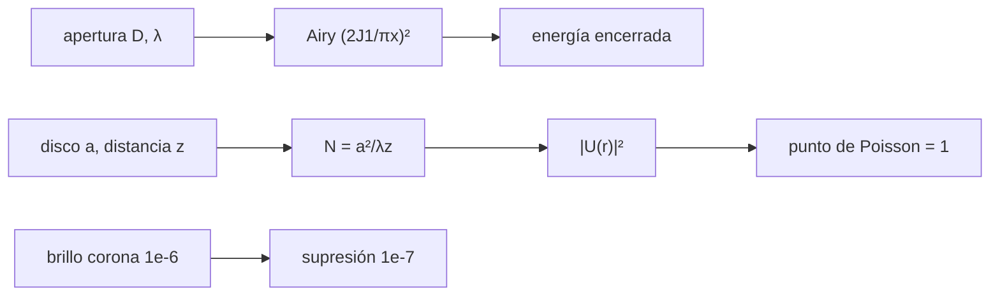

# B47-C07 — Coronógrafos espaciales

<!-- nav:top -->
[🏠 Programa](../../../../README.md) · [📚 Bloque B47](../../../tronco-comun/B47-instrumentacion-y-observatorios-espaciales.md) · [← Anterior: B47-C06 — Instrumentos de rayos gamma](../B47-C06-instrumentos-de-rayos-gamma/CLASE.md) · [Siguiente: B47-C08 — Espectrómetros de masas orbitales →](../B47-C08-espectrometros-de-masas-orbitales/CLASE.md)
<!-- /nav -->

## 1. Ubicación, nivel y alcance

Clase 7 del bloque B47. Nivel N3. Un coronógrafo bloquea la luz del disco para ver lo que lo rodea. Aquí comparas el patrón de Airy de una apertura con la energía encerrada, calculas el punto de Poisson que deja un ocultador externo y deduces la supresión que exige una corona un millón de veces más débil. Usas [B42](../../../tronco-comun/B42-optica-fisica-y-optica-adaptativa.md) y [B05](../../../tronco-comun/B05-fisica-fundamental-para-el-espacio.md). Todas las cifras son ilustrativas.

## 2. Por qué esta clase existe

La luz difractada del disco es mayor que la señal buscada. La decisión central: **¿cuánta supresión de luz difractada se necesita y con qué geometría de ocultador?**

## 3. Lo que podrás hacer al terminar

1. Calcular la intensidad de Airy con Bessel `J₁`.
2. Contrastar la energía encerrada numérica con la analítica.
3. Verificar la envolvente asintótica del patrón.
4. Calcular la difracción de Fresnel de un disco opaco.
5. Reconocer el punto de Poisson en el eje.
6. Deducir la supresión requerida.

La evidencia es la **ficha del coronógrafo** del ejercicio 12 (sección 20).

## 4. Con qué llegas y cómo comprobarlo

1. ¿Qué es una incertidumbre?
2. ¿Qué es una simulación Monte Carlo?
3. ¿Qué es una tabla de resultados?
4. ¿Qué es un valor ilustrativo?
5. ¿Qué es una verificación?

<details>
<summary>Ver respuestas</summary>

1. Un intervalo en que se espera el valor verdadero. 2. Repetir con números aleatorios de semilla fija. 3. Un resumen ordenado de cálculos. 4. Un valor propuesto para el ejemplo, no medido. 5. Comparar un cálculo con un caso independiente.
</details>

Con cuatro o cinco aciertos, sigue; si no, repasa los prerrequisitos.

## 5. Un caso de contexto y casos de referencia

El patrón de Airy cae a `1,41 × 10⁻³` a `3 λ/D` y a `4,01 × 10⁻⁵` a `10 λ/D`. Un disco de `0,05 m` a `1000 m` (número de Fresnel `4,545`) deja una intensidad axial de `1,000000`, el punto de Poisson. Ver una corona de brillo `10⁻⁶` con `S/N = 10` exige una supresión de `1,0 × 10⁻⁷`. Es el **ejemplo conductor**; es ilustrativo.

## 6. Vocabulario

El **patrón de Airy**. La **energía encerrada**. El **ocultador externo** y el **interno**. El **punto de Poisson**: máximo en el centro de la sombra. El **número de Fresnel** `a²/(λz)`. La **supresión**. El **contraste**.

## 7. Modelo mental: la sombra de una moneda

La sombra de una moneda iluminada por un punto lejano no es oscura en el centro: la luz se curva en el borde y deja una mancha brillante, igual que en un ocultador solar.



*Descripción textual:* la difracción de la apertura y del ocultador deja una luz residual que debe suprimirse por debajo del brillo de la corona.

Analogía: la sombra de una moneda. Límite: disco opaco ideal, onda plana.

## 8. La explicación, paso a paso

### 8.1 Patrón de Airy

| x (λ/D) | I(x) |
|---|---|
| 0 | 1,0 |
| 1,22 | 4,75 × 10⁻⁸ |
| 3 | 1,4064 × 10⁻³ |
| 5 | 3,1333 × 10⁻⁴ |
| 10 | 4,0099 × 10⁻⁵ |

En `x = 10,5` la intensidad exacta es `3,6291 × 10⁻⁵` y la envolvente asintótica `3,5473 × 10⁻⁵` (diferencia de 2,3 %).

### 8.2 Energía encerrada

| x (λ/D) | numérica | analítica `1 − J₀² − J₁²` |
|---|---|---|
| 1,22 | 0,83778487 | 0,83778487 |
| 2,23 | 0,90993053 | 0,90993053 |
| 5 | 0,96073965 | 0,96073965 |

El primer anillo oscuro (x = 1,22) encierra el 83,8 % de la energía; el 16 % restante es luz difractada.

### 8.3 Punto de Poisson

Con `λ = 550 nm`, `a = 0,05 m`, `z = 1000 m`, `N = 4,545`:

| r (cm) | intensidad relativa I |
|---|---|
| 0 | 1,000000 |
| 1 | 0,009468 |
| 2,5 | 0,037206 |
| 5 | 0,316981 |
| 10 | 1,086817 |

La intensidad axial vale 1: la luz sin obstáculo. Fuera del eje la sombra es oscura solo en un anillo.

### 8.4 Lectura

Para ver `10⁻⁶` con `S/N = 10` la luz residual debe ser `≤ 10⁻⁷` del disco. Un ocultador simple deja un máximo central; los coronógrafos reales apodizan el borde y usan etapas de Lyot (no modeladas aquí).

## 9. Magnitudes, símbolos y unidades

| Símbolo | Qué es | Unidad | Valor / nota |
|---|---|---|---|
| `x` | separación angular | λ/D | — |
| `I` | intensidad relativa | — | ver 8.1 |
| `N` | número de Fresnel | — | 4,545 |
| `a` | radio del ocultador | m | 0,05 (ilustrativo) |
| `z` | distancia | m | 1000 (ilustrativo) |

## 10. Convenciones y referencias

Sin unidades en el patrón de Airy; Fresnel en SI; aproximación paraxial; sin polarización.

## 11. De dónde sale lo que afirmamos

| ID | Fuente | Localizador | Respalda | Estado |
|---|---|---|---|---|
| — | Sin fuente externa | — | relaciones estándar que verifica el laboratorio | No se consultó una fuente para esta clase |

Límites: no se consultó ninguna fuente; el brillo coronal de `10⁻⁶` es un orden de magnitud de uso general, no una cifra verificada aquí.

## 12. Cómo ver los resultados

| Magnitud | Valor |
|---|---|
| I(3) | 1,41 × 10⁻³ |
| I(10) | 4,01 × 10⁻⁵ |
| N de Fresnel | 4,545 |
| I(0) | 1,0000 |

Descripción larga: el patrón de Airy cae lentamente y el ocultador deja un máximo central.

## 13. Ejemplo trabajado: el punto de Poisson

**Paso 1 · Campo.** `U(0) = 1 + (ik/z)∫₀ᵃ e^{ikρ²/2z} ρ dρ`.

**Paso 2 · Integral.** `= 1 + (e^{ika²/2z} − 1) = e^{ika²/2z}`.

**Paso 3 · Módulo.** `|U(0)|² = 1`.

**Lectura.** La cuadratura numérica da `1,000000`.

## 14. Distintas formas de describir el resultado

**Por fórmula:** Airy. **Por integral:** Fresnel. **Por tabla:** energía encerrada. **Por código:** `coronografo.py`.

## 15. Práctica guiada

**Ejercicio 1 · con los pasos indicados.** Supresión para brillo `10⁻⁵` con `S/N = 10`. *Pasos:* `b/10`.

<details><summary>Solución comentada</summary>

`10⁻⁶`.
</details>

**Ejercicio 2 · con una pista.** Energía fuera del primer anillo oscuro.

<details><summary>Solución comentada</summary>

`16,2 %`.
</details>

**Ejercicio 3 · casi autónomo.** `I(3)/I(10)`.

<details><summary>Solución comentada</summary>

`35,1`.
</details>

## 16. Práctica autónoma, transferencia e integrador

**Ejercicio 4.** Número de Fresnel si `a = 0,1 m`.

<details><summary>Solución comentada</summary>

`18,18`.
</details>

**Ejercicio 5.** `|U|²` en el eje.

<details><summary>Solución comentada</summary>

`1,0000`.
</details>

**Ejercicio 6.** `|U|²` a 10 cm del eje.

<details><summary>Solución comentada</summary>

`1,0868`.
</details>

**Ejercicio 7.** Energía encerrada a `x = 5`.

<details><summary>Solución comentada</summary>

`0,9607`.
</details>

**Ejercicio 8.** Diferencia envolvente−exacta en `x = 10,5`.

<details><summary>Solución comentada</summary>

`2,3 %`.
</details>

**Ejercicio 9 · transferencia.** **Transferencia.** ¿Por qué se apodiza el borde del ocultador?

<details><summary>Solución comentada</summary>

Para suavizar la transición y reducir el máximo central y los anillos.
</details>

**Ejercicio 10 · transferencia.** **Transferencia.** Un compañero afirma que la corona es siempre `10⁻⁶` del disco. Responde.

<details><summary>Solución comentada</summary>

Depende de la distancia al disco y del tipo de corona: es un orden de magnitud.
</details>

**Ejercicio 11 · transferencia.** **Transferencia.** ¿Qué ocurre con `N` si el ocultador se aleja a 2000 m?

<details><summary>Solución comentada</summary>

`N` se reduce a la mitad: `2,273`.
</details>

**Ejercicio 12.** **Integrador.** Elabora tu *ficha del coronógrafo*: patrón de Airy, punto de Poisson, supresión requerida y límites.

<details><summary>Solución comentada</summary>

Secciones 8.1–8.4.
</details>

**Ejercicio 12 · integrador.** **Integrador.** Elabora tu *ficha del coronógrafo*: patrón de Airy, punto de Poisson, supresión requerida y límites.

<details><summary>Solución modelo</summary>

Secciones 8.1–8.4.
</details>

## 17. Laboratorio: difracción y supresión del coronógrafo

El script [coronografo.py](coronografo.py) calcula Airy, la energía encerrada y la difracción de Fresnel (**comprueba** la energía a `10⁻⁶` y la intensidad axial a `10⁻⁶`).

**Datos:** ninguna constante; todo **ilustrativo**. **Predice antes de ejecutar:** ¿cuánto vale la intensidad en el centro de la sombra? (1.) **Ejecución del 2026-11-09 (Python 3.12.9):**

```text
Python 3.12.9 (biblioteca estandar)
Intensidad de Airy normalizada I(x), x en lambda/D:
  x =  0.00  I = 1.0000e+00
  x =  1.22  I = 4.7493e-08
  x =  3.00  I = 1.4064e-03
  x =  5.00  I = 3.1333e-04
  x = 10.00  I = 4.0099e-05
envolvente asintotica en x = 10.5: exacta = 3.6291e-05 ; asintotica = 3.5473e-05
     x    EE numerica   EE analitica
  1.22     0.83778487     0.83778487
  2.23     0.90993053     0.90993053
  5.00     0.96073965     0.96073965
numero de Fresnel N = a^2/(lambda z) = 4.545
  r =   0.0 cm : |U|^2 = 1.000000
  r =   1.0 cm : |U|^2 = 0.009468
  r =   2.5 cm : |U|^2 = 0.037206
  r =   5.0 cm : |U|^2 = 0.316981
  r =  10.0 cm : |U|^2 = 1.086817
supresion requerida para ver brillo 1e-6 con S/N = 10: 1.0e-07
Pruebas superadas.
```

```bash
python programa/clases/B47/B47-C07-coronografos-espaciales/coronografo.py
```

**Límites:** disco ideal, onda plana, sin Lyot.

## 18. Errores frecuentes y cómo corregirlos

**Esperar oscuridad en el centro de la sombra.** Se corrige con 8.3.

**Confundir `λ/D` con el radio del primer anillo.** Se corrige con 8.1.

**Tomar `10⁻⁶` como valor medido.** Se corrige con la sección 10.

**Ignorar la apodización.** Se corrige con 8.4.

## 19. Cómo sabrás que vas bien

Tras la sección 8: ¿qué resultado esperabas y cuál obtuviste? Si dudas, repasa el ejemplo 13. Tras el laboratorio: ¿qué comprueba? (ver la sección 17).

## 20. Qué entregas y cómo se evalúa

El producto es tu **ficha del coronógrafo** (ejercicio 12).

| Criterio | Inicial | En desarrollo | Logrado | Destacado |
|---|---|---|---|---|
| Conceptos | Los confunde | Parciales | conceptos de la clase | Explica los límites |
| Cálculo | Sin unidades | Con errores | Tablas completas | Calcula casos nuevos |
| Numérico | Sin comprobar | Un caso | Contraste con el análisis | Interpreta las diferencias |
| Fuentes | Sin fuente | Sin fecha | fuentes con fecha | Declara lo ilustrativo |
| Límites | No los nombra | Uno | Tres | Discute qué falta del modelo |

**Condiciones críticas (no se compensan con promedio):** rotular lo ilustrativo; no presentar el modelo como diseño de una misión real; citar solo lo consultado.

## 21. Ética, seguridad y límites

Clase educativa: los modelos son simplificados. Accesibilidad: tablas equivalentes a las gráficas, fórmulas en texto, ejercicios sin conexión.

## 22. Para cerrar y seguir

El patrón de Airy decae a `4,0 × 10⁻⁵` a `10 λ/D` y el punto de Poisson vale `1`; ver una corona de `10⁻⁶` exige suprimir a `10⁻⁷`. Queda una pregunta: ¿cómo se identifican las partículas del entorno que rodea al instrumento?

**Glosario español–inglés.** coronógrafo · *coronagraph*; ocultador · *occulter*; punto de Poisson · *Poisson spot*; energía encerrada · *encircled energy*; supresión · *suppression*.

**Continuidad.** [B47-C08](../B47-C08-espectrometros-de-masas-orbitales/CLASE.md) estudia los espectrómetros de masas orbitales.

**Referencias:** ver sección 11.

<!-- nav:bottom -->
---

[← Anterior: B47-C06 — Instrumentos de rayos gamma](../B47-C06-instrumentos-de-rayos-gamma/CLASE.md) · [📚 Bloque B47](../../../tronco-comun/B47-instrumentacion-y-observatorios-espaciales.md) · [Siguiente: B47-C08 — Espectrómetros de masas orbitales →](../B47-C08-espectrometros-de-masas-orbitales/CLASE.md)
<!-- /nav -->
