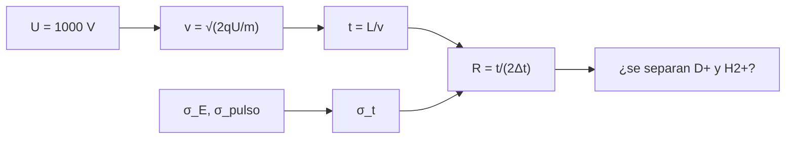

# B47-C08 — Espectrómetros de masas orbitales

<!-- nav:top -->
[🏠 Programa](../../../../README.md) · [📚 Bloque B47](../../../tronco-comun/B47-instrumentacion-y-observatorios-espaciales.md) · [← Anterior: B47-C07 — Coronógrafos espaciales](../B47-C07-coronografos-espaciales/CLASE.md) · [Siguiente: B47-C09 — Detectores de partículas — Instrumentación y observatorios espaciales →](../B47-C09-detectores-de-particulas-instrumentacion-y-observatorios-espaciales/CLASE.md)
<!-- /nav -->

## 1. Ubicación, nivel y alcance

Clase 8 del bloque B47. Nivel N3. Un espectrómetro de masas de tiempo de vuelo mide cuánto tarda un ion en recorrer una distancia tras ser acelerado: los más pesados llegan después. Aquí calculas los tiempos de vuelo por dos vías, la resolución que exige separar D⁺ de H₂⁺ y la que logra un instrumento con dispersión de energía y de pulso, con Monte Carlo. Usas [B05](../../../tronco-comun/B05-fisica-fundamental-para-el-espacio.md) y [B31](../../../tronco-comun/B31-fisica-cuantica-nuclear-y-astroparticulas.md). Los parámetros son ilustrativos.

## 2. Por qué esta clase existe

La resolución de masa decide qué especies se separan. La decisión central: **¿qué tiempo de vuelo, qué dispersión y qué resolución permiten distinguir dos iones casi isobáricos?**

## 3. Lo que podrás hacer al terminar

1. Calcular `t = L√(m/(2qU))` y compararlo con la vía de la energía cinética.
2. Usar masas atómicas de NIST para iones ligeros.
3. Calcular la resolución `m/Δm = t/(2Δt)`.
4. Simular dispersión de energía y de pulso (semilla fija).
5. Contrastar la dispersión con la propagación de errores.
6. Decidir si dos picos se separan.

La evidencia es la **ficha del espectrómetro de masas** del ejercicio 12 (sección 20).

## 4. Con qué llegas y cómo comprobarlo

1. ¿Qué es una incertidumbre?
2. ¿Qué es una simulación Monte Carlo?
3. ¿Qué es una tabla de resultados?
4. ¿Qué es un valor ilustrativo?
5. ¿Qué es una verificación?

<details>
<summary>Ver respuestas</summary>

1. Un intervalo en que se espera el valor verdadero. 2. Repetir con números aleatorios de semilla fija. 3. Un resumen ordenado de cálculos. 4. Un valor propuesto para el ejemplo, no medido. 5. Comparar un cálculo con un caso independiente.
</details>

Con cuatro o cinco aciertos, sigue; si no, repasa los prerrequisitos.

## 5. Un caso de contexto y casos de referencia

Con `L = 1,50 m` y `U = 1000 V` (ilustrativos), D⁺ llega en `4,84537 µs` y H₂⁺ en `4,84724 µs`. Separarlos exige `m/Δm = 1300,5`; la dispersión de `0,697 ns` da `R = 1476` pero los picos quedan a solo `1,89 σ`. Es el **ejemplo conductor**; no es un instrumento real.

## 6. Vocabulario

El **tiempo de vuelo**. La **resolución de masa** `m/Δm`. La **dispersión de energía inicial**. La **anchura del pulso**. Los **iones isobáricos**. La relación **m/q**. La **zona libre de campo**.

## 7. Modelo mental: una carrera de relevos

Es una carrera en que todos reciben el mismo empujón: los livianos llegan primero. Si la salida es desordenada, dos corredores casi iguales llegan juntos.



*Descripción textual:* el voltaje acelera los iones, el tiempo de vuelo codifica m/q y la dispersión de arranque fija la resolución.

Analogía: una carrera de relevos. Límite: campo uniforme, zona libre de campo.

## 8. La explicación, paso a paso

### 8.1 Tiempos de vuelo

| Ion | m/q (u) | t fórmula (µs) | t energía cinética (µs) |
|---|---|---|---|
| H₂⁺ | 2,015102 | 4,847235 | 4,847235 |
| D⁺ | 2,013553 | 4,845372 | 4,845372 |
| He²⁺ (m/q) | 2,000753 | 4,829947 | 4,829947 |

Las dos vías coinciden a `10⁻¹²`. La diferencia H₂⁺ − D⁺ es de `1,548 mu` (milésimas de u): hace falta `m/Δm = 1300,5`.

### 8.2 Monte Carlo

Con 40 000 iones por especie:

| Ion | media (µs) | σ Monte Carlo (ns) | σ propagación (ns) |
|---|---|---|---|
| H₂⁺ | 4,84724 | 0,699 | 0,696 |
| D⁺ | 4,84537 | 0,697 | 0,696 |

### 8.3 Resolución lograda

Con el ancho a media altura `2,3548 σ`, `R = t/(2·FWHM) = 1476`, mayor que la exigida. Sin embargo la separación de los picos es de `1,89 σ`: el criterio de resolución `m/Δm` define la separación a media altura, no una separación limpia.

### 8.4 Lectura

Una mayor distancia de vuelo o menor dispersión mejoran la separación. Los espejos electrostáticos (reflectrones) corrigen la dispersión de energía y no se modelan aquí.

## 9. Magnitudes, símbolos y unidades

| Símbolo | Qué es | Unidad | Valor / nota |
|---|---|---|---|
| `t` | tiempo de vuelo | µs | 4,8454 |
| `U` | tensión de aceleración | V | 1000 (ilustrativo) |
| `L` | longitud de vuelo | m | 1,50 (ilustrativo) |
| `u` | unidad de masa atómica | kg | 1,66053906892 × 10⁻²⁷ (NIST) |
| `R` | resolución de masa | — | 1476 |

## 10. Convenciones y referencias

SI; masas en u; iones de carga +1 (He²⁺ con `m/q`); masas de núcleos desnudos más electrones sin energía de enlace.

## 11. De dónde sale lo que afirmamos

| ID | Fuente | Localizador | Respalda | Estado |
|---|---|---|---|---|
| S1 | NIST, *Fundamental Physical Constants* (CODATA 2022) | https://physics.nist.gov/cuu/Constants/Table/allascii.txt | constantes citadas en la sección 9 | Consultada el 2026-11-09 |

Límites: las masas de protón, deuterón, alfa y electrón vienen de NIST. La longitud, la tensión y las dispersiones son ilustrativas; el H₂⁺ desprecia la energía de enlace de 2,65 eV (cambia la masa en `3 × 10⁻⁹ u`).

## 12. Cómo ver los resultados

| Ion | t (µs) |
|---|---|
| H₂⁺ | 4,84724 |
| D⁺ | 4,84537 |
| He²⁺ | 4,82995 |

Descripción larga: los tiempos difieren en nanosegundos entre H₂⁺ y D⁺.

## 13. Ejemplo trabajado: el tiempo de vuelo del D⁺

**Paso 1 · Masa.** `m = 2,013553 u = 3,3436 × 10⁻²⁷ kg`.

**Paso 2 · Velocidad.** `v = √(2eU/m) = 3,1 × 10⁵ m/s`.

**Paso 3 · Tiempo.** `t = 1,50/v = 4,845 µs`.

## 14. Distintas formas de describir el resultado

**Por fórmula:** `t = L√(m/2qU)`. **Por energía cinética:** `v = √(2qU/m)`. **Por simulación:** MC. **Por código:** `masas_vuelo.py`.

## 15. Práctica guiada

**Ejercicio 1 · con los pasos indicados.** `Δt` entre H₂⁺ y D⁺. *Pasos:* diferencia de tiempos.

<details><summary>Solución comentada</summary>

`1,863 ns`.
</details>

**Ejercicio 2 · con una pista.** `m/Δm` exigida.

<details><summary>Solución comentada</summary>

`1300,5`.
</details>

**Ejercicio 3 · casi autónomo.** `t` de He²⁺ respecto de D⁺.

<details><summary>Solución comentada</summary>

`15,4 ns` antes.
</details>

## 16. Práctica autónoma, transferencia e integrador

**Ejercicio 4.** σ de propagación del D⁺.

<details><summary>Solución comentada</summary>

`0,696 ns`.
</details>

**Ejercicio 5.** FWHM del D⁺.

<details><summary>Solución comentada</summary>

`1,641 ns`.
</details>

**Ejercicio 6.** Separación entre picos en σ.

<details><summary>Solución comentada</summary>

`1,89`.
</details>

**Ejercicio 7.** Resolución lograda.

<details><summary>Solución comentada</summary>

`1476`.
</details>

**Ejercicio 8.** Razón `t(D⁺)/t(He²⁺ m/q)`.

<details><summary>Solución comentada</summary>

`1,00319` (`√(m/m)`).
</details>

**Ejercicio 9 · transferencia.** **Transferencia.** ¿Por qué `R` alcanza lo exigido pero los picos se solapan?

<details><summary>Solución comentada</summary>

Porque `R` se define con el ancho a media altura, no con separación completa.
</details>

**Ejercicio 10 · transferencia.** **Transferencia.** Un compañero afirma que el instrumento calculado es real. Responde.

<details><summary>Solución comentada</summary>

Son parámetros ilustrativos de un ejemplo.
</details>

**Ejercicio 11 · transferencia.** **Transferencia.** ¿Cómo mejoraría la separación al duplicar `L`?

<details><summary>Solución comentada</summary>

`t` se duplica y la contribución de la energía también; domina el pulso, así que la resolución mejora.
</details>

**Ejercicio 12.** **Integrador.** Elabora tu *ficha del espectrómetro de masas*: tiempos, resolución exigida y lograda, y límites.

<details><summary>Solución comentada</summary>

Secciones 8.1–8.4.
</details>

**Ejercicio 12 · integrador.** **Integrador.** Elabora tu *ficha del espectrómetro de masas*: tiempos, resolución exigida y lograda, y límites.

<details><summary>Solución modelo</summary>

Secciones 8.1–8.4.
</details>

## 17. Laboratorio: tiempo de vuelo y resolución de masa

El script [masas_vuelo.py](masas_vuelo.py) calcula tiempos por dos vías y simula la dispersión (**comprueba** el tiempo a `10⁻¹²` y la dispersión a 3 %).

**Datos:** constantes y masas de NIST; instrumento **ilustrativo**. **Predice antes de ejecutar:** ¿se separan D+ y H2+? (a ≈ 1,9 σ.) **Ejecución del 2026-11-09 (Python 3.12.9):**

```text
Python 3.12.9 (biblioteca estandar)
         ion      m/q [u]   t formula [us]   t energia [us]
         H2+     2.015102         4.847235         4.847235
          D+     2.013553         4.845372         4.845372
  He2+ (m/q)     2.000753         4.829947         4.829947
resolucion exigida para separar D+ y H2+: m/dm = 1300.5
  H2+: media = 4.84724 us ; desviacion MC = 0.699 ns ; propagacion = 0.696 ns
   D+: media = 4.84537 us ; desviacion MC = 0.697 ns ; propagacion = 0.696 ns
resolucion lograda m/dm (FWHM) = 1476.0 ; separacion de picos = 1.89 sigma
Pruebas superadas.
```

```bash
python programa/clases/B47/B47-C08-espectrometros-de-masas-orbitales/masas_vuelo.py
```

**Límites:** sin reflectrón ni carga espacial.

## 18. Errores frecuentes y cómo corregirlos

**Confundir carga con masa.** Se corrige con 8.1.

**Usar `R` como criterio de separación limpia.** Se corrige con 8.3.

**Olvidar la masa del electrón en H₂⁺.** Se corrige con la sección 10.

**Tomar los parámetros como reales.** Se corrige con la sección 10.

## 19. Cómo sabrás que vas bien

Tras la sección 8: ¿qué resultado esperabas y cuál obtuviste? Si dudas, repasa el ejemplo 13. Tras el laboratorio: ¿qué comprueba? (ver la sección 17).

## 20. Qué entregas y cómo se evalúa

El producto es tu **ficha del espectrómetro de masas** (ejercicio 12).

| Criterio | Inicial | En desarrollo | Logrado | Destacado |
|---|---|---|---|---|
| Conceptos | Los confunde | Parciales | conceptos de la clase | Explica los límites |
| Cálculo | Sin unidades | Con errores | Tablas completas | Calcula casos nuevos |
| Numérico | Sin comprobar | Un caso | Contraste con el análisis | Interpreta las diferencias |
| Fuentes | Sin fuente | Sin fecha | fuentes con fecha | Declara lo ilustrativo |
| Límites | No los nombra | Uno | Tres | Discute qué falta del modelo |

**Condiciones críticas (no se compensan con promedio):** rotular lo ilustrativo; no presentar el modelo como diseño de una misión real; citar solo lo consultado.

## 21. Ética, seguridad y límites

Clase educativa: los modelos son simplificados. Accesibilidad: tablas equivalentes a las gráficas, fórmulas en texto, ejercicios sin conexión.

## 22. Para cerrar y seguir

D⁺ y H₂⁺ difieren en `1,86 ns` y la resolución exigida es `1300`. Queda una pregunta: ¿cómo se detectan las partículas energéticas del entorno?

**Glosario español–inglés.** tiempo de vuelo · *time of flight*; resolución de masa · *mass resolution*; ion · *ion*; isobárico · *isobaric*; reflectrón · *reflectron*.

**Continuidad.** [B47-C09](../B47-C09-detectores-de-particulas-instrumentacion-y-observatorios-espaciales/CLASE.md) estudia los detectores de partículas.

**Referencias:** ver sección 11.

<!-- nav:bottom -->
---

[← Anterior: B47-C07 — Coronógrafos espaciales](../B47-C07-coronografos-espaciales/CLASE.md) · [📚 Bloque B47](../../../tronco-comun/B47-instrumentacion-y-observatorios-espaciales.md) · [Siguiente: B47-C09 — Detectores de partículas — Instrumentación y observatorios espaciales →](../B47-C09-detectores-de-particulas-instrumentacion-y-observatorios-espaciales/CLASE.md)
<!-- /nav -->
