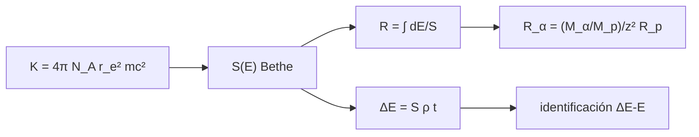

# B47-C09 — Detectores de partículas — Instrumentación y observatorios espaciales

<!-- nav:top -->
[🏠 Programa](../../../../README.md) · [📚 Bloque B47](../../../tronco-comun/B47-instrumentacion-y-observatorios-espaciales.md) · [← Anterior: B47-C08 — Espectrómetros de masas orbitales](../B47-C08-espectrometros-de-masas-orbitales/CLASE.md) · [Siguiente: B47-C10 — Estabilidad de apuntamiento →](../B47-C10-estabilidad-de-apuntamiento/CLASE.md)
<!-- /nav -->

## 1. Ubicación, nivel y alcance

Clase 9 del bloque B47. Nivel N3. Un detector de silicio mide la energía que una partícula cargada pierde al atravesarlo. Aquí calculas el poder de frenado de Bethe-Bloch, el alcance de protones, la identidad de escala para partículas alfa y la pérdida en un telescopio ΔE–E. Usas [B05](../../../tronco-comun/B05-fisica-fundamental-para-el-espacio.md) y [B31](../../../tronco-comun/B31-fisica-cuantica-nuclear-y-astroparticulas.md). Los datos del silicio son los de uso general, no consultados.

## 2. Por qué esta clase existe

Medir ΔE y E permite identificar la partícula. La decisión central: **¿qué espesor de detector y qué energía separan protones de partículas alfa?**

## 3. Lo que podrás hacer al terminar

1. Calcular `K = 4π N_A r_e² mₑc²` con NIST.
2. Calcular el poder de frenado de Bethe-Bloch.
3. Integrar el alcance CSDA.
4. Verificar la escala `R_α` con `R_p`.
5. Calcular la pérdida ΔE en una placa fina.
6. Reconocer los límites de Bethe sin correcciones.

La evidencia es la **ficha del detector de partículas** del ejercicio 12 (sección 20).

## 4. Con qué llegas y cómo comprobarlo

1. ¿Qué es una incertidumbre?
2. ¿Qué es una simulación Monte Carlo?
3. ¿Qué es una tabla de resultados?
4. ¿Qué es un valor ilustrativo?
5. ¿Qué es una verificación?

<details>
<summary>Ver respuestas</summary>

1. Un intervalo en que se espera el valor verdadero. 2. Repetir con números aleatorios de semilla fija. 3. Un resumen ordenado de cálculos. 4. Un valor propuesto para el ejemplo, no medido. 5. Comparar un cálculo con un caso independiente.
</details>

Con cuatro o cinco aciertos, sigue; si no, repasa los prerrequisitos.

## 5. Un caso de contexto y casos de referencia

Un protón de 10 MeV pierde `35,16 MeV cm²/g` en silicio y un protón de 30 MeV tiene alcance `4,87 mm`. En una placa de 300 µm el protón de 30 MeV deposita `1,047 MeV` y la partícula alfa de la misma velocidad `4,188 MeV`, `4,001` veces más. Es el **ejemplo conductor**.

## 6. Vocabulario

El **poder de frenado** `S = −dE/(ρ dx)`. La **fórmula de Bethe-Bloch**. El **alcance CSDA**. El **pico de Bragg**. El **telescopio ΔE–E**. La **carga efectiva** `z`. La **energía máxima transferible** `T_max`.

## 7. Modelo mental: un coche que frena en barro

Una partícula que atraviesa materia es como un coche en barro: frena más cuanto más lento va, y al final se detiene de golpe, depositando casi toda su energía.



*Descripción textual:* la fórmula de Bethe da la pérdida por unidad de masa; integrada da el alcance y la pérdida en una placa fina.

Analogía: un coche que frena en barro. Límite: partícula pesada, pérdida continua.

## 8. La explicación, paso a paso

### 8.1 Poder de frenado en silicio

`K = 0,307075 MeV cm²/mol`.

| E (protón, MeV) | S (MeV cm²/g) | dE/dx (MeV/cm) |
|---|---|---|
| 1 | 182,039 | 423,97 |
| 10 | 35,163 | 81,89 |
| 100 | 5,849 | 13,62 |
| 1000 | 1,819 | 4,24 |

### 8.2 Alcance y escala alfa

| E_p (MeV) | R_p (mm) | R_α integral (mm) | R_α por escala (mm) |
|---|---|---|---|
| 10 | 0,6821 | 0,6774 | 0,6774 |
| 30 | 4,8686 | 4,8348 | 4,8352 |
| 100 | 41,6392 | 41,3512 | 41,3540 |

La escala `R_α(E) = (M_α/M_p)/z² R_p(E M_p/M_α)` coincide a `10⁻³` (la corrección `mₑ/M` de `T_max` impide la igualdad exacta).

### 8.3 Placa fina de 300 µm

Protón de 30 MeV: ΔE = `1,0468 MeV` integrando paso a paso y `1,0323 MeV` con `S ρ t`. Alfa de 119,2 MeV: `4,1880` y `4,1296 MeV`. El cociente alfa/protón es `4,0007` (cercano a `z² = 4`).

### 8.4 Lectura

El producto ΔE·E separa especies porque ΔE crece con `z²`. El alcance de 4 cm en silicio de un protón de 100 MeV muestra por qué los detectores espaciales usan pilas de placas. El modelo omite correcciones de capas y de densidad y la dispersión de la pérdida (Landau).

## 9. Magnitudes, símbolos y unidades

| Símbolo | Qué es | Unidad | Valor / nota |
|---|---|---|---|
| `K` | constante de Bethe | MeV cm²/mol | 0,307075 |
| `S` | poder de frenado | MeV cm²/g | 35,16 a 10 MeV |
| `ρ` | densidad del silicio | g/cm³ | 2,329 (uso general) |
| `I` | energía media de excitación | eV | 173 (uso general) |
| `mₚc²` | protón | MeV | 938,27208943 (NIST) |

## 10. Convenciones y referencias

MeV, cm y g; fórmula de Bethe sin correcciones; protón de 1 a 1000 MeV.

## 11. De dónde sale lo que afirmamos

| ID | Fuente | Localizador | Respalda | Estado |
|---|---|---|---|---|
| S1 | NIST, *Fundamental Physical Constants* (CODATA 2022) | https://physics.nist.gov/cuu/Constants/Table/allascii.txt | constantes citadas en la sección 9 | Consultada el 2026-11-09 |

Límites: las constantes provienen de NIST. `Z/A`, la densidad y la energía de excitación del silicio son valores de uso general que no se consultaron en esta clase; no se contrastó contra tablas de poder de frenado.

## 12. Cómo ver los resultados

| Magnitud | Valor |
|---|---|
| `S` protón 10 MeV | 35,16 MeV cm²/g |
| Alcance 30 MeV | 4,87 mm |
| ΔE protón 300 µm | 1,047 MeV |
| ΔE alfa / protón | 4,001 |

Descripción larga: la alfa deposita cuatro veces más energía por su carga doble.

## 13. Ejemplo trabajado: la pérdida en 300 µm

**Paso 1 · `S` a 30 MeV.** `S = 14,77 MeV cm²/g`.

**Paso 2 · Masa superficial.** `ρ t = 2,329 × 0,03 = 0,0699 g/cm²`.

**Paso 3 · Producto.** `ΔE ≈ S ρ t = 1,032 MeV` (placa fina).

**Lectura.** La integración paso a paso da `1,047 MeV`: la diferencia es la variación de `S` dentro de la placa.

## 14. Distintas formas de describir el resultado

**Por fórmula:** Bethe. **Por integral:** alcance. **Por escala:** alfa. **Por código:** `particulas.py`.

## 15. Práctica guiada

**Ejercicio 1 · con los pasos indicados.** `dE/dx` de un protón de 10 MeV. *Pasos:* `S ρ`.

<details><summary>Solución comentada</summary>

`81,89 MeV/cm`.
</details>

**Ejercicio 2 · con una pista.** Cociente `S(1 MeV)/S(10 MeV)`.

<details><summary>Solución comentada</summary>

`5,18`.
</details>

**Ejercicio 3 · casi autónomo.** Alcance de 30 MeV en mm.

<details><summary>Solución comentada</summary>

`4,87 mm`.
</details>

## 16. Práctica autónoma, transferencia e integrador

**Ejercicio 4.** Alcance alfa de la misma velocidad.

<details><summary>Solución comentada</summary>

`4,83 mm`.
</details>

**Ejercicio 5.** Cociente `R_p/R_α`.

<details><summary>Solución comentada</summary>

`1,007`.
</details>

**Ejercicio 6.** ΔE del protón por `S ρ t`.

<details><summary>Solución comentada</summary>

`1,032 MeV`.
</details>

**Ejercicio 7.** ΔE alfa/protón.

<details><summary>Solución comentada</summary>

`4,0007`.
</details>

**Ejercicio 8.** Placas de 300 µm para detener 30 MeV.

<details><summary>Solución comentada</summary>

`16` placas.
</details>

**Ejercicio 9 · transferencia.** **Transferencia.** ¿Por qué `S` crece al bajar la energía?

<details><summary>Solución comentada</summary>

Por el factor `1/β²`: más tiempo de interacción.
</details>

**Ejercicio 10 · transferencia.** **Transferencia.** Un compañero afirma que el alcance calculado es el de tablas oficiales. Responde.

<details><summary>Solución comentada</summary>

No se contrastó con tablas; usa constantes de uso general.
</details>

**Ejercicio 11 · transferencia.** **Transferencia.** ¿Qué placa gruesa detiene a un protón de 100 MeV?

<details><summary>Solución comentada</summary>

Unos `42 mm` de silicio.
</details>

**Ejercicio 12.** **Integrador.** Elabora tu *ficha del detector de partículas*: `S`, alcance, ΔE y límites.

<details><summary>Solución comentada</summary>

Secciones 8.1–8.4.
</details>

**Ejercicio 12 · integrador.** **Integrador.** Elabora tu *ficha del detector de partículas*: `S`, alcance, ΔE y límites.

<details><summary>Solución modelo</summary>

Secciones 8.1–8.4.
</details>

## 17. Laboratorio: Bethe-Bloch en silicio

El script [particulas.py](particulas.py) calcula `S(E)`, el alcance CSDA, la escala alfa y la pérdida en una placa (**comprueba** la escala a `10⁻³` y ΔE a 2 %).

**Datos:** constantes de NIST; silicio de uso general **sin consultar**. **Predice antes de ejecutar:** ¿cuánto más pierde la alfa a igual velocidad? (4 veces.) **Ejecución del 2026-11-09 (Python 3.12.9):**

```text
Python 3.12.9 (biblioteca estandar)
K = 4 pi N_A r_e^2 m_e c^2 = 0.307075 MeV cm2/mol
protón     1 MeV: S = 182.039 MeV cm2/g ; dE/dx = 423.97 MeV/cm
protón    10 MeV: S = 35.163 MeV cm2/g ; dE/dx = 81.89 MeV/cm
protón   100 MeV: S = 5.849 MeV cm2/g ; dE/dx = 13.62 MeV/cm
protón  1000 MeV: S = 1.819 MeV cm2/g ; dE/dx = 4.24 MeV/cm
 E_p [MeV]   R_p [mm]  R_alfa [mm]  prediccion [mm]
        10     0.6821       0.6774           0.6774
        30     4.8686       4.8348           4.8352
       100    41.6392      41.3512          41.3540
DeltaE en 300 um: proton 30 MeV = 1.0468 MeV ; alfa 119.2 MeV (misma velocidad) = 4.1880 MeV ; cociente = 4.0007
placa fina S rho t: proton = 1.0323 MeV ; alfa = 4.1296 MeV
Pruebas superadas.
```

```bash
python programa/clases/B47/B47-C09-detectores-de-particulas-instrumentacion-y-observatorios-espaciales/particulas.py
```

**Límites:** sin correcciones de capa, densidad ni straggling.

## 18. Errores frecuentes y cómo corregirlos

**Usar masa en lugar de masa superficial.** Se corrige con 8.3.

**Olvidar el factor `z²`.** Se corrige con 8.2.

**Aplicar Bethe a baja energía (< 1 MeV).** Se corrige con 8.4.

**Tomar el silicio como dato consultado.** Se corrige con la sección 10.

## 19. Cómo sabrás que vas bien

Tras la sección 8: ¿qué resultado esperabas y cuál obtuviste? Si dudas, repasa el ejemplo 13. Tras el laboratorio: ¿qué comprueba? (ver la sección 17).

## 20. Qué entregas y cómo se evalúa

El producto es tu **ficha del detector de partículas** (ejercicio 12).

| Criterio | Inicial | En desarrollo | Logrado | Destacado |
|---|---|---|---|---|
| Conceptos | Los confunde | Parciales | conceptos de la clase | Explica los límites |
| Cálculo | Sin unidades | Con errores | Tablas completas | Calcula casos nuevos |
| Numérico | Sin comprobar | Un caso | Contraste con el análisis | Interpreta las diferencias |
| Fuentes | Sin fuente | Sin fecha | fuentes con fecha | Declara lo ilustrativo |
| Límites | No los nombra | Uno | Tres | Discute qué falta del modelo |

**Condiciones críticas (no se compensan con promedio):** rotular lo ilustrativo; no presentar el modelo como diseño de una misión real; citar solo lo consultado.

## 21. Ética, seguridad y límites

Clase educativa: los modelos son simplificados. Accesibilidad: tablas equivalentes a las gráficas, fórmulas en texto, ejercicios sin conexión.

## 22. Para cerrar y seguir

Bethe-Bloch da `35,2 MeV cm²/g` a 10 MeV y el cociente de ΔE alfa/protón es `4,00`. Queda una pregunta: ¿qué estabilidad de apuntamiento necesita el instrumento para aprovechar su resolución?

**Glosario español–inglés.** poder de frenado · *stopping power*; Bethe-Bloch · *Bethe-Bloch*; alcance · *range*; pico de Bragg · *Bragg peak*; telescopio ΔE–E · *ΔE–E telescope*.

**Continuidad.** [B47-C10](../B47-C10-estabilidad-de-apuntamiento/CLASE.md) estudia la estabilidad de apuntamiento.

**Referencias:** ver sección 11.

<!-- nav:bottom -->
---

[← Anterior: B47-C08 — Espectrómetros de masas orbitales](../B47-C08-espectrometros-de-masas-orbitales/CLASE.md) · [📚 Bloque B47](../../../tronco-comun/B47-instrumentacion-y-observatorios-espaciales.md) · [Siguiente: B47-C10 — Estabilidad de apuntamiento →](../B47-C10-estabilidad-de-apuntamiento/CLASE.md)
<!-- /nav -->
