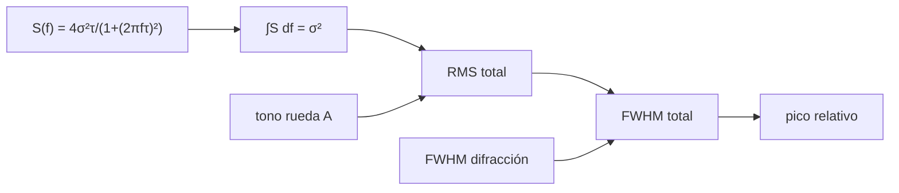

# B47-C10 — Estabilidad de apuntamiento

<!-- nav:top -->
[🏠 Programa](../../../../README.md) · [📚 Bloque B47](../../../tronco-comun/B47-instrumentacion-y-observatorios-espaciales.md) · [← Anterior: B47-C09 — Detectores de partículas — Instrumentación y observatorios espaciales](../B47-C09-detectores-de-particulas-instrumentacion-y-observatorios-espaciales/CLASE.md) · [Siguiente: B47-C11 — Aislamiento vibracional →](../B47-C11-aislamiento-vibracional/CLASE.md)
<!-- /nav -->

## 1. Ubicación, nivel y alcance

Clase 10 del bloque B47. Nivel N3. Un telescopio orbital apunta con una actitud que nunca es perfecta: el ruido y las ruedas de reacción la hacen oscilar. Aquí describes esa oscilación con una densidad espectral, calculas su RMS por integración, simulas una serie temporal y traduces el *jitter* en pérdida de pico de la imagen. Usas [B42](../../../tronco-comun/B42-optica-fisica-y-optica-adaptativa.md), [B15](../../../tronco-comun/B15-senales-imagenes-y-estimacion-cientifica.md) y [B05](../../../tronco-comun/B05-fisica-fundamental-para-el-espacio.md). Todo es ilustrativo.

## 2. Por qué esta clase existe

Una buena óptica con mal apuntamiento da imágenes borrosas. La decisión central: **¿qué RMS de *jitter* se puede tolerar para perder menos del 10 % del pico?**

## 3. Lo que podrás hacer al terminar

1. Escribir la PSD de un proceso de Ornstein-Uhlenbeck.
2. Integrarla y comparar con la solución analítica.
3. Simular una serie temporal (semilla fija).
4. Sumar el RMS de un tono de rueda.
5. Calcular el ensanchamiento de la PSF.
6. Deducir el *jitter* máximo admisible.

La evidencia es la **ficha de estabilidad de apuntamiento** del ejercicio 12 (sección 20).

## 4. Con qué llegas y cómo comprobarlo

1. ¿Qué es una incertidumbre?
2. ¿Qué es una simulación Monte Carlo?
3. ¿Qué es una tabla de resultados?
4. ¿Qué es un valor ilustrativo?
5. ¿Qué es una verificación?

<details>
<summary>Ver respuestas</summary>

1. Un intervalo en que se espera el valor verdadero. 2. Repetir con números aleatorios de semilla fija. 3. Un resumen ordenado de cálculos. 4. Un valor propuesto para el ejemplo, no medido. 5. Comparar un cálculo con un caso independiente.
</details>

Con cuatro o cinco aciertos, sigue; si no, repasa los prerrequisitos.

## 5. Un caso de contexto y casos de referencia

Con ruido de actitud de `0,010 arcsec` RMS y corte de `0,5 Hz`, más un tono de rueda de `0,004 arcsec` a 40 Hz, el RMS total es `0,01039 arcsec`. Para un telescopio de 0,5 m (FWHM de difracción `0,2332 arcsec`) el *jitter* máximo para perder el 10 % del pico es `0,03301 arcsec`. Es el **ejemplo conductor**; no es una misión real.

## 6. Vocabulario

El **jitter**: oscilación rápida de apuntamiento. La **deriva**: variación lenta. La **densidad espectral de potencia** `S(f)`. El **RMS**. El **proceso de Ornstein-Uhlenbeck**. La **rueda de reacción**. El **pico relativo** (Strehl por jitter).

## 7. Modelo mental: un fotógrafo con pulso tembloroso

Es el fotógrafo de pulso tembloroso: si el temblor es mucho menor que el detalle que quiere captar, la foto sale nítida; si es comparable, sale movida.



*Descripción textual:* la PSD describe cómo se reparte la potencia del *jitter* en frecuencia; integrada da el RMS y este ensancha la imagen.

Analogía: un fotógrafo con pulso tembloroso. Límite: jitter gaussiano por eje.

## 8. La explicación, paso a paso

### 8.1 PSD y RMS

`S₀ = 1,2732 × 10⁻⁴ arcsec²/Hz` y `σ² = 1,0000 × 10⁻⁴ arcsec²`.

| Hasta (Hz) | ∫ numérica | ∫ analítica `S₀ f_c atan(F/f_c)` |
|---|---|---|
| 2 | 8,440417 × 10⁻⁵ | 8,440417 × 10⁻⁵ |
| 10 | 9,681955 × 10⁻⁵ | 9,681955 × 10⁻⁵ |
| 100 | 9,968169 × 10⁻⁵ | 9,968169 × 10⁻⁵ |

La integral total converge a `σ²`. A 100 Hz ya se tiene el 99,7 %.

### 8.2 Serie temporal

Con 200 000 muestras a 20 Hz: coeficiente `a = 0,854636`, varianza simulada `9,9204 × 10⁻⁵` (esperada `1,0000 × 10⁻⁴`), autocorrelación en retardo 1 `0,8531` (esperada `0,8546`).

### 8.3 RMS total y efecto en la imagen

El tono de rueda aporta `A²/2`: RMS total `√(σ² + A²/2) = 0,01039 arcsec`.

| σ (arcsec) | FWHM total (arcsec) | pico relativo |
|---|---|---|
| 0,005 | 0,2335 | 0,9975 |
| 0,010 | 0,2344 | 0,9899 |
| 0,020 | 0,2379 | 0,9608 |
| 0,033 | 0,2458 | 0,9001 |
| 0,050 | 0,2612 | 0,7969 |

### 8.4 Lectura

Perder el 10 % del pico exige `σ ≤ 0,0330 arcsec` por eje, un 14 % del FWHM de difracción. El modelo supone PSF gaussiana y *jitter* independiente por eje; ignora la deriva y la dependencia temporal con el tiempo de exposición.

## 9. Magnitudes, símbolos y unidades

| Símbolo | Qué es | Unidad | Valor / nota |
|---|---|---|---|
| `σ` | RMS de jitter | arcsec | 0,010 (ilustrativo) |
| `f_c` | frecuencia de corte | Hz | 0,5 (ilustrativo) |
| `S₀` | PSD a baja frecuencia | arcsec²/Hz | 1,273 × 10⁻⁴ |
| `A` | tono de rueda | arcsec | 0,004 a 40 Hz |
| `FWHM_D` | difracción | arcsec | 0,2332 |

## 10. Convenciones y referencias

arcsec y Hz; PSD unilateral; PSF y jitter gaussianos.

## 11. De dónde sale lo que afirmamos

| ID | Fuente | Localizador | Respalda | Estado |
|---|---|---|---|---|
| — | Sin fuente externa | — | relaciones estándar que verifica el laboratorio | No se consultó una fuente para esta clase |

Límites: no se consultó ninguna fuente; la forma de la PSD y las cifras son ilustrativas y no corresponden a ninguna misión.

## 12. Cómo ver los resultados

| σ (arcsec) | pico relativo |
|---|---|
| 0,005 | 0,9975 |
| 0,010 | 0,9899 |
| 0,020 | 0,9608 |
| 0,033 | 0,9001 |
| 0,050 | 0,7969 |

Descripción larga: el pico decae de forma cuadrática en el *jitter*.

## 13. Ejemplo trabajado: el jitter máximo admisible

**Paso 1 · Condición.** pico relativo `= (FWHM_D/FWHM_tot)² = 0,9`.

**Paso 2 · Despeje.** `FWHM_tot² = FWHM_D²/0,9`, de donde `(2,3548 σ)² = FWHM_D² (1/0,9 − 1)`.

**Paso 3 · Valor.** `σ = 0,2332 √0,1111/2,3548 = 0,03301 arcsec`.

## 14. Distintas formas de describir el resultado

**Por fórmula:** PSD y RMS. **Por tabla:** pico. **Por simulación:** serie temporal. **Por código:** `apuntamiento.py`.

## 15. Práctica guiada

**Ejercicio 1 · con los pasos indicados.** `σ²` con `σ = 0,010`. *Pasos:* cuadrado.

<details><summary>Solución comentada</summary>

`1,00 × 10⁻⁴ arcsec²`.
</details>

**Ejercicio 2 · con una pista.** RMS total con el tono.

<details><summary>Solución comentada</summary>

`0,01039 arcsec`.
</details>

**Ejercicio 3 · casi autónomo.** Fracción de `σ²` hasta 10 Hz.

<details><summary>Solución comentada</summary>

`96,82 %`.
</details>

## 16. Práctica autónoma, transferencia e integrador

**Ejercicio 4.** Coeficiente `a`.

<details><summary>Solución comentada</summary>

`0,8546`.
</details>

**Ejercicio 5.** Pico relativo con `σ = 0,020`.

<details><summary>Solución comentada</summary>

`0,9608`.
</details>

**Ejercicio 6.** FWHM total con `σ = 0,050`.

<details><summary>Solución comentada</summary>

`0,2612 arcsec`.
</details>

**Ejercicio 7.** Cociente `σ_máx/FWHM_D`.

<details><summary>Solución comentada</summary>

`0,142`.
</details>

**Ejercicio 8.** `A²/2` del tono.

<details><summary>Solución comentada</summary>

`8,00 × 10⁻⁶ arcsec²`.
</details>

**Ejercicio 9 · transferencia.** **Transferencia.** ¿Por qué un tono de 40 Hz aporta poco al RMS?

<details><summary>Solución comentada</summary>

Su amplitud es pequeña: `A²/2` es una fracción del 8 % de `σ²`.
</details>

**Ejercicio 10 · transferencia.** **Transferencia.** Un compañero afirma que 0,033 arcsec es el requisito de cualquier telescopio de 0,5 m. Responde.

<details><summary>Solución comentada</summary>

Es el resultado de este ejemplo con 10 % de pérdida y PSF gaussiana.
</details>

**Ejercicio 11 · transferencia.** **Transferencia.** ¿Qué ocurre si se exigen 5 % de pérdida?

<details><summary>Solución comentada</summary>

`σ` baja a `0,2332 √(1/0,95−1)/2,3548 = 0,0227 arcsec`.
</details>

**Ejercicio 12.** **Integrador.** Elabora tu *ficha de estabilidad de apuntamiento*: PSD, RMS total, pico relativo y límites.

<details><summary>Solución comentada</summary>

Secciones 8.1–8.4.
</details>

**Ejercicio 12 · integrador.** **Integrador.** Elabora tu *ficha de estabilidad de apuntamiento*: PSD, RMS total, pico relativo y límites.

<details><summary>Solución modelo</summary>

Secciones 8.1–8.4.
</details>

## 17. Laboratorio: PSD, RMS y degradación de imagen

El script [apuntamiento.py](apuntamiento.py) integra la PSD, simula la serie y calcula el pico relativo (**comprueba** la integral a `10⁻⁶`, la varianza a 3 % y la autocorrelación a 0,01).

**Datos:** ninguna constante; todo **ilustrativo**. **Predice antes de ejecutar:** ¿qué jitter pierde el 10 % del pico? (≈ 0,033 arcsec.) **Ejecución del 2026-11-09 (Python 3.12.9):**

```text
Python 3.12.9 (biblioteca estandar)
S0 = 1.273240e-04 arcsec^2/Hz ; sigma^2 = 1.000000e-04 arcsec^2
integral de la PSD hasta    2.0 Hz: numerica = 8.44041739e-05 ; analitica = 8.44041739e-05
integral de la PSD hasta   10.0 Hz: numerica = 9.68195497e-05 ; analitica = 9.68195497e-05
integral de la PSD hasta  100.0 Hz: numerica = 9.96816928e-05 ; analitica = 9.96816928e-05
a = 0.854636 ; varianza simulada = 9.920350e-05 (esperada 1.000000e-04) ; autocorrelacion lag 1 = 0.8531
RMS total con el tono de la rueda = 0.01039 arcsec
 sigma [arcsec]   FWHM total  pico relativo
         0.0050       0.2335         0.9975
         0.0100       0.2344         0.9899
         0.0200       0.2379         0.9608
         0.0330       0.2458         0.9001
         0.0500       0.2612         0.7969
sigma maximo para perder 10 % de pico = 0.03301 arcsec
Pruebas superadas.
```

```bash
python programa/clases/B47/B47-C10-estabilidad-de-apuntamiento/apuntamiento.py
```

**Límites:** jitter gaussiano e independiente.

## 18. Errores frecuentes y cómo corregirlos

**Confundir RMS con pico a pico.** Se corrige con 8.3.

**Sumar RMS en lugar de varianzas.** Se corrige con 8.3.

**Olvidar el tiempo de exposición.** Se corrige con 8.4.

**Tomar la PSD como medida de una misión.** Se corrige con la sección 10.

## 19. Cómo sabrás que vas bien

Tras la sección 8: ¿qué resultado esperabas y cuál obtuviste? Si dudas, repasa el ejemplo 13. Tras el laboratorio: ¿qué comprueba? (ver la sección 17).

## 20. Qué entregas y cómo se evalúa

El producto es tu **ficha de estabilidad de apuntamiento** (ejercicio 12).

| Criterio | Inicial | En desarrollo | Logrado | Destacado |
|---|---|---|---|---|
| Conceptos | Los confunde | Parciales | conceptos de la clase | Explica los límites |
| Cálculo | Sin unidades | Con errores | Tablas completas | Calcula casos nuevos |
| Numérico | Sin comprobar | Un caso | Contraste con el análisis | Interpreta las diferencias |
| Fuentes | Sin fuente | Sin fecha | fuentes con fecha | Declara lo ilustrativo |
| Límites | No los nombra | Uno | Tres | Discute qué falta del modelo |

**Condiciones críticas (no se compensan con promedio):** rotular lo ilustrativo; no presentar el modelo como diseño de una misión real; citar solo lo consultado.

## 21. Ética, seguridad y límites

Clase educativa: los modelos son simplificados. Accesibilidad: tablas equivalentes a las gráficas, fórmulas en texto, ejercicios sin conexión.

## 22. Para cerrar y seguir

El RMS total es `0,0104 arcsec` y el máximo admisible para perder 10 % de pico es `0,033 arcsec`. Queda una pregunta: ¿cómo se aísla el instrumento de las vibraciones del vehículo?

**Glosario español–inglés.** jitter · *jitter*; densidad espectral · *power spectral density*; RMS · *RMS*; rueda de reacción · *reaction wheel*; apuntamiento · *pointing*.

**Continuidad.** [B47-C11](../B47-C11-aislamiento-vibracional/CLASE.md) estudia el aislamiento vibracional.

**Referencias:** ver sección 11.

<!-- nav:bottom -->
---

[← Anterior: B47-C09 — Detectores de partículas — Instrumentación y observatorios espaciales](../B47-C09-detectores-de-particulas-instrumentacion-y-observatorios-espaciales/CLASE.md) · [📚 Bloque B47](../../../tronco-comun/B47-instrumentacion-y-observatorios-espaciales.md) · [Siguiente: B47-C11 — Aislamiento vibracional →](../B47-C11-aislamiento-vibracional/CLASE.md)
<!-- /nav -->
