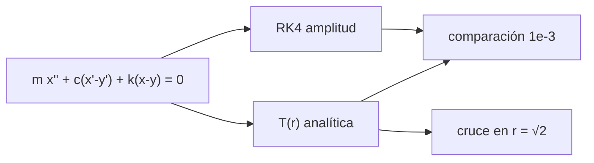

# B47-C11 — Aislamiento vibracional

<!-- nav:top -->
[🏠 Programa](../../../../README.md) · [📚 Bloque B47](../../../tronco-comun/B47-instrumentacion-y-observatorios-espaciales.md) · [← Anterior: B47-C10 — Estabilidad de apuntamiento](../B47-C10-estabilidad-de-apuntamiento/CLASE.md) · [Siguiente: B47-C12 — Óptica en ambientes de vacío →](../B47-C12-optica-en-ambientes-de-vacio/CLASE.md)
<!-- /nav -->

## 1. Ubicación, nivel y alcance

Clase 11 del bloque B47. Nivel N3. Durante el lanzamiento y la operación, la estructura vibra y esa vibración llega al instrumento. Un aislador (resorte con amortiguador) puede atenuarla, pero solo por encima de cierta frecuencia. Aquí calculas la transmisibilidad analítica de un oscilador con excitación en la base y la contrastas con una integración temporal de Runge-Kutta. Usas [B05](../../../tronco-comun/B05-fisica-fundamental-para-el-espacio.md) y [B10](../../../tronco-comun/B10-algebra-lineal-y-matematicas-geometricas.md). Los parámetros son ilustrativos.

## 2. Por qué esta clase existe

Un aislador mal sintonizado amplifica en vez de atenuar. La decisión central: **¿qué frecuencia natural y qué amortiguamiento aíslan sin amplificar demasiado en la resonancia?**

## 3. Lo que podrás hacer al terminar

1. Escribir la ecuación del oscilador con excitación en la base.
2. Calcular la transmisibilidad `T(r)`.
3. Integrar con Runge-Kutta y medir la amplitud estacionaria.
4. Verificar el cruce `T = 1` en `r = √2`.
5. Comparar amortiguamiento bajo y alto.
6. Reconocer los límites del modelo lineal.

La evidencia es la **ficha del aislador vibracional** del ejercicio 12 (sección 20).

## 4. Con qué llegas y cómo comprobarlo

1. ¿Qué es una incertidumbre?
2. ¿Qué es una simulación Monte Carlo?
3. ¿Qué es una tabla de resultados?
4. ¿Qué es un valor ilustrativo?
5. ¿Qué es una verificación?

<details>
<summary>Ver respuestas</summary>

1. Un intervalo en que se espera el valor verdadero. 2. Repetir con números aleatorios de semilla fija. 3. Un resumen ordenado de cálculos. 4. Un valor propuesto para el ejemplo, no medido. 5. Comparar un cálculo con un caso independiente.
</details>

Con cuatro o cinco aciertos, sigue; si no, repasa los prerrequisitos.

## 5. Un caso de contexto y casos de referencia

Con una frecuencia natural de `10 Hz` (ilustrativa) y `ζ = 0,05`, la transmisibilidad es `10,05` en la resonancia, `1` en `r = √2` y `0,0143` en `r = 10`; con `ζ = 0,5` esas cifras son `1,414`, `1` y `0,1010`. Es el **ejemplo conductor**; no es el aislador de un instrumento.

## 6. Vocabulario

La **frecuencia natural** `f_n`. La **razón de frecuencias** `r = f/f_n`. El **amortiguamiento** `ζ`. La **transmisibilidad** `T`. La **resonancia**: `r ≈ 1`. La **región de aislamiento**: `r > √2`. El **factor de calidad** `Q ≈ 1/(2ζ)`.

## 7. Modelo mental: un auto con amortiguadores

Un auto con buenos amortiguadores absorbe los baches rápidos (alta frecuencia) pero se balancea si los baches coinciden con su ritmo natural (resonancia).



*Descripción textual:* la base impone un movimiento, el oscilador responde con una amplitud que depende de la razón de frecuencias y del amortiguamiento.

Analogía: un auto con amortiguadores. Límite: oscilador lineal de un grado.

## 8. La explicación, paso a paso

### 8.1 Transmisibilidad

| ζ | r | T analítica | amplitud simulada |
|---|---|---|---|
| 0,05 | 0,5 | 1,332042 | 1,332039 |
| 0,05 | 1 | 10,049876 | 10,049872 |
| 0,05 | √2 | 1,000000 | 0,999998 |
| 0,05 | 3 | 0,130412 | 0,130412 |
| 0,05 | 10 | 0,014284 | 0,014284 |
| 0,5 | 0,5 | 1,240347 | 1,240346 |
| 0,5 | 1 | 1,414214 | 1,414214 |
| 0,5 | √2 | 1,000000 | 1,000000 |
| 0,5 | 3 | 0,370117 | 0,370117 |
| 0,5 | 10 | 0,101000 | 0,101000 |

### 8.2 Cruce y resonancia

`T(√2)` vale `1,000000000000` y `1,000000000000` para ambos `ζ`: todos los aisladores cruzan 1 en `√2`. El máximo para `ζ = 0,05` es `10,0622` en `r = 0,9975`, frente a `1/(2ζ) = 10,0`.

### 8.3 Compromiso

A baja frecuencia (`r = 0,5`) ambos amplifican (`1,33` y `1,24`). En `r = 3` el amortiguamiento alto transmite `0,370` frente a `0,130`: más amortiguamiento reduce la resonancia pero empeora el aislamiento a alta frecuencia.

### 8.4 Lectura

Para atenuar una vibración de 100 Hz con `T = 0,1` hace falta `f_n` de unos 30 Hz con poco amortiguamiento. El modelo es lineal, con un grado de libertad; los aisladores reales tienen no linealidades y varios modos.

## 9. Magnitudes, símbolos y unidades

| Símbolo | Qué es | Unidad | Valor / nota |
|---|---|---|---|
| `f_n` | frecuencia natural | Hz | 10 (ilustrativo) |
| `ζ` | amortiguamiento relativo | — | 0,05 y 0,5 |
| `r` | `f/f_n` | — | 0,5 a 10 |
| `T` | transmisibilidad | — | 10,05 en resonancia (ζ = 0,05) |
| `Q` | factor de calidad | — | ≈ 10 para ζ = 0,05 |

## 10. Convenciones y referencias

Sin unidades en `T` y `r`; base con `y = sen(ωt)` de amplitud unitaria; régimen estacionario.

## 11. De dónde sale lo que afirmamos

| ID | Fuente | Localizador | Respalda | Estado |
|---|---|---|---|---|
| — | Sin fuente externa | — | relaciones estándar que verifica el laboratorio | No se consultó una fuente para esta clase |

Límites: no se consultó ninguna fuente; el modelo es el del oscilador de un grado de libertad de un texto básico y las cifras son ilustrativas.

## 12. Cómo ver los resultados

| r | T (ζ = 0,05) | T (ζ = 0,5) |
|---|---|---|
| 0,5 | 1,332 | 1,240 |
| 1 | 10,050 | 1,414 |
| 3 | 0,130 | 0,370 |
| 10 | 0,0143 | 0,1010 |

Descripción larga: la resonancia domina en `r = 1` y el aislamiento mejora con `r`.

## 13. Ejemplo trabajado: la transmisibilidad en r = 3

**Paso 1 · Numerador.** `1 + (2ζr)² = 1 + 0,09 = 1,09` con `ζ = 0,05`.

**Paso 2 · Denominador.** `(1 − 9)² + 0,09 = 64,09`.

**Paso 3 · Raíz.** `T = √(1,09/64,09) = 0,1304`.

**Lectura.** La amplitud se atenúa a un 13 %.

## 14. Distintas formas de describir el resultado

**Por fórmula:** `T(r)`. **Por tabla:** valores. **Por simulación:** RK4. **Por código:** `aislamiento.py`.

## 15. Práctica guiada

**Ejercicio 1 · con los pasos indicados.** `T(0,5)` con `ζ = 0,05`. *Pasos:* ejemplo 13.

<details><summary>Solución comentada</summary>

`1,3320`.
</details>

**Ejercicio 2 · con una pista.** `T(1)` aproximado `1/(2ζ)`.

<details><summary>Solución comentada</summary>

`10`.
</details>

**Ejercicio 3 · casi autónomo.** `T(3)` con `ζ = 0,5`.

<details><summary>Solución comentada</summary>

`0,3701`.
</details>

## 16. Práctica autónoma, transferencia e integrador

**Ejercicio 4.** `T(10)` con `ζ = 0,05`.

<details><summary>Solución comentada</summary>

`0,0143`.
</details>

**Ejercicio 5.** Error relativo simulación frente a `T(1)`, `ζ = 0,05`.

<details><summary>Solución comentada</summary>

`3,7 × 10⁻⁷`.
</details>

**Ejercicio 6.** `r` mínima para aislar.

<details><summary>Solución comentada</summary>

`√2 = 1,4142`.
</details>

**Ejercicio 7.** `T(2)` con `ζ = 0,05`.

<details><summary>Solución comentada</summary>

`0,3392`.
</details>

**Ejercicio 8.** `f_n` para `r = 3` a 90 Hz.

<details><summary>Solución comentada</summary>

`30 Hz`.
</details>

**Ejercicio 9 · transferencia.** **Transferencia.** ¿Por qué el amortiguamiento alto empeora el aislamiento a alta frecuencia?

<details><summary>Solución comentada</summary>

Porque el amortiguador transmite fuerza proporcional a la velocidad de la base.
</details>

**Ejercicio 10 · transferencia.** **Transferencia.** Un compañero afirma que todo aislador atenúa. Responde.

<details><summary>Solución comentada</summary>

Solo por encima de `√2 f_n`; por debajo amplifica.
</details>

**Ejercicio 11 · transferencia.** **Transferencia.** ¿Qué pasa con la resonancia si se duplica `ζ`?

<details><summary>Solución comentada</summary>

El pico baja a casi la mitad (`≈ 1/(2ζ)`).
</details>

**Ejercicio 12.** **Integrador.** Elabora tu *ficha del aislador vibracional*: `T(r)` para dos `ζ`, cruce, compromiso y límites.

<details><summary>Solución comentada</summary>

Secciones 8.1–8.4.
</details>

**Ejercicio 12 · integrador.** **Integrador.** Elabora tu *ficha del aislador vibracional*: `T(r)` para dos `ζ`, cruce, compromiso y límites.

<details><summary>Solución modelo</summary>

Secciones 8.1–8.4.
</details>

## 17. Laboratorio: oscilador con excitación en la base

El script [aislamiento.py](aislamiento.py) integra el oscilador con RK4 y compara con `T(r)` (**comprueba** `10⁻³` y el cruce a `10⁻¹²`).

**Datos:** ninguna constante; parámetros **ilustrativos**. **Predice antes de ejecutar:** ¿cuánto vale T en la resonancia con poco amortiguamiento? (≈ 10.) **Ejecución del 2026-11-09 (Python 3.12.9):**

```text
Python 3.12.9 (biblioteca estandar)
  zeta   r=f/fn  T analitica  amp simulada
  0.05   0.5000     1.332042      1.332039
  0.05   1.0000    10.049876     10.049872
  0.05   1.4142     1.000000      0.999998
  0.05   3.0000     0.130412      0.130412
  0.05  10.0000     0.014284      0.014284
  0.50   0.5000     1.240347      1.240346
  0.50   1.0000     1.414214      1.414214
  0.50   1.4142     1.000000      1.000000
  0.50   3.0000     0.370117      0.370117
  0.50  10.0000     0.101000      0.101000
T(sqrt 2): zeta 0.05 -> 1.000000000000 ; zeta 0.5 -> 1.000000000000
maximo de T con zeta = 0.05: 10.0622 en r = 0.9975 ; aproximacion 1/(2 zeta) = 10.0000
Pruebas superadas.
```

```bash
python programa/clases/B47/B47-C11-aislamiento-vibracional/aislamiento.py
```

**Límites:** lineal, un grado de libertad, excitación armónica.

## 18. Errores frecuentes y cómo corregirlos

**Creer que más amortiguamiento siempre mejora.** Se corrige con 8.3.

**Olvidar el cruce en `√2`.** Se corrige con 8.2.

**Medir antes del régimen estacionario.** Se corrige con 8.1.

**Tomar `f_n = 10 Hz` como valor de un instrumento.** Se corrige con la sección 10.

## 19. Cómo sabrás que vas bien

Tras la sección 8: ¿qué resultado esperabas y cuál obtuviste? Si dudas, repasa el ejemplo 13. Tras el laboratorio: ¿qué comprueba? (ver la sección 17).

## 20. Qué entregas y cómo se evalúa

El producto es tu **ficha del aislador vibracional** (ejercicio 12).

| Criterio | Inicial | En desarrollo | Logrado | Destacado |
|---|---|---|---|---|
| Conceptos | Los confunde | Parciales | conceptos de la clase | Explica los límites |
| Cálculo | Sin unidades | Con errores | Tablas completas | Calcula casos nuevos |
| Numérico | Sin comprobar | Un caso | Contraste con el análisis | Interpreta las diferencias |
| Fuentes | Sin fuente | Sin fecha | fuentes con fecha | Declara lo ilustrativo |
| Límites | No los nombra | Uno | Tres | Discute qué falta del modelo |

**Condiciones críticas (no se compensan con promedio):** rotular lo ilustrativo; no presentar el modelo como diseño de una misión real; citar solo lo consultado.

## 21. Ética, seguridad y límites

Clase educativa: los modelos son simplificados. Accesibilidad: tablas equivalentes a las gráficas, fórmulas en texto, ejercicios sin conexión.

## 22. Para cerrar y seguir

El aislador amplifica hasta `r = √2` y atenúa después; con `ζ = 0,05` la resonancia da `10,0` y a `r = 10` queda `0,014`. Queda una pregunta: ¿qué pasa con la óptica cuando el entorno es vacío?

**Glosario español–inglés.** aislador · *isolator*; transmisibilidad · *transmissibility*; resonancia · *resonance*; amortiguamiento · *damping*; frecuencia natural · *natural frequency*.

**Continuidad.** [B47-C12](../B47-C12-optica-en-ambientes-de-vacio/CLASE.md) estudia la óptica en ambientes de vacío.

**Referencias:** ver sección 11.

<!-- nav:bottom -->
---

[← Anterior: B47-C10 — Estabilidad de apuntamiento](../B47-C10-estabilidad-de-apuntamiento/CLASE.md) · [📚 Bloque B47](../../../tronco-comun/B47-instrumentacion-y-observatorios-espaciales.md) · [Siguiente: B47-C12 — Óptica en ambientes de vacío →](../B47-C12-optica-en-ambientes-de-vacio/CLASE.md)
<!-- /nav -->
