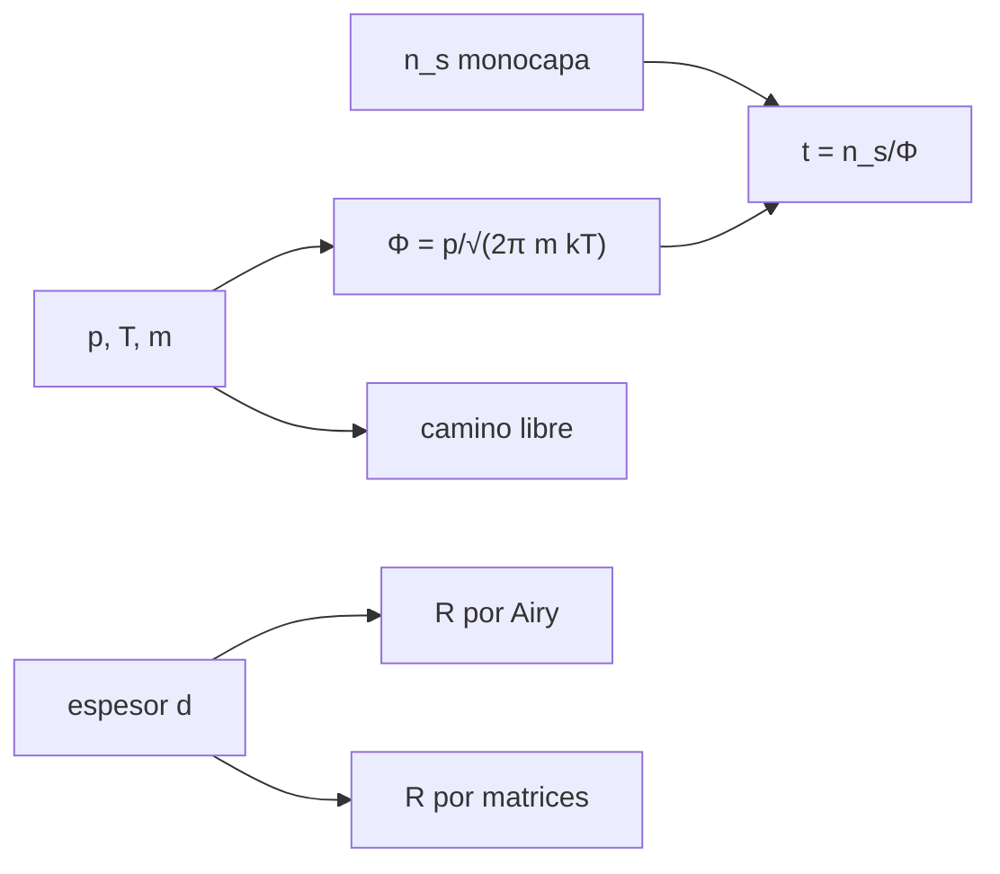

# B47-C12 — Óptica en ambientes de vacío

<!-- nav:top -->
[🏠 Programa](../../../../README.md) · [📚 Bloque B47](../../../tronco-comun/B47-instrumentacion-y-observatorios-espaciales.md) · [← Anterior: B47-C11 — Aislamiento vibracional](../B47-C11-aislamiento-vibracional/CLASE.md) · [Siguiente: B47-C13 — Criogenia instrumental →](../B47-C13-criogenia-instrumental/CLASE.md)
<!-- /nav -->

## 1. Ubicación, nivel y alcance

Clase 12 del bloque B47. Nivel N3. En el vacío no hay aire, pero tampoco hay protección: los materiales emiten gases que se pegan a las superficies frías y degradan los espejos. Aquí calculas el camino libre medio, el flujo de Hertz-Knudsen y el tiempo de monocapa de un contaminante, y el efecto de una película delgada sobre la reflectancia por dos métodos. Usas [B05](../../../tronco-comun/B05-fisica-fundamental-para-el-espacio.md) y [B42](../../../tronco-comun/B42-optica-fisica-y-optica-adaptativa.md). Las cifras son ilustrativas.

## 2. Por qué esta clase existe

La contaminación reduce la reflectancia y la transmisión sin aviso. La decisión central: **¿cuánto tarda en cubrirse una superficie y cuánto cambia la reflectancia por una película?**

## 3. Lo que podrás hacer al terminar

1. Calcular el camino libre medio `kT/(√2 π d² p)`.
2. Calcular el flujo de Hertz-Knudsen y verificarlo con `n⟨v⟩/4`.
3. Estimar el tiempo de monocapa.
4. Calcular la reflectancia de una película por Airy y por matrices.
5. Interpretar el efecto de la longitud de onda y el espesor.
6. Reconocer los límites de un modelo con adherencia 1.

La evidencia es la **ficha de la óptica en vacío** del ejercicio 12 (sección 20).

## 4. Con qué llegas y cómo comprobarlo

1. ¿Qué es una incertidumbre?
2. ¿Qué es una simulación Monte Carlo?
3. ¿Qué es una tabla de resultados?
4. ¿Qué es un valor ilustrativo?
5. ¿Qué es una verificación?

<details>
<summary>Ver respuestas</summary>

1. Un intervalo en que se espera el valor verdadero. 2. Repetir con números aleatorios de semilla fija. 3. Un resumen ordenado de cálculos. 4. Un valor propuesto para el ejemplo, no medido. 5. Comparar un cálculo con un caso independiente.
</details>

Con cuatro o cinco aciertos, sigue; si no, repasa los prerrequisitos.

## 5. Un caso de contexto y casos de referencia

A `10⁻⁶ Pa` el camino libre medio es de `6651 m`; un contaminante de 100 u a `10⁻⁸ Pa` forma una monocapa en `0,75 días`. Una película de 100 nm de índice 1,5 sobre aluminio (ilustrativo) baja la reflectancia de `0,9210` a `0,8553`. Es el **ejemplo conductor**; no mide ninguna contaminación real.

## 6. Vocabulario

El **camino libre medio**. El **flujo de Hertz-Knudsen** `Φ = p/√(2π m k T)`. La **monocapa**. El **coeficiente de adherencia**. La **desgasificación** (*outgassing*). La **película delgada**. La **reflectancia**. El **langmuir**.

## 7. Modelo mental: polvo cayendo sobre una mesa

El contaminante cae sobre el espejo como polvo sobre una mesa en una habitación cerrada: lentamente, pero sin pausa, hasta cubrirla.



*Descripción textual:* la presión y la masa molecular fijan el flujo de moléculas, que forma una película cuyo espesor modifica la reflectancia.

Analogía: polvo cayendo sobre una mesa. Límite: gas ideal, adherencia 1.

## 8. La explicación, paso a paso

### 8.1 Camino libre medio (N₂, 293 K, d = 3,7 × 10⁻¹⁰ m)

| p (Pa) | λ (m) |
|---|---|
| 101325 | 6,564 × 10⁻⁸ |
| 1 | 6,651 × 10⁻³ |
| 0,001 | 6,651 × 10⁰ |
| 0,000001 | 6,651 × 10³ |

### 8.2 Flujo y monocapa

| M (u) | Hertz-Knudsen (m⁻² s⁻¹) | n⟨v⟩/4 numérica |
|---|---|---|
| 28 | 2,908915 × 10¹⁴ | 2,908915 × 10¹⁴ |
| 100 | 1,539253 × 10¹⁴ | 1,539253 × 10¹⁴ |

Las dos vías coinciden a `10⁻⁶`. Con `n_s = 10¹⁹ m⁻²`, el contaminante de 100 u a `10⁻⁸ Pa` tarda `6,497 × 10⁴ s` = `0,75 días`. El N₂ a `10⁻⁶ Torr` (1 langmuir por segundo) tarda `2,58 s`.

### 8.3 Película sobre aluminio (550 nm, n = 0,96 + 6,69 i, película n = 1,5)

| d (nm) | R Airy | R matrices |
|---|---|---|
| 0 | 0,92098391 | 0,92098391 |
| 10 | 0,91656287 | 0,91656287 |
| 50 | 0,86893937 | 0,86893937 |
| 100 | 0,85526096 | 0,85526096 |
| 200 | 0,91206502 | 0,91206502 |

La reflectancia oscila con el espesor (interferencia): baja hasta ~100 nm y sube de nuevo cerca de media longitud de onda óptica (`λ/2n = 183 nm`).

### 8.4 Lectura

El vacío cambia la longitud de onda: con índice del aire 1,000277 la de 550 nm en el aire es `0,0000 nm` menor que en vacío. Los números de contaminación son ilustrativos; cada material tiene su desgasificación y su adherencia.

## 9. Magnitudes, símbolos y unidades

| Símbolo | Qué es | Unidad | Valor / nota |
|---|---|---|---|
| `λ` | camino libre medio | m | 6,65 × 10³ a 10⁻⁶ Pa |
| `Φ` | flujo molecular | m⁻² s⁻¹ | 1,539 × 10¹⁴ |
| `k_B` | Boltzmann | J/K | 1,380649 × 10⁻²³ (NIST) |
| `u` | unidad de masa atómica | kg | 1,66053906892 × 10⁻²⁷ (NIST) |
| `n_s` | monocapa | m⁻² | 10¹⁹ (ilustrativo) |

## 10. Convenciones y referencias

SI; 293 K; adherencia 1; incidencia normal; 1 Torr = 101325/760 Pa.

## 11. De dónde sale lo que afirmamos

| ID | Fuente | Localizador | Respalda | Estado |
|---|---|---|---|---|
| S1 | NIST, *Fundamental Physical Constants* (CODATA 2022) | https://physics.nist.gov/cuu/Constants/Table/allascii.txt | constantes citadas en la sección 9 | Consultada el 2026-11-09 |

Límites: solo `k_B`, `u` y `N_A` provienen de NIST. El diámetro molecular, el contaminante, la densidad de monocapa y los índices del aluminio y de la película son ilustrativos y no se consultaron.

## 12. Cómo ver los resultados

| Magnitud | Valor |
|---|---|
| Camino libre a 10⁻⁶ Pa | 6651 m |
| Monocapa (100 u, 10⁻⁸ Pa) | 0,75 d |
| R sin película | 0,9210 |
| R con 100 nm | 0,8553 |

Descripción larga: una película de 100 nm reduce la reflectancia unos siete puntos.

## 13. Ejemplo trabajado: el flujo de N₂ a 10⁻⁸ Pa

**Paso 1 · Masa.** `m = 28 u = 4,65 × 10⁻²⁶ kg`.

**Paso 2 · Denominador.** `√(2π m k T) = 3,44 × 10⁻²³`.

**Paso 3 · Cociente.** `Φ = 10⁻⁸/3,44 × 10⁻²³ = 2,909 × 10¹⁴ m⁻² s⁻¹`.

## 14. Distintas formas de describir el resultado

**Por fórmula:** Hertz-Knudsen. **Por integral:** `⟨v⟩`. **Por matrices:** película. **Por código:** `vacio.py`.

## 15. Práctica guiada

**Ejercicio 1 · con los pasos indicados.** Camino libre a 1 Pa.

<details><summary>Solución comentada</summary>

`6,65 × 10⁻³ m`.
</details>

**Ejercicio 2 · con una pista.** Razón de caminos libres entre `10⁻⁶` y 1 Pa.

<details><summary>Solución comentada</summary>

`10⁶`.
</details>

**Ejercicio 3 · casi autónomo.** Flujo de 100 u a `10⁻⁸ Pa`.

<details><summary>Solución comentada</summary>

`1,539 × 10¹⁴`.
</details>

## 16. Práctica autónoma, transferencia e integrador

**Ejercicio 4.** Tiempo de monocapa en días.

<details><summary>Solución comentada</summary>

`0,75`.
</details>

**Ejercicio 5.** Tiempo de N₂ a 1 langmuir (s).

<details><summary>Solución comentada</summary>

`2,58`.
</details>

**Ejercicio 6.** Reflectancia a 0 nm.

<details><summary>Solución comentada</summary>

`0,9210`.
</details>

**Ejercicio 7.** Pérdida a 100 nm.

<details><summary>Solución comentada</summary>

`6,57 puntos`.
</details>

**Ejercicio 8.** Diferencia Airy−matrices a 50 nm.

<details><summary>Solución comentada</summary>

`2,2 × 10⁻¹⁶`.
</details>

**Ejercicio 9 · transferencia.** **Transferencia.** ¿Por qué la presión baja a 10⁻⁶ Pa no basta si hay un contaminante frío?

<details><summary>Solución comentada</summary>

Porque las moléculas se condensan en superficies frías y se acumulan.
</details>

**Ejercicio 10 · transferencia.** **Transferencia.** Un compañero afirma que 0,75 días es el tiempo real de contaminación. Responde.

<details><summary>Solución comentada</summary>

Es un cálculo con adherencia 1 y presión parcial ilustrativa.
</details>

**Ejercicio 11 · transferencia.** **Transferencia.** ¿Qué cambia con 10⁻⁷ Pa?

<details><summary>Solución comentada</summary>

El tiempo de monocapa es 10 veces menor (`0,075 d`).
</details>

**Ejercicio 12.** **Integrador.** Elabora tu *ficha de la óptica en vacío*: camino libre, flujo, monocapa, película y límites.

<details><summary>Solución comentada</summary>

Secciones 8.1–8.4.
</details>

**Ejercicio 12 · integrador.** **Integrador.** Elabora tu *ficha de la óptica en vacío*: camino libre, flujo, monocapa, película y límites.

<details><summary>Solución modelo</summary>

Secciones 8.1–8.4.
</details>

## 17. Laboratorio: contaminación de un espejo en vacío

El script [vacio.py](vacio.py) calcula flujo, monocapa y reflectancia por dos métodos (**comprueba** el flujo a `10⁻⁶` y la reflectancia a `10⁻¹²`).

**Datos:** `k_B` y `u` de NIST; contaminante y espejo **ilustrativos**. **Predice antes de ejecutar:** ¿cuánto tarda una monocapa? (≈ 0,75 días.) **Ejecución del 2026-11-09 (Python 3.12.9):**

```text
Python 3.12.9 (biblioteca estandar)
p =  1.013e+05 Pa : camino libre medio = 6.5640e-08 m
p =  1.000e+00 Pa : camino libre medio = 6.6509e-03 m
p =  1.000e-03 Pa : camino libre medio = 6.6509e+00 m
p =  1.000e-06 Pa : camino libre medio = 6.6509e+03 m
M =  28.0 u a 1e-8 Pa: Hertz-Knudsen = 2.908915e+14 m-2 s-1 ; n<v>/4 con <v> numerica = 2.908915e+14
M = 100.0 u a 1e-8 Pa: Hertz-Knudsen = 1.539253e+14 m-2 s-1 ; n<v>/4 con <v> numerica = 1.539253e+14
tiempo de monocapa del contaminante (100 u, 1e-8 Pa): 6.497e+04 s = 0.75 dias
tiempo de monocapa de N2 a 1e-6 Torr: 2.58 s
  d [nm]       R Airy     R matriz
       0   0.92098391   0.92098391
      10   0.91656287   0.91656287
      50   0.86893937   0.86893937
     100   0.85526096   0.85526096
     200   0.91206502   0.91206502
diferencia de longitud de onda aire-vacio a 550 nm: 0.1523 nm
Pruebas superadas.
```

```bash
python programa/clases/B47/B47-C12-optica-en-ambientes-de-vacio/vacio.py
```

**Límites:** adherencia 1, película homogénea y transparente.

## 18. Errores frecuentes y cómo corregirlos

**Usar `n⟨v⟩` sin el factor 1/4.** Se corrige con 8.2.

**Confundir monocapa con película de 100 nm.** Se corrige con 8.3.

**Olvidar la adherencia.** Se corrige con la sección 10.

**Tomar los índices como datos.** Se corrige con la sección 10.

## 19. Cómo sabrás que vas bien

Tras la sección 8: ¿qué resultado esperabas y cuál obtuviste? Si dudas, repasa el ejemplo 13. Tras el laboratorio: ¿qué comprueba? (ver la sección 17).

## 20. Qué entregas y cómo se evalúa

El producto es tu **ficha de la óptica en vacío** (ejercicio 12).

| Criterio | Inicial | En desarrollo | Logrado | Destacado |
|---|---|---|---|---|
| Conceptos | Los confunde | Parciales | conceptos de la clase | Explica los límites |
| Cálculo | Sin unidades | Con errores | Tablas completas | Calcula casos nuevos |
| Numérico | Sin comprobar | Un caso | Contraste con el análisis | Interpreta las diferencias |
| Fuentes | Sin fuente | Sin fecha | fuentes con fecha | Declara lo ilustrativo |
| Límites | No los nombra | Uno | Tres | Discute qué falta del modelo |

**Condiciones críticas (no se compensan con promedio):** rotular lo ilustrativo; no presentar el modelo como diseño de una misión real; citar solo lo consultado.

## 21. Ética, seguridad y límites

Clase educativa: los modelos son simplificados. Accesibilidad: tablas equivalentes a las gráficas, fórmulas en texto, ejercicios sin conexión.

## 22. Para cerrar y seguir

A `10⁻⁶ Pa` una molécula recorre `6,7 km` entre choques y un contaminante cubre el espejo en `0,75 días`. Queda una pregunta: ¿cómo se mantiene frío el instrumento?

**Glosario español–inglés.** camino libre medio · *mean free path*; monocapa · *monolayer*; desgasificación · *outgassing*; película delgada · *thin film*; reflectancia · *reflectance*.

**Continuidad.** [B47-C13](../B47-C13-criogenia-instrumental/CLASE.md) estudia la criogenia instrumental.

**Referencias:** ver sección 11.

<!-- nav:bottom -->
---

[← Anterior: B47-C11 — Aislamiento vibracional](../B47-C11-aislamiento-vibracional/CLASE.md) · [📚 Bloque B47](../../../tronco-comun/B47-instrumentacion-y-observatorios-espaciales.md) · [Siguiente: B47-C13 — Criogenia instrumental →](../B47-C13-criogenia-instrumental/CLASE.md)
<!-- /nav -->
