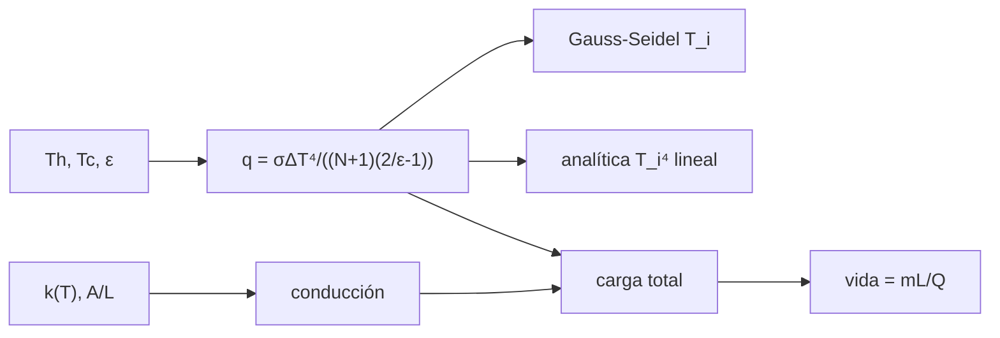

# B47-C13 — Criogenia instrumental

<!-- nav:top -->
[🏠 Programa](../../../../README.md) · [📚 Bloque B47](../../../tronco-comun/B47-instrumentacion-y-observatorios-espaciales.md) · [← Anterior: B47-C12 — Óptica en ambientes de vacío](../B47-C12-optica-en-ambientes-de-vacio/CLASE.md) · [Siguiente: B47-C14 — Radiación y degradación →](../B47-C14-radiacion-y-degradacion/CLASE.md)
<!-- /nav -->

## 1. Ubicación, nivel y alcance

Clase 13 del bloque B47. Nivel N3. Para reducir el fondo infrarrojo un instrumento se enfría, y el calor que llega por radiación y por conducción debe ser menor que la capacidad del sistema frío. Aquí calculas el flujo entre escudos radiativos, sus temperaturas de equilibrio por dos vías, la conducción por soportes y la vida de un criógeno. Usas [B05](../../../tronco-comun/B05-fisica-fundamental-para-el-espacio.md). Los parámetros son ilustrativos.

## 2. Por qué esta clase existe

Cada vatio parásito acorta la vida de un criógeno. La decisión central: **¿cuántos escudos y qué soportes bastan para una vida útil dada?**

## 3. Lo que podrás hacer al terminar

1. Calcular el flujo entre `N` escudos grises.
2. Hallar las temperaturas de los escudos iterando el balance.
3. Contrastarlas con la solución analítica.
4. Integrar la conducción de un soporte con `k(T)`.
5. Calcular la vida de un criógeno.
6. Reconocer los límites de superficies grises ideales.

La evidencia es la **ficha de la criogenia instrumental** del ejercicio 12 (sección 20).

## 4. Con qué llegas y cómo comprobarlo

1. ¿Qué es una incertidumbre?
2. ¿Qué es una simulación Monte Carlo?
3. ¿Qué es una tabla de resultados?
4. ¿Qué es un valor ilustrativo?
5. ¿Qué es una verificación?

<details>
<summary>Ver respuestas</summary>

1. Un intervalo en que se espera el valor verdadero. 2. Repetir con números aleatorios de semilla fija. 3. Un resumen ordenado de cálculos. 4. Un valor propuesto para el ejemplo, no medido. 5. Comparar un cálculo con un caso independiente.
</details>

Con cuatro o cinco aciertos, sigue; si no, repasa los prerrequisitos.

## 5. Un caso de contexto y casos de referencia

Con emisividad `0,02`, área `0,2 m²`, 4 soportes y 50 kg de criógeno (ilustrativos), la carga parásita baja de `818,2 mW` sin escudos a `28,0 mW` con 40 escudos, y la vida pasa de `0,040` a `1,182 años`. Es el **ejemplo conductor**; no es un instrumento real.

## 6. Vocabulario

El **escudo radiativo**. El **aislamiento multicapa**. La **emisividad** `ε`. La **conducción** `Q = (A/L)∫k dT`. El **criógeno**. El **calor latente**. La **carga parásita**.

## 7. Modelo mental: un termo con capas

Es un termo con varias capas reflectantes: cada capa intermedia reparte la diferencia de temperatura y reduce el calor que pasa en proporción a `1/(N+1)`.



*Descripción textual:* la radiación entre escudos y la conducción por soportes suman una carga que consume el criógeno.

Analogía: un termo con capas. Límite: grises, difusas, régimen estacionario.

## 8. La explicación, paso a paso

### 8.1 Flujo radiativo (ε = 0,02; Th = 290 K; Tc = 40 K)

| N escudos | q (W/m²) | q/q₀ |
|---|---|---|
| 0 | 4,0496 | 1 |
| 1 | 2,0248 | 0,5000 |
| 3 | 1,0124 | 0,2500 |
| 10 | 0,3681 | 0,0909 |

El cociente es `1/(N+1)` exactamente.

### 8.2 Temperaturas con 3 escudos

| superficie | Gauss-Seidel (K) | analítica (K) |
|---|---|---|
| 0 | 290,000000 | 290,000000 |
| 1 | 269,883549 | 269,883549 |
| 2 | 243,882024 | 243,882024 |
| 3 | 205,116610 | 205,116610 |
| 4 | 40,000000 | 40,000000 |

### 8.3 Conducción y vida

Un soporte (`k = 0,005 T`, `A = 2 mm²`, `L = 0,2 m`) conduce `2,062500 mW` por trapecios y `2,062500 mW` por la fórmula; cuatro soportes, `8,250 mW`.

| N | carga total (mW) | vida (años) |
|---|---|---|
| 0 | 818,168 | 0,040 |
| 10 | 81,879 | 0,404 |
| 40 | 28,004 | 1,182 |

### 8.4 Lectura

Con muchos escudos la conducción por los soportes (8,25 mW) pasa a ser un tercio de la carga. Un resumen de Spitzer cita una vida criogénica proyectada de más de 5 años; no se compara con estas cifras ilustrativas.

## 9. Magnitudes, símbolos y unidades

| Símbolo | Qué es | Unidad | Valor / nota |
|---|---|---|---|
| `σ` | Stefan-Boltzmann | W m⁻² K⁻⁴ | 5,670374419 × 10⁻⁸ (NIST) |
| `ε` | emisividad | — | 0,02 (ilustrativo) |
| `N` | escudos | — | 0 a 40 |
| `Q` | carga parásita | W | 0,0280 |
| `L` | calor latente | J/kg | 2,09 × 10⁴ (uso general) |

## 10. Convenciones y referencias

SI; temperaturas en K; superficies paralelas grandes; estado estacionario.

## 11. De dónde sale lo que afirmamos

| ID | Fuente | Localizador | Respalda | Estado |
|---|---|---|---|---|
| S1 | NIST, *Fundamental Physical Constants* (CODATA 2022) | https://physics.nist.gov/cuu/Constants/Table/allascii.txt | constantes citadas en la sección 9 | Consultada el 2026-11-09 |
| S2 | Werner et al., *The Spitzer Space Telescope Mission* | https://arxiv.org/abs/astro-ph/0406223 | vida criogénica proyectada de más de 5 años (resumen) | Solo resumen, consultado el 2026-11-09 |

Límites: S2 es solo el resumen de Spitzer (vida criogénica proyectada de más de 5 años); no se usa otra cifra. Todo lo demás es ilustrativo y el calor latente es un valor de uso general sin consultar.

## 12. Cómo ver los resultados

| N | q (W/m²) | vida (años) |
|---|---|---|
| 0 | 4,050 | 0,040 |
| 10 | 0,368 | 0,404 |
| 40 | 0,099 | 1,182 |

Descripción larga: la vida crece con el número de escudos hasta que domina la conducción.

## 13. Ejemplo trabajado: el flujo con 3 escudos

**Paso 1 · `ΔT⁴`.** `290⁴ − 40⁴ = 7,07 × 10⁹`.

**Paso 2 · Factor.** `(N+1)(2/ε−1) = 4 × 99 = 396`.

**Paso 3 · Cociente.** `q = 5,67 × 10⁻⁸ × 7,07 × 10⁹/396 = 1,0124 W/m²`.

## 14. Distintas formas de describir el resultado

**Por fórmula:** `q`. **Por iteración:** Gauss-Seidel. **Por integral:** `∫k dT`. **Por código:** `criogenia.py`.

## 15. Práctica guiada

**Ejercicio 1 · con los pasos indicados.** `q/q₀` con 9 escudos.

<details><summary>Solución comentada</summary>

`1/10 = 0,1`.
</details>

**Ejercicio 2 · con una pista.** `q` con 1 escudo.

<details><summary>Solución comentada</summary>

`2,0248 W/m²`.
</details>

**Ejercicio 3 · casi autónomo.** `T₂` con 3 escudos.

<details><summary>Solución comentada</summary>

`243,882 K`.
</details>

## 16. Práctica autónoma, transferencia e integrador

**Ejercicio 4.** `T₁` con 3 escudos.

<details><summary>Solución comentada</summary>

`269,884 K`.
</details>

**Ejercicio 5.** Conducción de 4 soportes.

<details><summary>Solución comentada</summary>

`8,25 mW`.
</details>

**Ejercicio 6.** Carga total con 10 escudos.

<details><summary>Solución comentada</summary>

`81,88 mW`.
</details>

**Ejercicio 7.** Vida con 40 escudos.

<details><summary>Solución comentada</summary>

`1,18 años`.
</details>

**Ejercicio 8.** Razón de vidas 40/10 escudos.

<details><summary>Solución comentada</summary>

`2,92`.
</details>

**Ejercicio 9 · transferencia.** **Transferencia.** ¿Por qué el aislamiento multicapa real rinde peor que `1/(N+1)`?

<details><summary>Solución comentada</summary>

Por conducción entre capas, costuras y contacto.
</details>

**Ejercicio 10 · transferencia.** **Transferencia.** Un compañero afirma que 1,2 años es la vida de un instrumento real. Responde.

<details><summary>Solución comentada</summary>

Es un resultado de parámetros ilustrativos.
</details>

**Ejercicio 11 · transferencia.** **Transferencia.** ¿Qué pasa si se duplica la emisividad?

<details><summary>Solución comentada</summary>

`2/ε − 1` pasa de 99 a 49: el flujo casi se duplica.
</details>

**Ejercicio 12.** **Integrador.** Elabora tu *ficha de la criogenia instrumental*: flujo por escudos, temperaturas, conducción, vida y límites.

<details><summary>Solución comentada</summary>

Secciones 8.1–8.4.
</details>

**Ejercicio 12 · integrador.** **Integrador.** Elabora tu *ficha de la criogenia instrumental*: flujo por escudos, temperaturas, conducción, vida y límites.

<details><summary>Solución modelo</summary>

Secciones 8.1–8.4.
</details>

## 17. Laboratorio: escudos radiativos y vida del criógeno

El script [criogenia.py](criogenia.py) itera las temperaturas de los escudos, integra la conducción y calcula la vida (**comprueba** las temperaturas a `10⁻⁶` y la conducción a `10⁻⁶`).

**Datos:** `σ` de NIST; el resto **ilustrativo**. **Predice antes de ejecutar:** ¿cuánto aumenta la vida con 40 escudos? (≈ 30 veces.) **Ejecución del 2026-11-09 (Python 3.12.9):**

```text
Python 3.12.9 (biblioteca estandar)
N =  0 escudos: q = 4.0496 W/m2 (cociente con N = 0: 1.0000 = 1/(N+1))
N =  1 escudos: q = 2.0248 W/m2 (cociente con N = 0: 0.5000 = 1/(N+1))
N =  3 escudos: q = 1.0124 W/m2 (cociente con N = 0: 0.2500 = 1/(N+1))
N = 10 escudos: q = 0.3681 W/m2 (cociente con N = 0: 0.0909 = 1/(N+1))
temperaturas con 3 escudos [K]:
  superficie 0: Gauss-Seidel = 290.000000 ; analitica = 290.000000
  superficie 1: Gauss-Seidel = 269.883549 ; analitica = 269.883549
  superficie 2: Gauss-Seidel = 243.882024 ; analitica = 243.882024
  superficie 3: Gauss-Seidel = 205.116610 ; analitica = 205.116610
  superficie 4: Gauss-Seidel = 40.000000 ; analitica = 40.000000
conduccion por soporte: numerica = 2.062500 mW ; analitica = 2.062500 mW ; 4 soportes = 8.2500 mW
N =  0: carga total = 818.168 mW ; vida del criogeno = 0.040 anios
N = 10: carga total = 81.879 mW ; vida del criogeno = 0.404 anios
N = 40: carga total = 28.004 mW ; vida del criogeno = 1.182 anios
Pruebas superadas.
```

```bash
python programa/clases/B47/B47-C13-criogenia-instrumental/criogenia.py
```

**Límites:** superficies grises ideales, sin fugas por cables.

## 18. Errores frecuentes y cómo corregirlos

**Usar temperaturas en °C.** Se corrige con la sección 9.

**Olvidar el término `2/ε − 1`.** Se corrige con el ejemplo 13.

**Ignorar la conducción por soportes.** Se corrige con 8.3.

**Tomar la vida como la de un instrumento real.** Se corrige con la sección 10.

## 19. Cómo sabrás que vas bien

Tras la sección 8: ¿qué resultado esperabas y cuál obtuviste? Si dudas, repasa el ejemplo 13. Tras el laboratorio: ¿qué comprueba? (ver la sección 17).

## 20. Qué entregas y cómo se evalúa

El producto es tu **ficha de la criogenia instrumental** (ejercicio 12).

| Criterio | Inicial | En desarrollo | Logrado | Destacado |
|---|---|---|---|---|
| Conceptos | Los confunde | Parciales | conceptos de la clase | Explica los límites |
| Cálculo | Sin unidades | Con errores | Tablas completas | Calcula casos nuevos |
| Numérico | Sin comprobar | Un caso | Contraste con el análisis | Interpreta las diferencias |
| Fuentes | Sin fuente | Sin fecha | fuentes con fecha | Declara lo ilustrativo |
| Límites | No los nombra | Uno | Tres | Discute qué falta del modelo |

**Condiciones críticas (no se compensan con promedio):** rotular lo ilustrativo; no presentar el modelo como diseño de una misión real; citar solo lo consultado.

## 21. Ética, seguridad y límites

Clase educativa: los modelos son simplificados. Accesibilidad: tablas equivalentes a las gráficas, fórmulas en texto, ejercicios sin conexión.

## 22. Para cerrar y seguir

La radiación baja como `1/(N+1)` y la conducción pone el piso: la vida pasa de `0,04` a `1,18 años` entre 0 y 40 escudos. Queda una pregunta: ¿qué daño hace la radiación del entorno a los detectores?

**Glosario español–inglés.** criogenia · *cryogenics*; escudo · *shield*; multicapa · *multilayer insulation*; calor latente · *latent heat*; carga parásita · *parasitic load*.

**Continuidad.** [B47-C14](../B47-C14-radiacion-y-degradacion/CLASE.md) estudia la radiación y la degradación.

**Referencias:** ver sección 11.

<!-- nav:bottom -->
---

[← Anterior: B47-C12 — Óptica en ambientes de vacío](../B47-C12-optica-en-ambientes-de-vacio/CLASE.md) · [📚 Bloque B47](../../../tronco-comun/B47-instrumentacion-y-observatorios-espaciales.md) · [Siguiente: B47-C14 — Radiación y degradación →](../B47-C14-radiacion-y-degradacion/CLASE.md)
<!-- /nav -->
