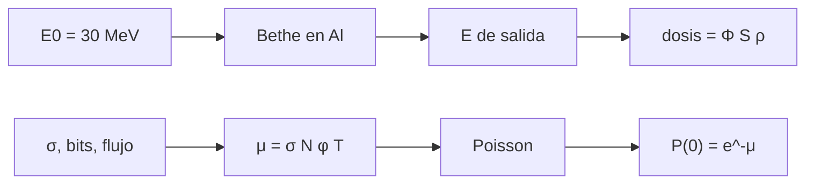

# B47-C14 — Radiación y degradación

<!-- nav:top -->
[🏠 Programa](../../../../README.md) · [📚 Bloque B47](../../../tronco-comun/B47-instrumentacion-y-observatorios-espaciales.md) · [← Anterior: B47-C13 — Criogenia instrumental](../B47-C13-criogenia-instrumental/CLASE.md) · [Siguiente: B47-C15 — Calibración a bordo →](../B47-C15-calibracion-a-bordo/CLASE.md)
<!-- /nav -->

## 1. Ubicación, nivel y alcance

Clase 14 del bloque B47. Nivel N3. Los protones y otras partículas del entorno depositan dosis en los componentes y producen eventos aislados en las memorias. Aquí calculas la energía de un protón tras atravesar un blindaje de aluminio, la dosis resultante en silicio y la tasa de eventos de partícula simple con Monte Carlo. Usas [B05](../../../tronco-comun/B05-fisica-fundamental-para-el-espacio.md) y [B31](../../../tronco-comun/B31-fisica-cuantica-nuclear-y-astroparticulas.md). Los flujos y las secciones eficaces son ilustrativos.

## 2. Por qué esta clase existe

El blindaje reduce la dosis hasta que el protón se detiene; los eventos de partícula simple, en cambio, son aleatorios. La decisión central: **¿qué espesor de blindaje y qué probabilidad de eventos son aceptables?**

## 3. Lo que podrás hacer al terminar

1. Calcular la energía de salida de un blindaje de aluminio con Bethe.
2. Obtener el alcance por dos vías.
3. Convertir fluencia y poder de frenado en dosis.
4. Simular eventos de partícula simple con Poisson.
5. Calcular la probabilidad de ningún evento.
6. Reconocer lo que omite el modelo.

La evidencia es la **ficha de radiación y degradación** del ejercicio 12 (sección 20).

## 4. Con qué llegas y cómo comprobarlo

1. ¿Qué es una incertidumbre?
2. ¿Qué es una simulación Monte Carlo?
3. ¿Qué es una tabla de resultados?
4. ¿Qué es un valor ilustrativo?
5. ¿Qué es una verificación?

<details>
<summary>Ver respuestas</summary>

1. Un intervalo en que se espera el valor verdadero. 2. Repetir con números aleatorios de semilla fija. 3. Un resumen ordenado de cálculos. 4. Un valor propuesto para el ejemplo, no medido. 5. Comparar un cálculo con un caso independiente.
</details>

Con cuatro o cinco aciertos, sigue; si no, repasa los prerrequisitos.

## 5. Un caso de contexto y casos de referencia

Un protón de 30 MeV con fluencia `10¹⁰ cm⁻²` deposita `23,67 Gy` en silicio sin blindaje y `74,91 Gy` tras 4 mm de aluminio (sube porque llega más lento); a 6 mm se detiene. Con `σ = 10⁻¹⁴ cm²/bit`, `10⁶` bits y flujo `1 cm⁻² s⁻¹` se esperan `1,578` eventos en 5 años. Es el **ejemplo conductor**; no es un entorno real.

## 6. Vocabulario

La **dosis ionizante total** (TID, en Gy). La **fluencia** (cm⁻²). El **blindaje**. El **evento de partícula simple** (SEU). La **sección eficaz** `σ`. La **tasa de eventos**. El **alcance**. El **pico de Bragg**.

## 7. Modelo mental: lluvia sobre un paraguas

El blindaje es un paraguas: detiene las gotas lentas y deja pasar las rápidas, pero las gotas que casi se detienen son las que más mojan al final.



*Descripción textual:* el blindaje frena el protón, la dosis depende de cuánta energía le queda y los eventos aislados siguen una distribución de Poisson.

Analogía: lluvia sobre un paraguas. Límite: perdida continua, haz unidireccional.

## 8. La explicación, paso a paso

### 8.1 Blindaje y dosis (protón de 30 MeV, fluencia 10¹⁰ cm⁻²)

El alcance del protón en aluminio es `4,3196 mm` por integral y `4,3200 mm` por barrido del espesor.

| Al (mm) | E de salida (MeV) | S en Si (MeV cm²/g) | dosis (Gy) |
|---|---|---|---|
| 0 | 30,000 | 14,775 | 23,67 |
| 1 | 25,892 | 16,603 | 26,60 |
| 2 | 21,183 | 19,466 | 31,19 |
| 4 | 6,920 | 46,756 | 74,91 |
| 6 | 0,000 | 0,000 | 0,00 |

### 8.2 Eventos de partícula simple

Eventos esperados en 5 años: `μ = σ N φ T = 1,578`. Con 20 000 misiones simuladas: media `1,592`, varianza `1,613` (Poisson: igual a la media). `P(0) = e^(−μ) = 0,2064` y el Monte Carlo da `0,2059`.

### 8.3 Lectura

Un blindaje fino no reduce la dosis de un protón de 30 MeV: la aumenta, porque el protón frenado deposita más por unidad de masa. Solo un espesor mayor que el alcance lo detiene. Los eventos aislados no se evitan con blindaje: se mitigan con corrección de errores.

### 8.4 Límites

Haz monoenergético y unidireccional, sin secundarios ni dispersión nuclear, sin dependencia con la tasa de dosis. Ningún número es un entorno real.

## 9. Magnitudes, símbolos y unidades

| Símbolo | Qué es | Unidad | Valor / nota |
|---|---|---|---|
| `Φ` | fluencia | cm⁻² | 10¹⁰ (ilustrativo) |
| `D` | dosis | Gy | 23,67 |
| `σ` | sección eficaz de evento | cm²/bit | 10⁻¹⁴ (ilustrativo) |
| `μ` | eventos esperados | — | 1,578 |
| `1 MeV` | energía | J | 1,602176634 × 10⁻¹³ (NIST) |

## 10. Convenciones y referencias

MeV, cm y g; `1 Gy = 1 J/kg`; Bethe sin correcciones (como C09).

## 11. De dónde sale lo que afirmamos

| ID | Fuente | Localizador | Respalda | Estado |
|---|---|---|---|---|
| S1 | NIST, *Fundamental Physical Constants* (CODATA 2022) | https://physics.nist.gov/cuu/Constants/Table/allascii.txt | constantes citadas en la sección 9 | Consultada el 2026-11-09 |

Límites: las constantes provienen de NIST. Aluminio, silicio, fluencia, sección eficaz y flujo son valores de uso general o ilustrativos que no se consultaron.

## 12. Cómo ver los resultados

| Al (mm) | dosis (Gy) |
|---|---|
| 0 | 23,67 |
| 1 | 26,60 |
| 2 | 31,19 |
| 4 | 74,91 |
| 6 | 0,00 |

Descripción larga: la dosis crece con el espesor hasta que el protón se detiene.

## 13. Ejemplo trabajado: la dosis sin blindaje

**Paso 1 · `S`.** `S = 14,775 MeV cm²/g` en Si a 30 MeV.

**Paso 2 · Energía por gramo.** `Φ S = 10¹⁰ × 14,775 = 1,477 × 10¹¹ MeV/g`.

**Paso 3 · Gray.** `× 1,602 × 10⁻¹³ × 1000 = 23,67 Gy`.

## 14. Distintas formas de describir el resultado

**Por fórmula:** `D = Φ S`. **Por tabla:** blindaje. **Por simulación:** Poisson. **Por código:** `radiacion.py`.

## 15. Práctica guiada

**Ejercicio 1 · con los pasos indicados.** Dosis a 1 mm de aluminio. *Pasos:* ejemplo 13.

<details><summary>Solución comentada</summary>

`26,60 Gy`.
</details>

**Ejercicio 2 · con una pista.** Alcance en aluminio.

<details><summary>Solución comentada</summary>

`4,32 mm`.
</details>

**Ejercicio 3 · casi autónomo.** Energía a 2 mm.

<details><summary>Solución comentada</summary>

`21,18 MeV`.
</details>

## 16. Práctica autónoma, transferencia e integrador

**Ejercicio 4.** Cociente dosis a 4 mm / sin blindaje.

<details><summary>Solución comentada</summary>

`3,16`.
</details>

**Ejercicio 5.** `μ` en 5 años.

<details><summary>Solución comentada</summary>

`1,578`.
</details>

**Ejercicio 6.** `P(0)`.

<details><summary>Solución comentada</summary>

`0,2064`.
</details>

**Ejercicio 7.** `P(≥ 1)`.

<details><summary>Solución comentada</summary>

`0,7936`.
</details>

**Ejercicio 8.** Varianza esperada de Poisson.

<details><summary>Solución comentada</summary>

`1,578`.
</details>

**Ejercicio 9 · transferencia.** **Transferencia.** ¿Por qué 4 mm de aluminio aumentan la dosis?

<details><summary>Solución comentada</summary>

El protón llega con 6,9 MeV y `S` es más del triple.
</details>

**Ejercicio 10 · transferencia.** **Transferencia.** Un compañero afirma que 4,3 mm de aluminio protegen de cualquier radiación. Responde.

<details><summary>Solución comentada</summary>

Solo detiene protones de 30 MeV de este modelo; los más energéticos y los secundarios atraviesan.
</details>

**Ejercicio 11 · transferencia.** **Transferencia.** ¿Qué hace un código de corrección de errores?

<details><summary>Solución comentada</summary>

Corrige eventos aislados sin reducir su tasa.
</details>

**Ejercicio 12.** **Integrador.** Elabora tu *ficha de radiación y degradación*: blindaje, dosis, eventos y límites.

<details><summary>Solución comentada</summary>

Secciones 8.1–8.4.
</details>

**Ejercicio 12 · integrador.** **Integrador.** Elabora tu *ficha de radiación y degradación*: blindaje, dosis, eventos y límites.

<details><summary>Solución modelo</summary>

Secciones 8.1–8.4.
</details>

## 17. Laboratorio: dosis y eventos aislados

El script [radiacion.py](radiacion.py) frena un protón con Bethe, calcula dosis y simula eventos (**comprueba** el alcance a 2 %, la media a 2 % y `P(0)` a 0,01).

**Datos:** constantes de NIST; entorno y componentes **ilustrativos**. **Predice antes de ejecutar:** ¿qué fracción de misiones no sufre eventos? (≈ 21 %.) **Ejecución del 2026-11-09 (Python 3.12.9):**

```text
Python 3.12.9 (biblioteca estandar)
alcance CSDA de 30 MeV en aluminio (integral) = 4.3196 mm ; espesor de parada por barrido = 4.3200 mm
 Al [mm]  E_salida [MeV]   S_Si [MeV cm2/g]   dosis [Gy]
     0.0          30.000             14.775        23.67
     1.0          25.892             16.603        26.60
     2.0          21.183             19.466        31.19
     4.0           6.920             46.756        74.91
     6.0           0.000              0.000         0.00
eventos esperados en la mision = 1.578 ; Monte Carlo: media = 1.592, varianza = 1.613
P(0 eventos): exp(-mu) = 0.2064 ; Monte Carlo = 0.2059
Pruebas superadas.
```

```bash
python programa/clases/B47/B47-C14-radiacion-y-degradacion/radiacion.py
```

**Límites:** haz monoenergético, sin secundarios.

## 18. Errores frecuentes y cómo corregirlos

**Creer que más blindaje siempre reduce la dosis.** Se corrige con 8.3.

**Confundir dosis y fluencia.** Se corrige con la sección 9.

**Esperar que Poisson tenga varianza distinta de la media.** Se corrige con 8.2.

**Tomar el flujo como entorno real.** Se corrige con la sección 10.

## 19. Cómo sabrás que vas bien

Tras la sección 8: ¿qué resultado esperabas y cuál obtuviste? Si dudas, repasa el ejemplo 13. Tras el laboratorio: ¿qué comprueba? (ver la sección 17).

## 20. Qué entregas y cómo se evalúa

El producto es tu **ficha de radiación y degradación** (ejercicio 12).

| Criterio | Inicial | En desarrollo | Logrado | Destacado |
|---|---|---|---|---|
| Conceptos | Los confunde | Parciales | conceptos de la clase | Explica los límites |
| Cálculo | Sin unidades | Con errores | Tablas completas | Calcula casos nuevos |
| Numérico | Sin comprobar | Un caso | Contraste con el análisis | Interpreta las diferencias |
| Fuentes | Sin fuente | Sin fecha | fuentes con fecha | Declara lo ilustrativo |
| Límites | No los nombra | Uno | Tres | Discute qué falta del modelo |

**Condiciones críticas (no se compensan con promedio):** rotular lo ilustrativo; no presentar el modelo como diseño de una misión real; citar solo lo consultado.

## 21. Ética, seguridad y límites

Clase educativa: los modelos son simplificados. Accesibilidad: tablas equivalentes a las gráficas, fórmulas en texto, ejercicios sin conexión.

## 22. Para cerrar y seguir

El alcance de 30 MeV en aluminio es `4,32 mm` y los eventos aislados esperados son `1,58` en 5 años. Queda una pregunta: ¿cómo se calibra un detector que se degrada?

**Glosario español–inglés.** dosis · *dose*; fluencia · *fluence*; blindaje · *shielding*; evento de partícula simple · *single-event upset*; sección eficaz · *cross section*.

**Continuidad.** [B47-C15](../B47-C15-calibracion-a-bordo/CLASE.md) estudia la calibración a bordo.

**Referencias:** ver sección 11.

<!-- nav:bottom -->
---

[← Anterior: B47-C13 — Criogenia instrumental](../B47-C13-criogenia-instrumental/CLASE.md) · [📚 Bloque B47](../../../tronco-comun/B47-instrumentacion-y-observatorios-espaciales.md) · [Siguiente: B47-C15 — Calibración a bordo →](../B47-C15-calibracion-a-bordo/CLASE.md)
<!-- /nav -->
