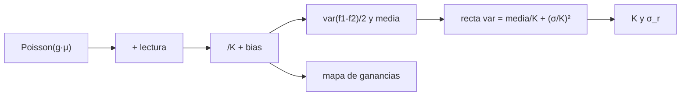

# B47-C15 — Calibración a bordo

<!-- nav:top -->
[🏠 Programa](../../../../README.md) · [📚 Bloque B47](../../../tronco-comun/B47-instrumentacion-y-observatorios-espaciales.md) · [← Anterior: B47-C14 — Radiación y degradación](../B47-C14-radiacion-y-degradacion/CLASE.md) · [Siguiente: B47-C16 — Compresión de datos científicos →](../B47-C16-compresion-de-datos-cientificos/CLASE.md)
<!-- /nav -->

## 1. Ubicación, nivel y alcance

Clase 15 del bloque B47. Nivel N3. Un detector se calibra con imágenes de oscuridad y campos planos. Aquí simulas una matriz sintética con ganancia, ruido de lectura y no uniformidad conocidos, construyes la curva de transferencia de fotones, recuperas la ganancia y el ruido de lectura y corriges un campo plano. Usas [B15](../../../tronco-comun/B15-senales-imagenes-y-estimacion-cientifica.md) y [B12](../../../tronco-comun/B12-probabilidad-estadistica-e-incertidumbre.md). Todo es sintético.

## 2. Por qué esta clase existe

Sin ganancia ni ruido calibrados no se puede convertir cuentas en fotones ni dar incertidumbres. La decisión central: **¿cómo se obtiene la ganancia sin conocerla y cuánto residuo deja la corrección de campo plano?**

## 3. Lo que podrás hacer al terminar

1. Simular tramas con ruido de fotones, de lectura y no uniformidad.
2. Calcular media y varianza con pares de tramas.
3. Ajustar la recta de la PTC con pesos.
4. Recuperar `K` y el ruido de lectura.
5. Corregir un campo plano y medir el residuo.
6. Contrastar con la predicción analítica.

La evidencia es la **ficha de calibración a bordo** del ejercicio 12 (sección 20).

## 4. Con qué llegas y cómo comprobarlo

1. ¿Qué es una incertidumbre?
2. ¿Qué es una simulación Monte Carlo?
3. ¿Qué es una tabla de resultados?
4. ¿Qué es un valor ilustrativo?
5. ¿Qué es una verificación?

<details>
<summary>Ver respuestas</summary>

1. Un intervalo en que se espera el valor verdadero. 2. Repetir con números aleatorios de semilla fija. 3. Un resumen ordenado de cálculos. 4. Un valor propuesto para el ejemplo, no medido. 5. Comparar un cálculo con un caso independiente.
</details>

Con cuatro o cinco aciertos, sigue; si no, repasa los prerrequisitos.

## 5. Un caso de contexto y casos de referencia

Con ganancia verdadera `K = 2,0 e⁻/DN`, lectura `5 e⁻` y no uniformidad `1 %` (sintéticas), la curva recupera `K = 2,061` y `5,06 e⁻`. Un campo plano a `20 000 e⁻` se reduce de `1,23 %` a `0,72 %`. Es el **ejemplo conductor**; los datos no son de ningún instrumento.

## 6. Vocabulario

La **curva de transferencia de fotones** (PTC): varianza frente a media. La **ganancia** `K` (e⁻/DN). El **ruido de lectura**. El **campo plano** (*flat field*). La **no uniformidad de respuesta** (PRNU). El **nivel de bias**. El **par de tramas**.

## 7. Modelo mental: pesar con una balanza desconocida

Es calibrar una balanza sin pesas patrón: mides el azar de las lecturas y, como el azar de contar fotones es conocido, de ahí se deduce cuánto pesa cada cuenta.



*Descripción textual:* como el ruido de fotones es poissoniano, la pendiente de varianza frente a media da la ganancia y la ordenada el ruido de lectura.

Analogía: pesar con una balanza desconocida. Límite: respuesta lineal sin patrón fijo extra.

## 8. La explicación, paso a paso

### 8.1 Curva de transferencia

| μ (e⁻) | media (DN) | varianza (DN²) |
|---|---|---|
| 50 | 24,94 | 17,953 |
| 200 | 100,04 | 56,479 |
| 1000 | 499,82 | 246,790 |
| 4000 | 1999,64 | 963,960 |
| 10000 | 4998,61 | 2456,903 |
| 20000 | 9997,27 | 4789,744 |
| 40000 | 19 996,16 | 9714,785 |

### 8.2 Ajuste ponderado

Pendiente `0,48513 DN⁻¹` y ordenada `6,0319 DN²`. Entonces `K = 1/pendiente = 2,0613 e⁻/DN` (verdadera 2,0) y el ruido de lectura `K√ordenada = 5,063 e⁻` (verdadero 5,0). El error estadístico de una varianza con 4900 píxeles es del 2 %.

### 8.3 Campo plano

Con 16 tramas planas de `20 000 e⁻` se construye el mapa de ganancias relativas. La dispersión relativa de una trama de ciencia baja de `1,226 %` a `0,721 %`. El límite esperado por ruido de fotones y lectura es `0,708 %` y, con el ruido del propio mapa, `0,729 %`.

### 8.4 Lectura

El mapa de ganancias añade un `1/N_f` a la varianza: con más tramas planas el residuo se acerca al límite de fotones. El método supone un detector lineal sin saturación ni ruido de patrón fijo adicional, y los datos son sintéticos.

## 9. Magnitudes, símbolos y unidades

| Símbolo | Qué es | Unidad | Valor / nota |
|---|---|---|---|
| `K` | ganancia | e⁻/DN | 2,061 (verdadera 2,0) |
| `σ_r` | ruido de lectura | e⁻ | 5,06 (verdadero 5,0) |
| `μ` | señal media | e⁻ | 50 a 40 000 |
| `bias` | nivel de cero | DN | 500 (sintético) |
| PRNU | no uniformidad | — | 1 % (sintético) |

## 10. Convenciones y referencias

e⁻ para electrones y DN para cuentas digitales; pares de tramas para cancelar el patrón fijo.

## 11. De dónde sale lo que afirmamos

| ID | Fuente | Localizador | Respalda | Estado |
|---|---|---|---|---|
| — | Sin fuente externa | — | relaciones estándar que verifica el laboratorio | No se consultó una fuente para esta clase |

Límites: no se consultó ninguna fuente; la PTC es una técnica estándar que aquí se reimplementa con datos sintéticos, sin contrastarla con una norma.

## 12. Cómo ver los resultados

| Magnitud | Valor |
|---|---|
| `K` | 2,061 e⁻/DN |
| `σ_r` | 5,06 e⁻ |
| dispersión sin corregir | 1,23 % |
| dispersión corregida | 0,72 % |

Descripción larga: la corrección reduce la dispersión a casi el límite de fotones.

## 13. Ejemplo trabajado: ganancia desde la pendiente

**Paso 1 · Pendiente.** `a = 0,48513 DN⁻¹`.

**Paso 2 · Inversa.** `K = 1/a`.

**Paso 3 · Valor.** `K = 2,061 e⁻/DN`.

**Lectura.** Se acerca a 2,0 con un error de 3,1 %.

## 14. Distintas formas de describir el resultado

**Por fórmula:** `var = media/K + (σ_r/K)²`. **Por tabla:** PTC. **Por simulación:** tramas. **Por código:** `calibracion.py`.

## 15. Práctica guiada

**Ejercicio 1 · con los pasos indicados.** Varianza esperada con media 1000 DN, `K = 2`, `σ_r = 5`. *Pasos:* `m/K + (σ/K)²`.

<details><summary>Solución comentada</summary>

`500 + 6,25 = 506,25 DN²`.
</details>

**Ejercicio 2 · con una pista.** Ganancia recuperada.

<details><summary>Solución comentada</summary>

`2,061`.
</details>

**Ejercicio 3 · casi autónomo.** Error relativo de `K`.

<details><summary>Solución comentada</summary>

`3,1 %`.
</details>

## 16. Práctica autónoma, transferencia e integrador

**Ejercicio 4.** Ruido de lectura recuperado.

<details><summary>Solución comentada</summary>

`5,06 e⁻`.
</details>

**Ejercicio 5.** Dispersión sin corregir.

<details><summary>Solución comentada</summary>

`1,23 %`.
</details>

**Ejercicio 6.** Dispersión corregida.

<details><summary>Solución comentada</summary>

`0,72 %`.
</details>

**Ejercicio 7.** Límite esperado de fotones.

<details><summary>Solución comentada</summary>

`0,71 %`.
</details>

**Ejercicio 8.** Reducción por la corrección.

<details><summary>Solución comentada</summary>

`1,70` veces.
</details>

**Ejercicio 9 · transferencia.** **Transferencia.** ¿Por qué se usan pares de tramas?

<details><summary>Solución comentada</summary>

Para restar el patrón fijo (no uniformidad) y quedarse con el ruido aleatorio.
</details>

**Ejercicio 10 · transferencia.** **Transferencia.** Un compañero afirma que `K = 2,06` es la ganancia de un detector real. Responde.

<details><summary>Solución comentada</summary>

Es un resultado sintético con `K` verdadera 2,0.
</details>

**Ejercicio 11 · transferencia.** **Transferencia.** ¿Qué ocurre si el detector satura?

<details><summary>Solución comentada</summary>

La PTC se aplana: hay que excluir los niveles saturados del ajuste.
</details>

**Ejercicio 12.** **Integrador.** Elabora tu *ficha de calibración a bordo*: PTC, `K`, ruido de lectura, campo plano y límites.

<details><summary>Solución comentada</summary>

Secciones 8.1–8.4.
</details>

**Ejercicio 12 · integrador.** **Integrador.** Elabora tu *ficha de calibración a bordo*: PTC, `K`, ruido de lectura, campo plano y límites.

<details><summary>Solución modelo</summary>

Secciones 8.1–8.4.
</details>

## 17. Laboratorio: PTC y campo plano

El script [calibracion.py](calibracion.py) simula tramas, ajusta la PTC y corrige un campo plano (**comprueba** `K` a 5 %, el ruido a 10 % y el residuo a 10 %).

**Datos:** ninguna constante; datos **sintéticos** (semilla 20261109). **Predice antes de ejecutar:** ¿qué ganancia recupera la curva? (≈ 2,06.) **Ejecución del 2026-11-09 (Python 3.12.9):**

```text
Python 3.12.9 (biblioteca estandar)
  mu [e-]  media [DN]  varianza [DN2]
       50       24.94          17.953
      200      100.04          56.479
     1000      499.82         246.790
     4000     1999.64         963.960
    10000     4998.61        2456.903
    20000     9997.27        4789.744
    40000    19996.16        9714.785
pendiente = 0.48513 DN-1 ; ordenada = 6.0319 DN2
ganancia recuperada K = 2.0613 e-/DN (verdadera 2.0) ; ruido de lectura = 5.063 e- (verdadero 5.0)
dispersion relativa del campo plano a 20000 e-: sin corregir = 1.2261 % ; corregida = 0.7212 %
ruido de fotones y lectura esperado (1 trama) = 0.7075 % ; con ruido del mapa (N_f = 16) = 0.7293 %
Pruebas superadas.
```

```bash
python programa/clases/B47/B47-C15-calibracion-a-bordo/calibracion.py
```

**Límites:** lineal, sin saturación ni patrón fijo extra.

## 18. Errores frecuentes y cómo corregirlos

**Usar tramas sueltas sin restar el patrón fijo.** Se corrige con 8.1.

**Olvidar el bias.** Se corrige con 8.1.

**Ajustar sin pesos.** Se corrige con 8.2.

**Tomar los datos sintéticos como reales.** Se corrige con la sección 10.

## 19. Cómo sabrás que vas bien

Tras la sección 8: ¿qué resultado esperabas y cuál obtuviste? Si dudas, repasa el ejemplo 13. Tras el laboratorio: ¿qué comprueba? (ver la sección 17).

## 20. Qué entregas y cómo se evalúa

El producto es tu **ficha de calibración a bordo** (ejercicio 12).

| Criterio | Inicial | En desarrollo | Logrado | Destacado |
|---|---|---|---|---|
| Conceptos | Los confunde | Parciales | conceptos de la clase | Explica los límites |
| Cálculo | Sin unidades | Con errores | Tablas completas | Calcula casos nuevos |
| Numérico | Sin comprobar | Un caso | Contraste con el análisis | Interpreta las diferencias |
| Fuentes | Sin fuente | Sin fecha | fuentes con fecha | Declara lo ilustrativo |
| Límites | No los nombra | Uno | Tres | Discute qué falta del modelo |

**Condiciones críticas (no se compensan con promedio):** rotular lo ilustrativo; no presentar el modelo como diseño de una misión real; citar solo lo consultado.

## 21. Ética, seguridad y límites

Clase educativa: los modelos son simplificados. Accesibilidad: tablas equivalentes a las gráficas, fórmulas en texto, ejercicios sin conexión.

## 22. Para cerrar y seguir

La PTC recupera `K = 2,06` y `5,1 e⁻` y el campo plano baja la dispersión de `1,23 %` a `0,72 %`. Queda una pregunta: ¿cómo se reduce el volumen de datos para enviarlos a tierra?

**Glosario español–inglés.** ganancia · *gain*; ruido de lectura · *read noise*; campo plano · *flat field*; curva de transferencia de fotones · *photon transfer curve*; bias · *bias*.

**Continuidad.** [B47-C16](../B47-C16-compresion-de-datos-cientificos/CLASE.md) estudia la compresión de datos científicos.

**Referencias:** ver sección 11.

<!-- nav:bottom -->
---

[← Anterior: B47-C14 — Radiación y degradación](../B47-C14-radiacion-y-degradacion/CLASE.md) · [📚 Bloque B47](../../../tronco-comun/B47-instrumentacion-y-observatorios-espaciales.md) · [Siguiente: B47-C16 — Compresión de datos científicos →](../B47-C16-compresion-de-datos-cientificos/CLASE.md)
<!-- /nav -->
