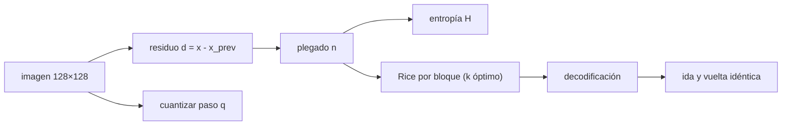

# B47-C16 — Compresión de datos científicos

<!-- nav:top -->
[🏠 Programa](../../../../README.md) · [📚 Bloque B47](../../../tronco-comun/B47-instrumentacion-y-observatorios-espaciales.md) · [← Anterior: B47-C15 — Calibración a bordo](../B47-C15-calibracion-a-bordo/CLASE.md) · [Siguiente: B47-C17 — Planificación de observaciones →](../B47-C17-planificacion-de-observaciones/CLASE.md)
<!-- /nav -->

## 1. Ubicación, nivel y alcance

Clase 16 del bloque B47. Nivel N3. Un instrumento produce más datos de los que el enlace puede enviar. Aquí generas una imagen sintética con ruido de fotones, mides su entropía, la comprimes sin pérdida con un código de Rice adaptativo, compruebas que la ida y vuelta es idéntica y estudias una cuantización con pérdida acotada. Usas [B15](../../../tronco-comun/B15-senales-imagenes-y-estimacion-cientifica.md) y [B12](../../../tronco-comun/B12-probabilidad-estadistica-e-incertidumbre.md). La imagen es sintética y el código es una versión simplificada, no el estándar.

## 2. Por qué esta clase existe

La compresión sin pérdida está acotada por la entropía; la con pérdida cambia fidelidad por volumen. La decisión central: **¿cuántos bits por píxel necesita la imagen y cuánto error se acepta a cambio de menos datos?**

## 3. Lo que podrás hacer al terminar

1. Calcular la entropía empírica de una imagen y de sus residuos.
2. Predecir con el píxel anterior y plegar a enteros no negativos.
3. Codificar con Rice y parámetro adaptativo.
4. Decodificar y verificar que la ida y vuelta es exacta.
5. Cuantizar con paso `q` y medir el error.
6. Reconocer que el código simplificado no es el estándar.

La evidencia es la **ficha de compresión de datos** del ejercicio 12 (sección 20).

## 4. Con qué llegas y cómo comprobarlo

1. ¿Qué es una incertidumbre?
2. ¿Qué es una simulación Monte Carlo?
3. ¿Qué es una tabla de resultados?
4. ¿Qué es un valor ilustrativo?
5. ¿Qué es una verificación?

<details>
<summary>Ver respuestas</summary>

1. Un intervalo en que se espera el valor verdadero. 2. Repetir con números aleatorios de semilla fija. 3. Un resumen ordenado de cálculos. 4. Un valor propuesto para el ejemplo, no medido. 5. Comparar un cálculo con un caso independiente.
</details>

Con cuatro o cinco aciertos, sigue; si no, repasa los prerrequisitos.

## 5. Un caso de contexto y casos de referencia

Una imagen sintética de `128 × 128` píxeles de 16 bit tiene entropía de `8,21 bit` por píxel; los residuos de predicción, `6,94 bit`. El código de Rice usa `7,26 bit/píxel`, razón `2,20` respecto de 16 bit, con ida y vuelta idéntica. Es el **ejemplo conductor**; la imagen no es de ningún instrumento.

## 6. Vocabulario

La **entropía de Shannon**. El **residuo de predicción**. El **plegado** a enteros no negativos. El **código de Rice** (unario más `k` bits). El **bloque adaptativo**. La **razón de compresión**. La **cuantización** con pérdida. El **error acotado**.

## 7. Modelo mental: abreviar un telegrama

Es como redactar un telegrama: las palabras frecuentes se abrevian (códigos cortos) y las raras se escriben completas; en total se envían menos letras sin perder el mensaje.



*Descripción textual:* la predicción concentra los valores cerca de cero, la entropía da el límite y el código de Rice se acerca a él.

Analogía: abreviar un telegrama. Límite: residuos independientes por bloque.

## 8. La explicación, paso a paso

### 8.1 Entropía

Imagen sintética de 16384 píxeles: entropía de los píxeles crudos `8,2112 bit`; entropía de los residuos `6,9449 bit`. La predicción ahorra 1,27 bit por píxel.

### 8.2 Código de Rice adaptativo

Con bloques de 32 muestras, parámetro `k` óptimo por bloque y 4 bits de cabecera: `7,2605 bit/píxel`, razón de compresión `2,204`. El exceso sobre la entropía es de `0,316 bit` (cabeceras y desajuste del código). La decodificación recupera la imagen exacta: ida y vuelta idéntica = True.

### 8.3 Cuantización con pérdida (paso entero impar)

| q | error máximo | RMS medido | RMS teórico `√((q²−1)/12)` | entropía cuantizada (bit) |
|---|---|---|---|---|
| 3 | 1,0 | 0,8149 | 0,8165 | 6,639 |
| 5 | 2,0 | 1,4114 | 1,4142 | 5,904 |
| 9 | 4,0 | 2,5937 | 2,5820 | 5,059 |

### 8.4 Lectura

Cada duplicación de `q` ahorra casi un bit. El ruido de fotones (desviación ≈ 20 cuentas) hace que errores de ±1–4 cuentas sean pequeños frente a él. El código simplificado aquí no es el estándar de compresión del espacio, que no se consultó.

## 9. Magnitudes, símbolos y unidades

| Símbolo | Qué es | Unidad | Valor / nota |
|---|---|---|---|
| `H` | entropía | bit/píxel | 6,94 (residuos) |
| `k` | parámetro de Rice | — | 0–15 por bloque |
| `q` | paso de cuantización | DN | 3, 5, 9 |
| RMS | error cuadrático medio | DN | `√((q²−1)/12)` |
| `CR` | razón de compresión | — | 2,20 |

## 10. Convenciones y referencias

Bits y cuentas digitales (DN); entropía en base 2; imagen de 16 bit.

## 11. De dónde sale lo que afirmamos

| ID | Fuente | Localizador | Respalda | Estado |
|---|---|---|---|---|
| — | Sin fuente externa | — | relaciones estándar que verifica el laboratorio | No se consultó una fuente para esta clase |

Límites: no se consultó ninguna fuente; el código de Rice es el del libro, sin la cabecera ni las opciones del estándar CCSDS (no consultado), y la imagen es sintética.

## 12. Cómo ver los resultados

| Magnitud | Valor |
|---|---|
| H crudo | 8,211 bit |
| H residuos | 6,945 bit |
| Rice | 7,260 bit/píxel |
| razón | 2,204 |

Descripción larga: Rice se queda a unas décimas de bit de la entropía.

## 13. Ejemplo trabajado: la longitud de Rice de un valor

**Paso 1 · Valor.** Sea `n = 37` y `k = 3`.

**Paso 2 · Cociente.** `n >> 3 = 4` unos y un cero: 5 bits.

**Paso 3 · Resto.** `37 mod 8 = 5` en 3 bits: `101`.

**Paso 4 · Total.** `5 + 3 = 8` bits.

## 14. Distintas formas de describir el resultado

**Por fórmula:** `(n>>k) + 1 + k`. **Por tabla:** cuantización. **Por simulación:** ida y vuelta. **Por código:** `compresion.py`.

## 15. Práctica guiada

**Ejercicio 1 · con los pasos indicados.** Plegado de `d = −3`. *Pasos:* `−2d − 1`.

<details><summary>Solución comentada</summary>

`5`.
</details>

**Ejercicio 2 · con una pista.** Plegado de `d = 4`.

<details><summary>Solución comentada</summary>

`8`.
</details>

**Ejercicio 3 · casi autónomo.** Longitud de Rice de `n = 37`, `k = 3`. *Pasos:* ejemplo 13.

<details><summary>Solución comentada</summary>

`8` bits.
</details>

## 16. Práctica autónoma, transferencia e integrador

**Ejercicio 4.** Razón de compresión.

<details><summary>Solución comentada</summary>

`2,204`.
</details>

**Ejercicio 5.** Exceso sobre la entropía.

<details><summary>Solución comentada</summary>

`0,316 bit`.
</details>

**Ejercicio 6.** Ahorro de la predicción.

<details><summary>Solución comentada</summary>

`1,27 bit`.
</details>

**Ejercicio 7.** RMS con `q = 5`.

<details><summary>Solución comentada</summary>

`1,411`.
</details>

**Ejercicio 8.** Error máximo con `q = 9`.

<details><summary>Solución comentada</summary>

`4`.
</details>

**Ejercicio 9 · transferencia.** **Transferencia.** ¿Por qué la entropía es un límite para la compresión sin pérdida?

<details><summary>Solución comentada</summary>

Ningún código de símbolos independientes puede promediar menos bits que la entropía.
</details>

**Ejercicio 10 · transferencia.** **Transferencia.** Un compañero afirma que este código es el estándar espacial. Responde.

<details><summary>Solución comentada</summary>

No: es una versión simplificada; el estándar no se consultó.
</details>

**Ejercicio 11 · transferencia.** **Transferencia.** ¿Cuándo conviene la compresión con pérdida?

<details><summary>Solución comentada</summary>

Cuando el error cuantizado es menor que el ruido y el enlace es el cuello de botella.
</details>

**Ejercicio 12.** **Integrador.** Elabora tu *ficha de compresión de datos*: entropía, bits por píxel, ida y vuelta, cuantización y límites.

<details><summary>Solución comentada</summary>

Secciones 8.1–8.4.
</details>

**Ejercicio 12 · integrador.** **Integrador.** Elabora tu *ficha de compresión de datos*: entropía, bits por píxel, ida y vuelta, cuantización y límites.

<details><summary>Solución modelo</summary>

Secciones 8.1–8.4.
</details>

## 17. Laboratorio: entropía, Rice y cuantización

El script [compresion.py](compresion.py) comprime una imagen sintética con Rice y verifica la ida y vuelta (**comprueba** que `H ≤ bpp ≤ H + 0,6` y el RMS a 3 %).

**Datos:** ninguna constante; imagen **sintética** (semilla 20261109). **Predice antes de ejecutar:** ¿cuántos bits por píxel? (≈ 7,3.) **Ejecución del 2026-11-09 (Python 3.12.9):**

```text
Python 3.12.9 (biblioteca estandar)
pixeles = 16384 ; entropia de los pixeles crudos = 8.2112 bit ; entropia de los residuos = 6.9449 bit
Rice adaptativo (con cabecera): 7.2605 bit/pixel ; razon de compresion frente a 16 bit = 2.204
ida y vuelta identica: True
  q  error max  RMS medido   teorico  H cuantizada [bit]
  3        1.0      0.8149    0.8165              6.6385
  5        2.0      1.4114    1.4142              5.9038
  9        4.0      2.5937    2.5820              5.0586
Pruebas superadas.
```

```bash
python programa/clases/B47/B47-C16-compresion-de-datos-cientificos/compresion.py
```

**Límites:** residuos independientes; código simplificado.

## 18. Errores frecuentes y cómo corregirlos

**Comprimir sin predecir.** Se corrige con 8.1.

**Olvidar la cabecera de cada bloque.** Se corrige con 8.2.

**Aplicar q par con la fórmula de q impar.** Se corrige con 8.3.

**Confundir cuantización con compresión sin pérdida.** Se corrige con 8.3.

## 19. Cómo sabrás que vas bien

Tras la sección 8: ¿qué resultado esperabas y cuál obtuviste? Si dudas, repasa el ejemplo 13. Tras el laboratorio: ¿qué comprueba? (ver la sección 17).

## 20. Qué entregas y cómo se evalúa

El producto es tu **ficha de compresión de datos** (ejercicio 12).

| Criterio | Inicial | En desarrollo | Logrado | Destacado |
|---|---|---|---|---|
| Conceptos | Los confunde | Parciales | conceptos de la clase | Explica los límites |
| Cálculo | Sin unidades | Con errores | Tablas completas | Calcula casos nuevos |
| Numérico | Sin comprobar | Un caso | Contraste con el análisis | Interpreta las diferencias |
| Fuentes | Sin fuente | Sin fecha | fuentes con fecha | Declara lo ilustrativo |
| Límites | No los nombra | Uno | Tres | Discute qué falta del modelo |

**Condiciones críticas (no se compensan con promedio):** rotular lo ilustrativo; no presentar el modelo como diseño de una misión real; citar solo lo consultado.

## 21. Ética, seguridad y límites

Clase educativa: los modelos son simplificados. Accesibilidad: tablas equivalentes a las gráficas, fórmulas en texto, ejercicios sin conexión.

## 22. Para cerrar y seguir

La predicción y Rice llevan la imagen a `7,26 bit/píxel` (razón `2,20`) sin pérdida. Queda una pregunta: ¿cuánto tiempo hay para observar y transmitir?

**Glosario español–inglés.** entropía · *entropy*; código de Rice · *Rice code*; compresión sin pérdida · *lossless compression*; cuantización · *quantization*; razón de compresión · *compression ratio*.

**Continuidad.** [B47-C17](../B47-C17-planificacion-de-observaciones/CLASE.md) estudia la planificación de observaciones.

**Referencias:** ver sección 11.

<!-- nav:bottom -->
---

[← Anterior: B47-C15 — Calibración a bordo](../B47-C15-calibracion-a-bordo/CLASE.md) · [📚 Bloque B47](../../../tronco-comun/B47-instrumentacion-y-observatorios-espaciales.md) · [Siguiente: B47-C17 — Planificación de observaciones →](../B47-C17-planificacion-de-observaciones/CLASE.md)
<!-- /nav -->
