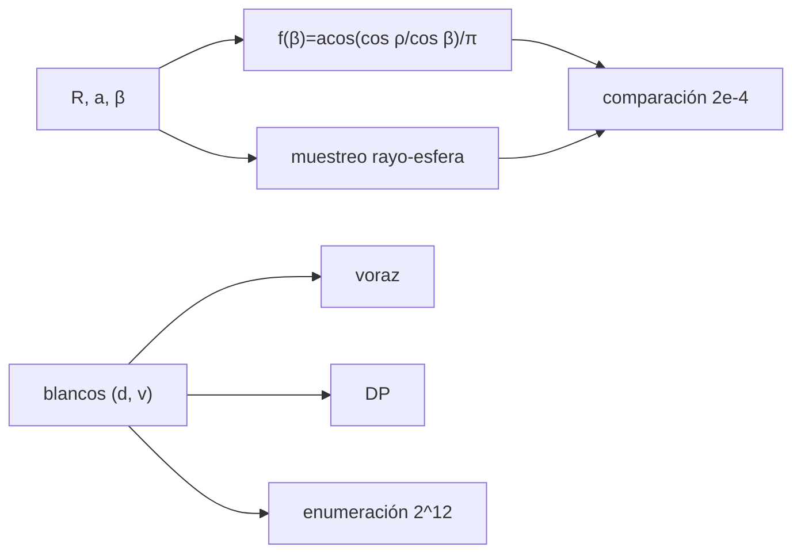

# B47-C17 — Planificación de observaciones

<!-- nav:top -->
[🏠 Programa](../../../../README.md) · [📚 Bloque B47](../../../tronco-comun/B47-instrumentacion-y-observatorios-espaciales.md) · [← Anterior: B47-C16 — Compresión de datos científicos](../B47-C16-compresion-de-datos-cientificos/CLASE.md) · [Siguiente: B47-C18 — Downlink de instrumentos científicos →](../B47-C18-downlink-de-instrumentos-cientificos/CLASE.md)
<!-- /nav -->

## 1. Ubicación, nivel y alcance

Clase 17 del bloque B47. Nivel N3. La Tierra bloquea el blanco durante parte de cada órbita, así que el tiempo útil es limitado y debe repartirse entre blancos. Aquí calculas la fracción ocultada en función de la inclinación del blanco respecto del plano orbital, la verificas con una prueba rayo-esfera independiente y comparas una selección voraz de blancos con el óptimo exacto. Usas [B05](../../../tronco-comun/B05-fisica-fundamental-para-el-espacio.md) y [B12](../../../tronco-comun/B12-probabilidad-estadistica-e-incertidumbre.md). Los blancos son sintéticos.

## 2. Por qué esta clase existe

Sin planificación se desperdicia tiempo de observación. La decisión central: **¿qué blancos observar con un presupuesto de tiempo limitado y cuánto tiempo hay de visibilidad?**

## 3. Lo que podrás hacer al terminar

1. Calcular el semiángulo de la Tierra y el período.
2. Obtener la fracción de oclusión `acos(cos ρ/cos β)/π`.
3. Verificarla con muestreo y prueba rayo-esfera.
4. Plantear la selección como mochila 0/1.
5. Comparar un método voraz con programación dinámica y enumeración.
6. Reconocer lo que el modelo omite.

La evidencia es la **ficha de planificación de observaciones** del ejercicio 12 (sección 20).

## 4. Con qué llegas y cómo comprobarlo

1. ¿Qué es una incertidumbre?
2. ¿Qué es una simulación Monte Carlo?
3. ¿Qué es una tabla de resultados?
4. ¿Qué es un valor ilustrativo?
5. ¿Qué es una verificación?

<details>
<summary>Ver respuestas</summary>

1. Un intervalo en que se espera el valor verdadero. 2. Repetir con números aleatorios de semilla fija. 3. Un resumen ordenado de cálculos. 4. Un valor propuesto para el ejemplo, no medido. 5. Comparar un cálculo con un caso independiente.
</details>

Con cuatro o cinco aciertos, sigue; si no, repasa los prerrequisitos.

## 5. Un caso de contexto y casos de referencia

A 600 km el semiángulo de la Tierra es `66,066°` y el período `96,69 min`. Un blanco en el plano orbital queda oculto el `36,70 %` de la órbita (`61,2 min` visibles); a `β = 60°`, el `19,87 %`; a `β = 70°` nunca. Con 12 blancos sintéticos y 150 min, el óptimo es `47` y el voraz `47`. Es el **ejemplo conductor**.

## 6. Vocabulario

La **oclusión terrestre**. El **ángulo beta** del blanco respecto del plano. El **semiángulo** `ρ = asin(R/a)`. La **ventana de visibilidad**. El **problema de la mochila**. La **heurística voraz**. La **programación dinámica**.

## 7. Modelo mental: ocultarse tras una montaña

El blanco se oculta tras la Tierra como un faro tras una montaña mientras recorres la ruta: el tiempo visible depende de cuán lejos del plano de la ruta esté el faro.



*Descripción textual:* la geometría fija cuánto tiempo hay y la selección reparte ese tiempo entre blancos con valor distinto.

Analogía: ocultarse tras una montaña. Límite: órbita circular, blanco fijo en dirección.

## 8. La explicación, paso a paso

### 8.1 Oclusión (h = 600 km)

| β (°) | f analítica | f muestreo | visible por órbita (min) |
|---|---|---|---|
| 0 | 0,36704 | 0,36704 | 61,199 |
| 30 | 0,34482 | 0,34482 | 63,347 |
| 60 | 0,19873 | 0,19873 | 77,472 |
| 65 | 0,09043 | 0,09043 | 87,943 |
| 70 | 0,00000 | 0,00000 | 96,686 |

Los blancos con `β ≥ ρ = 66,07°` están en zona de visibilidad continua.

### 8.2 Selección de blancos

Doce blancos sintéticos (duración en min, valor): [(10, 1), (20, 5), (24, 3), (18, 6), (10, 1), (19, 2), (11, 8), (11, 6), (10, 6), (25, 5), (30, 3), (16, 7)]. Duración total `204 min`, valor total `53`.

Con presupuesto de 150 min: voraz `47` (usa `145 min`), programación dinámica `47` y enumeración de los 4096 subconjuntos `47`. Aquí el voraz coincide con el óptimo.

### 8.3 Caso en que el voraz falla

Blancos (10, 60), (20, 100), (30, 120) con presupuesto 50: voraz `160`; óptimo `220` (programación dinámica) y `220` (enumeración). El voraz elige por valor/duración y pierde.

### 8.4 Lectura

Sin tiempos de maniobra, anomalías de radiación ni restricciones solares, el modelo da una cota superior del tiempo útil.

## 9. Magnitudes, símbolos y unidades

| Símbolo | Qué es | Unidad | Valor / nota |
|---|---|---|---|
| `ρ` | semiángulo de la Tierra | ° | 66,066 |
| `β` | ángulo del blanco al plano | ° | 0 a 70 |
| `T` | período orbital | min | 96,69 |
| `f(β)` | fracción ocultada | — | 0,3670 en β = 0 |
| `d`, `v` | duración y valor del blanco | min, — | sintéticos |

## 10. Convenciones y referencias

Grados y minutos; órbita circular; Tierra esférica; sin refracción atmosférica.

## 11. De dónde sale lo que afirmamos

| ID | Fuente | Localizador | Respalda | Estado |
|---|---|---|---|---|
| S1 | UAI, Resolución B3 de 2015 | https://arxiv.org/abs/1510.07674 | `GM` y radio ecuatorial de la Tierra | Consultada el 2026-11-09 |

Límites: solo `GM` y `R` provienen de la UAI. Los blancos y el presupuesto son sintéticos; no se consultó ningún sistema de planificación real.

## 12. Cómo ver los resultados

| β (°) | visible (min) |
|---|---|
| 0 | 61,2 |
| 30 | 63,3 |
| 60 | 77,5 |
| 70 | 96,7 |

Descripción larga: el tiempo visible crece con β hasta cubrir la órbita completa.

## 13. Ejemplo trabajado: la oclusión a β = 30°

**Paso 1 · Cociente.** `cos ρ/cos β = cos 66,07°/cos 30° = 0,4059/0,8660 = 0,4687`.

**Paso 2 · Arco.** `acos(0,4687) = 1,083 rad`.

**Paso 3 · Fracción.** `1,083/π = 0,3448`.

## 14. Distintas formas de describir el resultado

**Por fórmula:** `acos(cos ρ/cos β)/π`. **Por muestreo:** rayo-esfera. **Por DP:** mochila. **Por código:** `planificacion.py`.

## 15. Práctica guiada

**Ejercicio 1 · con los pasos indicados.** Minutos ocultos a β = 0. *Pasos:* `f T`.

<details><summary>Solución comentada</summary>

`35,49 min`.
</details>

**Ejercicio 2 · con una pista.** Visibles a β = 0.

<details><summary>Solución comentada</summary>

`61,20 min`.
</details>

**Ejercicio 3 · casi autónomo.** Visibles a β = 60°.

<details><summary>Solución comentada</summary>

`77,47 min`.
</details>

## 16. Práctica autónoma, transferencia e integrador

**Ejercicio 4.** ¿Hay oclusión a β = 70°?

<details><summary>Solución comentada</summary>

No: `70° > ρ`.
</details>

**Ejercicio 5.** Duración total de blancos.

<details><summary>Solución comentada</summary>

`204 min`.
</details>

**Ejercicio 6.** Valor del voraz.

<details><summary>Solución comentada</summary>

`47`.
</details>

**Ejercicio 7.** Valor óptimo.

<details><summary>Solución comentada</summary>

`47`.
</details>

**Ejercicio 8.** Pérdida del voraz en el caso clásico.

<details><summary>Solución comentada</summary>

`60`.
</details>

**Ejercicio 9 · transferencia.** **Transferencia.** ¿Por qué la visibilidad crece con β?

<details><summary>Solución comentada</summary>

Porque el blanco se aleja del disco de la Tierra visto desde la nave.
</details>

**Ejercicio 10 · transferencia.** **Transferencia.** Un compañero afirma que el óptimo siempre es el voraz. Responde.

<details><summary>Solución comentada</summary>

Falla en el caso clásico (160 frente a 220).
</details>

**Ejercicio 11 · transferencia.** **Transferencia.** ¿Qué restricción real falta?

<details><summary>Solución comentada</summary>

Maniobras, Sol y Luna, zona de anomalía magnética, enlace con tierra.
</details>

**Ejercicio 12.** **Integrador.** Elabora tu *ficha de planificación de observaciones*: visibilidad, selección de blancos y límites.

<details><summary>Solución comentada</summary>

Secciones 8.1–8.4.
</details>

**Ejercicio 12 · integrador.** **Integrador.** Elabora tu *ficha de planificación de observaciones*: visibilidad, selección de blancos y límites.

<details><summary>Solución modelo</summary>

Secciones 8.1–8.4.
</details>

## 17. Laboratorio: oclusión y selección de blancos

El script [planificacion.py](planificacion.py) calcula la oclusión por dos métodos y compara tres algoritmos de selección (**comprueba** la fracción a `2 × 10⁻⁴` y DP = enumeración).

**Datos:** `GM` y radio de la UAI; blancos **sintéticos**. **Predice antes de ejecutar:** ¿cuánto tiempo visible hay por órbita? (≈ 61 min.) **Ejecución del 2026-11-09 (Python 3.12.9):**

```text
Python 3.12.9 (biblioteca estandar)
semiangulo de la Tierra rho = 66.0665 grados ; periodo = 96.686 min
 beta  f analitica  f muestreo  visible [min/orbita]
    0      0.36704     0.36704                61.199
   30      0.34482     0.34482                63.347
   60      0.19873     0.19873                77.472
   65      0.09043     0.09043                87.943
   70      0.00000     0.00000                96.686
blancos (duracion min, valor): [(10, 1), (20, 5), (24, 3), (18, 6), (10, 1), (19, 2), (11, 8), (11, 6), (10, 6), (25, 5), (30, 3), (16, 7)]
duracion total = 204 min ; valor total = 53
presupuesto 150 min: voraz = 47 (usa 145 min) ; optimo por programacion dinamica = 47 ; optimo por enumeracion = 47
caso clasico (10,60) (20,100) (30,120) con presupuesto 50: voraz = 160 ; optimo DP = 220 ; enumeracion = 220
Pruebas superadas.
```

```bash
python programa/clases/B47/B47-C17-planificacion-de-observaciones/planificacion.py
```

**Límites:** sin maniobras ni restricciones solares.

## 18. Errores frecuentes y cómo corregirlos

**Suponer visibilidad continua en el plano orbital.** Se corrige con 8.1.

**Usar el voraz como si fuera óptimo.** Se corrige con 8.3.

**Olvidar la oclusión en `β` altos.** Se corrige con 8.1.

**Ignorar maniobras.** Se corrige con 8.4.

## 19. Cómo sabrás que vas bien

Tras la sección 8: ¿qué resultado esperabas y cuál obtuviste? Si dudas, repasa el ejemplo 13. Tras el laboratorio: ¿qué comprueba? (ver la sección 17).

## 20. Qué entregas y cómo se evalúa

El producto es tu **ficha de planificación de observaciones** (ejercicio 12).

| Criterio | Inicial | En desarrollo | Logrado | Destacado |
|---|---|---|---|---|
| Conceptos | Los confunde | Parciales | conceptos de la clase | Explica los límites |
| Cálculo | Sin unidades | Con errores | Tablas completas | Calcula casos nuevos |
| Numérico | Sin comprobar | Un caso | Contraste con el análisis | Interpreta las diferencias |
| Fuentes | Sin fuente | Sin fecha | fuentes con fecha | Declara lo ilustrativo |
| Límites | No los nombra | Uno | Tres | Discute qué falta del modelo |

**Condiciones críticas (no se compensan con promedio):** rotular lo ilustrativo; no presentar el modelo como diseño de una misión real; citar solo lo consultado.

## 21. Ética, seguridad y límites

Clase educativa: los modelos son simplificados. Accesibilidad: tablas equivalentes a las gráficas, fórmulas en texto, ejercicios sin conexión.

## 22. Para cerrar y seguir

El tiempo visible por órbita va de `61` a `97 min` según `β`, y el óptimo supera al voraz en el caso clásico (`220` frente a `160`). Queda una pregunta: ¿con qué velocidad y volumen se baja lo observado?

**Glosario español–inglés.** oclusión · *occultation*; ventana de visibilidad · *visibility window*; mochila · *knapsack*; heurística voraz · *greedy heuristic*; programación dinámica · *dynamic programming*.

**Continuidad.** [B47-C18](../B47-C18-downlink-de-instrumentos-cientificos/CLASE.md) estudia el enlace de bajada de instrumentos científicos.

**Referencias:** ver sección 11.

<!-- nav:bottom -->
---

[← Anterior: B47-C16 — Compresión de datos científicos](../B47-C16-compresion-de-datos-cientificos/CLASE.md) · [📚 Bloque B47](../../../tronco-comun/B47-instrumentacion-y-observatorios-espaciales.md) · [Siguiente: B47-C18 — Downlink de instrumentos científicos →](../B47-C18-downlink-de-instrumentos-cientificos/CLASE.md)
<!-- /nav -->
