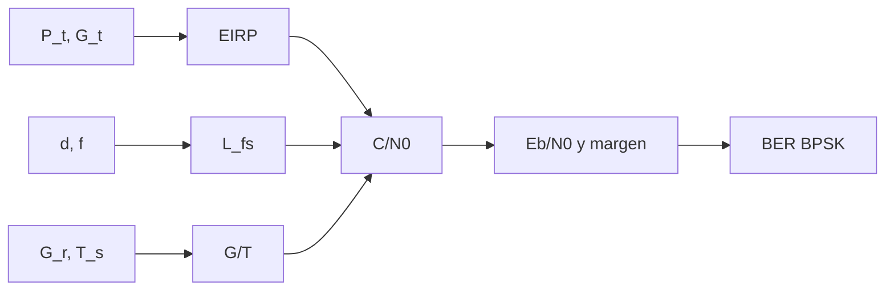

# B47-C18 — Downlink de instrumentos científicos

<!-- nav:top -->
[🏠 Programa](../../../../README.md) · [📚 Bloque B47](../../../tronco-comun/B47-instrumentacion-y-observatorios-espaciales.md) · [← Anterior: B47-C17 — Planificación de observaciones](../B47-C17-planificacion-de-observaciones/CLASE.md) · [Siguiente: B47-C19 — Mantenimiento y vida útil →](../B47-C19-mantenimiento-y-vida-util/CLASE.md)
<!-- /nav -->

## 1. Ubicación, nivel y alcance

Clase 18 del bloque B47. Nivel N3. El enlace de bajada convierte potencia, ganancias y distancia en bits por segundo. Aquí armas un presupuesto de enlace con constantes de NIST, simulas la tasa de error de una modulación BPSK, calculas el límite de Shannon y la duración de un paso por una estación, con el volumen de datos resultante. Usas [B05](../../../tronco-comun/B05-fisica-fundamental-para-el-espacio.md), [B12](../../../tronco-comun/B12-probabilidad-estadistica-e-incertidumbre.md) y [B15](../../../tronco-comun/B15-senales-imagenes-y-estimacion-cientifica.md). Los equipos son ilustrativos.

## 2. Por qué esta clase existe

Los datos que no caben en un paso se pierden o se acumulan. La decisión central: **¿cuántos bits por paso admite el enlace con margen suficiente?**

## 3. Lo que podrás hacer al terminar

1. Calcular la distancia oblicua y la pérdida de espacio libre.
2. Armar `C/N₀` con EIRP, `G/T` y `k_B`.
3. Hallar la `Eb/N₀` requerida para BER 10⁻⁵.
4. Simular la BER de BPSK.
5. Calcular el límite de Shannon.
6. Calcular la duración del paso y el volumen.

La evidencia es la **ficha del enlace de bajada** del ejercicio 12 (sección 20).

## 4. Con qué llegas y cómo comprobarlo

1. ¿Qué es una incertidumbre?
2. ¿Qué es una simulación Monte Carlo?
3. ¿Qué es una tabla de resultados?
4. ¿Qué es un valor ilustrativo?
5. ¿Qué es una verificación?

<details>
<summary>Ver respuestas</summary>

1. Un intervalo en que se espera el valor verdadero. 2. Repetir con números aleatorios de semilla fija. 3. Un resumen ordenado de cálculos. 4. Un valor propuesto para el ejemplo, no medido. 5. Comparar un cálculo con un caso independiente.
</details>

Con cuatro o cinco aciertos, sigue; si no, repasa los prerrequisitos.

## 5. Un caso de contexto y casos de referencia

A 8,2 GHz y 10° de elevación la distancia es `1932,3 km`, la pérdida `176,45 dB` y `C/N₀ = 75,38 dB-Hz`. A 1 Mbit/s el margen sobre `Eb/N₀ = 9,59 dB` es `5,79 dB`; la velocidad máxima es `3,80 Mbit/s`. El paso dura `510 s`, unos `63,8 MB`. Es el **ejemplo conductor**.

## 6. Vocabulario

El **presupuesto de enlace**. La **pérdida de espacio libre** `(4πd/λ)²`. La **PIRE** (EIRP). La **relación G/T**. La **relación `C/N₀`**. La **relación `Eb/N₀`**. La **BER**. El **límite de Shannon**. El **paso** y la **máscara de elevación**.

## 7. Modelo mental: gritar a un amigo lejano

Hablar a un amigo lejano: la voz (potencia) se diluye con la distancia, el oído (G/T) capta lo que llega y el ruido de fondo fija cuántas palabras por segundo se entienden.



*Descripción textual:* la potencia radiada, las ganancias y las pérdidas dan `C/N₀`; dividido por la velocidad da `Eb/N₀`, que fija la BER.

Analogía: gritar a un amigo lejano. Límite: espacio libre, BPSK sin codificación.

## 8. La explicación, paso a paso

### 8.1 Presupuesto (8,2 GHz, 10° de elevación, órbita de 600 km)

| Término | Valor |
|---|---|
| distancia oblicua | 1932,25 km |
| pérdida de espacio libre | 176,45 dB |
| EIRP | 12,99 dBW |
| G/T | 13,24 dB/K |
| C/N₀ (con 3 dB de pérdidas varias) | 75,38 dB-Hz |
| Eb/N₀ a 1 Mbit/s | 15,38 dB |
| Eb/N₀ requerida (BER 10⁻⁵) | 9,588 dB |
| margen | 5,79 dB |
| velocidad máxima | 3,80 Mbit/s |

### 8.2 BER de BPSK

A `Eb/N₀ = 4.3 dB`: teórica `0,01017` y simulada `0,01016` (400 000 bits, semilla 20261109).

### 8.3 Límite de Shannon

| R/B | Eb/N₀ mínima (dB) |
|---|---|
| 0,1 | -1,440 |
| 1 | 0,000 |
| 2 | 1,761 |
| 4 | 5,740 |

Cuando `R/B → 0` el límite es `-1,5917 dB` (`ln 2`).

### 8.4 Paso por la estación

La duración del paso cenital es `510,013 s` por fórmula y `510,050 s` por simulación vectorial; a 1 Mbit/s, `63,8 MB`. No se modelan la atenuación atmosférica, el Doppler ni los errores de apuntamiento.

## 9. Magnitudes, símbolos y unidades

| Símbolo | Qué es | Unidad | Valor / nota |
|---|---|---|---|
| `k_B` | Boltzmann | J/K | 1,380649 × 10⁻²³ (NIST) |
| `c` | velocidad de la luz | m/s | 299 792 458 (NIST) |
| `L_fs` | pérdida de espacio libre | dB | 176,45 |
| `C/N₀` | relación portadora/densidad de ruido | dB-Hz | 75,38 |
| `Eb/N₀` | energía por bit/densidad de ruido | dB | 15,38 |

## 10. Convenciones y referencias

dB, dBW, dB-Hz; `C/N₀ = EIRP + G/T − L − k`; BPSK coherente; paso cenital.

## 11. De dónde sale lo que afirmamos

| ID | Fuente | Localizador | Respalda | Estado |
|---|---|---|---|---|
| S1 | NIST, *Fundamental Physical Constants* (CODATA 2022) | https://physics.nist.gov/cuu/Constants/Table/allascii.txt | constantes citadas en la sección 9 | Consultada el 2026-11-09 |
| S2 | UAI, Resolución B3 de 2015 | https://arxiv.org/abs/1510.07674 | `GM` y radio ecuatorial de la Tierra | Consultada el 2026-11-09 |

Límites: solo `k_B`, `c`, `GM` y el radio provienen de fuentes consultadas. La potencia, las ganancias, la temperatura de sistema y las pérdidas son ilustrativas; no se consultó ningún estándar de enlace.

## 12. Cómo ver los resultados

| Magnitud | Valor |
|---|---|
| C/N₀ | 75,38 dB-Hz |
| Eb/N₀ (1 Mbit/s) | 15,38 dB |
| margen | 5,79 dB |
| volumen por paso | 63,8 MB |

Descripción larga: el margen permite hasta casi cuatro veces la velocidad usada.

## 13. Ejemplo trabajado: la pérdida de espacio libre

**Paso 1 · Longitud de onda.** `λ = c/f = 0,03656 m`.

**Paso 2 · Factor.** `4πd/λ = 4π × 1,932 × 10⁶/0,03656 = 6,64 × 10⁸`.

**Paso 3 · dB.** `20 log₁₀(6,64 × 10⁸) = 176,45 dB`.

## 14. Distintas formas de describir el resultado

**Por fórmula:** Friis. **Por tabla:** presupuesto. **Por simulación:** BER y paso. **Por código:** `enlace.py`.

## 15. Práctica guiada

**Ejercicio 1 · con los pasos indicados.** `Eb/N₀` a 100 kbit/s. *Pasos:* `C/N₀ − 10 log R`.

<details><summary>Solución comentada</summary>

`25,38 dB`.
</details>

**Ejercicio 2 · con una pista.** Margen a 3 Mbit/s.

<details><summary>Solución comentada</summary>

`1,02 dB`.
</details>

**Ejercicio 3 · casi autónomo.** Velocidad máxima.

<details><summary>Solución comentada</summary>

`3,80 Mbit/s`.
</details>

## 16. Práctica autónoma, transferencia e integrador

**Ejercicio 4.** BER teórica a 4,3 dB.

<details><summary>Solución comentada</summary>

`0,0102`.
</details>

**Ejercicio 5.** Límite de Shannon a `R/B = 1`.

<details><summary>Solución comentada</summary>

`0 dB`.
</details>

**Ejercicio 6.** Duración del paso.

<details><summary>Solución comentada</summary>

`510,0 s`.
</details>

**Ejercicio 7.** Volumen a 1 Mbit/s.

<details><summary>Solución comentada</summary>

`63,8 MB`.
</details>

**Ejercicio 8.** Pérdida adicional por duplicar la distancia.

<details><summary>Solución comentada</summary>

`6,02 dB`.
</details>

**Ejercicio 9 · transferencia.** **Transferencia.** ¿Por qué la `Eb/N₀` mínima es `−1,59 dB` y no cero?

<details><summary>Solución comentada</summary>

Es el límite de Shannon con ancho de banda infinito (`ln 2`).
</details>

**Ejercicio 10 · transferencia.** **Transferencia.** Un compañero afirma que 3,8 Mbit/s es la velocidad de un satélite real. Responde.

<details><summary>Solución comentada</summary>

Es un resultado de parámetros ilustrativos.
</details>

**Ejercicio 11 · transferencia.** **Transferencia.** ¿Qué haría ganar 6 dB de margen?

<details><summary>Solución comentada</summary>

Duplicar la antena de a bordo o reducir la velocidad a una cuarta parte.
</details>

**Ejercicio 12.** **Integrador.** Elabora tu *ficha del enlace de bajada*: presupuesto, margen, BER, Shannon, paso y límites.

<details><summary>Solución comentada</summary>

Secciones 8.1–8.4.
</details>

**Ejercicio 12 · integrador.** **Integrador.** Elabora tu *ficha del enlace de bajada*: presupuesto, margen, BER, Shannon, paso y límites.

<details><summary>Solución modelo</summary>

Secciones 8.1–8.4.
</details>

## 17. Laboratorio: presupuesto de enlace y BER

El script [enlace.py](enlace.py) arma el presupuesto, simula la BER y la duración del paso (**comprueba** la BER a 5 %, el paso a `10⁻³` y el límite `ln 2`).

**Datos:** `k_B`, `c` de NIST y `GM` de la UAI; equipos **ilustrativos**. **Predice antes de ejecutar:** ¿qué margen hay a 1 Mbit/s? (≈ 5,8 dB.) **Ejecución del 2026-11-09 (Python 3.12.9):**

```text
Python 3.12.9 (biblioteca estandar)
distancia oblicua a 10 grados = 1932.25 km ; perdida de espacio libre = 176.45 dB
EIRP = 12.99 dBW ; G/T = 13.24 dB/K ; C/N0 = 75.38 dB-Hz
a 1 Mbit/s: Eb/N0 = 15.38 dB ; requerida para BER 1e-5 = 9.588 dB ; margen = 5.79 dB ; velocidad maxima = 3.80 Mbit/s
BER de BPSK a Eb/N0 = 4.3 dB: teorica = 0.01017 ; simulada = 0.01016
Shannon: R/B = 0.1 -> Eb/N0 minima =  -1.440 dB
Shannon: R/B = 1.0 -> Eb/N0 minima =   0.000 dB
Shannon: R/B = 2.0 -> Eb/N0 minima =   1.761 dB
Shannon: R/B = 4.0 -> Eb/N0 minima =   5.740 dB
limite R/B -> 0: -1.5917 dB
duracion del paso cenital: formula = 510.013 s ; simulacion = 510.050 s ; volumen a 1 Mbit/s = 63.8 MB
Pruebas superadas.
```

```bash
python programa/clases/B47/B47-C18-downlink-de-instrumentos-cientificos/enlace.py
```

**Límites:** espacio libre, BPSK sin codificación.

## 18. Errores frecuentes y cómo corregirlos

**Mezclar dB y valores lineales.** Se corrige con la sección 9.

**Olvidar las pérdidas varias.** Se corrige con 8.1.

**Usar la duración cenital para cualquier paso.** Se corrige con 8.4.

**Tomar la BER teórica como medida.** Se corrige con 8.2.

## 19. Cómo sabrás que vas bien

Tras la sección 8: ¿qué resultado esperabas y cuál obtuviste? Si dudas, repasa el ejemplo 13. Tras el laboratorio: ¿qué comprueba? (ver la sección 17).

## 20. Qué entregas y cómo se evalúa

El producto es tu **ficha del enlace de bajada** (ejercicio 12).

| Criterio | Inicial | En desarrollo | Logrado | Destacado |
|---|---|---|---|---|
| Conceptos | Los confunde | Parciales | conceptos de la clase | Explica los límites |
| Cálculo | Sin unidades | Con errores | Tablas completas | Calcula casos nuevos |
| Numérico | Sin comprobar | Un caso | Contraste con el análisis | Interpreta las diferencias |
| Fuentes | Sin fuente | Sin fecha | fuentes con fecha | Declara lo ilustrativo |
| Límites | No los nombra | Uno | Tres | Discute qué falta del modelo |

**Condiciones críticas (no se compensan con promedio):** rotular lo ilustrativo; no presentar el modelo como diseño de una misión real; citar solo lo consultado.

## 21. Ética, seguridad y límites

Clase educativa: los modelos son simplificados. Accesibilidad: tablas equivalentes a las gráficas, fórmulas en texto, ejercicios sin conexión.

## 22. Para cerrar y seguir

El enlace tiene `5,8 dB` de margen a 1 Mbit/s y entrega `64 MB` por paso. Queda una pregunta: ¿cuánto dura el instrumento antes de que los recursos se agoten?

**Glosario español–inglés.** presupuesto de enlace · *link budget*; pérdida de espacio libre · *free-space loss*; tasa de error · *bit error rate*; límite de Shannon · *Shannon limit*; paso · *pass*.

**Continuidad.** [B47-C19](../B47-C19-mantenimiento-y-vida-util/CLASE.md) estudia el mantenimiento y la vida útil.

**Referencias:** ver sección 11.

<!-- nav:bottom -->
---

[← Anterior: B47-C17 — Planificación de observaciones](../B47-C17-planificacion-de-observaciones/CLASE.md) · [📚 Bloque B47](../../../tronco-comun/B47-instrumentacion-y-observatorios-espaciales.md) · [Siguiente: B47-C19 — Mantenimiento y vida útil →](../B47-C19-mantenimiento-y-vida-util/CLASE.md)
<!-- /nav -->
