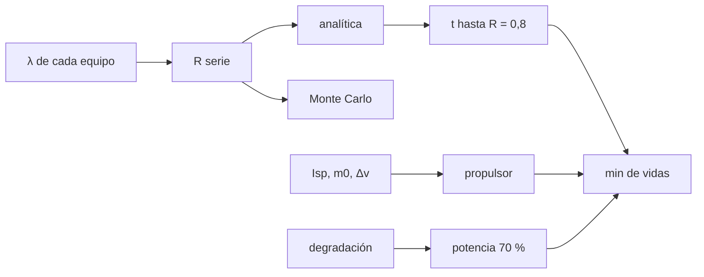

# B47-C19 — Mantenimiento y vida útil

<!-- nav:top -->
[🏠 Programa](../../../../README.md) · [📚 Bloque B47](../../../tronco-comun/B47-instrumentacion-y-observatorios-espaciales.md) · [← Anterior: B47-C18 — Downlink de instrumentos científicos](../B47-C18-downlink-de-instrumentos-cientificos/CLASE.md) · [Siguiente: B47-C20 — Caso comparativo de observatorios espaciales →](../B47-C20-caso-comparativo-de-observatorios-espaciales/CLASE.md)
<!-- /nav -->

## 1. Ubicación, nivel y alcance

Clase 19 del bloque B47. Nivel N3. La vida útil de un instrumento la fija el recurso que se agota primero: confiabilidad, propulsor, potencia o criógeno. Aquí combinas redundancias en serie y en paralelo, comparas el cálculo analítico con un Monte Carlo y calculas el combustible por Tsiolkovsky y la degradación de potencia. Usas [B05](../../../tronco-comun/B05-fisica-fundamental-para-el-espacio.md) y [B12](../../../tronco-comun/B12-probabilidad-estadistica-e-incertidumbre.md). Todas las tasas son ilustrativas.

## 2. Por qué esta clase existe

No sirve duplicar un equipo si otro componente falla antes. La decisión central: **¿qué recurso limita la vida de la misión y qué redundancia vale la pena?**

## 3. Lo que podrás hacer al terminar

1. Calcular la confiabilidad de sistemas en serie.
2. Calcular respaldo frío y redundancia `k` de `n`.
3. Simular fallas con exponenciales (semilla fija).
4. Hallar el tiempo hasta `R = 0,8`.
5. Calcular propulsor con Tsiolkovsky.
6. Determinar la vida de la misión como el mínimo.

La evidencia es la **ficha de vida útil** del ejercicio 12 (sección 20).

## 4. Con qué llegas y cómo comprobarlo

1. ¿Qué es una incertidumbre?
2. ¿Qué es una simulación Monte Carlo?
3. ¿Qué es una tabla de resultados?
4. ¿Qué es un valor ilustrativo?
5. ¿Qué es una verificación?

<details>
<summary>Ver respuestas</summary>

1. Un intervalo en que se espera el valor verdadero. 2. Repetir con números aleatorios de semilla fija. 3. Un resumen ordenado de cálculos. 4. Un valor propuesto para el ejemplo, no medido. 5. Comparar un cálculo con un caso independiente.
</details>

Con cuatro o cinco aciertos, sigue; si no, repasa los prerrequisitos.

## 5. Un caso de contexto y casos de referencia

Con tasas ilustrativas, la confiabilidad del sistema a 5 años es `0,6469` (Monte Carlo `0,6472`), baja a `0,8` en `3,24 años`; el propulsor dura `17,3 años` y la potencia llega al 70 % en `14,1 años`. La vida de la misión es el mínimo, `3,24 años`. Es el **ejemplo conductor**.

## 6. Vocabulario

La **confiabilidad** `R(t)`. La **tasa de falla** `λ`. La **redundancia** (respaldo frío, `k` de `n`). La **curva de la bañera**. El **propulsor**. La **ecuación de Tsiolkovsky**. La **degradación**. La **vida útil**.

## 7. Modelo mental: una cadena con eslabones de repuesto

Es una cadena: se rompe por el eslabón más débil; duplicar un eslabón fuerte no sirve si otro se gasta antes.



*Descripción textual:* cada equipo y cada recurso tiene su vida; la de la misión es la menor.

Analogía: una cadena con eslabones de repuesto. Límite: tasa constante, fallas independientes.

## 8. La explicación, paso a paso

### 8.1 Confiabilidad

| t (años) | carga | ordenador (respaldo frío) | ruedas (3 de 4) | sistema |
|---|---|---|---|---|
| 1 | 0,9802 | 0,9953 | 0,9866 | 0,9626 |
| 2 | 0,9608 | 0,9825 | 0,9523 | 0,8989 |
| 5 | 0,9048 | 0,9098 | 0,7858 | 0,6469 |
| 8 | 0,8521 | 0,8088 | 0,5991 | 0,4129 |
| 10 | 0,8187 | 0,7358 | 0,4865 | 0,2931 |

A 5 años: analítica `0,6469` y Monte Carlo (100 000 sistemas, semilla 20261109) `0,6472`. El tiempo hasta `R = 0,8` es `3,237 años`.

### 8.2 Recursos

Propulsor: `0,6937 kg/año` para `10 m/s` sobre 150 kg con `Isp = 220 s`; los 12 kg duran `17,30 años`. Control: el `Δv` inverso da `10,000000 m/s`. Potencia: `(1 − 0,025)^t = 0,7` en `14,09 años`.

### 8.3 Vida de la misión

`min(3,24, 17,30, 14,09) = 3,24 años`: la confiabilidad limita.

### 8.4 Lectura

Las ruedas 3 de 4 son el eslabón débil a 10 años (`0,487`). El modelo supone fallas independientes, conmutación perfecta y ninguna reparación.

## 9. Magnitudes, símbolos y unidades

| Símbolo | Qué es | Unidad | Valor / nota |
|---|---|---|---|
| `λ` | tasa de falla | año⁻¹ | 0,02 / 0,10 / 0,05 (ilustrativas) |
| `R` | confiabilidad | — | 0,647 a 5 años |
| `Isp` | impulso específico | s | 220 (ilustrativo) |
| `g₀` | gravedad estándar | m/s² | 9,80665 (NIST) |
| `d` | degradación | año⁻¹ | 0,025 |

## 10. Convenciones y referencias

Años y kg; fallas exponenciales; Tsiolkovsky `Δv = Isp g₀ ln(m₀/m)`.

## 11. De dónde sale lo que afirmamos

| ID | Fuente | Localizador | Respalda | Estado |
|---|---|---|---|---|
| S1 | NIST, *Fundamental Physical Constants* (CODATA 2022) | https://physics.nist.gov/cuu/Constants/Table/allascii.txt | constantes citadas en la sección 9 | Consultada el 2026-11-09 |

Límites: solo `g₀` proviene de NIST. Las tasas de falla, el `Isp` y la degradación son ilustrativos y no se consultaron.

## 12. Cómo ver los resultados

| Recurso | Vida (años) |
|---|---|
| confiabilidad (R = 0,8) | 3,24 |
| propulsor | 17,3 |
| potencia (70 %) | 14,1 |
| **misión** | **3,24** |

Descripción larga: la confiabilidad es el recurso limitante.

## 13. Ejemplo trabajado: respaldo frío a 5 años

**Paso 1 · Producto.** `λt = 0,10 × 5 = 0,5`.

**Paso 2 · Exponencial.** `e^(−0,5) = 0,6065`.

**Paso 3 · Respaldo frío.** `R = e^(−λt)(1 + λt) = 0,6065 × 1,5 = 0,9098`.

## 14. Distintas formas de describir el resultado

**Por fórmula:** `R(t)`. **Por tabla:** tiempos. **Por simulación:** Monte Carlo. **Por código:** `vida_util.py`.

## 15. Práctica guiada

**Ejercicio 1 · con los pasos indicados.** `R` de la carga a 5 años. *Pasos:* `e^(−0,02×5)`.

<details><summary>Solución comentada</summary>

`0,9048`.
</details>

**Ejercicio 2 · con una pista.** `R` de las ruedas a 5 años.

<details><summary>Solución comentada</summary>

`0,7858`.
</details>

**Ejercicio 3 · casi autónomo.** `R` del sistema a 10 años.

<details><summary>Solución comentada</summary>

`0,2931`.
</details>

## 16. Práctica autónoma, transferencia e integrador

**Ejercicio 4.** Tiempo hasta `R = 0,8`.

<details><summary>Solución comentada</summary>

`3,24 años`.
</details>

**Ejercicio 5.** Propulsor por año.

<details><summary>Solución comentada</summary>

`0,694 kg`.
</details>

**Ejercicio 6.** Vida por propulsor.

<details><summary>Solución comentada</summary>

`17,3 años`.
</details>

**Ejercicio 7.** Potencia a 10 años.

<details><summary>Solución comentada</summary>

`77,6 %`.
</details>

**Ejercicio 8.** Diferencia analítica−MC a 5 años.

<details><summary>Solución comentada</summary>

`0,0003`.
</details>

**Ejercicio 9 · transferencia.** **Transferencia.** ¿Por qué el respaldo frío mejora más que duplicar el equipo en paralelo?

<details><summary>Solución comentada</summary>

Porque el respaldo no envejece hasta que se conmuta.
</details>

**Ejercicio 10 · transferencia.** **Transferencia.** Un compañero afirma que 3,2 años es la vida de una misión real. Responde.

<details><summary>Solución comentada</summary>

Son tasas ilustrativas.
</details>

**Ejercicio 11 · transferencia.** **Transferencia.** ¿Qué pasa si las ruedas fueran 4 de 4?

<details><summary>Solución comentada</summary>

Sería una serie: `R = e^(−4λt)`, mucho peor.
</details>

**Ejercicio 12.** **Integrador.** Elabora tu *ficha de vida útil*: confiabilidad, recursos, mínimo y límites.

<details><summary>Solución comentada</summary>

Secciones 8.1–8.4.
</details>

**Ejercicio 12 · integrador.** **Integrador.** Elabora tu *ficha de vida útil*: confiabilidad, recursos, mínimo y límites.

<details><summary>Solución modelo</summary>

Secciones 8.1–8.4.
</details>

## 17. Laboratorio: confiabilidad, propulsor y potencia

El script [vida_util.py](vida_util.py) calcula la confiabilidad analítica y simulada y los recursos (**comprueba** el Monte Carlo a 0,005 y Tsiolkovsky a `10⁻⁹`).

**Datos:** `g₀` de NIST; tasas **ilustrativas**. **Predice antes de ejecutar:** ¿qué recurso limita? (la confiabilidad, ≈ 3,2 años.) **Ejecución del 2026-11-09 (Python 3.12.9):**

```text
Python 3.12.9 (biblioteca estandar)
t [anios]   R carga  R ordenador  R ruedas 3/4  R sistema
        1    0.9802       0.9953        0.9866     0.9626
        2    0.9608       0.9825        0.9523     0.8989
        5    0.9048       0.9098        0.7858     0.6469
        8    0.8521       0.8088        0.5991     0.4129
       10    0.8187       0.7358        0.4865     0.2931
R(5 anios): analitica = 0.6469 ; Monte Carlo = 0.6472
tiempo hasta R = 0.8: 3.237 anios
propulsor por anio = 0.6937 kg ; vida por propulsor = 17.30 anios ; dv inverso = 10.000000 m/s
tiempo hasta 70 % de potencia = 14.09 anios
vida de la mision = minimo de las vidas parciales = 3.237 anios
Pruebas superadas.
```

```bash
python programa/clases/B47/B47-C19-mantenimiento-y-vida-util/vida_util.py
```

**Límites:** fallas independientes y conmutación perfecta.

## 18. Errores frecuentes y cómo corregirlos

**Sumar tasas de equipos redundantes.** Se corrige con 8.1.

**Olvidar que el respaldo conmuta.** Se corrige con el ejemplo 13.

**Dar la vida como el promedio de recursos.** Se corrige con 8.3.

**Tomar las tasas como medidas.** Se corrige con la sección 10.

## 19. Cómo sabrás que vas bien

Tras la sección 8: ¿qué resultado esperabas y cuál obtuviste? Si dudas, repasa el ejemplo 13. Tras el laboratorio: ¿qué comprueba? (ver la sección 17).

## 20. Qué entregas y cómo se evalúa

El producto es tu **ficha de vida útil** (ejercicio 12).

| Criterio | Inicial | En desarrollo | Logrado | Destacado |
|---|---|---|---|---|
| Conceptos | Los confunde | Parciales | conceptos de la clase | Explica los límites |
| Cálculo | Sin unidades | Con errores | Tablas completas | Calcula casos nuevos |
| Numérico | Sin comprobar | Un caso | Contraste con el análisis | Interpreta las diferencias |
| Fuentes | Sin fuente | Sin fecha | fuentes con fecha | Declara lo ilustrativo |
| Límites | No los nombra | Uno | Tres | Discute qué falta del modelo |

**Condiciones críticas (no se compensan con promedio):** rotular lo ilustrativo; no presentar el modelo como diseño de una misión real; citar solo lo consultado.

## 21. Ética, seguridad y límites

Clase educativa: los modelos son simplificados. Accesibilidad: tablas equivalentes a las gráficas, fórmulas en texto, ejercicios sin conexión.

## 22. Para cerrar y seguir

La confiabilidad cae a `0,8` en `3,2 años`, antes que el propulsor (`17 años`) y la potencia (`14 años`). Queda una pregunta: ¿cómo se comparan observatorios con características tan distintas?

**Glosario español–inglés.** confiabilidad · *reliability*; tasa de falla · *failure rate*; redundancia · *redundancy*; propulsor · *propellant*; vida útil · *useful life*.

**Continuidad.** [B47-C20](../B47-C20-caso-comparativo-de-observatorios-espaciales/CLASE.md) estudia el caso comparativo de observatorios espaciales.

**Referencias:** ver sección 11.

<!-- nav:bottom -->
---

[← Anterior: B47-C18 — Downlink de instrumentos científicos](../B47-C18-downlink-de-instrumentos-cientificos/CLASE.md) · [📚 Bloque B47](../../../tronco-comun/B47-instrumentacion-y-observatorios-espaciales.md) · [Siguiente: B47-C20 — Caso comparativo de observatorios espaciales →](../B47-C20-caso-comparativo-de-observatorios-espaciales/CLASE.md)
<!-- /nav -->
