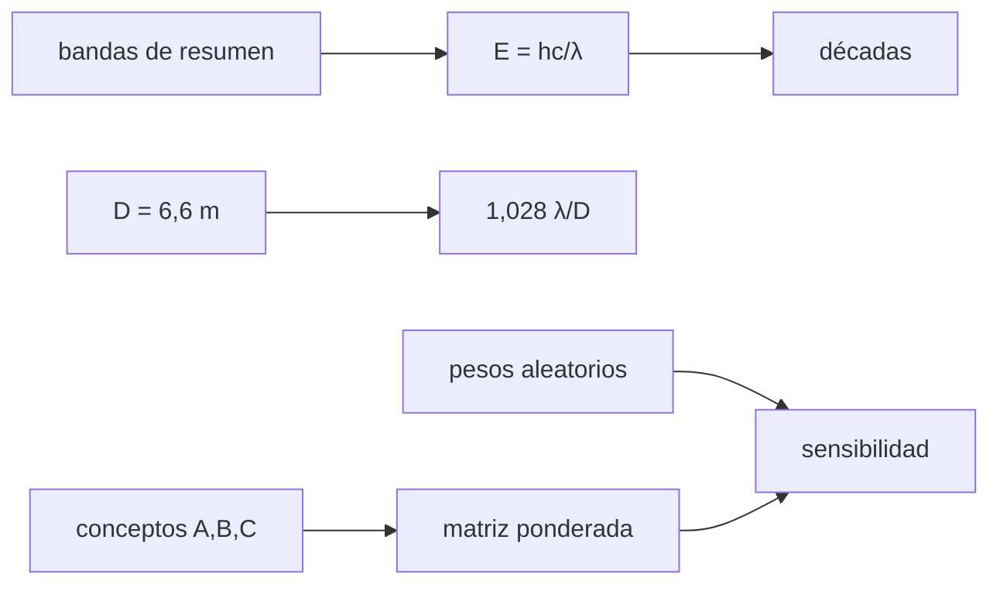

# B47-C20 — Caso comparativo de observatorios espaciales

<!-- nav:top -->
[🏠 Programa](../../../../README.md) · [📚 Bloque B47](../../../tronco-comun/B47-instrumentacion-y-observatorios-espaciales.md) · [← Anterior: B47-C19 — Mantenimiento y vida útil](../B47-C19-mantenimiento-y-vida-util/CLASE.md) · [Siguiente: B47-C21 — Magnetógrafos y medición de campos solares →](../B47-C21-magnetografos-y-medicion-de-campos-solares/CLASE.md)
<!-- /nav -->

## 1. Ubicación, nivel y alcance

Clase 20 del bloque B47. Nivel N3. Comparar observatorios exige métricas físicas comparables y una forma honesta de pesar criterios. Aquí calculas las energías y longitudes de onda de cuatro bandas (con los intervalos que dan los resúmenes consultados de JWST, GALEX, NuSTAR y Fermi LAT), el límite de difracción de un espejo de 6,6 m y una matriz de decisión con análisis de sensibilidad a los pesos, usando tres conceptos hipotéticos. Usas [B05](../../../tronco-comun/B05-fisica-fundamental-para-el-espacio.md) y [B42](../../../tronco-comun/B42-optica-fisica-y-optica-adaptativa.md). Las puntuaciones son ilustrativas; no clasifican misiones reales.

## 2. Por qué esta clase existe

Un ranking depende de los pesos elegidos. La decisión central: **¿qué conclusión sobrevive cuando los pesos cambian?**

## 3. Lo que podrás hacer al terminar

1. Convertir un intervalo de longitud de onda en energía y viceversa.
2. Contar las décadas espectrales cubiertas.
3. Calcular el límite de difracción de un espejo.
4. Calcular la oclusión de una órbita de 600 km.
5. Construir una matriz de decisión ponderada.
6. Evaluar la sensibilidad a los pesos con Monte Carlo.

La evidencia es la **ficha comparativa de observatorios** del ejercicio 12 (sección 20).

## 4. Con qué llegas y cómo comprobarlo

1. ¿Qué es una incertidumbre?
2. ¿Qué es una simulación Monte Carlo?
3. ¿Qué es una tabla de resultados?
4. ¿Qué es un valor ilustrativo?
5. ¿Qué es una verificación?

<details>
<summary>Ver respuestas</summary>

1. Un intervalo en que se espera el valor verdadero. 2. Repetir con números aleatorios de semilla fija. 3. Un resumen ordenado de cálculos. 4. Un valor propuesto para el ejemplo, no medido. 5. Comparar un cálculo con un caso independiente.
</details>

Con cuatro o cinco aciertos, sigue; si no, repasa los prerrequisitos.

## 5. Un caso de contexto y casos de referencia

Los intervalos de los resúmenes cubren `1,68` décadas (JWST), `0,31` (GALEX), `1,42` (NuSTAR) y `4,18` (Fermi LAT). Un espejo de 6,6 m difracta `0,0643 arcsec` a 2 µm. En la matriz ilustrativa el concepto B gana en `91 %` de los pesos aleatorios. Es el **ejemplo conductor**.

## 6. Vocabulario

La **banda espectral**. La **década**. El **límite de difracción**. La **matriz de decisión** (suma ponderada). El **peso**. El **análisis de sensibilidad**. El **concepto** hipotético. La **oclusión**.

## 7. Modelo mental: elegir un auto con una lista de criterios

Es elegir un auto con una lista de criterios: el ganador cambia si se da más peso al precio que a la potencia; un buen análisis dice cuánto cambia.



*Descripción textual:* las métricas físicas describen lo que cada observatorio puede ver y la matriz de decisión resume una elección cuya robustez se mide cambiando los pesos.

Analogía: elegir un auto con una lista de criterios. Límite: conceptos hipotéticos.

## 8. La explicación, paso a paso

### 8.1 Bandas (intervalos de los resúmenes consultados)

| Observatorio | λ (m) | E (eV) | décadas |
|---|---|---|---|
| JWST (0,6-29 um) | 6,000 × 10⁻⁷ a 2,900 × 10⁻⁵ | 4,275 × 10⁻² a 2,066 × 10⁰ | 1,68 |
| GALEX (135-275 nm) | 1,350 × 10⁻⁷ a 2,750 × 10⁻⁷ | 4,509 × 10⁰ a 9,184 × 10⁰ | 0,31 |
| NuSTAR (3-79 keV) | 1,569 × 10⁻¹¹ a 4,133 × 10⁻¹⁰ | 3,000 × 10³ a 7,900 × 10⁴ | 1,42 |
| Fermi LAT (20 MeV-300 GeV) | 4,133 × 10⁻¹⁸ a 6,199 × 10⁻¹⁴ | 2,000 × 10⁷ a 3,000 × 10¹¹ | 4,18 |

La ida y vuelta `λ → E → λ` es exacta a `10⁻¹²`.

### 8.2 Resolución y órbita

Un espejo de 6,6 m a 2 µm da `1,028 λ/D = 0,0643 arcsec`. Una órbita a 600 km (la de un resumen consultado) tiene período `96,686 min` y oclusión máxima `0,3670`, es decir, una eficiencia máxima de `63,3 %`.

### 8.3 Matriz de decisión (ilustrativa)

Criterios y pesos: resolución 0,30; cobertura 0,25; coste 0,20; riesgo 0,15; cadencia 0,10 (suman 1).

| Concepto | puntuación base | gana con pesos aleatorios |
|---|---|---|
| A gran telescopio frio | 3,200 | 8,5 % |
| B constelacion pequena | 3,450 | 90,9 % |
| C telescopio de rayos X | 3,050 | 0,6 % |

### 8.4 Lectura

El concepto B gana con los pesos base y en la gran mayoría de los pesos aleatorios, pero eso depende de puntuaciones inventadas. A y C ganan en el resto de los vectores de pesos (la tabla da sus porcentajes). Este laboratorio no clasifica observatorios reales.

## 9. Magnitudes, símbolos y unidades

| Símbolo | Qué es | Unidad | Valor / nota |
|---|---|---|---|
| `E` | energía del fotón | eV | ver 8.1 |
| `λ` | longitud de onda | m | ver 8.1 |
| `D` | apertura (resumen) | m | 6,6 |
| `w_i` | pesos | — | 0,30; 0,25; 0,20; 0,15; 0,10 |
| `s_ij` | puntuaciones | 1–5 | ilustrativas |

## 10. Convenciones y referencias

SI y eV; décadas en `log₁₀`; puntuaciones de 1 a 5; pesos normalizados.

## 11. De dónde sale lo que afirmamos

| ID | Fuente | Localizador | Respalda | Estado |
|---|---|---|---|---|
| S1 | NIST, *Fundamental Physical Constants* (CODATA 2022) | https://physics.nist.gov/cuu/Constants/Table/allascii.txt | constantes citadas en la sección 9 | Consultada el 2026-11-09 |
| S2 | Gardner et al., *The James Webb Space Telescope* | https://arxiv.org/abs/astro-ph/0606175 | observatorio de 6,6 m, 50 K, 0,6–29 µm con segmentos de berilio (resumen) | Solo resumen, consultado el 2026-11-09 |
| S3 | Martin et al., *The Galaxy Evolution Explorer: A Space Ultraviolet Survey Mission* | https://arxiv.org/abs/astro-ph/0411302 | bandas de 1350–1750 Å y 1750–2750 Å (resumen) | Solo resumen, consultado el 2026-11-09 |
| S4 | Harrison et al., *The Nuclear Spectroscopic Telescope Array (NuSTAR) Mission* | https://arxiv.org/abs/1301.7307 | banda de 3–79 keV, órbita de unos 600 km con inclinación de 6° (resumen) | Solo resumen, consultado el 2026-11-09 |
| S5 | Atwood et al., *The Large Area Telescope on the Fermi Gamma-ray Space Telescope Mission* | https://arxiv.org/abs/0902.1089 | telescopio de conversión de pares de menos de 20 MeV a más de 300 GeV y campo de 2,4 sr (resumen) | Solo resumen, consultado el 2026-11-09 |

Límites: S2 a S5 son solo resúmenes; de ellos se usan únicamente los intervalos de banda, 6,6 m y 600 km. Los conceptos A, B y C, sus puntuaciones y los pesos son hipotéticos.

## 12. Cómo ver los resultados

| Concepto | puntuación | victorias |
|---|---|---|
| A gran telescopio frio | 3,200 | 8,5 % |
| B constelacion pequena | 3,450 | 90,9 % |
| C telescopio de rayos X | 3,050 | 0,6 % |

Descripción larga: B gana con casi todos los pesos aleatorios.

## 13. Ejemplo trabajado: décadas de JWST

**Paso 1 · Cociente.** `29/0,6 = 48,33`.

**Paso 2 · Logaritmo.** `log₁₀ 48,33 = 1,68`.

**Lectura.** La banda cubre casi dos décadas.

## 14. Distintas formas de describir el resultado

**Por fórmula:** `E = hc/λ`. **Por tabla:** bandas. **Por simulación:** pesos. **Por código:** `comparativo.py`.

## 15. Práctica guiada

**Ejercicio 1 · con los pasos indicados.** Energía de 0,6 µm.

<details><summary>Solución comentada</summary>

`2,0664 eV`.
</details>

**Ejercicio 2 · con una pista.** Energía de 29 µm.

<details><summary>Solución comentada</summary>

`0,0428 eV`.
</details>

**Ejercicio 3 · casi autónomo.** Décadas de NuSTAR.

<details><summary>Solución comentada</summary>

`1,42`.
</details>

## 16. Práctica autónoma, transferencia e integrador

**Ejercicio 4.** Décadas de GALEX.

<details><summary>Solución comentada</summary>

`0,31`.
</details>

**Ejercicio 5.** FWHM a 2 µm con 6,6 m.

<details><summary>Solución comentada</summary>

`0,0643 arcsec`.
</details>

**Ejercicio 6.** Puntuación base de B.

<details><summary>Solución comentada</summary>

`3,45`.
</details>

**Ejercicio 7.** Puntuación base de A.

<details><summary>Solución comentada</summary>

`3,20`.
</details>

**Ejercicio 8.** Eficiencia máxima a 600 km.

<details><summary>Solución comentada</summary>

`63,3 %`.
</details>

**Ejercicio 9 · transferencia.** **Transferencia.** ¿Por qué un ranking con un solo conjunto de pesos es frágil?

<details><summary>Solución comentada</summary>

Porque pequeños cambios de pesos pueden cambiar al ganador.
</details>

**Ejercicio 10 · transferencia.** **Transferencia.** Un compañero afirma que B es el mejor observatorio. Responde.

<details><summary>Solución comentada</summary>

Es un concepto hipotético con puntuaciones inventadas.
</details>

**Ejercicio 11 · transferencia.** **Transferencia.** ¿Qué métrica física falta para comparar sensibilidad?

<details><summary>Solución comentada</summary>

Área colectora, fondo y tiempo de integración.
</details>

**Ejercicio 12.** **Integrador.** Elabora tu *ficha comparativa de observatorios*: bandas, difracción, matriz y sensibilidad.

<details><summary>Solución comentada</summary>

Secciones 8.1–8.4.
</details>

**Ejercicio 12 · integrador.** **Integrador.** Elabora tu *ficha comparativa de observatorios*: bandas, difracción, matriz y sensibilidad.

<details><summary>Solución modelo</summary>

Secciones 8.1–8.4.
</details>

## 17. Laboratorio: bandas, difracción y decisión

El script [comparativo.py](comparativo.py) convierte bandas, calcula difracción y oclusión y mide la robustez de una decisión (**comprueba** la ida y vuelta a `10⁻¹²` y que los pesos suman 1).

**Datos:** constantes de NIST y de la UAI; intervalos de **resúmenes**; conceptos **hipotéticos**. **Predice antes de ejecutar:** ¿gana B con casi todos los pesos? (sí, en ≈ 91 %.) **Ejecución del 2026-11-09 (Python 3.12.9):**

```text
Python 3.12.9 (biblioteca estandar)
JWST (0,6-29 um)             lambda 6.0000e-07 a 2.9000e-05 m ; E 4.2753e-02 a 2.0664e+00 eV ; 1.68 decadas
GALEX (135-275 nm)           lambda 1.3500e-07 a 2.7500e-07 m ; E 4.5085e+00 a 9.1840e+00 eV ; 0.31 decadas
NuSTAR (3-79 keV)            lambda 1.5694e-11 a 4.1328e-10 m ; E 3.0000e+03 a 7.9000e+04 eV ; 1.42 decadas
Fermi LAT (20 MeV-300 GeV)   lambda 4.1328e-18 a 6.1992e-14 m ; E 2.0000e+07 a 3.0000e+11 eV ; 4.18 decadas
FWHM de difraccion de un espejo de 6,6 m a 2 um = 0.0643 arcsec
orbita de 600 km: periodo = 96.686 min ; oclusion maxima = 0.3670 ; eficiencia maxima = 0.6330
pesos: {'resolucion': 0.3, 'cobertura': 0.25, 'coste': 0.2, 'riesgo': 0.15, 'cadencia': 0.1} suma = 1.0
concepto A gran telescopio frio     puntuacion = 3.200 ; gana en 8.5 % de los pesos aleatorios
concepto B constelacion pequena     puntuacion = 3.450 ; gana en 90.9 % de los pesos aleatorios
concepto C telescopio de rayos X    puntuacion = 3.050 ; gana en 0.6 % de los pesos aleatorios
Pruebas superadas.
```

```bash
python programa/clases/B47/B47-C20-caso-comparativo-de-observatorios-espaciales/comparativo.py
```

**Límites:** intervalos de resúmenes, conceptos hipotéticos.

## 18. Errores frecuentes y cómo corregirlos

**Dar los intervalos como espec. del instrumento.** Se corrige con la sección 11.

**Tomar las puntuaciones como evaluación real.** Se corrige con 8.4.

**Usar pesos sin normalizar.** Se corrige con 8.3.

**Concluir sin análisis de sensibilidad.** Se corrige con 8.3.

## 19. Cómo sabrás que vas bien

Tras la sección 8: ¿qué resultado esperabas y cuál obtuviste? Si dudas, repasa el ejemplo 13. Tras el laboratorio: ¿qué comprueba? (ver la sección 17).

## 20. Qué entregas y cómo se evalúa

El producto es tu **ficha comparativa de observatorios** (ejercicio 12).

| Criterio | Inicial | En desarrollo | Logrado | Destacado |
|---|---|---|---|---|
| Conceptos | Los confunde | Parciales | conceptos de la clase | Explica los límites |
| Cálculo | Sin unidades | Con errores | Tablas completas | Calcula casos nuevos |
| Numérico | Sin comprobar | Un caso | Contraste con el análisis | Interpreta las diferencias |
| Fuentes | Sin fuente | Sin fecha | fuentes con fecha | Declara lo ilustrativo |
| Límites | No los nombra | Uno | Tres | Discute qué falta del modelo |

**Condiciones críticas (no se compensan con promedio):** rotular lo ilustrativo; no presentar el modelo como diseño de una misión real; citar solo lo consultado.

## 21. Ética, seguridad y límites

Clase educativa: los modelos son simplificados. Accesibilidad: tablas equivalentes a las gráficas, fórmulas en texto, ejercicios sin conexión.

## 22. Para cerrar y seguir

Las bandas de los resúmenes cubren de `0,3` a `4,2` décadas y B gana en `91 %` de los pesos ilustrativos. Queda una pregunta: ¿cómo se mide el campo magnético del Sol?

**Glosario español–inglés.** banda · *band*; década · *decade*; matriz de decisión · *decision matrix*; sensibilidad · *sensitivity*; concepto · *concept*.

**Continuidad.** [B47-C21](../B47-C21-magnetografos-y-medicion-de-campos-solares/CLASE.md) pasa a la ampliación con los magnetógrafos solares.

**Referencias:** ver sección 11.

<!-- nav:bottom -->
---

[← Anterior: B47-C19 — Mantenimiento y vida útil](../B47-C19-mantenimiento-y-vida-util/CLASE.md) · [📚 Bloque B47](../../../tronco-comun/B47-instrumentacion-y-observatorios-espaciales.md) · [Siguiente: B47-C21 — Magnetógrafos y medición de campos solares →](../B47-C21-magnetografos-y-medicion-de-campos-solares/CLASE.md)
<!-- /nav -->
