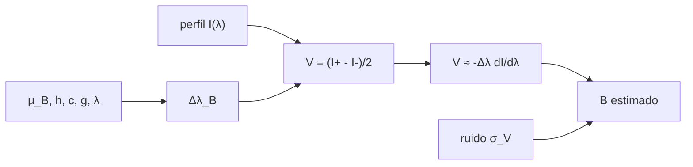

# B47-C21 — Magnetógrafos y medición de campos solares

<!-- nav:top -->
[🏠 Programa](../../../../README.md) · [📚 Bloque B47](../../../tronco-comun/B47-instrumentacion-y-observatorios-espaciales.md) · [← Anterior: B47-C20 — Caso comparativo de observatorios espaciales](../B47-C20-caso-comparativo-de-observatorios-espaciales/CLASE.md) · [Siguiente: B47-C22 — Misiones de física solar: SOHO, SDO y Solar Orbiter →](../B47-C22-misiones-de-fisica-solar-soho-sdo-y-solar-orbiter/CLASE.md)
<!-- /nav -->

## 1. Ubicación, nivel y alcance

Clase 21 del bloque B47. Nivel N3. Un magnetógrafo mide el campo magnético de la superficie solar a partir del desdoblamiento Zeeman de una línea espectral. Aquí calculas el desdoblamiento con el magnetón de Bohr, construyes el parámetro de Stokes V de una línea gaussiana, recuperas el campo longitudinal con un estimador de campo débil y mides cuánto lo afecta el ruido y la saturación. Usas [B05](../../../tronco-comun/B05-fisica-fundamental-para-el-espacio.md), [B31](../../../tronco-comun/B31-fisica-cuantica-nuclear-y-astroparticulas.md) y [B42](../../../tronco-comun/B42-optica-fisica-y-optica-adaptativa.md). Línea y ruido son ilustrativos.

## 2. Por qué esta clase existe

El campo solar se infiere de una señal diminuta: una diferencia de polarización circular. La decisión central: **¿cuántas posiciones espectrales y qué ruido permiten medir el campo con una incertidumbre dada, y hasta qué campo vale la aproximación débil?**

## 3. Lo que podrás hacer al terminar

1. Calcular el desdoblamiento Zeeman con `μ_B`, `h` y `c`.
2. Contrastar con la constante `4,67 × 10⁻¹³ g λ² B`.
3. Construir `V = (I₊ − I₋)/2` de una línea gaussiana.
4. Aplicar el estimador de campo débil.
5. Propagar el ruido (Monte Carlo y analítico).
6. Reconocer la saturación a campos fuertes.

La evidencia es la **ficha del magnetógrafo** del ejercicio 12 (sección 20).

## 4. Con qué llegas y cómo comprobarlo

1. ¿Qué es una incertidumbre?
2. ¿Qué es una simulación Monte Carlo?
3. ¿Qué es una tabla de resultados?
4. ¿Qué es un valor ilustrativo?
5. ¿Qué es una verificación?

<details>
<summary>Ver respuestas</summary>

1. Un intervalo en que se espera el valor verdadero. 2. Repetir con números aleatorios de semilla fija. 3. Un resumen ordenado de cálculos. 4. Un valor propuesto para el ejemplo, no medido. 5. Comparar un cálculo con un caso independiente.
</details>

Con cuatro o cinco aciertos, sigue; si no, repasa los prerrequisitos.

## 5. Un caso de contexto y casos de referencia

Para una línea de `617,33 nm` con factor de Landé `2,5` (ilustrativos), el desdoblamiento a `1000 G` es `4,448 pm` y `k = 0,00445 pm/G`. El estimador recupera `100 G` exactos, `996,9 G` para `1000 G` y `2917 G` para `3000 G` (saturación). Con ruido de `10⁻³` en `V`, la incertidumbre a 100 G es `15,9 G`. Es el **ejemplo conductor**; no es un instrumento ni una línea medida.

## 6. Vocabulario

El **efecto Zeeman**. El **factor de Landé efectivo** `g`. El **desdoblamiento** `Δλ_B`. El **parámetro de Stokes V**: diferencia de polarización circular. La **aproximación de campo débil**. El **magnetograma**. La **línea de absorción** gaussiana.

## 7. Modelo mental: dos peines desplazados

Es como dos peines idénticos desplazados en sentidos opuestos: si el desplazamiento es pequeño la diferencia entre ambos es proporcional a la pendiente de los dientes (campo débil), y se satura si es grande.



*Descripción textual:* el campo desplaza las componentes circulares de la línea, la diferencia entre ellas es V y su proporción a la pendiente del perfil da el campo.

Analogía: dos peines desplazados. Límite: campo longitudinal uniforme.

## 8. La explicación, paso a paso

### 8.1 Desdoblamiento

`μ_B/(hc)` por gauss da `4,6686 × 10⁻¹³` (por Ų de `g λ²`), igual a `4,67 × 10⁻¹³` a `10⁻³`. Para `B = 1000 G`: `Δλ_B = 0,00445 nm = 4,448 pm`; `k = 0,00445 pm/G`.

### 8.2 Parámetro de Stokes V (B = 1000 G)

En las seis posiciones (−0,10, −0,06, −0,02, +0,02, +0,06, +0,10 nm): `+0.0074`, `+0.0324`, `+0.0293`, `-0.0293`, `-0.0324`, `-0.0074`. La señal es antisimétrica, como la derivada del perfil.

### 8.3 Recuperación del campo

| B verdadero (G) | B recuperado (G) | error (%) |
|---|---|---|
| 100 | 100,00 | -0,00 |
| 500 | 499,61 | -0,08 |
| 1000 | 996,88 | -0,31 |
| 3000 | 2916,72 | -2,78 |

El estimador subestima cuando `Δλ_B` se acerca al ancho de la línea (σ = 0,04 nm).

### 8.4 Ruido

Con ruido gaussiano de `10⁻³` en cada posición y `B = 100 G` (5000 repeticiones, semilla 20261109): media `100,08 G`, desviación `15,76 G` frente a la analítica `15,91 G` (`σ_V/(k √Σ(dI)²)`). El modelo omite la polarización lineal, los gradientes de velocidad y el ensanchamiento magnético.

## 9. Magnitudes, símbolos y unidades

| Símbolo | Qué es | Unidad | Valor / nota |
|---|---|---|---|
| `μ_B` | magnetón de Bohr | J/T | 9,2740100657 × 10⁻²⁴ (NIST) |
| `g` | factor de Landé efectivo | — | 2,5 (ilustrativo) |
| `λ₀` | longitud de onda | nm | 617,33 (ilustrativo) |
| `Δλ_B` | desdoblamiento | pm | 4,448 a 1000 G |
| `σ_V` | ruido en V | — | 10⁻³ (ilustrativo) |

## 10. Convenciones y referencias

SI con campo en T y gauss (`1 G = 10⁻⁴ T`); longitudes de onda en nm; polarización circular.

## 11. De dónde sale lo que afirmamos

| ID | Fuente | Localizador | Respalda | Estado |
|---|---|---|---|---|
| S1 | NIST, *Fundamental Physical Constants* (CODATA 2022) | https://physics.nist.gov/cuu/Constants/Table/allascii.txt | constantes citadas en la sección 9 | Consultada el 2026-11-09 |
| S2 | Fragmentos de búsqueda sobre HMI/SDO (por ejemplo arXiv astro-ph/0608124) | https://arxiv.org/abs/astro-ph/0608124 | mencionan una línea de Fe I cerca de 6173 Å y la medición del vector de Stokes (solo fragmento de buscador; no se leyó) | Fragmento de búsqueda, 2026-11-09 |

Límites: S2 es un fragmento de buscador, no un artículo leído; ningún número del laboratorio proviene de HMI. La línea, el factor de Landé y el ruido son ilustrativos.

## 12. Cómo ver los resultados

| B (G) | recuperado (G) |
|---|---|
| 100 | 100,0 |
| 500 | 499,6 |
| 1000 | 996,9 |
| 3000 | 2916,7 |

Descripción larga: el estimador es exacto a campo débil y subestima a campo fuerte.

## 13. Ejemplo trabajado: el desdoblamiento a 1000 G

**Paso 1 · Constante.** `4,67 × 10⁻¹³ Å⁻¹ G⁻¹ × (g λ²)`.

**Paso 2 · Producto.** `g λ² = 2,5 × 6173,3² Ų = 9,527 × 10⁷ Ų`.

**Paso 3 · Δλ.** `4,67 × 10⁻¹³ × 9,527 × 10⁷ × 1000 = 0,0445 Å = 0,00445 nm`.

## 14. Distintas formas de describir el resultado

**Por fórmula:** `Δλ_B = g μ_B B λ²/(hc)`. **Por tabla:** recuperación. **Por simulación:** ruido. **Por código:** `magnetografo.py`.

## 15. Práctica guiada

**Ejercicio 1 · con los pasos indicados.** `Δλ_B` a 100 G. *Pasos:* proporcional a `B`.

<details><summary>Solución comentada</summary>

`0,4448 pm`.
</details>

**Ejercicio 2 · con una pista.** `Δλ_B` a 3000 G.

<details><summary>Solución comentada</summary>

`0,01334 nm`.
</details>

**Ejercicio 3 · casi autónomo.** Cociente `Δλ_B/σ` a 1000 G.

<details><summary>Solución comentada</summary>

`0,111`.
</details>

## 16. Práctica autónoma, transferencia e integrador

**Ejercicio 4.** `B` recuperado a 1000 G.

<details><summary>Solución comentada</summary>

`996,9 G`.
</details>

**Ejercicio 5.** Error a 3000 G.

<details><summary>Solución comentada</summary>

`-2,78 %`.
</details>

**Ejercicio 6.** Incertidumbre analítica a ruido `10⁻³`.

<details><summary>Solución comentada</summary>

`15,91 G`.
</details>

**Ejercicio 7.** Incertidumbre con ruido `10⁻⁴`.

<details><summary>Solución comentada</summary>

`1,59 G`.
</details>

**Ejercicio 8.** Signo de `V` en la posición −0,10 nm.

<details><summary>Solución comentada</summary>

`+0.0074`.
</details>

**Ejercicio 9 · transferencia.** **Transferencia.** ¿Por qué el estimador falla a 3000 G?

<details><summary>Solución comentada</summary>

Porque `Δλ_B` ya no es pequeño frente al ancho de la línea.
</details>

**Ejercicio 10 · transferencia.** **Transferencia.** Un compañero afirma que 15,9 G es la sensibilidad de un magnetógrafo real. Responde.

<details><summary>Solución comentada</summary>

Es un resultado de parámetros ilustrativos.
</details>

**Ejercicio 11 · transferencia.** **Transferencia.** ¿Qué mejora si se usan 12 posiciones espectrales?

<details><summary>Solución comentada</summary>

Reduce la incertidumbre en `√2`.
</details>

**Ejercicio 12.** **Integrador.** Elabora tu *ficha del magnetógrafo*: desdoblamiento, Stokes V, recuperación, ruido y límites.

<details><summary>Solución comentada</summary>

Secciones 8.1–8.4.
</details>

**Ejercicio 12 · integrador.** **Integrador.** Elabora tu *ficha del magnetógrafo*: desdoblamiento, Stokes V, recuperación, ruido y límites.

<details><summary>Solución modelo</summary>

Secciones 8.1–8.4.
</details>

## 17. Laboratorio: Zeeman y recuperación del campo

El script [magnetografo.py](magnetografo.py) construye V, recupera el campo y simula el ruido (**comprueba** la constante a `10⁻³`, el caso de 100 G a 1 % y la dispersión a 5 %).

**Datos:** `μ_B`, `h`, `c` de NIST; línea y ruido **ilustrativos**. **Predice antes de ejecutar:** ¿qué error comete el estimador de campo débil a 3000 G? (≈ −2,8 %.) **Ejecución del 2026-11-09 (Python 3.12.9):**

```text
Python 3.12.9 (biblioteca estandar)
mu_B/(h c) por gauss = 4.6686e-13 A-1 G-1 (referencia 4.67e-13 con g lambda^2 en A^2)
desdoblamiento para B = 1000 G: 0.00445 nm ; k = 0.0044 pm/G
 B [G]  B recuperado [G]  error [%]
   100            100.00      -0.00
   500            499.61      -0.08
  1000            996.88      -0.31
  3000           2916.72      -2.78
Stokes V (B = 1000 G) en las 6 posiciones: +0.0074 +0.0324 +0.0293 -0.0293 -0.0324 -0.0074
ruido 1e-3 en V y B = 100 G: media = 100.08 G ; desviacion MC = 15.76 G ; analitica = 15.91 G
Pruebas superadas.
```

```bash
python programa/clases/B47/B47-C21-magnetografos-y-medicion-de-campos-solares/magnetografo.py
```

**Límites:** campo longitudinal, perfil gaussiano.

## 18. Errores frecuentes y cómo corregirlos

**Confundir gauss con tesla.** Se corrige con la sección 9.

**Olvidar el factor `g`.** Se corrige con el ejemplo 13.

**Aplicar campo débil a campos fuertes.** Se corrige con 8.3.

**Tomar la línea como la de un instrumento.** Se corrige con la sección 10.

## 19. Cómo sabrás que vas bien

Tras la sección 8: ¿qué resultado esperabas y cuál obtuviste? Si dudas, repasa el ejemplo 13. Tras el laboratorio: ¿qué comprueba? (ver la sección 17).

## 20. Qué entregas y cómo se evalúa

El producto es tu **ficha del magnetógrafo** (ejercicio 12).

| Criterio | Inicial | En desarrollo | Logrado | Destacado |
|---|---|---|---|---|
| Conceptos | Los confunde | Parciales | conceptos de la clase | Explica los límites |
| Cálculo | Sin unidades | Con errores | Tablas completas | Calcula casos nuevos |
| Numérico | Sin comprobar | Un caso | Contraste con el análisis | Interpreta las diferencias |
| Fuentes | Sin fuente | Sin fecha | fuentes con fecha | Declara lo ilustrativo |
| Límites | No los nombra | Uno | Tres | Discute qué falta del modelo |

**Condiciones críticas (no se compensan con promedio):** rotular lo ilustrativo; no presentar el modelo como diseño de una misión real; citar solo lo consultado.

## 21. Ética, seguridad y límites

Clase educativa: los modelos son simplificados. Accesibilidad: tablas equivalentes a las gráficas, fórmulas en texto, ejercicios sin conexión.

## 22. Para cerrar y seguir

El desdoblamiento a 1000 G es `4,45 pm` y el estimador débil tiene un error de `-2,8 %` a 3000 G. Queda una pregunta: ¿qué misiones llevan estos instrumentos al espacio?

**Glosario español–inglés.** efecto Zeeman · *Zeeman effect*; magnetógrafo · *magnetograph*; parámetro de Stokes · *Stokes parameter*; factor de Landé · *Landé factor*; campo débil · *weak field*.

**Continuidad.** [B47-C22](../B47-C22-misiones-de-fisica-solar-soho-sdo-y-solar-orbiter/CLASE.md) estudia las misiones de física solar.

**Referencias:** ver sección 11.

<!-- nav:bottom -->
---

[← Anterior: B47-C20 — Caso comparativo de observatorios espaciales](../B47-C20-caso-comparativo-de-observatorios-espaciales/CLASE.md) · [📚 Bloque B47](../../../tronco-comun/B47-instrumentacion-y-observatorios-espaciales.md) · [Siguiente: B47-C22 — Misiones de física solar: SOHO, SDO y Solar Orbiter →](../B47-C22-misiones-de-fisica-solar-soho-sdo-y-solar-orbiter/CLASE.md)
<!-- /nav -->
