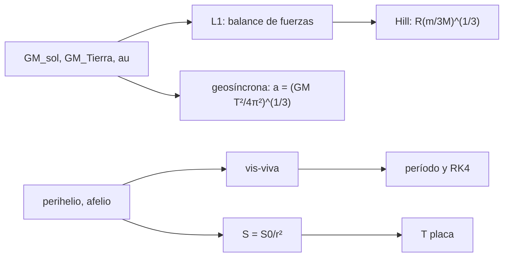

# B47-C22 — Misiones de física solar: SOHO, SDO y Solar Orbiter

<!-- nav:top -->
[🏠 Programa](../../../../README.md) · [📚 Bloque B47](../../../tronco-comun/B47-instrumentacion-y-observatorios-espaciales.md) · [← Anterior: B47-C21 — Magnetógrafos y medición de campos solares](../B47-C21-magnetografos-y-medicion-de-campos-solares/CLASE.md) · [Siguiente: B47-C23 — Sondas heliosféricas: Parker Solar Probe y Voyager →](../B47-C23-sondas-heliosfericas-parker-solar-probe-y-voyager/CLASE.md)
<!-- /nav -->

## 1. Ubicación, nivel y alcance

Clase 22 del bloque B47. Nivel N3. Las misiones heliofísicas eligen una órbita según lo que quieren medir: un punto de Lagrange para vigilar el Sol sin interrupción, una órbita geosíncrona para un enlace continuo, o una órbita heliocéntrica de perihelio cercano. Aquí calculas el punto L1, la órbita geosíncrona, la velocidad en el perihelio de una órbita ilustrativa y el flujo solar con la temperatura de una placa. Usas [B05](../../../tronco-comun/B05-fisica-fundamental-para-el-espacio.md) y [B26](../../../tronco-comun/B26-relatividad-y-cosmologia.md). La órbita heliocéntrica es ilustrativa.

## 2. Por qué esta clase existe

Cada órbita compra una ventaja y una dificultad. La decisión central: **¿qué punto o qué órbita da la vista del Sol que necesita el instrumento a un costo térmico y de enlace aceptable?**

## 3. Lo que podrás hacer al terminar

1. Resolver el punto L1 del sistema Sol–Tierra.
2. Comparar con la aproximación de Hill.
3. Calcular el radio de la órbita geosíncrona.
4. Calcular período y velocidades de una órbita de perihelio cercano.
5. Calcular flujo, temperatura de placa y tiempo luz.
6. Reconocer los límites de los modelos de dos cuerpos.

La evidencia es la **ficha de misiones de física solar** del ejercicio 12 (sección 20).

## 4. Con qué llegas y cómo comprobarlo

1. ¿Qué es una incertidumbre?
2. ¿Qué es una simulación Monte Carlo?
3. ¿Qué es una tabla de resultados?
4. ¿Qué es un valor ilustrativo?
5. ¿Qué es una verificación?

<details>
<summary>Ver respuestas</summary>

1. Un intervalo en que se espera el valor verdadero. 2. Repetir con números aleatorios de semilla fija. 3. Un resumen ordenado de cálculos. 4. Un valor propuesto para el ejemplo, no medido. 5. Comparar un cálculo con un caso independiente.
</details>

Con cuatro o cinco aciertos, sigue; si no, repasa los prerrequisitos.

## 5. Un caso de contexto y casos de referencia

El punto L1 queda a `1,4916` millones de km de la Tierra (Hill: `1,4966`); la órbita geosíncrona tiene `42 164,2 km` de radio. Una órbita ilustrativa de `0,28 × 0,91 au` tiene período `167,6 d`, velocidad `69,6 km/s` en el perihelio y flujo `17 360 W/m²`. Es el **ejemplo conductor**; no es el diseño de ninguna misión.

## 6. Vocabulario

El **punto de Lagrange L1**. La **aproximación de Hill**. La **órbita geosíncrona**. El **perihelio** y el **afelio**. La **ecuación vis-viva**. El **flujo solar** `S ∝ 1/r²`. La **temperatura de equilibrio**. El **tiempo luz**.

## 7. Modelo mental: una bicicleta junto a un tren

En L1 la nave se mantiene entre la Tierra y el Sol como una bicicleta que pedalea al ritmo exacto de un tren: la gravedad de ambos y el giro se equilibran.



*Descripción textual:* la gravedad de dos cuerpos fija los puntos y las órbitas útiles, y el flujo y el tiempo luz fijan las condiciones de la nave.

Analogía: una bicicleta junto a un tren. Límite: dos cuerpos, órbitas circulares.

## 8. La explicación, paso a paso

### 8.1 Puntos y órbitas

| Resultado | Valor |
|---|---|
| distancia Tierra–L1 (exacta) | 1,49155 millones de km |
| aproximación de Hill | 1,49656 millones de km (0,336 % mayor) |
| radio geosíncrono | 42 164,17 km |
| altitud geosíncrona | 35 786,07 km |

### 8.2 Órbita heliocéntrica ilustrativa (perihelio 0,28 au, afelio 0,91 au)

Semieje `0,5950 au`, excentricidad `0,5294`. Período kepleriano `167,6385 d` y por RK4 `167,6385 d`. Velocidad en perihelio `69,611 km/s`, en afelio `21,419 km/s`; el cociente es `0,91/0,28 = 3,25` (conservación del momento angular).

### 8.3 Flujo, temperatura y tiempo luz

| d (au) | S (W/m²) | T placa negra (K) |
|---|---|---|
| 1,00 | 1361,0 | 393,6 |
| 0,91 | 1643,5 | 412,6 |
| 0,28 | 17 359,7 | 743,8 |

Tiempo luz de 1 au: `499,00 s`; de 0,72 au: `359,28 s`.

### 8.4 Lectura

L1 permite observar el Sol sin eclipses a 1,5 millones de km; la geosíncrona da enlace continuo pero con eclipses estacionales. Un resumen de Solar Orbiter da la fecha de lanzamiento y la cantidad de instrumentos, no las distancias, así que la órbita de 0,28 au es una elección ilustrativa de este laboratorio.

## 9. Magnitudes, símbolos y unidades

| Símbolo | Qué es | Unidad | Valor / nota |
|---|---|---|---|
| `GM_☉` | parámetro solar | m³/s² | 1,3271244 × 10²⁰ (UAI) |
| `S☉` | irradiancia nominal | W/m² | 1361 (UAI) |
| `au` | unidad astronómica | m | 1,495978707 × 10¹¹ (IERS) |
| `r_L1` | distancia a L1 | km | 1 491 551 |
| `v_p` | velocidad en perihelio | km/s | 69,6 |

## 10. Convenciones y referencias

SI y au; órbitas keplerianas; Tierra en órbita circular; placa negra perpendicular a la luz.

## 11. De dónde sale lo que afirmamos

| ID | Fuente | Localizador | Respalda | Estado |
|---|---|---|---|---|
| S1 | UAI, Resolución B3 de 2015 | https://arxiv.org/abs/1510.07674 | `GM_☉`, `S☉`, `GM_Tierra` y radio terrestre | Consultada el 2026-11-09 |
| S2 | IERS Technical Note 36, Tabla 1.1 | https://iers-conventions.obspm.fr/ | `au` | Consultada el 2026-11-09 |
| S3 | Müller et al., *The Solar Orbiter mission: Science overview* | https://arxiv.org/abs/2009.00861 | lanzamiento el 10 de febrero de 2020, seis instrumentos de teledetección y cuatro in situ (resumen; las cifras orbitales no estaban en el resumen) | Solo resumen, consultado el 2026-11-09 |
| S1 | NIST, *Fundamental Physical Constants* (CODATA 2022) | https://physics.nist.gov/cuu/Constants/Table/allascii.txt | constantes citadas en la sección 9 | Consultada el 2026-11-09 |

Límites: S3 es solo el resumen de Solar Orbiter (lanzamiento y número de instrumentos). Las distancias 0,28 y 0,91 au, el día sideral y la placa negra son ilustrativos.

## 12. Cómo ver los resultados

| Resultado | Valor |
|---|---|
| L1 | 1,492 millones de km |
| geosíncrona | 42 164 km |
| período (0,28 × 0,91 au) | 167,6 d |
| S a 0,28 au | 17 360 W/m² |

Descripción larga: cada órbita fija una ventaja y un costo térmico distinto.

## 13. Ejemplo trabajado: la aproximación de Hill

**Paso 1 · Razón de masas.** `m/(3M) = 3,986 × 10¹⁴/(3 × 1,327 × 10²⁰) = 1,0012 × 10⁻⁶`.

**Paso 2 · Raíz cúbica.** `(1,0012 × 10⁻⁶)^(1/3) = 0,010004`.

**Paso 3 · Distancia.** `r ≈ 1,496 × 10¹¹ × 0,010004 = 1,4966 × 10⁹ m`.

## 14. Distintas formas de describir el resultado

**Por fórmula:** balance de fuerzas. **Por aproximación:** Hill. **Por simulación:** RK4. **Por código:** `heliofisica.py`.

## 15. Práctica guiada

**Ejercicio 1 · con los pasos indicados.** `S` a 0,28 au. *Pasos:* `S☉/r²`.

<details><summary>Solución comentada</summary>

`17 360 W/m²`.
</details>

**Ejercicio 2 · con una pista.** Cociente `S(0,28)/S(1)`.

<details><summary>Solución comentada</summary>

`12,76`.
</details>

**Ejercicio 3 · casi autónomo.** `T` de placa a 0,28 au.

<details><summary>Solución comentada</summary>

`744 K`.
</details>

## 16. Práctica autónoma, transferencia e integrador

**Ejercicio 4.** Período en días.

<details><summary>Solución comentada</summary>

`167,6`.
</details>

**Ejercicio 5.** `v_p/v_a`.

<details><summary>Solución comentada</summary>

`3,25`.
</details>

**Ejercicio 6.** Tiempo luz a 0,28 au.

<details><summary>Solución comentada</summary>

`139,7 s`.
</details>

**Ejercicio 7.** Altitud geosíncrona.

<details><summary>Solución comentada</summary>

`35 786 km`.
</details>

**Ejercicio 8.** Diferencia Hill−exacta.

<details><summary>Solución comentada</summary>

`5,01 mil km`.
</details>

**Ejercicio 9 · transferencia.** **Transferencia.** ¿Por qué L1 es inestable?

<details><summary>Solución comentada</summary>

Un desplazamiento crece exponencialmente: se requiere control de mantenimiento.
</details>

**Ejercicio 10 · transferencia.** **Transferencia.** Un compañero afirma que Solar Orbiter tiene perihelio de 0,28 au según el resumen. Responde.

<details><summary>Solución comentada</summary>

El resumen no da esa cifra; es una elección ilustrativa.
</details>

**Ejercicio 11 · transferencia.** **Transferencia.** ¿Qué cambia con un perihelio de 0,15 au?

<details><summary>Solución comentada</summary>

El flujo sube a `S☉/0,15²` (cerca de 60 kW/m²).
</details>

**Ejercicio 12.** **Integrador.** Elabora tu *ficha de misiones de física solar*: L1, geosíncrona, órbita de perihelio, flujo y límites.

<details><summary>Solución comentada</summary>

Secciones 8.1–8.4.
</details>

**Ejercicio 12 · integrador.** **Integrador.** Elabora tu *ficha de misiones de física solar*: L1, geosíncrona, órbita de perihelio, flujo y límites.

<details><summary>Solución modelo</summary>

Secciones 8.1–8.4.
</details>

## 17. Laboratorio: órbitas heliofísicas

El script [heliofisica.py](heliofisica.py) resuelve L1, la órbita geosíncrona y una órbita heliocéntrica (**comprueba** Hill a 1 % y el período a `10⁻⁶`).

**Datos:** `GM`, `S☉` y radios de la UAI; `au` del IERS; órbita **ilustrativa**. **Predice antes de ejecutar:** ¿a qué distancia queda L1? (≈ 1,49 millones de km.) **Ejecución del 2026-11-09 (Python 3.12.9):**

```text
Python 3.12.9 (biblioteca estandar)
L1: distancia a la Tierra = 1.49155 millones de km ; aproximacion de Hill = 1.49656 ; diferencia = 0.336 %
orbita geosincrona: a = 42164.17 km ; altitud = 35786.07 km
orbita heliocentrica ilustrativa: a = 0.5950 au ; e = 0.5294 ; periodo kepleriano = 167.6385 d ; RK4 = 167.6385 d
vis-viva: v perihelio = 69.611 km/s ; v afelio = 21.419 km/s ; cociente = 3.2500 (afelio/perihelio = 3.2500)
d = 1.00 au: S = 1361.0 W/m2 ; T de placa negra = 393.6 K
d = 0.91 au: S = 1643.5 W/m2 ; T de placa negra = 412.6 K
d = 0.28 au: S = 17359.7 W/m2 ; T de placa negra = 743.8 K
tiempo luz: 1 au = 499.00 s ; 0.72 au = 359.28 s
Pruebas superadas.
```

```bash
python programa/clases/B47/B47-C22-misiones-de-fisica-solar-soho-sdo-y-solar-orbiter/heliofisica.py
```

**Límites:** dos cuerpos, órbitas circulares.

## 18. Errores frecuentes y cómo corregirlos

**Medir desde el centro del Sol.** Se corrige con 8.1.

**Olvidar la masa de la Tierra en L1.** Se corrige con 8.1.

**Usar el flujo a 1 au en el perihelio.** Se corrige con 8.3.

**Atribuir 0,28 au al resumen de la misión.** Se corrige con la sección 11.

## 19. Cómo sabrás que vas bien

Tras la sección 8: ¿qué resultado esperabas y cuál obtuviste? Si dudas, repasa el ejemplo 13. Tras el laboratorio: ¿qué comprueba? (ver la sección 17).

## 20. Qué entregas y cómo se evalúa

El producto es tu **ficha de misiones de física solar** (ejercicio 12).

| Criterio | Inicial | En desarrollo | Logrado | Destacado |
|---|---|---|---|---|
| Conceptos | Los confunde | Parciales | conceptos de la clase | Explica los límites |
| Cálculo | Sin unidades | Con errores | Tablas completas | Calcula casos nuevos |
| Numérico | Sin comprobar | Un caso | Contraste con el análisis | Interpreta las diferencias |
| Fuentes | Sin fuente | Sin fecha | fuentes con fecha | Declara lo ilustrativo |
| Límites | No los nombra | Uno | Tres | Discute qué falta del modelo |

**Condiciones críticas (no se compensan con promedio):** rotular lo ilustrativo; no presentar el modelo como diseño de una misión real; citar solo lo consultado.

## 21. Ética, seguridad y límites

Clase educativa: los modelos son simplificados. Accesibilidad: tablas equivalentes a las gráficas, fórmulas en texto, ejercicios sin conexión.

## 22. Para cerrar y seguir

L1 está a `1,49` millones de km y el flujo a 0,28 au es `12,8` veces el de 1 au. Queda una pregunta: ¿cómo se mide in situ la región más cercana al Sol o el borde de la heliosfera?

**Glosario español–inglés.** punto de Lagrange · *Lagrange point*; órbita geosíncrona · *geosynchronous orbit*; perihelio · *perihelion*; vis-viva · *vis-viva*; flujo solar · *solar flux*.

**Continuidad.** [B47-C23](../B47-C23-sondas-heliosfericas-parker-solar-probe-y-voyager/CLASE.md) estudia las sondas heliosféricas.

**Referencias:** ver sección 11.

<!-- nav:bottom -->
---

[← Anterior: B47-C21 — Magnetógrafos y medición de campos solares](../B47-C21-magnetografos-y-medicion-de-campos-solares/CLASE.md) · [📚 Bloque B47](../../../tronco-comun/B47-instrumentacion-y-observatorios-espaciales.md) · [Siguiente: B47-C23 — Sondas heliosféricas: Parker Solar Probe y Voyager →](../B47-C23-sondas-heliosfericas-parker-solar-probe-y-voyager/CLASE.md)
<!-- /nav -->
