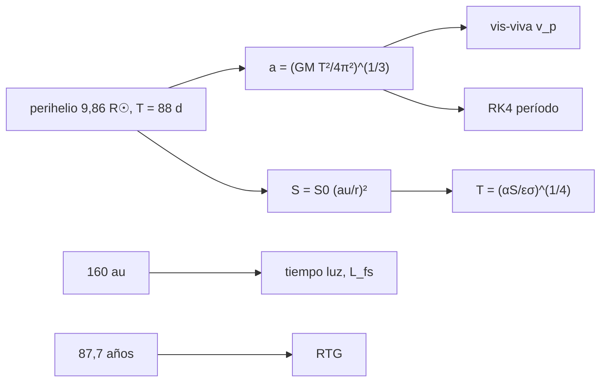

# B47-C23 — Sondas heliosféricas: Parker Solar Probe y Voyager

<!-- nav:top -->
[🏠 Programa](../../../../README.md) · [📚 Bloque B47](../../../tronco-comun/B47-instrumentacion-y-observatorios-espaciales.md) · [← Anterior: B47-C22 — Misiones de física solar: SOHO, SDO y Solar Orbiter](../B47-C22-misiones-de-fisica-solar-soho-sdo-y-solar-orbiter/CLASE.md) · [Siguiente: B47-C24 — Instrumentos de plasma y campos in situ →](../B47-C24-instrumentos-de-plasma-y-campos-in-situ/CLASE.md)
<!-- /nav -->

## 1. Ubicación, nivel y alcance

Clase 23 del bloque B47. Nivel N3. Las sondas in situ viven en condiciones extremas: muy cerca del Sol el problema es térmico; muy lejos, el de la energía y el enlace. Aquí calculas la velocidad en el perihelio de una órbita de 88 días, el flujo y la temperatura de una placa, el tiempo luz y la pérdida de espacio libre a 160 au y el decaimiento de un generador radioisotópico. Usas [B05](../../../tronco-comun/B05-fisica-fundamental-para-el-espacio.md) y [B26](../../../tronco-comun/B26-relatividad-y-cosmologia.md). Los parámetros son ilustrativos.

## 2. Por qué esta clase existe

Cerca del Sol sobra energía y falta refrigeración; lejos, ocurre lo contrario. La decisión central: **¿qué escudo, qué enlace y qué fuente de energía exige cada extremo?**

## 3. Lo que podrás hacer al terminar

1. Obtener semieje y afelio desde el período y el perihelio.
2. Calcular velocidad en perihelio con vis-viva y comprobar la conservación de energía.
3. Calcular flujo y temperatura de placa.
4. Calcular tiempo luz y pérdida de espacio libre a 160 au.
5. Calcular el decaimiento de un RTG.
6. Reconocer lo que omiten los modelos.

La evidencia es la **ficha de sondas heliosféricas** del ejercicio 12 (sección 20).

## 4. Con qué llegas y cómo comprobarlo

1. ¿Qué es una incertidumbre?
2. ¿Qué es una simulación Monte Carlo?
3. ¿Qué es una tabla de resultados?
4. ¿Qué es un valor ilustrativo?
5. ¿Qué es una verificación?

<details>
<summary>Ver respuestas</summary>

1. Un intervalo en que se espera el valor verdadero. 2. Repetir con números aleatorios de semilla fija. 3. Un resumen ordenado de cálculos. 4. Un valor propuesto para el ejemplo, no medido. 5. Comparar un cálculo con un caso independiente.
</details>

Con cuatro o cinco aciertos, sigue; si no, repasa los prerrequisitos.

## 5. Un caso de contexto y casos de referencia

Con perihelio `9,86 R☉` y período `88 d` (ilustrativos) la velocidad en el perihelio es `190,8 km/s`, el flujo `476` veces el de 1 au y la placa negra llega a `1838 K`. A 160 au el tiempo luz es `22,2 h` y la pérdida de enlace supera en `141,9 dB` a la de 1932 km. Es el **ejemplo conductor**; no es el diseño de ninguna sonda.

## 6. Vocabulario

El **perihelio**. La **ecuación vis-viva**. El **escudo térmico**. La **absortividad** `α`. La **emisividad** `ε`. El **generador termoeléctrico de radioisótopos** (RTG). La **vida media**. La **pérdida de espacio libre**.

## 7. Modelo mental: acercarse a una hoguera

Es acercarse a una hoguera: a 10 radios de distancia el calor es abrumador y se necesita un escudo; a decenas de unidades astronómicas el fuego es una chispa y toda la energía debe venir de a bordo.



*Descripción textual:* la órbita fija la velocidad y el flujo en el perihelio, y la distancia a gran escala fija el enlace y la energía.

Analogía: acercarse a una hoguera. Límite: dos cuerpos, placa plana.

## 8. La explicación, paso a paso

### 8.1 Órbita (perihelio 9,86 R☉, período 88 d)

| Magnitud | Valor |
|---|---|
| perihelio | 0,04585 au |
| semieje | 0,38719 au |
| afelio | 0,72852 au |
| excentricidad | 0,88157 |
| v perihelio | 190,795 km/s |
| v afelio | 12,009 km/s |

Periodo integrado con RK4: `88,000000 d`; error máximo relativo de la energía específica `2,93 × 10⁻¹¹`.

### 8.2 Flujo y temperatura en el perihelio

Flujo `647 308,2 W/m²` = `475,6` veces `S☉`. Placa negra: `1838,1 K`. Placa con `α/ε = 0,4`: `1461,8 K`.

### 8.3 Lejos del Sol (160 au)

Tiempo luz de ida: `22,178 h`. Pérdida de espacio libre a 8,4 GHz: `318,51 dB` frente a `176,65 dB` a 1932 km: `141,86 dB` más.

| t (años) | potencia del RTG (% de la inicial) |
|---|---|
| 0 | 100,00 |
| 10 | 85,27 |
| 25 | 67,14 |
| 47 | 47,28 |

### 8.4 Lectura

La velocidad de ~191 km/s y los 475 soles de flujo explican la necesidad de un escudo. A 160 au la energía cae a menos de la mitad en 47 años. El resumen consultado de Parker Solar Probe da el lanzamiento (12 de agosto de 2018) y 24 órbitas previstas, no el perihelio ni los datos térmicos; todo lo del laboratorio es ilustrativo, y no se consultó ninguna fuente sobre las Voyager.

## 9. Magnitudes, símbolos y unidades

| Símbolo | Qué es | Unidad | Valor / nota |
|---|---|---|---|
| `GM_☉` | parámetro solar | m³/s² | 1,3271244 × 10²⁰ (UAI) |
| `R☉` | radio solar | m | 6,957 × 10⁸ (UAI) |
| `v_p` | velocidad en perihelio | km/s | 190,8 |
| `S` | flujo | W/m² | 647 308 |
| `t_½` | vida media Pu-238 | años | 87,7 (uso general) |

## 10. Convenciones y referencias

SI y au; `1 au = 1,495978707 × 10¹¹ m`; absortividad/emisividad 0,4; 8,4 GHz para el enlace lejano.

## 11. De dónde sale lo que afirmamos

| ID | Fuente | Localizador | Respalda | Estado |
|---|---|---|---|---|
| S1 | UAI, Resolución B3 de 2015 | https://arxiv.org/abs/1510.07674 | `GM_☉`, `R☉` y `S☉` | Consultada el 2026-11-09 |
| S2 | IERS Technical Note 36, Tabla 1.1 | https://iers-conventions.obspm.fr/ | `au` | Consultada el 2026-11-09 |
| S3 | Raouafi et al., *Parker Solar Probe: Four Years of Discoveries at Solar Cycle Minimum* | https://arxiv.org/abs/2301.02727 | lanzamiento el 12 de agosto de 2018 y 24 órbitas previstas (resumen; la distancia del perihelio no estaba en el resumen) | Solo resumen, consultado el 2026-11-09 |
| S1 | NIST, *Fundamental Physical Constants* (CODATA 2022) | https://physics.nist.gov/cuu/Constants/Table/allascii.txt | constantes citadas en la sección 9 | Consultada el 2026-11-09 |
| S5 | Misión Voyager (distancia, enlace, RTG) | — | datos de uso general no consultados | No consultado |

Límites: S3 es solo el resumen de Parker Solar Probe (lanzamiento y 24 órbitas). El perihelio, el período, la vida media del Pu-238, la degradación y la distancia de 160 au son valores de uso general, ilustrativos y no consultados; no se reproduce ningún dato de las Voyager.

## 12. Cómo ver los resultados

| Magnitud | Valor |
|---|---|
| v perihelio | 190,8 km/s |
| S / S☉ | 475,6 |
| T placa negra | 1838 K |
| tiempo luz 160 au | 22,18 h |

Descripción larga: los extremos exigen escudo cerca y energía propia lejos.

## 13. Ejemplo trabajado: la velocidad en perihelio

**Paso 1 · Semieje.** `a = 0,3872 au = 5,792 × 10¹⁰ m`.

**Paso 2 · Vis-viva.** `v² = GM(2/r_p − 1/a)`.

**Paso 3 · Valor.** `v = 190,79 km/s`.

## 14. Distintas formas de describir el resultado

**Por fórmula:** vis-viva. **Por simulación:** RK4. **Por tabla:** RTG. **Por código:** `sondas.py`.

## 15. Práctica guiada

**Ejercicio 1 · con los pasos indicados.** Flujo relativo en el perihelio. *Pasos:* `(au/r)²`.

<details><summary>Solución comentada</summary>

`475,6`.
</details>

**Ejercicio 2 · con una pista.** `T` de placa negra.

<details><summary>Solución comentada</summary>

`1838 K`.
</details>

**Ejercicio 3 · casi autónomo.** `T` con `α/ε = 0,4`.

<details><summary>Solución comentada</summary>

`1462 K`.
</details>

## 16. Práctica autónoma, transferencia e integrador

**Ejercicio 4.** Tiempo luz a 160 au.

<details><summary>Solución comentada</summary>

`22,18 h`.
</details>

**Ejercicio 5.** Diferencia de pérdida de enlace.

<details><summary>Solución comentada</summary>

`141,9 dB`.
</details>

**Ejercicio 6.** Potencia del RTG a 25 años.

<details><summary>Solución comentada</summary>

`67,1 %`.
</details>

**Ejercicio 7.** `v_p/v_a`.

<details><summary>Solución comentada</summary>

`15,89`.
</details>

**Ejercicio 8.** Perihelio en radios solares.

<details><summary>Solución comentada</summary>

`9,86`.
</details>

**Ejercicio 9 · transferencia.** **Transferencia.** ¿Por qué el escudo térmico tiene `α/ε` bajo?

<details><summary>Solución comentada</summary>

Para absorber poco y radiar mucho.
</details>

**Ejercicio 10 · transferencia.** **Transferencia.** Un compañero afirma que 9,86 R☉ viene del resumen consultado. Responde.

<details><summary>Solución comentada</summary>

No: el resumen no da el perihelio; es un valor de uso general sin consultar.
</details>

**Ejercicio 11 · transferencia.** **Transferencia.** ¿Qué pasa con la pérdida de enlace si se duplica la distancia?

<details><summary>Solución comentada</summary>

Aumenta 6,02 dB.
</details>

**Ejercicio 12.** **Integrador.** Elabora tu *ficha de sondas heliosféricas*: perihelio, flujo, temperatura, enlace lejano, RTG y límites.

<details><summary>Solución comentada</summary>

Secciones 8.1–8.4.
</details>

**Ejercicio 12 · integrador.** **Integrador.** Elabora tu *ficha de sondas heliosféricas*: perihelio, flujo, temperatura, enlace lejano, RTG y límites.

<details><summary>Solución modelo</summary>

Secciones 8.1–8.4.
</details>

## 17. Laboratorio: extremos térmicos y de energía

El script [sondas.py](sondas.py) calcula la órbita, el flujo, el enlace lejano y el RTG (**comprueba** el período a `10⁻⁶` y la energía a `10⁻⁸`).

**Datos:** `GM`, `R☉`, `S☉`, `au` y constantes consultadas; resto **ilustrativo**. **Predice antes de ejecutar:** ¿qué temperatura alcanza una placa negra? (≈ 1840 K.) **Ejecución del 2026-11-09 (Python 3.12.9):**

```text
Python 3.12.9 (biblioteca estandar)
perihelio = 0.04585 au = 9.86 R_sol ; semieje = 0.38719 au ; afelio = 0.72852 au ; e = 0.88157
vis-viva: v perihelio = 190.795 km/s ; v afelio = 12.009 km/s
periodo dado = 88.0 d ; periodo RK4 = 88.000000 d ; error maximo de energia = 2.93e-11
flujo en perihelio = 647308.2 W/m2 = 475.6 x S_sol
temperatura de placa negra = 1838.1 K ; placa con alpha/eps = 0.4 = 1461.8 K
160 au: tiempo luz = 22.178 h ; perdida de espacio libre a 8.4 GHz = 318.51 dB ; a 1932 km = 176.65 dB ; diferencia = 141.86 dB
RTG a los  0 anios: 100.00 % de la potencia inicial
RTG a los 10 anios: 85.27 % de la potencia inicial
RTG a los 25 anios: 67.14 % de la potencia inicial
RTG a los 47 anios: 47.28 % de la potencia inicial
Pruebas superadas.
```

```bash
python programa/clases/B47/B47-C23-sondas-heliosfericas-parker-solar-probe-y-voyager/sondas.py
```

**Límites:** dos cuerpos; placa plana; Pu-238 de uso general.

## 18. Errores frecuentes y cómo corregirlos

**Ignorar el escudo en el perihelio.** Se corrige con 8.2.

**Olvidar la pérdida de enlace a 160 au.** Se corrige con 8.3.

**Atribuir cifras al resumen de Parker.** Se corrige con la sección 11.

**Dar datos de las Voyager como consultados.** Se corrige con la sección 11.

## 19. Cómo sabrás que vas bien

Tras la sección 8: ¿qué resultado esperabas y cuál obtuviste? Si dudas, repasa el ejemplo 13. Tras el laboratorio: ¿qué comprueba? (ver la sección 17).

## 20. Qué entregas y cómo se evalúa

El producto es tu **ficha de sondas heliosféricas** (ejercicio 12).

| Criterio | Inicial | En desarrollo | Logrado | Destacado |
|---|---|---|---|---|
| Conceptos | Los confunde | Parciales | conceptos de la clase | Explica los límites |
| Cálculo | Sin unidades | Con errores | Tablas completas | Calcula casos nuevos |
| Numérico | Sin comprobar | Un caso | Contraste con el análisis | Interpreta las diferencias |
| Fuentes | Sin fuente | Sin fecha | fuentes con fecha | Declara lo ilustrativo |
| Límites | No los nombra | Uno | Tres | Discute qué falta del modelo |

**Condiciones críticas (no se compensan con promedio):** rotular lo ilustrativo; no presentar el modelo como diseño de una misión real; citar solo lo consultado.

## 21. Ética, seguridad y límites

Clase educativa: los modelos son simplificados. Accesibilidad: tablas equivalentes a las gráficas, fórmulas en texto, ejercicios sin conexión.

## 22. Para cerrar y seguir

En el perihelio la velocidad es `191 km/s` y el flujo `476 S☉`; a 160 au la luz tarda `22,2 h`. Queda una pregunta: ¿cómo se mide el plasma que atraviesa la nave?

**Glosario español–inglés.** perihelio · *perihelion*; escudo térmico · *heat shield*; RTG · *radioisotope thermoelectric generator*; vida media · *half-life*; tiempo luz · *light time*.

**Continuidad.** [B47-C24](../B47-C24-instrumentos-de-plasma-y-campos-in-situ/CLASE.md) estudia los instrumentos de plasma y campos in situ.

**Referencias:** ver sección 11.

<!-- nav:bottom -->
---

[← Anterior: B47-C22 — Misiones de física solar: SOHO, SDO y Solar Orbiter](../B47-C22-misiones-de-fisica-solar-soho-sdo-y-solar-orbiter/CLASE.md) · [📚 Bloque B47](../../../tronco-comun/B47-instrumentacion-y-observatorios-espaciales.md) · [Siguiente: B47-C24 — Instrumentos de plasma y campos in situ →](../B47-C24-instrumentos-de-plasma-y-campos-in-situ/CLASE.md)
<!-- /nav -->
