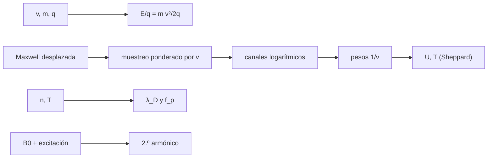

# B47-C24 — Instrumentos de plasma y campos in situ

<!-- nav:top -->
[🏠 Programa](../../../../README.md) · [📚 Bloque B47](../../../tronco-comun/B47-instrumentacion-y-observatorios-espaciales.md) · [← Anterior: B47-C23 — Sondas heliosféricas: Parker Solar Probe y Voyager](../B47-C23-sondas-heliosfericas-parker-solar-probe-y-voyager/CLASE.md) · [Siguiente: B47-C25 — Diseño de cargas útiles educativas →](../B47-C25-diseno-de-cargas-utiles-educativas/CLASE.md)
<!-- /nav -->

## 1. Ubicación, nivel y alcance

Clase 24 del bloque B47. Nivel N3. Un analizador electrostático selecciona partículas por su energía por carga y un magnetómetro fluxgate mide el campo local. Aquí simulas el barrido de un analizador sobre protones del viento solar (con semilla fija), recuperas velocidad y temperatura con pesos `1/v` y corrección de Sheppard, calculas la longitud de Debye y la frecuencia de plasma, y verificas la linealidad de un fluxgate. Usas [B05](../../../tronco-comun/B05-fisica-fundamental-para-el-espacio.md). Las condiciones del viento son ilustrativas.

## 2. Por qué esta clase existe

La energía por carga elegida por el analizador determina qué se mide; la resolución de los canales limita la temperatura que se recupera. La decisión central: **¿cuántos canales y qué corrección dan la velocidad y la temperatura del plasma con error aceptable?**

## 3. Lo que podrás hacer al terminar

1. Convertir velocidad en energía por carga.
2. Simular detecciones ponderadas por el flujo.
3. Recuperar velocidad y temperatura de los canales.
4. Aplicar la corrección de Sheppard.
5. Calcular longitud de Debye y frecuencia de plasma.
6. Verificar la linealidad de un fluxgate y su saturación.

La evidencia es la **ficha del instrumento de plasma** del ejercicio 12 (sección 20).

## 4. Con qué llegas y cómo comprobarlo

1. ¿Qué es una incertidumbre?
2. ¿Qué es una simulación Monte Carlo?
3. ¿Qué es una tabla de resultados?
4. ¿Qué es un valor ilustrativo?
5. ¿Qué es una verificación?

<details>
<summary>Ver respuestas</summary>

1. Un intervalo en que se espera el valor verdadero. 2. Repetir con números aleatorios de semilla fija. 3. Un resumen ordenado de cálculos. 4. Un valor propuesto para el ejemplo, no medido. 5. Comparar un cálculo con un caso independiente.
</details>

Con cuatro o cinco aciertos, sigue; si no, repasa los prerrequisitos.

## 5. Un caso de contexto y casos de referencia

Un protón a `400 km/s` tiene `E/q = 835,2 V`. Con `T = 10⁵ K` la velocidad térmica es `28,73 km/s` (`7,2 %` de la deriva). El barrido recupera `399,92 km/s` y `99 625 K` (verdaderos 400 y 100 000). La longitud de Debye es `9,76 m` y la frecuencia de plasma `20,08 kHz`. Es el **ejemplo conductor**; no son medidas.

## 6. Vocabulario

El **analizador electrostático** (ESA). La **energía por carga** `E/q`. La **copa de Faraday**. La **distribución de velocidades** maxwelliana. La **velocidad térmica** `√(k T/m)`. La **longitud de Debye**. La **frecuencia de plasma**. El **magnetómetro fluxgate**.

## 7. Modelo mental: una criba por energía

El analizador es una criba que deja pasar solo las partículas de una energía por carga; barriendo la criba se cuenta cuántas hay de cada energía y de ahí se deducen la velocidad media y la dispersión.



*Descripción textual:* la tensión del analizador fija `E/q`, el flujo de partículas por canal permite reconstruir los momentos, y el fluxgate lee el campo por el segundo armónico.

Analogía: una criba por energía. Límite: un haz alineado, una especie.

## 8. La explicación, paso a paso

### 8.1 Barrido del analizador

`E/q` de la deriva: `835,17 V`. Velocidad térmica: `28,730 km/s`. El máximo de cuentas cae en el canal de `858,2 V` (el flujo favorece las energías mayores).

| Magnitud | Verdadera | Recuperada |
|---|---|---|
| velocidad (km/s) | 400 | 399,918 |
| temperatura sin corrección (K) | 100 000 | 100 045 |
| temperatura con Sheppard (K) | 100 000 | 99 625 |

### 8.2 Escalas del plasma

Para `n = 5 cm⁻³`: longitud de Debye `9,759 m` y frecuencia de plasma electrónica `20,077 kHz`.

### 8.3 Fluxgate

Con excitación sinusoidal y núcleo `tanh`, el segundo armónico es proporcional al campo:

| B₀ (nT) | 2.º armónico | por nT |
|---|---|---|
| 10 | -48,2208 | -4,82208 |
| 50 | -241,104 | -4,82208 |
| 100 | -482,207 | -4,82207 |
| 5000 | -23 968,0 | -4,79360 |

La sensibilidad es constante a `10⁻³` hasta 100 nT y cae un `0,59 %` a 5000 nT.

### 8.4 Lectura

Los canales logarítmicos de ancho `ΔE/E = 1,6 %` bastan para la velocidad con error de `0,02 %` y la temperatura con `0,4 %`. El modelo supone un haz alineado, sin potencial de la nave, sin dispersión angular y una sola especie.

## 9. Magnitudes, símbolos y unidades

| Símbolo | Qué es | Unidad | Valor / nota |
|---|---|---|---|
| `E/q` | energía por carga | V | 835,2 |
| `w` | velocidad térmica | km/s | 28,73 |
| `λ_D` | longitud de Debye | m | 9,76 |
| `f_p` | frecuencia de plasma | kHz | 20,08 |
| `ε₀` | permitividad del vacío | F/m | 8,8541878188 × 10⁻¹² (NIST) |

## 10. Convenciones y referencias

SI y eV por carga (V); 200 canales logarítmicos entre 200 eV y 5 keV; protones; fluxgate en unidades arbitrarias de nT.

## 11. De dónde sale lo que afirmamos

| ID | Fuente | Localizador | Respalda | Estado |
|---|---|---|---|---|
| S1 | NIST, *Fundamental Physical Constants* (CODATA 2022) | https://physics.nist.gov/cuu/Constants/Table/allascii.txt | constantes citadas en la sección 9 | Consultada el 2026-11-09 |

Límites: las constantes provienen de NIST. La densidad, velocidad y temperatura del viento, los canales y el núcleo del fluxgate son ilustrativos; no se consultó ninguna medición ni instrumento.

## 12. Cómo ver los resultados

| Magnitud | Verdadera | Recuperada |
|---|---|---|
| velocidad (km/s) | 400 | 399,92 |
| T (K) | 100 000 | 99 625 |

Descripción larga: los momentos se recuperan con errores menores que el 1 %.

## 13. Ejemplo trabajado: la energía por carga

**Paso 1 · Velocidad.** `v = 4 × 10⁵ m/s`.

**Paso 2 · Energía.** `½ m v² = ½ × 1,6726 × 10⁻²⁷ × 1,6 × 10¹¹ = 1,338 × 10⁻¹⁶ J`.

**Paso 3 · Por carga.** `÷ 1,602 × 10⁻¹⁹ = 835,2 V`.

## 14. Distintas formas de describir el resultado

**Por fórmula:** `E/q`. **Por tabla:** momentos. **Por simulación:** muestreo. **Por código:** `plasma.py`.

## 15. Práctica guiada

**Ejercicio 1 · con los pasos indicados.** `E/q` a 500 km/s. *Pasos:* ejemplo 13, `∝ v²`.

<details><summary>Solución comentada</summary>

`1305,0 V`.
</details>

**Ejercicio 2 · con una pista.** Velocidad desde 1000 V.

<details><summary>Solución comentada</summary>

`437,7 km/s`.
</details>

**Ejercicio 3 · casi autónomo.** Velocidad térmica.

<details><summary>Solución comentada</summary>

`28,73 km/s`.
</details>

## 16. Práctica autónoma, transferencia e integrador

**Ejercicio 4.** Error de la velocidad recuperada.

<details><summary>Solución comentada</summary>

`0,021 %`.
</details>

**Ejercicio 5.** Error de la temperatura con Sheppard.

<details><summary>Solución comentada</summary>

`0,38 %`.
</details>

**Ejercicio 6.** Longitud de Debye.

<details><summary>Solución comentada</summary>

`9,76 m`.
</details>

**Ejercicio 7.** Frecuencia de plasma.

<details><summary>Solución comentada</summary>

`20,08 kHz`.
</details>

**Ejercicio 8.** Sensibilidad del fluxgate a 10 nT.

<details><summary>Solución comentada</summary>

`-4,8221` por nT.
</details>

**Ejercicio 9 · transferencia.** **Transferencia.** ¿Por qué el pico de cuentas no está en la deriva exacta?

<details><summary>Solución comentada</summary>

Porque el flujo que entra al analizador es proporcional a `v f(v)`.
</details>

**Ejercicio 10 · transferencia.** **Transferencia.** Un compañero afirma que estos valores son medidas del viento solar. Responde.

<details><summary>Solución comentada</summary>

Son condiciones ilustrativas, sin datos de ninguna misión.
</details>

**Ejercicio 11 · transferencia.** **Transferencia.** ¿Qué pasa si el potencial de la nave es +10 V?

<details><summary>Solución comentada</summary>

Los protones se frenan y `E/q` medido se corre unos 10 V.
</details>

**Ejercicio 12.** **Integrador.** Elabora tu *ficha del instrumento de plasma*: `E/q`, momentos, Debye y fluxgate con límites.

<details><summary>Solución comentada</summary>

Secciones 8.1–8.4.
</details>

**Ejercicio 12 · integrador.** **Integrador.** Elabora tu *ficha del instrumento de plasma*: `E/q`, momentos, Debye y fluxgate con límites.

<details><summary>Solución modelo</summary>

Secciones 8.1–8.4.
</details>

## 17. Laboratorio: analizador electrostático y fluxgate

El script [plasma.py](plasma.py) simula el barrido, recupera los momentos y verifica el fluxgate (**comprueba** la velocidad a 1 %, la temperatura a 10 % y la linealidad a `10⁻³`).

**Datos:** constantes de NIST; viento y núcleo **ilustrativos**. **Predice antes de ejecutar:** ¿cuánta temperatura se recupera? (≈ 99 600 K.) **Ejecución del 2026-11-09 (Python 3.12.9):**

```text
Python 3.12.9 (biblioteca estandar)
E/q de un proton a 400 km/s = 835.17 eV ; velocidad termica = 28.730 km/s (7.18 % de la deriva)
canal del maximo: E/q = 858.2 eV
velocidad recuperada = 399.918 km/s (verdadera 400) ; temperatura sin correccion = 100045 K ; con Sheppard = 99625 K (verdadera 100000)
longitud de Debye = 9.759 m ; frecuencia de plasma electronica = 20.077 kHz
fluxgate B0 =    10.0 nT : 2.o armonico = -4.822084e+01 ; por nT = -4.822084e+00
fluxgate B0 =    50.0 nT : 2.o armonico = -2.411041e+02 ; por nT = -4.822081e+00
fluxgate B0 =   100.0 nT : 2.o armonico = -4.822073e+02 ; por nT = -4.822073e+00
fluxgate B0 =  5000.0 nT : 2.o armonico = -2.396801e+04 ; por nT = -4.793603e+00
Pruebas superadas.
```

```bash
python programa/clases/B47/B47-C24-instrumentos-de-plasma-y-campos-in-situ/plasma.py
```

**Límites:** un haz alineado; una especie; sin potencial de la nave.

## 18. Errores frecuentes y cómo corregirlos

**Tomar el pico de cuentas por la velocidad.** Se corrige con 8.1.

**Olvidar los pesos `1/v`.** Se corrige con 8.1.

**Ignorar el ancho del canal.** Se corrige con la corrección de Sheppard.

**Dar los valores como medidas.** Se corrige con la sección 10.

## 19. Cómo sabrás que vas bien

Tras la sección 8: ¿qué resultado esperabas y cuál obtuviste? Si dudas, repasa el ejemplo 13. Tras el laboratorio: ¿qué comprueba? (ver la sección 17).

## 20. Qué entregas y cómo se evalúa

El producto es tu **ficha del instrumento de plasma** (ejercicio 12).

| Criterio | Inicial | En desarrollo | Logrado | Destacado |
|---|---|---|---|---|
| Conceptos | Los confunde | Parciales | conceptos de la clase | Explica los límites |
| Cálculo | Sin unidades | Con errores | Tablas completas | Calcula casos nuevos |
| Numérico | Sin comprobar | Un caso | Contraste con el análisis | Interpreta las diferencias |
| Fuentes | Sin fuente | Sin fecha | fuentes con fecha | Declara lo ilustrativo |
| Límites | No los nombra | Uno | Tres | Discute qué falta del modelo |

**Condiciones críticas (no se compensan con promedio):** rotular lo ilustrativo; no presentar el modelo como diseño de una misión real; citar solo lo consultado.

## 21. Ética, seguridad y límites

Clase educativa: los modelos son simplificados. Accesibilidad: tablas equivalentes a las gráficas, fórmulas en texto, ejercicios sin conexión.

## 22. Para cerrar y seguir

El barrido recupera `399,9 km/s` y `99 625 K`; la longitud de Debye es `9,8 m`. Queda una pregunta: ¿cómo se reúnen estas piezas en una carga útil pequeña y verificable?

**Glosario español–inglés.** analizador electrostático · *electrostatic analyzer*; energía por carga · *energy per charge*; longitud de Debye · *Debye length*; fluxgate · *fluxgate*; viento solar · *solar wind*.

**Continuidad.** [B47-C25](../B47-C25-diseno-de-cargas-utiles-educativas/CLASE.md) estudia el diseño de cargas útiles educativas.

**Referencias:** ver sección 11.

<!-- nav:bottom -->
---

[← Anterior: B47-C23 — Sondas heliosféricas: Parker Solar Probe y Voyager](../B47-C23-sondas-heliosfericas-parker-solar-probe-y-voyager/CLASE.md) · [📚 Bloque B47](../../../tronco-comun/B47-instrumentacion-y-observatorios-espaciales.md) · [Siguiente: B47-C25 — Diseño de cargas útiles educativas →](../B47-C25-diseno-de-cargas-utiles-educativas/CLASE.md)
<!-- /nav -->
