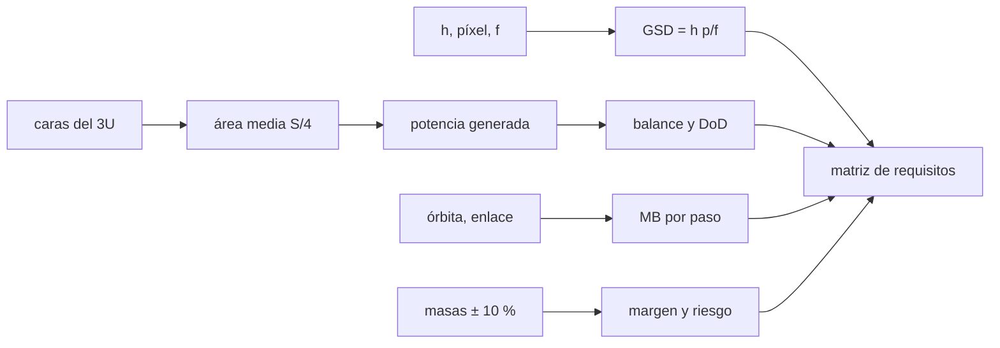

# B47-C25 — Diseño de cargas útiles educativas

<!-- nav:top -->
[🏠 Programa](../../../../README.md) · [📚 Bloque B47](../../../tronco-comun/B47-instrumentacion-y-observatorios-espaciales.md) · [← Anterior: B47-C24 — Instrumentos de plasma y campos in situ](../B47-C24-instrumentos-de-plasma-y-campos-in-situ/CLASE.md) · [Siguiente: B48-C01 — Observatorio como sistema socio-técnico →](../../B48/B48-C01-observatorio-como-sistema-socio-tecnico/CLASE.md)
<!-- /nav -->

## 1. Ubicación, nivel y alcance

Clase 25 del bloque B47. Nivel N3. Un CubeSat universitario obliga a decidir pronto qué se puede medir con poco volumen, poca potencia y un enlace modesto. Aquí partes de una cámara ilustrativa en un 3U y calculas resolución en tierra, área proyectada media, balance de potencia, volumen de datos por paso y masa con margen, y los reúnes en una matriz de verificación de requisitos. Usas [B05](../../../tronco-comun/B05-fisica-fundamental-para-el-espacio.md), [B42](../../../tronco-comun/B42-optica-fisica-y-optica-adaptativa.md) y [B15](../../../tronco-comun/B15-senales-imagenes-y-estimacion-cientifica.md). Todo es un ejemplo docente, no una convocatoria ni una misión.

## 2. Por qué esta clase existe

Muchos CubeSat universitarios fracasan por requisitos sin cifra o sin evidencia. La decisión central: **¿qué requisitos medibles se fijan, cómo se verifican y cuáles cumple un diseño preliminar?**

## 3. Lo que podrás hacer al terminar

1. Calcular el GSD y el parámetro de muestreo `Q`.
2. Verificar el área proyectada media con el teorema de Cauchy y un Monte Carlo.
3. Calcular el balance de potencia y la profundidad de descarga.
4. Calcular el volumen de datos por paso.
5. Calcular la masa con margen y su riesgo.
6. Redactar y verificar una matriz de requisitos.

La evidencia es la **ficha de la carga útil educativa** del ejercicio 12 (sección 20).

## 4. Con qué llegas y cómo comprobarlo

1. ¿Qué es una incertidumbre?
2. ¿Qué es una simulación Monte Carlo?
3. ¿Qué es una tabla de resultados?
4. ¿Qué es un valor ilustrativo?
5. ¿Qué es una verificación?

<details>
<summary>Ver respuestas</summary>

1. Un intervalo en que se espera el valor verdadero. 2. Repetir con números aleatorios de semilla fija. 3. Un resumen ordenado de cálculos. 4. Un valor propuesto para el ejemplo, no medido. 5. Comparar un cálculo con un caso independiente.
</details>

Con cuatro o cinco aciertos, sigue; si no, repasa los prerrequisitos.

## 5. Un caso de contexto y casos de referencia

Con la cámara ilustrativa (`h = 500 km`, píxel 3,45 µm, focal 0,10 m) el GSD es `17,25 m` y la franja `35,3 km`. La potencia media generada es `4,98 W` frente a `3,80 W` de carga; la batería se descarga `11,3 %` en el eclipse. Cada paso baja `5,54 MB`, `2,58` imágenes comprimidas. Los cinco requisitos de la matriz se cumplen. Es el **ejemplo conductor**.

## 6. Vocabulario

La **carga útil**. El **CubeSat 3U**. El **GSD** (distancia de muestreo en tierra). El **parámetro `Q = λF/p`**. La **profundidad de descarga**. La **matriz de verificación**. El **margen** de masa. El **requisito** medible.

## 7. Modelo mental: preparar una mochila de excursión

Es preparar una mochila: cada objeto (cámara, batería, radio) tiene peso y consumo, y antes de salir se comprueba con una lista que todo cabe y alcanza.



*Descripción textual:* la óptica, la energía, el enlace y la masa se cuantifican por separado y se verifican contra requisitos escritos.

Analogía: preparar una mochila de excursión. Límite: orientación aleatoria (caso peor).

## 8. La explicación, paso a paso

### 8.1 Imagen

GSD `17,250 m`; franja `35,33 km`; `Q = λF/p = 0,531` (submuestreo: la PSF cae en un píxel); disco de Airy `4,47 µm`.

### 8.2 Energía

La superficie del 3U es `0,140 m²`. El área proyectada media de un cuerpo convexo es `S/4`: teórica `0,03500 m²` y Monte Carlo (200 000 orientaciones, semilla 20261109) `0,03499 m²`.

| Magnitud | Valor |
|---|---|
| período | 94,616 min |
| eclipse | 35,75 min (37,79 %) |
| potencia generada media | 4,979 W |
| carga media | 3,800 W |
| balance | +1.179 W |
| energía en eclipse | 2,264 Wh |
| profundidad de descarga | 11,32 % |

### 8.3 Datos y masa

Paso a 10° de elevación: `443,0 s`; a 100 kbit/s, `5,537 MB`. Una imagen comprimida (razón 2,2) pesa `2,145 MB`: `2,58` por paso. Masa nominal `3,10 kg`; con margen del 20 %, `3,720 kg`; la probabilidad de superar 4 kg con incertidumbre del 10 % por partida es `0,0398`.

### 8.4 Matriz de verificación

| Requisito | Valor | Resultado |
|---|---|---|
| R1 GSD <= 20 m | 17,250 | cumple |
| R2 masa con margen <= 4 kg | 3,720 | cumple |
| R3 profundidad de descarga <= 30 % | 11,322 | cumple |
| R4 balance de potencia > 0 W | 1,179 | cumple |
| R5 imagenes por paso >= 2 | 2,582 | cumple |

La matriz es un ejemplo de método: los umbrales son ilustrativos y no provienen de ninguna convocatoria ni estándar de CubeSat.

## 9. Magnitudes, símbolos y unidades

| Símbolo | Qué es | Unidad | Valor / nota |
|---|---|---|---|
| `GSD` | distancia de muestreo en tierra | m | 17,25 |
| `Q` | `λF/p` | — | 0,531 |
| `S☉` | irradiancia nominal | W/m² | 1361 (UAI) |
| `DoD` | profundidad de descarga | % | 11,3 |
| `m` | masa con margen | kg | 3,72 |

## 10. Convenciones y referencias

SI; h = 500 km; 3U de 0,1 × 0,1 × 0,3 m; celdas del 28 % que cubren el 60 % de cada cara; margen de masa del 20 %.

## 11. De dónde sale lo que afirmamos

| ID | Fuente | Localizador | Respalda | Estado |
|---|---|---|---|---|
| S1 | UAI, Resolución B3 de 2015 | https://arxiv.org/abs/1510.07674 | `S☉`, `GM` y radio terrestre | Consultada el 2026-11-09 |

Límites: solo `S☉`, `GM` y el radio provienen de la UAI. La cámara, las cargas, la batería, el enlace, las masas y los umbrales son ilustrativos; no se consultó ningún estándar de CubeSat ni convocatoria.

## 12. Cómo ver los resultados

| Requisito | Valor | Resultado |
|---|---|---|
| R1 GSD <= 20 m | 17,250 | cumple |
| R2 masa con margen <= 4 kg | 3,720 | cumple |
| R3 profundidad de descarga <= 30 % | 11,322 | cumple |
| R4 balance de potencia > 0 W | 1,179 | cumple |
| R5 imagenes por paso >= 2 | 2,582 | cumple |

Descripción larga: los cinco requisitos del ejemplo se cumplen con margen moderado.

## 13. Ejemplo trabajado: el GSD

**Paso 1 · Datos.** `h = 500 km`, `p = 3,45 µm`, `f = 0,10 m`.

**Paso 2 · Fórmula.** `GSD = h p/f = 5 × 10⁵ × 3,45 × 10⁻⁶/0,10`.

**Paso 3 · Valor.** `GSD = 17,25 m`.

## 14. Distintas formas de describir el resultado

**Por fórmula:** `GSD = h p/f`. **Por teorema:** `S/4`. **Por simulación:** MC. **Por código:** `carga_util.py`.

## 15. Práctica guiada

**Ejercicio 1 · con los pasos indicados.** GSD a 600 km. *Pasos:* `∝ h`.

<details><summary>Solución comentada</summary>

`20,70 m`.
</details>

**Ejercicio 2 · con una pista.** Franja.

<details><summary>Solución comentada</summary>

`35,3 km`.
</details>

**Ejercicio 3 · casi autónomo.** Área proyectada media.

<details><summary>Solución comentada</summary>

`0,0350 m²`.
</details>

## 16. Práctica autónoma, transferencia e integrador

**Ejercicio 4.** Potencia media generada.

<details><summary>Solución comentada</summary>

`4,98 W`.
</details>

**Ejercicio 5.** Balance.

<details><summary>Solución comentada</summary>

`+1.18 W`.
</details>

**Ejercicio 6.** Energía de eclipse.

<details><summary>Solución comentada</summary>

`2,26 Wh`.
</details>

**Ejercicio 7.** Imágenes por paso.

<details><summary>Solución comentada</summary>

`2,58`.
</details>

**Ejercicio 8.** Masa con margen.

<details><summary>Solución comentada</summary>

`3,72 kg`.
</details>

**Ejercicio 9 · transferencia.** **Transferencia.** ¿Por qué la orientación aleatoria es el caso peor de potencia?

<details><summary>Solución comentada</summary>

Porque ninguna cara apunta de forma sostenida al Sol.
</details>

**Ejercicio 10 · transferencia.** **Transferencia.** Un compañero afirma que el 3U cumple los requisitos de una convocatoria. Responde.

<details><summary>Solución comentada</summary>

Los umbrales son ilustrativos; no se consultó ninguna convocatoria.
</details>

**Ejercicio 11 · transferencia.** **Transferencia.** ¿Qué requisito fallaría si la masa subiera un 8 %?

<details><summary>Solución comentada</summary>

Con margen, `4,02 kg` aún cumple, pero la probabilidad de exceder 4 kg sube.
</details>

**Ejercicio 12.** **Integrador.** Elabora tu *ficha de la carga útil educativa*: cinco requisitos con valor, método y límite.

<details><summary>Solución comentada</summary>

Secciones 8.1–8.4.
</details>

**Ejercicio 12 · integrador.** **Integrador.** Elabora tu *ficha de la carga útil educativa*: cinco requisitos con valor, método y límite.

<details><summary>Solución modelo</summary>

Secciones 8.1–8.4.
</details>

## 17. Laboratorio: GSD, potencia, datos y masa de un 3U

El script [carga_util.py](carga_util.py) dimensiona imagen, energía, datos y masa y verifica cinco requisitos (**comprueba** el área media a 1 %).

**Datos:** `S☉`, `GM`, radio de la UAI; carga útil **ilustrativa** (ejemplo docente). **Predice antes de ejecutar:** ¿cumple el diseño los cinco requisitos? (sí.) **Ejecución del 2026-11-09 (Python 3.12.9):**

```text
Python 3.12.9 (biblioteca estandar)
GSD = 17.250 m ; franja = 35.33 km ; Q = lambda F/p = 0.531 ; disco de Airy (2.44 lambda F) = 4.47 um
superficie del 3U = 0.140 m2 ; area proyectada media: teoria S/4 = 0.03500 ; Monte Carlo = 0.03499 m2
periodo = 94.616 min ; eclipse = 35.75 min (37.79 %)
potencia generada media = 4.979 W ; carga media = 3.800 W ; balance = +1.179 W
energia en eclipse = 2.264 Wh ; profundidad de descarga = 11.32 %
paso a 10 grados = 443.0 s ; volumen = 5.537 MB ; imagen comprimida = 2.145 MB ; imagenes por paso = 2.58
masa nominal = 3.10 kg ; con margen 20 % = 3.720 kg ; P(masa con margen > 4 kg) = 0.0398
  R1 GSD <= 20 m                         valor =    17.250  CUMPLE
  R2 masa con margen <= 4 kg             valor =     3.720  CUMPLE
  R3 profundidad de descarga <= 30 %     valor =    11.322  CUMPLE
  R4 balance de potencia > 0 W           valor =     1.179  CUMPLE
  R5 imagenes por paso >= 2              valor =     2.582  CUMPLE
Pruebas superadas.
```

```bash
python programa/clases/B47/B47-C25-diseno-de-cargas-utiles-educativas/carga_util.py
```

**Límites:** orientación aleatoria; sin degradación; umbrales ilustrativos.

## 18. Errores frecuentes y cómo corregirlos

**Escribir requisitos sin cifra.** Se corrige con 8.4.

**Olvidar el eclipse en el balance.** Se corrige con 8.2.

**Usar la masa sin margen.** Se corrige con 8.3.

**Presentar los umbrales como estándar.** Se corrige con la sección 10.

## 19. Cómo sabrás que vas bien

Tras la sección 8: ¿qué resultado esperabas y cuál obtuviste? Si dudas, repasa el ejemplo 13. Tras el laboratorio: ¿qué comprueba? (ver la sección 17).

## 20. Qué entregas y cómo se evalúa

El producto es tu **ficha de la carga útil educativa** (ejercicio 12).

| Criterio | Inicial | En desarrollo | Logrado | Destacado |
|---|---|---|---|---|
| Conceptos | Los confunde | Parciales | conceptos de la clase | Explica los límites |
| Cálculo | Sin unidades | Con errores | Tablas completas | Calcula casos nuevos |
| Numérico | Sin comprobar | Un caso | Contraste con el análisis | Interpreta las diferencias |
| Fuentes | Sin fuente | Sin fecha | fuentes con fecha | Declara lo ilustrativo |
| Límites | No los nombra | Uno | Tres | Discute qué falta del modelo |

**Condiciones críticas (no se compensan con promedio):** rotular lo ilustrativo; no presentar el modelo como diseño de una misión real; citar solo lo consultado.

## 21. Ética, seguridad y límites

Clase educativa: los modelos son simplificados. Accesibilidad: tablas equivalentes a las gráficas, fórmulas en texto, ejercicios sin conexión.

## 22. Para cerrar y seguir

El diseño ilustrativo da GSD `17,2 m`, balance `+1.18 W`, `2,6` imágenes por paso y masa `3,72 kg` con margen; los cinco requisitos se cumplen. Con esta clase se cierra el bloque; el siguiente paso es llevar estos métodos a un instrumento propio.

**Glosario español–inglés.** carga útil · *payload*; CubeSat · *CubeSat*; matriz de verificación · *verification matrix*; margen · *margin*; GSD · *ground sample distance*.

**Continuidad.** cierra el bloque.

**Referencias:** ver sección 11.

<!-- nav:bottom -->
---

[← Anterior: B47-C24 — Instrumentos de plasma y campos in situ](../B47-C24-instrumentos-de-plasma-y-campos-in-situ/CLASE.md) · [📚 Bloque B47](../../../tronco-comun/B47-instrumentacion-y-observatorios-espaciales.md) · [Siguiente: B48-C01 — Observatorio como sistema socio-técnico →](../../B48/B48-C01-observatorio-como-sistema-socio-tecnico/CLASE.md)
<!-- /nav -->
