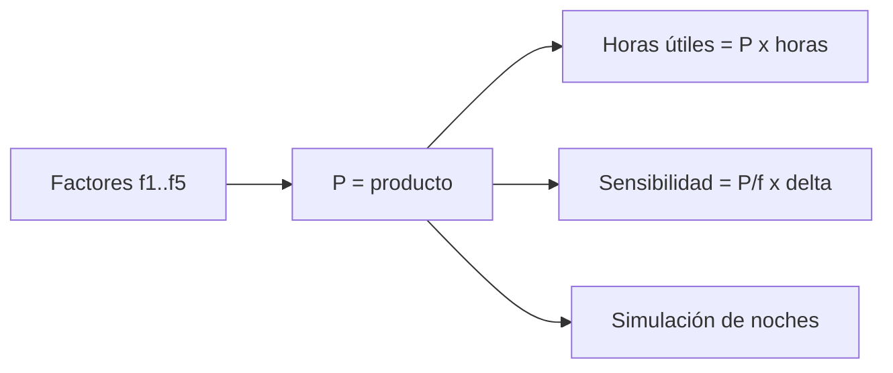

# B48-C01 — Observatorio como sistema socio-técnico

<!-- nav:top -->
[🏠 Programa](../../../../README.md) · [📚 Bloque B48](../../../tronco-comun/B48-operaciones-de-observatorios-cientificos.md) · [← Anterior: B47-C25 — Diseño de cargas útiles educativas](../../B47/B47-C25-diseno-de-cargas-utiles-educativas/CLASE.md) · [Siguiente: B48-C02 — Concesión de tiempo de observación →](../B48-C02-concesion-de-tiempo-de-observacion/CLASE.md)
<!-- /nav -->

## 1. Ubicación, nivel y alcance

Clase 1 del bloque B48. Nivel N3. Un observatorio no es solo un telescopio: es un sistema socio-técnico en que el clima, el telescopio, el instrumento, el software y las personas deben funcionar a la vez. Aquí medirás su **eficiencia global** como producto de factores. Usas [B12](../../../tronco-comun/B12-probabilidad-estadistica-e-incertidumbre.md). Todos los factores son ilustrativos.

## 2. Por qué esta clase existe

Sin una visión de sistema, cada equipo optimiza su parte y nadie sabe qué mejora rinde más. La decisión central: **¿en qué factor conviene invertir para recuperar más noches útiles?**

## 3. Lo que podrás hacer al terminar

1. Descomponer la eficiencia de un observatorio en factores independientes.
2. Calcular la probabilidad de una noche útil como producto.
3. Verificar el producto con una simulación de semilla fija.
4. Estimar la ganancia marginal de mejorar cada factor.
5. Evaluar el efecto de duplicar un subsistema en paralelo.
6. Reconocer los límites de suponer independencia.

La evidencia es la **ficha del observatorio como sistema** del ejercicio 12 (sección 20).

## 4. Con qué llegas y cómo comprobarlo

1. ¿Qué es una incertidumbre?
2. ¿Qué es una simulación Monte Carlo?
3. ¿Qué es una tabla de resultados?
4. ¿Qué es un valor ilustrativo?
5. ¿Qué es una verificación?

<details>
<summary>Ver respuestas</summary>

1. Un intervalo en que se espera el valor verdadero. 2. Repetir con números aleatorios de semilla fija. 3. Un resumen ordenado de cálculos. 4. Un valor propuesto para el ejemplo, no medido. 5. Comparar un cálculo con un caso independiente.
</details>

Con cuatro o cinco aciertos, sigue; si no, repasa los prerrequisitos.

## 5. Un caso de contexto y casos de referencia

Con clima 0,72, telescopio 0,95, instrumento 0,93, software 0,98 y operación 0,85 (ilustrativos), una noche es útil con probabilidad `0,52989`; en 10 h por noche y 365 noches son 1934,1 h útiles al año. Es el **ejemplo conductor**.

## 6. Vocabulario

**Sistema socio-técnico**: conjunto de personas, procedimientos y equipos interdependientes. **Factor de eficiencia**: probabilidad de que un subsistema esté disponible. **Serie**: todos deben funcionar. **Paralelo**: basta uno. **Sensibilidad**: cambio del resultado por cambio de un factor.

## 7. Modelo mental: una cadena de eslabones

Una noche útil es una cadena: si un eslabón falla, no se observa. Reforzar el eslabón más débil rinde más que pulir el más fuerte.



*Descripción textual:* los factores se multiplican en serie para dar la probabilidad de noche útil, de la que salen las horas y la sensibilidad; la simulación contrasta el producto.

Analogía: una cadena de eslabones. Límite: la independencia entre factores.

## 8. La explicación, paso a paso

### 8.1 Producto y simulación

| Magnitud | Valor |
|---|---|
| Producto analítico | 0,52989 |
| Simulación de 200000 noches | 0,52873 |
| Sigma binomial | 0,00112 |
| z de la simulación | -1,04 |

### 8.2 Sensibilidad (subir cada factor en 0,02)

| Factor | Ganancia |
|---|---|
| clima | 0,01472 |
| operación | 0,01247 |
| instrumento | 0,01140 |
| telescopio | 0,01116 |
| software | 0,01081 |

La ganancia vale `P/f × 0,02`: es mayor donde el factor es menor. Pero el clima no se compra: la inversión útil está en los demás.

### 8.3 Paralelo

Con dos instrumentos intercambiables el factor pasa de 0,93 a 0,9951 y la probabilidad global a 0,56698.

### 8.4 Lectura

El producto vale solo si los factores son independientes. Una tormenta que causa a la vez mal clima y corte eléctrico los correlaciona y el producto deja de ser exacto.

## 9. Magnitudes, símbolos y unidades

| Símbolo | Qué es | Unidad | Valor / nota |
|---|---|---|---|
| `f_i` | factor de disponibilidad | — | 0,72 a 0,98 (ilustrativos) |
| `P` | probabilidad de noche útil | — | 0,52989 |
| `N` | noches simuladas | — | 200000 |
| `σ` | sigma binomial | — | 0,00112 |
| `H` | horas útiles por año | h | 1934,1 |

## 10. Convenciones y referencias

Unidades del SI salvo donde se indique; coma decimal en el texto y punto decimal en las salidas del laboratorio; semilla 20261109; todo valor que no esté citado en la sección 11 es ilustrativo o sintético.

## 11. De dónde sale lo que afirmamos

| ID | Fuente | Localizador | Respalda | Estado |
|---|---|---|---|---|
| — | Sin fuente externa | — | relaciones estándar que verifica el laboratorio | No se consultó una fuente para esta clase |

Límites: no se consultó ninguna fuente externa para esta clase; los valores son ilustrativos o sintéticos y las relaciones son de libro, verificadas solo por el laboratorio.

## 12. Cómo ver los resultados

| Factor | Valor ilustrativo |
|---|---|
| clima | 0,72 |
| telescopio | 0,95 |
| instrumento | 0,93 |
| software | 0,98 |
| operación | 0,85 |
| **producto** | 0,52989 |

Descripción larga: el clima es el factor más bajo y domina el producto.

## 13. Ejemplo trabajado: producto de cinco factores

**Paso 1.** `0,72 × 0,95 = 0,684`.

**Paso 2.** `0,684 × 0,93 = 0,63612`.

**Paso 3.** `0,63612 × 0,98 = 0,62340`; `× 0,85 = 0,52989`.

**Paso 4.** Horas útiles: `0,52989 × 3650 = 1934,1` h.

## 14. Distintas formas de describir el resultado

**Por fórmula:** sección 8. **Por tabla:** sección 12. **Por código:** `eficiencia_global.py`. **Por contraste:** el laboratorio compara dos vías independientes.

## 15. Práctica guiada

**Ejercicio 1 · con los pasos indicados.** Calcula el producto de los cinco factores. *Pasos:* multiplica de a uno.

<details><summary>Solución comentada</summary>

`0,52989`.
</details>

**Ejercicio 2 · con una pista.** Horas útiles al año con 10 h por noche. *Pista:* `P × 3650`.

<details><summary>Solución comentada</summary>

`1934,1` h.
</details>

**Ejercicio 3 · casi autónomo.** Ganancia de subir el clima en 0,02. *Pasos:* `P/f × 0,02`.

<details><summary>Solución comentada</summary>

`0,01472`.
</details>

## 16. Práctica autónoma, transferencia e integrador

**Ejercicio 4.** Probabilidad global si el clima fuera 0,60.

<details><summary>Solución comentada</summary>

`0,44157`.
</details>

**Ejercicio 5.** Noches útiles en 365.

<details><summary>Solución comentada</summary>

`193,4`.
</details>

**Ejercicio 6.** Factor con dos instrumentos en paralelo.

<details><summary>Solución comentada</summary>

`1 − 0,07² = 0,9951`.
</details>

**Ejercicio 7.** Sigma binomial con `N = 200000`.

<details><summary>Solución comentada</summary>

`√(P(1−P)/N) = 0,00112`.
</details>

**Ejercicio 8.** z de la simulación.

<details><summary>Solución comentada</summary>

`-1,04`: compatible con el azar.
</details>

**Ejercicio 9 · transferencia.** **Transferencia.** Un directivo afirma que el observatorio tiene 53 % de eficiencia real. Responde.

<details><summary>Solución comentada</summary>

Los factores son ilustrativos: el 53 % es el resultado de un ejemplo, no una medición.
</details>

**Ejercicio 10 · transferencia.** **Transferencia.** Si clima y fallas eléctricas están correlacionados positivamente (ambos malos en tormentas), ¿el producto sobreestima o subestima?

<details><summary>Solución comentada</summary>

Subestima la probabilidad de noche útil: los fallos coinciden y hay más noches con todo bien de lo que el producto predice.
</details>

**Ejercicio 11 · transferencia.** **Transferencia.** ¿Qué factor conviene mejorar si cada +0,02 cuesta lo mismo?

<details><summary>Solución comentada</summary>

El de menor valor controlable, porque la ganancia `P/f × 0,02` crece al bajar `f`.
</details>

**Ejercicio 12.** **Integrador.** Elabora tu *ficha del observatorio como sistema*: factores, producto, simulación, sensibilidad y límites.

<details><summary>Solución comentada</summary>

Secciones 8.1–8.4.
</details>

**Ejercicio 12 · integrador.** **Integrador.** Elabora tu *ficha del observatorio como sistema*: factores, producto, simulación, sensibilidad y límites.

<details><summary>Solución modelo</summary>

Secciones 8.1–8.4.
</details>

## 17. Laboratorio: eficiencia global de un observatorio

El script [eficiencia_global.py](eficiencia_global.py) calcula el producto de factores, lo contrasta con una simulación y estima sensibilidades (**comprueba** que `|z| < 4`).

**Datos:** factores **ilustrativos**; sin constantes. **Predice antes de ejecutar:** ¿cuánto valdrá el producto? (≈ 0,53.) **Ejecución del 2026-11-09 (Python 3.12.9):**

```text
Producto analítico P = 0.52989
Simulación (200000 noches) = 0.52873  (sigma binomial 0.00112, z = -1.04)
Ganancia de subir clima en 0,02: 0.01472
Ganancia de subir telescopio en 0,02: 0.01116
Ganancia de subir instrumento en 0,02: 0.01140
Ganancia de subir software en 0,02: 0.01081
Ganancia de subir operación en 0,02: 0.01247
Instrumento duplicado: factor 0.9951, P = 0.56698
Horas útiles al año con 10 h de noche: 1934.1
Pruebas superadas.
```

```bash
python programa/clases/B48/B48-C01-observatorio-como-sistema-socio-tecnico/eficiencia_global.py
```

**Límites:** el modelo es de libro y sus parámetros son ilustrativos; no describe ningún observatorio ni instrumento real.

## 18. Errores frecuentes y cómo corregirlos

**Sumar factores en vez de multiplicarlos.** Se corrige con 8.1.

**Suponer independencia sin discutirla.** Se corrige con 8.4.

**Tomar los factores como datos reales.** Se corrige con la sección 10.

**Olvidar que el paralelo mejora un factor, no el clima.** Se corrige con 8.3.

## 19. Cómo sabrás que vas bien

Tras la sección 8: ¿qué resultado esperabas y cuál obtuviste? Si dudas, repasa el ejemplo 13. Tras el laboratorio: ¿qué comprueba? (ver la sección 17).

## 20. Qué entregas y cómo se evalúa

El producto es tu **ficha del observatorio como sistema** (ejercicio 12).

| Criterio | Inicial | En desarrollo | Logrado | Destacado |
|---|---|---|---|---|
| Conceptos | Los confunde | Parciales | conceptos de la clase | Explica los límites |
| Cálculo | Sin unidades | Con errores | Tablas completas | Calcula casos nuevos |
| Numérico | Sin comprobar | Un caso | Contraste con el análisis | Interpreta las diferencias |
| Fuentes | Sin fuente | Sin fecha | fuentes con fecha | Declara lo ilustrativo |
| Límites | No los nombra | Uno | Tres | Discute qué falta del modelo |

**Condiciones críticas (no se compensan con promedio):** rotular lo ilustrativo y lo sintético; no presentar el modelo como práctica de un observatorio real; citar solo lo consultado.

## 21. Ética, seguridad y límites

Clase educativa: los modelos son simplificados. Accesibilidad: tablas equivalentes a las gráficas, fórmulas en texto, ejercicios sin conexión.

## 22. Para cerrar y seguir

El producto de los factores da 0,52989 y la simulación lo confirma. Queda una pregunta: ¿cómo se reparte el tiempo útil entre quienes lo piden?

**Glosario español–inglés.** sistema socio-técnico · *socio-technical system*; disponibilidad · *availability*; sensibilidad · *sensitivity*; serie · *series*; paralelo · *parallel*.

**Continuidad.** [B48-C02](../B48-C02-concesion-de-tiempo-de-observacion/CLASE.md) estudia la concesión de tiempo.

**Referencias:** ver sección 11.

<!-- nav:bottom -->
---

[← Anterior: B47-C25 — Diseño de cargas útiles educativas](../../B47/B47-C25-diseno-de-cargas-utiles-educativas/CLASE.md) · [📚 Bloque B48](../../../tronco-comun/B48-operaciones-de-observatorios-cientificos.md) · [Siguiente: B48-C02 — Concesión de tiempo de observación →](../B48-C02-concesion-de-tiempo-de-observacion/CLASE.md)
<!-- /nav -->
