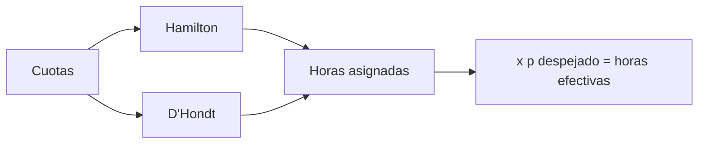

# B48-C02 — Concesión de tiempo de observación

<!-- nav:top -->
[🏠 Programa](../../../../README.md) · [📚 Bloque B48](../../../tronco-comun/B48-operaciones-de-observatorios-cientificos.md) · [← Anterior: B48-C01 — Observatorio como sistema socio-técnico](../B48-C01-observatorio-como-sistema-socio-tecnico/CLASE.md) · [Siguiente: B48-C03 — Propuestas científicas y criterios →](../B48-C03-propuestas-cientificas-y-criterios/CLASE.md)
<!-- /nav -->

## 1. Ubicación, nivel y alcance

Clase 2 del bloque B48. Nivel N3. El tiempo de telescopio es escaso y se concede por cuotas entre socios. Aquí repartes 620 horas con dos métodos y calculas cuántas horas se observarán de verdad tras el clima. Usas [B12](../../../tronco-comun/B12-probabilidad-estadistica-e-incertidumbre.md). Las instituciones son ficticias.

## 2. Por qué esta clase existe

Un reparto sin regla clara genera conflicto, y uno sin clima genera promesas incumplibles. La decisión central: **¿cuántas horas se asignan y cuántas se esperan efectivas?**

## 3. Lo que podrás hacer al terminar

1. Repartir horas enteras con el método de Hamilton.
2. Repartir con el método de D'Hondt y comparar.
3. Calcular la presión de sobresuscripción.
4. Hallar las horas efectivas esperadas con su dispersión.
5. Verificar la dispersión con simulación.
6. Reconocer los límites de un reparto puramente proporcional.

La evidencia es la **ficha de la concesión de tiempo** del ejercicio 12 (sección 20).

## 4. Con qué llegas y cómo comprobarlo

1. ¿Qué es una incertidumbre?
2. ¿Qué es una simulación Monte Carlo?
3. ¿Qué es una tabla de resultados?
4. ¿Qué es un valor ilustrativo?
5. ¿Qué es una verificación?

<details>
<summary>Ver respuestas</summary>

1. Un intervalo en que se espera el valor verdadero. 2. Repetir con números aleatorios de semilla fija. 3. Un resumen ordenado de cálculos. 4. Un valor propuesto para el ejemplo, no medido. 5. Comparar un cálculo con un caso independiente.
</details>

Con cuatro o cinco aciertos, sigue; si no, repasa los prerrequisitos.

## 5. Un caso de contexto y casos de referencia

Con cuotas 0,38, 0,27, 0,21 y 0,14 sobre 620 h, el Instituto A recibe 236 h, B 167, C 130 y D 87; la presión global es 1,694. Con clima de 0,72 en 62 noches de 10 h se esperan 446,4 h efectivas. Es el **ejemplo conductor** (todo sintético).

## 6. Vocabulario

**Cuota**: fracción pactada. **Sobresuscripción**: horas pedidas entre horas disponibles. **Método de Hamilton**: parte entera y se reparten los restos mayores. **Método de D'Hondt**: asigna cada hora al mayor cociente. **Horas efectivas**: asignadas por la fracción despejada.

## 7. Modelo mental: repartir una torta en porciones enteras

Como repartir una torta en porciones enteras: las cuotas dan trozos con fracciones y alguna regla decide quién recibe las migas sobrantes.



*Descripción textual:* las cuotas se convierten en horas enteras por dos métodos y las horas asignadas se reducen por el clima para dar las efectivas.

Analogía: repartir una torta en porciones enteras. Límite: un reparto proporcional de cuotas fijas.

## 8. La explicación, paso a paso

### 8.1 Reparto

| Institución | Cuota | Hamilton | D'Hondt | Pedido | Presión |
|---|---|---|---|---|---|
| A | 0,38 | 236 | 236 | 410 | 1,74 |
| B | 0,27 | 167 | 167 | 300 | 1,80 |
| C | 0,21 | 130 | 130 | 150 | 1,15 |
| D | 0,14 | 87 | 87 | 190 | 2,18 |

Ambos métodos coinciden aquí; con otras cuotas pueden diferir en una hora. La presión global es 1,694.

### 8.2 Horas efectivas

El número de noches despejadas en 62 es binomial: media `62 × 0,72`, o 446,4 h, y desviación 35,35 h. La simulación de 20000 temporadas da media 446,13 h y desviación 35,33 h (z = -1,07).

### 8.3 Lectura

Asignar 620 h cuando se esperan 446 efectivas obliga a decidir qué programas se pierden si el clima falla: esa es la política de prioridades, no una cuenta.

## 9. Magnitudes, símbolos y unidades

| Símbolo | Qué es | Unidad | Valor / nota |
|---|---|---|---|
| `q_i` | cuota | — | 0,38; 0,27; 0,21; 0,14 |
| `T` | horas totales | h | 620 |
| `p` | fracción despejada | — | 0,72 (ilustrativo) |
| `n` | noches | — | 62 |
| `σ` | dispersión de horas efectivas | h | 35,35 |

## 10. Convenciones y referencias

Unidades del SI salvo donde se indique; coma decimal en el texto y punto decimal en las salidas del laboratorio; semilla 20261109; todo valor que no esté citado en la sección 11 es ilustrativo o sintético.

## 11. De dónde sale lo que afirmamos

| ID | Fuente | Localizador | Respalda | Estado |
|---|---|---|---|---|
| — | Sin fuente externa | — | relaciones estándar que verifica el laboratorio | No se consultó una fuente para esta clase |

Límites: no se consultó ninguna fuente externa para esta clase; los valores son ilustrativos o sintéticos y las relaciones son de libro, verificadas solo por el laboratorio.

## 12. Cómo ver los resultados

| Magnitud | Valor |
|---|---|
| horas asignadas | 620 |
| horas efectivas esperadas | 446,4 |
| dispersión | 35,35 h |
| presión global | 1,694 |

Descripción larga: se espera observar cerca del 72 % de lo asignado, con una dispersión de unas 35 h.

## 13. Ejemplo trabajado: el reparto del Instituto A

**Paso 1.** Exacto: `0,38 × 620 = 235,6`.

**Paso 2.** Parte entera 235; el resto 0,6 es el mayor de los cuatro (B: 167,4; C: 130,2; D: 86,8 con resto 0,8).

**Paso 3.** Sobran 620 − (235 + 167 + 130 + 86) = 2 horas: van a los restos 0,8 (D) y 0,6 (A).

**Paso 4.** A recibe 236 h y D 87 h.

## 14. Distintas formas de describir el resultado

**Por fórmula:** sección 8. **Por tabla:** sección 12. **Por código:** `reparto_tiempo.py`. **Por contraste:** el laboratorio compara dos vías independientes.

## 15. Práctica guiada

**Ejercicio 1 · con los pasos indicados.** Horas exactas del Instituto C. *Pasos:* `0,21 × 620`.

<details><summary>Solución comentada</summary>

`130,2` h.
</details>

**Ejercicio 2 · con una pista.** Presión del Instituto D. *Pista:* pedido entre asignado.

<details><summary>Solución comentada</summary>

`190/87 = 2,18`.
</details>

**Ejercicio 3 · casi autónomo.** Horas efectivas esperadas. *Pasos:* `62 × 10 × 0,72`.

<details><summary>Solución comentada</summary>

`446,4` h.
</details>

## 16. Práctica autónoma, transferencia e integrador

**Ejercicio 4.** Dispersión de las horas efectivas.

<details><summary>Solución comentada</summary>

`10 √(62 × 0,72 × 0,28) = 35,35` h.
</details>

**Ejercicio 5.** Presión global.

<details><summary>Solución comentada</summary>

`1050/620 = 1,694`.
</details>

**Ejercicio 6.** Suma de horas de Hamilton.

<details><summary>Solución comentada</summary>

`620`.
</details>

**Ejercicio 7.** Diferencia de Hamilton y D'Hondt para B.

<details><summary>Solución comentada</summary>

`0` h.
</details>

**Ejercicio 8.** Intervalo de unas dos sigmas alrededor de la media.

<details><summary>Solución comentada</summary>

`376` a `517` h.
</details>

**Ejercicio 9 · transferencia.** **Transferencia.** ¿Qué pasa si el clima baja a 0,60?

<details><summary>Solución comentada</summary>

Se esperan `62 × 10 × 0,60 = 372` h: la presión efectiva sube a más del doble.
</details>

**Ejercicio 10 · transferencia.** **Transferencia.** ¿Por qué no asignar solo las horas esperadas?

<details><summary>Solución comentada</summary>

Porque un año bueno dejaría tiempo sin usar; se asigna de más y se priorizan los programas.
</details>

**Ejercicio 11 · transferencia.** **Transferencia.** ¿Un reparto por cuotas es una decisión científica?

<details><summary>Solución comentada</summary>

No: fija derechos; la selección científica dentro de cada cuota es otro paso.
</details>

**Ejercicio 12.** **Integrador.** Elabora tu *ficha de la concesión de tiempo*: cuotas, horas, presión, horas efectivas y límites.

<details><summary>Solución comentada</summary>

Secciones 8.1–8.3.
</details>

**Ejercicio 12 · integrador.** **Integrador.** Elabora tu *ficha de la concesión de tiempo*: cuotas, horas, presión, horas efectivas y límites.

<details><summary>Solución modelo</summary>

Secciones 8.1–8.3.
</details>

## 17. Laboratorio: reparto de horas

El script [reparto_tiempo.py](reparto_tiempo.py) reparte horas por dos métodos y simula las horas efectivas (**comprueba** sumas exactas y `|z| < 4`).

**Datos:** cuotas y solicitudes **sintéticas**. **Predice antes de ejecutar:** ¿cuántas horas efectivas se esperan? (≈ 446.) **Ejecución del 2026-11-09 (Python 3.12.9):**

```text
Instituto A: Hamilton  236 h | D'Hondt  236 h | presión 1.74
Instituto B: Hamilton  167 h | D'Hondt  167 h | presión 1.80
Instituto C: Hamilton  130 h | D'Hondt  130 h | presión 1.15
Instituto D: Hamilton   87 h | D'Hondt   87 h | presión 2.18
Presión global = 1.694
Horas efectivas esperadas = 446.4 h (sigma 35.35 h)
Simulación: media 446.13 h, desviación 35.33 h, z = -1.07
Pruebas superadas.
```

```bash
python programa/clases/B48/B48-C02-concesion-de-tiempo-de-observacion/reparto_tiempo.py
```

**Límites:** el modelo es de libro y sus parámetros son ilustrativos; no describe ningún observatorio ni instrumento real.

## 18. Errores frecuentes y cómo corregirlos

**Asignar horas fraccionarias sin regla.** Se corrige con 8.1.

**Confundir horas asignadas y efectivas.** Se corrige con 8.2.

**Ignorar la dispersión del clima.** Se corrige con 8.2.

**Presentar el reparto como mérito científico.** Se corrige con 8.3.

## 19. Cómo sabrás que vas bien

Tras la sección 8: ¿qué resultado esperabas y cuál obtuviste? Si dudas, repasa el ejemplo 13. Tras el laboratorio: ¿qué comprueba? (ver la sección 17).

## 20. Qué entregas y cómo se evalúa

El producto es tu **ficha de la concesión de tiempo** (ejercicio 12).

| Criterio | Inicial | En desarrollo | Logrado | Destacado |
|---|---|---|---|---|
| Conceptos | Los confunde | Parciales | conceptos de la clase | Explica los límites |
| Cálculo | Sin unidades | Con errores | Tablas completas | Calcula casos nuevos |
| Numérico | Sin comprobar | Un caso | Contraste con el análisis | Interpreta las diferencias |
| Fuentes | Sin fuente | Sin fecha | fuentes con fecha | Declara lo ilustrativo |
| Límites | No los nombra | Uno | Tres | Discute qué falta del modelo |

**Condiciones críticas (no se compensan con promedio):** rotular lo ilustrativo y lo sintético; no presentar el modelo como práctica de un observatorio real; citar solo lo consultado.

## 21. Ética, seguridad y límites

Clase educativa: los modelos son simplificados. Accesibilidad: tablas equivalentes a las gráficas, fórmulas en texto, ejercicios sin conexión.

## 22. Para cerrar y seguir

El reparto suma 620 h y el clima deja unas 446 efectivas. Queda una pregunta: ¿cómo se elige qué propuestas ocupan esas horas?

**Glosario español–inglés.** cuota · *quota*; sobresuscripción · *oversubscription*; horas efectivas · *effective hours*; resto mayor · *largest remainder*; presión · *pressure*.

**Continuidad.** [B48-C03](../B48-C03-propuestas-cientificas-y-criterios/CLASE.md) estudia las propuestas y sus criterios.

**Referencias:** ver sección 11.

<!-- nav:bottom -->
---

[← Anterior: B48-C01 — Observatorio como sistema socio-técnico](../B48-C01-observatorio-como-sistema-socio-tecnico/CLASE.md) · [📚 Bloque B48](../../../tronco-comun/B48-operaciones-de-observatorios-cientificos.md) · [Siguiente: B48-C03 — Propuestas científicas y criterios →](../B48-C03-propuestas-cientificas-y-criterios/CLASE.md)
<!-- /nav -->
