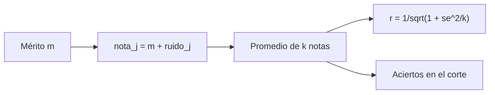

# B48-C03 — Propuestas científicas y criterios

<!-- nav:top -->
[🏠 Programa](../../../../README.md) · [📚 Bloque B48](../../../tronco-comun/B48-operaciones-de-observatorios-cientificos.md) · [← Anterior: B48-C02 — Concesión de tiempo de observación](../B48-C02-concesion-de-tiempo-de-observacion/CLASE.md) · [Siguiente: B48-C04 — Planificación por visibilidad →](../B48-C04-planificacion-por-visibilidad/CLASE.md)
<!-- /nav -->

## 1. Ubicación, nivel y alcance

Clase 3 del bloque B48. Nivel N3. Un comité califica propuestas con revisores que se equivocan. Aquí simulas revisores ruidosos y mides qué tan bien la nota media recupera el mérito verdadero. Usas [B12](../../../tronco-comun/B12-probabilidad-estadistica-e-incertidumbre.md). Los datos son sintéticos.

## 2. Por qué esta clase existe

Si la nota es muy ruidosa, el comité selecciona al azar sin saberlo. La decisión central: **¿cuántos revisores hacen falta para que la nota sea confiable?**

## 3. Lo que podrás hacer al terminar

1. Modelar la nota como mérito más ruido.
2. Calcular la correlación esperada con k revisores.
3. Verificar la correlación por simulación.
4. Medir los aciertos al elegir el 25 % superior.
5. Decidir un número de revisores con criterio.
6. Reconocer los sesgos que el modelo no incluye.

La evidencia es la **ficha de propuestas y criterios** del ejercicio 12 (sección 20).

## 4. Con qué llegas y cómo comprobarlo

1. ¿Qué es una incertidumbre?
2. ¿Qué es una simulación Monte Carlo?
3. ¿Qué es una tabla de resultados?
4. ¿Qué es un valor ilustrativo?
5. ¿Qué es una verificación?

<details>
<summary>Ver respuestas</summary>

1. Un intervalo en que se espera el valor verdadero. 2. Repetir con números aleatorios de semilla fija. 3. Un resumen ordenado de cálculos. 4. Un valor propuesto para el ejemplo, no medido. 5. Comparar un cálculo con un caso independiente.
</details>

Con cuatro o cinco aciertos, sigue; si no, repasa los prerrequisitos.

## 5. Un caso de contexto y casos de referencia

Con ruido de 1,2 respecto del mérito (desviación 1), un revisor da correlación 0,6402 y ocho dan 0,9206. Con un revisor, solo 0,565 de las propuestas del 25 % superior verdadero quedan en el 25 % superior de las notas. Es el **ejemplo conductor** (sintético).

## 6. Vocabulario

**Mérito**: calidad verdadera de la propuesta. **Ruido**: error independiente de cada revisor. **Correlación**: acuerdo lineal entre nota y mérito. **Acuerdo entre revisores**: cuánto coinciden entre sí. **Corte**: fracción que se financia.

## 7. Modelo mental: pesar con una balanza temblorosa

Es pesar con una balanza que tiembla: cada pesada es ruidosa y promediar varias da un valor más estable.



*Descripción textual:* la nota de cada revisor es el mérito más ruido; promediar k notas reduce el ruido y sube la correlación con el mérito según la fórmula.

Analogía: pesar con una balanza temblorosa. Límite: revisores independientes y sin sesgo.

## 8. La explicación, paso a paso

### 8.1 Correlación según el número de revisores

| k | r teórica | r simulada | Aciertos en el 25 % superior |
|---|---|---|---|
| 1 | 0,6402 | 0,6391 | 0,565 |
| 2 | 0,7625 | 0,7726 | 0,649 |
| 3 | 0,8220 | 0,8202 | 0,696 |
| 5 | 0,8811 | 0,8817 | 0,753 |
| 8 | 0,9206 | 0,9204 | 0,801 |

### 8.2 Rendimientos decrecientes

Pasar de 1 a 3 revisores sube `r` en 0,182; de 5 a 8, solo 0,039. Cada revisor adicional aporta menos.

### 8.3 Lectura

Aun con ocho revisores, 0,20 de los mejores quedan fuera del corte: la selección con ruido siempre comete errores. Y el modelo omite sesgos compartidos entre revisores, que no se promedian.

## 9. Magnitudes, símbolos y unidades

| Símbolo | Qué es | Unidad | Valor / nota |
|---|---|---|---|
| `m` | mérito verdadero | — | normal (0, 1) |
| `σ_e` | ruido de un revisor | — | 1,2 |
| `k` | número de revisores | — | 1 a 8 |
| `r` | correlación nota-mérito | — | 0,6402 a 0,9206 |

## 10. Convenciones y referencias

Unidades del SI salvo donde se indique; coma decimal en el texto y punto decimal en las salidas del laboratorio; semilla 20261109; todo valor que no esté citado en la sección 11 es ilustrativo o sintético.

## 11. De dónde sale lo que afirmamos

| ID | Fuente | Localizador | Respalda | Estado |
|---|---|---|---|---|
| — | Sin fuente externa | — | relaciones estándar que verifica el laboratorio | No se consultó una fuente para esta clase |

Límites: no se consultó ninguna fuente externa para esta clase; los valores son ilustrativos o sintéticos y las relaciones son de libro, verificadas solo por el laboratorio.

## 12. Cómo ver los resultados

| k | r teórica |
|---|---|
| 1 | 0,6402 |
| 3 | 0,8220 |
| 8 | 0,9206 |

Descripción larga: la correlación crece con k pero cada vez más despacio.

## 13. Ejemplo trabajado: la correlación con 3 revisores

**Paso 1.** `σ_e²/k = 1,44/3 = 0,48`.

**Paso 2.** `1 + 0,48 = 1,48`.

**Paso 3.** `r = 1/√1,48 = 0,8220`.

**Paso 4.** La simulación da 0,8202.

## 14. Distintas formas de describir el resultado

**Por fórmula:** sección 8. **Por tabla:** sección 12. **Por código:** `revisores.py`. **Por contraste:** el laboratorio compara dos vías independientes.

## 15. Práctica guiada

**Ejercicio 1 · con los pasos indicados.** Correlación teórica con `k = 2`. *Pasos:* `1/√(1 + 1,44/2)`.

<details><summary>Solución comentada</summary>

`0,7625`.
</details>

**Ejercicio 2 · con una pista.** Correlación con `k = 5`.

<details><summary>Solución comentada</summary>

`0,8811`.
</details>

**Ejercicio 3 · casi autónomo.** Correlación con ruido 0 y un revisor.

<details><summary>Solución comentada</summary>

`1`.
</details>

## 16. Práctica autónoma, transferencia e integrador

**Ejercicio 4.** Diferencia teórica entre 8 y 5 revisores.

<details><summary>Solución comentada</summary>

`0,039`.
</details>

**Ejercicio 5.** Fracción de errores en el corte con 5 revisores.

<details><summary>Solución comentada</summary>

`1 − 0,753 = 0,247`.
</details>

**Ejercicio 6.** Diferencia simulada − teórica para `k = 1`.

<details><summary>Solución comentada</summary>

`-0,0011`.
</details>

**Ejercicio 7.** ¿Con qué `k` se supera 0,9 de correlación?

<details><summary>Solución comentada</summary>

Con `k = 8` (0,9206); con 5 da 0,8811.
</details>

**Ejercicio 8.** Ruido si `k = 1` y `r = 0,8`.

<details><summary>Solución comentada</summary>

`σ_e = √(1/0,64 − 1) = 0,750`.
</details>

**Ejercicio 9 · transferencia.** **Transferencia.** Dos revisores comparten un sesgo contra un método. ¿Promediar ayuda?

<details><summary>Solución comentada</summary>

No: el sesgo común no se reduce al promediar.
</details>

**Ejercicio 10 · transferencia.** **Transferencia.** ¿Es justo decir que el comité mide el mérito?

<details><summary>Solución comentada</summary>

Mide una nota con ruido: la correlación nunca es 1.
</details>

**Ejercicio 11 · transferencia.** **Transferencia.** ¿Qué hacer cerca del corte?

<details><summary>Solución comentada</summary>

Usar sorteo o una segunda ronda: la diferencia de nota allí es indistinguible del ruido.
</details>

**Ejercicio 12.** **Integrador.** Elabora tu *ficha de propuestas y criterios*: modelo, tabla de `r`, aciertos y límites.

<details><summary>Solución comentada</summary>

Secciones 8.1–8.3.
</details>

**Ejercicio 12 · integrador.** **Integrador.** Elabora tu *ficha de propuestas y criterios*: modelo, tabla de `r`, aciertos y límites.

<details><summary>Solución modelo</summary>

Secciones 8.1–8.3.
</details>

## 17. Laboratorio: revisores ruidosos

El script [revisores.py](revisores.py) simula notas con ruido y compara con la correlación teórica (**comprueba** diferencia menor que 0,03).

**Datos:** mérito y ruido **sintéticos**. **Predice antes de ejecutar:** ¿cuánto sube `r` de 1 a 8 revisores? (≈ 0,28.) **Ejecución del 2026-11-09 (Python 3.12.9):**

```text
k = 1: r teórica 0.6402 | r simulada 0.6391 | aciertos en el 25 % superior 0.565
k = 2: r teórica 0.7625 | r simulada 0.7726 | aciertos en el 25 % superior 0.649
k = 3: r teórica 0.8220 | r simulada 0.8202 | aciertos en el 25 % superior 0.696
k = 5: r teórica 0.8811 | r simulada 0.8817 | aciertos en el 25 % superior 0.753
k = 8: r teórica 0.9206 | r simulada 0.9204 | aciertos en el 25 % superior 0.801
Pruebas superadas.
```

```bash
python programa/clases/B48/B48-C03-propuestas-cientificas-y-criterios/revisores.py
```

**Límites:** el modelo es de libro y sus parámetros son ilustrativos; no describe ningún observatorio ni instrumento real.

## 18. Errores frecuentes y cómo corregirlos

**Creer que más revisores eliminan los sesgos comunes.** Se corrige con 8.3.

**Interpretar la nota como mérito exacto.** Se corrige con 8.1.

**Ignorar los rendimientos decrecientes.** Se corrige con 8.2.

**Tomar los datos como los de un comité real.** Se corrige con la sección 10.

## 19. Cómo sabrás que vas bien

Tras la sección 8: ¿qué resultado esperabas y cuál obtuviste? Si dudas, repasa el ejemplo 13. Tras el laboratorio: ¿qué comprueba? (ver la sección 17).

## 20. Qué entregas y cómo se evalúa

El producto es tu **ficha de propuestas y criterios** (ejercicio 12).

| Criterio | Inicial | En desarrollo | Logrado | Destacado |
|---|---|---|---|---|
| Conceptos | Los confunde | Parciales | conceptos de la clase | Explica los límites |
| Cálculo | Sin unidades | Con errores | Tablas completas | Calcula casos nuevos |
| Numérico | Sin comprobar | Un caso | Contraste con el análisis | Interpreta las diferencias |
| Fuentes | Sin fuente | Sin fecha | fuentes con fecha | Declara lo ilustrativo |
| Límites | No los nombra | Uno | Tres | Discute qué falta del modelo |

**Condiciones críticas (no se compensan con promedio):** rotular lo ilustrativo y lo sintético; no presentar el modelo como práctica de un observatorio real; citar solo lo consultado.

## 21. Ética, seguridad y límites

Clase educativa: los modelos son simplificados. Accesibilidad: tablas equivalentes a las gráficas, fórmulas en texto, ejercicios sin conexión.

## 22. Para cerrar y seguir

Con ocho revisores la correlación sube a 0,9206, pero siempre quedan errores en el corte. Queda una pregunta: ¿cuándo se puede observar cada objeto elegido?

**Glosario español–inglés.** mérito · *merit*; ruido · *noise*; correlación · *correlation*; revisor · *referee*; corte · *cutoff*.

**Continuidad.** [B48-C04](../B48-C04-planificacion-por-visibilidad/CLASE.md) estudia la planificación por visibilidad.

**Referencias:** ver sección 11.

<!-- nav:bottom -->
---

[← Anterior: B48-C02 — Concesión de tiempo de observación](../B48-C02-concesion-de-tiempo-de-observacion/CLASE.md) · [📚 Bloque B48](../../../tronco-comun/B48-operaciones-de-observatorios-cientificos.md) · [Siguiente: B48-C04 — Planificación por visibilidad →](../B48-C04-planificacion-por-visibilidad/CLASE.md)
<!-- /nav -->
