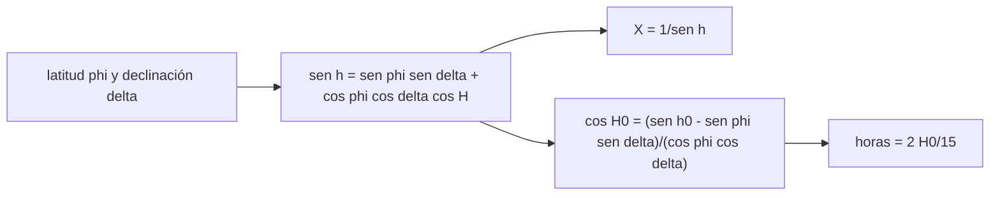

# B48-C04 — Planificación por visibilidad

<!-- nav:top -->
[🏠 Programa](../../../../README.md) · [📚 Bloque B48](../../../tronco-comun/B48-operaciones-de-observatorios-cientificos.md) · [← Anterior: B48-C03 — Propuestas científicas y criterios](../B48-C03-propuestas-cientificas-y-criterios/CLASE.md) · [Siguiente: B48-C05 — Ventanas atmosféricas →](../B48-C05-ventanas-atmosfericas/CLASE.md)
<!-- /nav -->

## 1. Ubicación, nivel y alcance

Clase 4 del bloque B48. Nivel N3. Elegir un objeto no basta: hay que saber cuándo está alto sobre el horizonte. Aquí calculas la altitud, la masa de aire y las horas sobre un límite por dos vías. Usas [B15](../../../tronco-comun/B15-senales-imagenes-y-estimacion-cientifica.md). El sitio y los objetos son ilustrativos.

## 2. Por qué esta clase existe

Programar un objeto bajo en el cielo desperdicia luz y calidad. La decisión central: **¿cuántas horas al día está un objeto por encima del límite de altitud?**

## 3. Lo que podrás hacer al terminar

1. Calcular la altitud con la latitud, la declinación y el ángulo horario.
2. Obtener la masa de aire como secante de la distancia cenital.
3. Deducir las horas sobre un límite con el ángulo horario límite.
4. Verificar con un barrido numérico.
5. Reconocer objetos que nunca alcanzan el límite.
6. Reconocer los límites de la masa de aire de capa plana.

La evidencia es la **ficha de planificación por visibilidad** del ejercicio 12 (sección 20).

## 4. Con qué llegas y cómo comprobarlo

1. ¿Qué es una incertidumbre?
2. ¿Qué es una simulación Monte Carlo?
3. ¿Qué es una tabla de resultados?
4. ¿Qué es un valor ilustrativo?
5. ¿Qué es una verificación?

<details>
<summary>Ver respuestas</summary>

1. Un intervalo en que se espera el valor verdadero. 2. Repetir con números aleatorios de semilla fija. 3. Un resumen ordenado de cálculos. 4. Un valor propuesto para el ejemplo, no medido. 5. Comparar un cálculo con un caso independiente.
</details>

Con cuatro o cinco aciertos, sigue; si no, repasa los prerrequisitos.

## 5. Un caso de contexto y casos de referencia

A latitud −30° y con límite de 30° de altitud, el Objeto A (declinación −20°) transita a 80,00° y está 8,821 h sobre el límite; el Objeto C (+20°) transita a 40,00° y está 4,594 h; el Objeto D (+60°) nunca lo alcanza. Es el **ejemplo conductor**.

## 6. Vocabulario

**Declinación**: latitud celeste. **Ángulo horario**: tiempo desde el tránsito. **Altitud** `h`: ángulo sobre el horizonte. **Masa de aire** `X = sec z`. **Tránsito**: paso por el meridiano. **Hora sidérea**: unidad en que avanza el ángulo horario.

## 7. Modelo mental: el arco de un objeto en el cielo

Cada objeto traza un arco: los de declinación opuesta al sitio hacen arcos altos y largos, y los del lado contrario, arcos bajos y cortos.



*Descripción textual:* la altitud depende del ángulo horario; fijando un límite se despeja el ángulo horario en que se cruza y de él se obtienen las horas de visibilidad.

Analogía: el arco de un objeto en el cielo. Límite: la masa de aire de capa plana.

## 8. La explicación, paso a paso

### 8.1 Cuatro objetos

| Objeto | Declinación | Altitud en el tránsito | Masa de aire | Horas (analítico) | Horas (barrido) |
|---|---|---|---|---|---|
| A | −20° | 80,00° | 1,015 | 8,821 | 8,817 |
| B | −60° | 60,00° | 1,155 | 10,813 | 10,817 |
| C | +20° | 40,00° | 1,556 | 4,594 | 4,583 |
| D | +60° | 0,00° | no aplica | 0,000 | 0,000 |

### 8.2 Comprobación

Las dos vías difieren menos de un minuto en todos los casos. La altitud de tránsito cumple `90° − |φ − δ|`.

### 8.3 Lectura

El Objeto B, de declinación −60°, está 10,8 h sobre el límite: casi toda la noche. El Objeto C ofrece solo 4,6 h y a mayor masa de aire. El modelo omite refracción, horizonte local, la Luna y la masa de aire real cerca del horizonte.

## 9. Magnitudes, símbolos y unidades

| Símbolo | Qué es | Unidad | Valor / nota |
|---|---|---|---|
| `φ` | latitud del sitio | ° | −30 (ilustrativo) |
| `δ` | declinación | ° | −60 a +60 |
| `h₀` | límite de altitud | ° | 30 |
| `X` | masa de aire | — | sec z |
| `H₀` | ángulo horario límite | h | según la fórmula |

## 10. Convenciones y referencias

Unidades del SI salvo donde se indique; coma decimal en el texto y punto decimal en las salidas del laboratorio; semilla 20261109; todo valor que no esté citado en la sección 11 es ilustrativo o sintético.

## 11. De dónde sale lo que afirmamos

| ID | Fuente | Localizador | Respalda | Estado |
|---|---|---|---|---|
| — | Sin fuente externa | — | relaciones estándar que verifica el laboratorio | No se consultó una fuente para esta clase |

Límites: no se consultó ninguna fuente externa para esta clase; los valores son ilustrativos o sintéticos y las relaciones son de libro, verificadas solo por el laboratorio.

## 12. Cómo ver los resultados

| Objeto | Horas sobre 30° |
|---|---|
| A | 8,821 |
| B | 10,813 |
| C | 4,594 |
| D | 0,000 |

Descripción larga: el objeto del lado sur del sitio permanece más tiempo alto; el del lado norte, menos; el más boreal no sale del límite.

## 13. Ejemplo trabajado: las horas del Objeto A

**Paso 1.** `sen 30° = 0,5`; `sen φ sen δ = (−0,5)(−0,342) = 0,171`.

**Paso 2.** `cos φ cos δ = 0,866 × 0,940 = 0,8138`.

**Paso 3.** `cos H₀ = (0,5 − 0,171)/0,8138 = 0,4043`; `H₀ = 66,2°`.

**Paso 4.** `2 × 66,2/15 = 8,821` h (con más cifras).

## 14. Distintas formas de describir el resultado

**Por fórmula:** sección 8. **Por tabla:** sección 12. **Por código:** `visibilidad.py`. **Por contraste:** el laboratorio compara dos vías independientes.

## 15. Práctica guiada

**Ejercicio 1 · con los pasos indicados.** Altitud de tránsito del Objeto C. *Pasos:* `90 − |−30 − 20|`.

<details><summary>Solución comentada</summary>

`40,00°`.
</details>

**Ejercicio 2 · con una pista.** Masa de aire de ese tránsito. *Pista:* `1/sen 40°`.

<details><summary>Solución comentada</summary>

`1,556`.
</details>

**Ejercicio 3 · casi autónomo.** Horas del Objeto B.

<details><summary>Solución comentada</summary>

`10,813` h.
</details>

## 16. Práctica autónoma, transferencia e integrador

**Ejercicio 4.** Diferencia analítico − barrido del Objeto A.

<details><summary>Solución comentada</summary>

`0,004` h.
</details>

**Ejercicio 5.** ¿Alcanza el límite el Objeto D?

<details><summary>Solución comentada</summary>

No: transita a 0°.
</details>

**Ejercicio 6.** Altitud de tránsito de un objeto de declinación −30° en este sitio.

<details><summary>Solución comentada</summary>

`90°` (cenit).
</details>

**Ejercicio 7.** Masa de aire a 30° de altitud.

<details><summary>Solución comentada</summary>

`2`.
</details>

**Ejercicio 8.** Horas del Objeto A en minutos.

<details><summary>Solución comentada</summary>

`529` min.
</details>

**Ejercicio 9 · transferencia.** **Transferencia.** ¿Por qué la masa de aire sec z falla cerca del horizonte?

<details><summary>Solución comentada</summary>

Porque la atmósfera es curva y refractante: sec z diverge, la masa de aire real no.
</details>

**Ejercicio 10 · transferencia.** **Transferencia.** ¿Qué cambia si el límite sube a 45°?

<details><summary>Solución comentada</summary>

Todas las horas bajan; calcúlalo con la fórmula del ejemplo.
</details>

**Ejercicio 11 · transferencia.** **Transferencia.** ¿Basta la visibilidad geométrica para programar?

<details><summary>Solución comentada</summary>

No: hay Luna, clima, horizonte local y calidad de imagen.
</details>

**Ejercicio 12.** **Integrador.** Elabora tu *ficha de planificación por visibilidad*: tabla de objetos, fórmula, barrido y límites.

<details><summary>Solución comentada</summary>

Secciones 8.1–8.3.
</details>

**Ejercicio 12 · integrador.** **Integrador.** Elabora tu *ficha de planificación por visibilidad*: tabla de objetos, fórmula, barrido y límites.

<details><summary>Solución modelo</summary>

Secciones 8.1–8.3.
</details>

## 17. Laboratorio: visibilidad por dos vías

El script [visibilidad.py](visibilidad.py) calcula altitud y horas sobre un límite con la fórmula y con un barrido (**comprueba** diferencia menor que un minuto).

**Datos:** latitud, límite y declinaciones **ilustrativos**. **Predice antes de ejecutar:** ¿qué objeto está más tiempo alto? (el B.) **Ejecución del 2026-11-09 (Python 3.12.9):**

```text
Objeto A: dec -20°  altitud en el tránsito 80.00°  X = 1.015  horas analítico 8.821  barrido 8.817  (sube y baja)
Objeto B: dec -60°  altitud en el tránsito 60.00°  X = 1.155  horas analítico 10.813  barrido 10.817  (sube y baja)
Objeto C: dec +20°  altitud en el tránsito 40.00°  X = 1.556  horas analítico 4.594  barrido 4.583  (sube y baja)
Objeto D: dec +60°  altitud en el tránsito 0.00°  X = —  horas analítico 0.000  barrido 0.000  (nunca alcanza el límite)
Pruebas superadas.
```

```bash
python programa/clases/B48/B48-C04-planificacion-por-visibilidad/visibilidad.py
```

**Límites:** el modelo es de libro y sus parámetros son ilustrativos; no describe ningún observatorio ni instrumento real.

## 18. Errores frecuentes y cómo corregirlos

**Medir el ángulo horario en horas solares.** Se corrige con la sección 10.

**Olvidar los casos circumpolar y nunca visible.** Se corrige con 8.1.

**Usar sec z cerca del horizonte.** Se corrige con 8.3.

**Confundir latitud y declinación.** Se corrige con la sección 6.

## 19. Cómo sabrás que vas bien

Tras la sección 8: ¿qué resultado esperabas y cuál obtuviste? Si dudas, repasa el ejemplo 13. Tras el laboratorio: ¿qué comprueba? (ver la sección 17).

## 20. Qué entregas y cómo se evalúa

El producto es tu **ficha de planificación por visibilidad** (ejercicio 12).

| Criterio | Inicial | En desarrollo | Logrado | Destacado |
|---|---|---|---|---|
| Conceptos | Los confunde | Parciales | conceptos de la clase | Explica los límites |
| Cálculo | Sin unidades | Con errores | Tablas completas | Calcula casos nuevos |
| Numérico | Sin comprobar | Un caso | Contraste con el análisis | Interpreta las diferencias |
| Fuentes | Sin fuente | Sin fecha | fuentes con fecha | Declara lo ilustrativo |
| Límites | No los nombra | Uno | Tres | Discute qué falta del modelo |

**Condiciones críticas (no se compensan con promedio):** rotular lo ilustrativo y lo sintético; no presentar el modelo como práctica de un observatorio real; citar solo lo consultado.

## 21. Ética, seguridad y límites

Clase educativa: los modelos son simplificados. Accesibilidad: tablas equivalentes a las gráficas, fórmulas en texto, ejercicios sin conexión.

## 22. Para cerrar y seguir

El Objeto A queda 8,8 h sobre el límite y el D nunca. Queda una pregunta: ¿qué parte de la luz llega a través de la atmósfera?

**Glosario español–inglés.** declinación · *declination*; ángulo horario · *hour angle*; masa de aire · *airmass*; tránsito · *transit*; altitud · *altitude*.

**Continuidad.** [B48-C05](../B48-C05-ventanas-atmosfericas/CLASE.md) estudia las ventanas atmosféricas.

**Referencias:** ver sección 11.

<!-- nav:bottom -->
---

[← Anterior: B48-C03 — Propuestas científicas y criterios](../B48-C03-propuestas-cientificas-y-criterios/CLASE.md) · [📚 Bloque B48](../../../tronco-comun/B48-operaciones-de-observatorios-cientificos.md) · [Siguiente: B48-C05 — Ventanas atmosféricas →](../B48-C05-ventanas-atmosfericas/CLASE.md)
<!-- /nav -->
