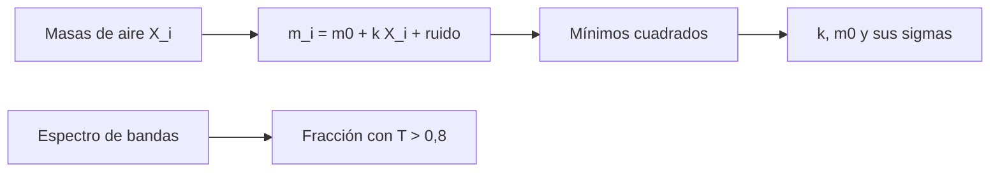

# B48-C05 — Ventanas atmosféricas

<!-- nav:top -->
[🏠 Programa](../../../../README.md) · [📚 Bloque B48](../../../tronco-comun/B48-operaciones-de-observatorios-cientificos.md) · [← Anterior: B48-C04 — Planificación por visibilidad](../B48-C04-planificacion-por-visibilidad/CLASE.md) · [Siguiente: B48-C06 — Meteorología de observatorios →](../B48-C06-meteorologia-de-observatorios/CLASE.md)
<!-- /nav -->

## 1. Ubicación, nivel y alcance

Clase 5 del bloque B48. Nivel N3. La atmósfera deja pasar la luz solo en ciertas bandas y la debilita según la masa de aire. Aquí ajustas la **recta de Bouguer** para medir la extinción y cuentas la fracción de banda útil de un espectro de bandas inventadas. Usas [B42](../../../tronco-comun/B42-optica-fisica-y-optica-adaptativa.md) y [B12](../../../tronco-comun/B12-probabilidad-estadistica-e-incertidumbre.md).

## 2. Por qué esta clase existe

Sin conocer la extinción, las magnitudes de distintas noches no se comparan. La decisión central: **¿qué extinción y qué incertidumbre tiene una serie de medidas?**

## 3. Lo que podrás hacer al terminar

1. Escribir la ley de Bouguer en magnitudes.
2. Ajustar la recta por mínimos cuadrados cerrados.
3. Calcular la incertidumbre analítica de la pendiente y la ordenada.
4. Verificarla con 4000 simulaciones.
5. Definir una ventana como banda con transmisión alta.
6. Reconocer que las bandas del ejemplo son inventadas.

La evidencia es la **ficha de las ventanas atmosféricas** del ejercicio 12 (sección 20).

## 4. Con qué llegas y cómo comprobarlo

1. ¿Qué es una incertidumbre?
2. ¿Qué es una simulación Monte Carlo?
3. ¿Qué es una tabla de resultados?
4. ¿Qué es un valor ilustrativo?
5. ¿Qué es una verificación?

<details>
<summary>Ver respuestas</summary>

1. Un intervalo en que se espera el valor verdadero. 2. Repetir con números aleatorios de semilla fija. 3. Un resumen ordenado de cálculos. 4. Un valor propuesto para el ejemplo, no medido. 5. Comparar un cálculo con un caso independiente.
</details>

Con cuatro o cinco aciertos, sigue; si no, repasa los prerrequisitos.

## 5. Un caso de contexto y casos de referencia

Con k = 0,20 mag por masa de aire, m₀ = 12,000 y ruido de 0,01 mag en 12 masas de aire (1,0 a 2,5), la pendiente se recupera con desviación 0,00607 frente a 0,00613 analítica. En el espectro de bandas inventadas, la fracción útil es 0,0119. Es el **ejemplo conductor**.

## 6. Vocabulario

**Extinción**: pérdida de luz en la atmósfera. **Coeficiente** `k`: mag por masa de aire. **Recta de Bouguer**: `m = m₀ + kX`. **Ventana**: rango de longitudes de onda con transmisión alta. **Banda de absorción**: rango con transmisión baja.

## 7. Modelo mental: una pendiente que mide cuánta luz se pierde por cada capa

Cada masa de aire adicional resta una cantidad fija de magnitud: la pendiente mide esa pérdida y la ordenada es el brillo fuera de la atmósfera.



*Descripción textual:* las magnitudes medidas a distintas masas de aire se ajustan con una recta cuya pendiente es la extinción; aparte, el espectro de transmisión define las ventanas.

Analogía: una pendiente que mide cuánta luz se pierde por cada capa. Límite: extinción constante y sin término de color.

## 8. La explicación, paso a paso

### 8.1 Ajuste

| Magnitud | Valor |
|---|---|
| Sxx de las masas de aire | 2,6591 |
| k medio simulado | 0,20000 (verdadero 0,20) |
| Desviación de k, simulada | 0,00607 |
| Desviación de k, analítica `σ/√Sxx` | 0,00613 |
| m₀ medio simulado | 11,99997 |
| Desviación de m₀, simulada | 0,01093 |
| Desviación de m₀, analítica | 0,01111 |

### 8.2 Ventanas

La fracción de banda con transmisión mayor que 0,8 entre 0,70 y 1,50 µm es 0,0120 con 1000 puntos y 0,0119 con 20000: el resultado converge. Las cuatro bandas del ejemplo (0,76; 0,94; 1,13 y 1,38 µm) son **inventadas**.

### 8.3 Lectura

Con pocas masas de aire cercanas, `Sxx` es pequeño y `k` sale muy incierto. Observar de 1,0 a 2,5 reduce la incertidumbre. La fracción útil tan baja (1,2 %) es consecuencia de las bandas anchas inventadas, no un dato de la atmósfera.

## 9. Magnitudes, símbolos y unidades

| Símbolo | Qué es | Unidad | Valor / nota |
|---|---|---|---|
| `k` | coeficiente de extinción | mag/masa de aire | 0,20 (ilustrativo) |
| `m₀` | magnitud fuera de la atmósfera | mag | 12,000 |
| `σ` | ruido por medida | mag | 0,01 |
| `Sxx` | suma de cuadrados de X | — | 2,6591 |
| `T` | transmisión | — | 0 a 1 |

## 10. Convenciones y referencias

Unidades del SI salvo donde se indique; coma decimal en el texto y punto decimal en las salidas del laboratorio; semilla 20261109; todo valor que no esté citado en la sección 11 es ilustrativo o sintético.

## 11. De dónde sale lo que afirmamos

| ID | Fuente | Localizador | Respalda | Estado |
|---|---|---|---|---|
| — | Sin fuente externa | — | relaciones estándar que verifica el laboratorio | No se consultó una fuente para esta clase |

Límites: no se consultó ninguna fuente externa para esta clase; los valores son ilustrativos o sintéticos y las relaciones son de libro, verificadas solo por el laboratorio.

## 12. Cómo ver los resultados

| X | magnitud ideal |
|---|---|
| 1,0 | 12,200 |
| 1,5 | 12,300 |
| 2,0 | 12,400 |
| 2,5 | 12,500 |

Descripción larga: sin ruido, la magnitud crece linealmente con la masa de aire con pendiente 0,20.

## 13. Ejemplo trabajado: la incertidumbre de la pendiente

**Paso 1.** `Sxx = 2,6591`.

**Paso 2.** `√Sxx = 1,6307`.

**Paso 3.** `σ_k = 0,01/1,6307 = 0,00613` mag por masa de aire.

**Paso 4.** La simulación da 0,00607.

## 14. Distintas formas de describir el resultado

**Por fórmula:** sección 8. **Por tabla:** sección 12. **Por código:** `extincion_bouguer.py`. **Por contraste:** el laboratorio compara dos vías independientes.

## 15. Práctica guiada

**Ejercicio 1 · con los pasos indicados.** Magnitud ideal a `X = 1,8`. *Pasos:* `12 + 0,20 × 1,8`.

<details><summary>Solución comentada</summary>

`12,360`.
</details>

**Ejercicio 2 · con una pista.** `σ_k`. *Pista:* `0,01/√Sxx`.

<details><summary>Solución comentada</summary>

`0,00613`.
</details>

**Ejercicio 3 · casi autónomo.** `σ` de m₀ analítica.

<details><summary>Solución comentada</summary>

`0,01111`.
</details>

## 16. Práctica autónoma, transferencia e integrador

**Ejercicio 4.** Razón simulada/analítica de `σ_k`.

<details><summary>Solución comentada</summary>

`0,989`.
</details>

**Ejercicio 5.** Cuántas veces mayor sería `σ_k` si `σ = 0,03`.

<details><summary>Solución comentada</summary>

`3` veces.
</details>

**Ejercicio 6.** Magnitud fuera de la atmósfera estimada en promedio.

<details><summary>Solución comentada</summary>

`11,99997`.
</details>

**Ejercicio 7.** Fracción útil con 20000 puntos en porcentaje.

<details><summary>Solución comentada</summary>

`1,19 %`.
</details>

**Ejercicio 8.** Diferencia entre las fracciones de 1000 y 20000 puntos.

<details><summary>Solución comentada</summary>

`0,0001`.
</details>

**Ejercicio 9 · transferencia.** **Transferencia.** ¿Qué pasa si la extinción cambia durante la serie?

<details><summary>Solución comentada</summary>

La recta se curva y `k` pierde sentido: hay que ajustar por tramos.
</details>

**Ejercicio 10 · transferencia.** **Transferencia.** ¿Por qué el color de la estrella importa?

<details><summary>Solución comentada</summary>

Porque la extinción depende de la longitud de onda: hay un término de color que el modelo omite.
</details>

**Ejercicio 11 · transferencia.** **Transferencia.** ¿Son reales las bandas del laboratorio?

<details><summary>Solución comentada</summary>

No: son inventadas; solo sirven para practicar el cálculo de ventanas.
</details>

**Ejercicio 12.** **Integrador.** Elabora tu *ficha de las ventanas atmosféricas*: recta, incertidumbres, fracción útil y límites.

<details><summary>Solución comentada</summary>

Secciones 8.1–8.3.
</details>

**Ejercicio 12 · integrador.** **Integrador.** Elabora tu *ficha de las ventanas atmosféricas*: recta, incertidumbres, fracción útil y límites.

<details><summary>Solución modelo</summary>

Secciones 8.1–8.3.
</details>

## 17. Laboratorio: recta de Bouguer y bandas

El script [extincion_bouguer.py](extincion_bouguer.py) ajusta la recta con ruido simulado y cuenta una fracción de banda útil (**comprueba** que la desviación simulada coincide con la analítica a 5 %).

**Datos:** extinción, ruido y bandas **sintéticos**. **Predice antes de ejecutar:** ¿cuánto vale `σ_k`? (≈ 0,006.) **Ejecución del 2026-11-09 (Python 3.12.9):**

```text
Sxx = 2.6591
k medio simulado = 0.20000 (verdadero 0.2); desviación simulada 0.00607; analítica 0.00613
m0 medio simulado = 11.99997 (verdadero 12.0); desviación simulada 0.01093; analítica 0.01111
Fracción de banda útil (T > 0,8): 0.0120 con 1000 puntos y 0.0119 con 20000
Pruebas superadas.
```

```bash
python programa/clases/B48/B48-C05-ventanas-atmosfericas/extincion_bouguer.py
```

**Límites:** el modelo es de libro y sus parámetros son ilustrativos; no describe ningún observatorio ni instrumento real.

## 18. Errores frecuentes y cómo corregirlos

**Ajustar con masas de aire muy próximas.** Se corrige con 8.3.

**Suponer extinción constante toda la noche.** Se corrige con la sección 10.

**Tomar las bandas inventadas como las reales.** Se corrige con 8.2.

**Confundir mag por masa de aire con magnitud absoluta.** Se corrige con la sección 9.

## 19. Cómo sabrás que vas bien

Tras la sección 8: ¿qué resultado esperabas y cuál obtuviste? Si dudas, repasa el ejemplo 13. Tras el laboratorio: ¿qué comprueba? (ver la sección 17).

## 20. Qué entregas y cómo se evalúa

El producto es tu **ficha de las ventanas atmosféricas** (ejercicio 12).

| Criterio | Inicial | En desarrollo | Logrado | Destacado |
|---|---|---|---|---|
| Conceptos | Los confunde | Parciales | conceptos de la clase | Explica los límites |
| Cálculo | Sin unidades | Con errores | Tablas completas | Calcula casos nuevos |
| Numérico | Sin comprobar | Un caso | Contraste con el análisis | Interpreta las diferencias |
| Fuentes | Sin fuente | Sin fecha | fuentes con fecha | Declara lo ilustrativo |
| Límites | No los nombra | Uno | Tres | Discute qué falta del modelo |

**Condiciones críticas (no se compensan con promedio):** rotular lo ilustrativo y lo sintético; no presentar el modelo como práctica de un observatorio real; citar solo lo consultado.

## 21. Ética, seguridad y límites

Clase educativa: los modelos son simplificados. Accesibilidad: tablas equivalentes a las gráficas, fórmulas en texto, ejercicios sin conexión.

## 22. Para cerrar y seguir

La recta de Bouguer recupera k con incertidumbre 0,0061 mag por masa de aire. Queda una pregunta: ¿qué condiciones del sitio se miden para decidir si se observa?

**Glosario español–inglés.** extinción · *extinction*; ventana atmosférica · *atmospheric window*; masa de aire · *airmass*; transmisión · *transmission*; banda · *band*.

**Continuidad.** [B48-C06](../B48-C06-meteorologia-de-observatorios/CLASE.md) estudia la meteorología del observatorio.

**Referencias:** ver sección 11.

<!-- nav:bottom -->
---

[← Anterior: B48-C04 — Planificación por visibilidad](../B48-C04-planificacion-por-visibilidad/CLASE.md) · [📚 Bloque B48](../../../tronco-comun/B48-operaciones-de-observatorios-cientificos.md) · [Siguiente: B48-C06 — Meteorología de observatorios →](../B48-C06-meteorologia-de-observatorios/CLASE.md)
<!-- /nav -->
