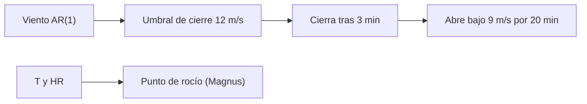

# B48-C06 — Meteorología de observatorios

<!-- nav:top -->
[🏠 Programa](../../../../README.md) · [📚 Bloque B48](../../../tronco-comun/B48-operaciones-de-observatorios-cientificos.md) · [← Anterior: B48-C05 — Ventanas atmosféricas](../B48-C05-ventanas-atmosfericas/CLASE.md) · [Siguiente: B48-C07 — Seguridad en instalaciones remotas →](../B48-C07-seguridad-en-instalaciones-remotas/CLASE.md)
<!-- /nav -->

## 1. Ubicación, nivel y alcance

Clase 6 del bloque B48. Nivel N3. Un observatorio cierra por viento, humedad o nubes. Aquí calculas el punto de rocío, modelas el viento como proceso de Ornstein-Uhlenbeck y comparas una regla de cierre con histéresis frente a una sin ella. Usas [B12](../../../tronco-comun/B12-probabilidad-estadistica-e-incertidumbre.md). Los umbrales son inventados.

## 2. Por qué esta clase existe

Un cierre que oscila abre y cierra la cúpula cientos de veces y desgasta el equipo. La decisión central: **¿qué regla de cierre evita el parpadeo sin perder tiempo útil?**

## 3. Lo que podrás hacer al terminar

1. Calcular el punto de rocío con la fórmula de Magnus.
2. Simular viento autocorrelacionado.
3. Comparar la fracción sobre un umbral con la normal.
4. Contar cambios de estado con y sin histéresis.
5. Medir el tiempo abierto en cada regla.
6. Reconocer que los umbrales son ilustrativos.

La evidencia es la **ficha de meteorología del observatorio** del ejercicio 12 (sección 20).

## 4. Con qué llegas y cómo comprobarlo

1. ¿Qué es una incertidumbre?
2. ¿Qué es una simulación Monte Carlo?
3. ¿Qué es una tabla de resultados?
4. ¿Qué es un valor ilustrativo?
5. ¿Qué es una verificación?

<details>
<summary>Ver respuestas</summary>

1. Un intervalo en que se espera el valor verdadero. 2. Repetir con números aleatorios de semilla fija. 3. Un resumen ordenado de cálculos. 4. Un valor propuesto para el ejemplo, no medido. 5. Comparar un cálculo con un caso independiente.
</details>

Con cuatro o cinco aciertos, sigue; si no, repasa los prerrequisitos.

## 5. Un caso de contexto y casos de referencia

A 20 °C y 50 % de humedad el punto de rocío es 9,26 °C. Un viento con media 6 m/s y desviación 2,5 m/s supera 12 m/s el 0,795 % del tiempo (analítico 0,820 %). Con histéresis hay 1272 cambios de estado en un millón de minutos; sin ella, 1836. Es el **ejemplo conductor**.

## 6. Vocabulario

**Punto de rocío**: temperatura a la que el vapor satura. **Proceso de Ornstein-Uhlenbeck**: fluctuación que regresa a su media con memoria. **Autocorrelación**: dependencia con el pasado. **Histéresis**: umbrales distintos para cerrar y abrir. **Parpadeo**: cambios rápidos y repetidos de estado.

## 7. Modelo mental: un termostato

Un termostato que se enciende y apaga en el mismo umbral parpadea; con dos umbrales (histéresis) espera a que el cambio sea claro.



*Descripción textual:* el viento simulado alimenta una regla con dos umbrales y tiempos de espera; la temperatura y la humedad dan el punto de rocío como margen contra la condensación.

Analogía: un termostato. Límite: viento gaussiano y estacionario.

## 8. La explicación, paso a paso

### 8.1 Rocío

| Magnitud | Valor |
|---|---|
| Punto de rocío (20 °C, 50 %) | 9,26 °C |
| Humedad recuperada desde el rocío | 50,000 % |

Los coeficientes de Magnus (17,62 y 243,12 °C) son de libro y no se verificaron contra la fuente primaria; el valor de tablas cercano a 9,3 °C se usó solo como cota.

### 8.2 Viento

| Magnitud | Valor |
|---|---|
| Media simulada | 5,992 m/s |
| Desviación simulada | 2,506 m/s |
| P(v > 12), analítica | 0,00820 |
| P(v > 12), simulada | 0,00795 |
| Autocorrelación a 30 min | 0,357 (teórica 0,368) |

### 8.3 Reglas de cierre

| Regla | Cambios de estado | Fracción abierta |
|---|---|---|
| Con histéresis (cierra 3 min sobre 12; abre 20 min bajo 9) | 1272 | 0,9627 |
| Sin histéresis (mismo umbral) | 1836 | 0,9957 |

### 8.4 Lectura

La histéresis reduce los cambios en 30,7 %, pero cuesta 3,3 puntos de tiempo abierto. Esa es la decisión: más tiempo cerrado a cambio de un equipo menos castigado. Los umbrales no son los de ningún observatorio.

## 9. Magnitudes, símbolos y unidades

| Símbolo | Qué es | Unidad | Valor / nota |
|---|---|---|---|
| `T_d` | punto de rocío | °C | 9,26 |
| `v` | velocidad del viento | m/s | media 6 |
| `τ` | tiempo de correlación | min | 30 |
| `v_alto`, `v_bajo` | umbrales de cierre y apertura | m/s | 12 y 9 (inventados) |

## 10. Convenciones y referencias

Unidades del SI salvo donde se indique; coma decimal en el texto y punto decimal en las salidas del laboratorio; semilla 20261109; todo valor que no esté citado en la sección 11 es ilustrativo o sintético.

## 11. De dónde sale lo que afirmamos

| ID | Fuente | Localizador | Respalda | Estado |
|---|---|---|---|---|
| — | Sin fuente externa | — | relaciones estándar que verifica el laboratorio | No se consultó una fuente para esta clase |

Límites: no se consultó ninguna fuente externa para esta clase; los valores son ilustrativos o sintéticos y las relaciones son de libro, verificadas solo por el laboratorio.

## 12. Cómo ver los resultados

| Regla | Cambios | Abierto |
|---|---|---|
| con histéresis | 1272 | 0,9627 |
| sin histéresis | 1836 | 0,9957 |

Descripción larga: la histéresis cierra más tiempo pero cambia de estado menos veces.

## 13. Ejemplo trabajado: la probabilidad de superar 12 m/s

**Paso 1.** `z = (12 − 6)/2,5 = 2,4`.

**Paso 2.** `Φ(2,4) ≈ 0,9918`.

**Paso 3.** `P = 1 − 0,9918 = 0,0082`.

**Paso 4.** La simulación da 0,00795.

## 14. Distintas formas de describir el resultado

**Por fórmula:** sección 8. **Por tabla:** sección 12. **Por código:** `meteorologia.py`. **Por contraste:** el laboratorio compara dos vías independientes.

## 15. Práctica guiada

**Ejercicio 1 · con los pasos indicados.** z del umbral de 12 m/s. *Pasos:* `(12 − 6)/2,5`.

<details><summary>Solución comentada</summary>

`2,4`.
</details>

**Ejercicio 2 · con una pista.** Probabilidad analítica de superarlo.

<details><summary>Solución comentada</summary>

`0,00820`.
</details>

**Ejercicio 3 · casi autónomo.** Minutos al año sobre el umbral (525600 min).

<details><summary>Solución comentada</summary>

`4309` min.
</details>

## 16. Práctica autónoma, transferencia e integrador

**Ejercicio 4.** Reducción de cambios con histéresis.

<details><summary>Solución comentada</summary>

`30,7 %`.
</details>

**Ejercicio 5.** Costo de tiempo abierto.

<details><summary>Solución comentada</summary>

`3,3` puntos.
</details>

**Ejercicio 6.** Autocorrelación teórica a 30 min.

<details><summary>Solución comentada</summary>

`e^−1 = 0,368`.
</details>

**Ejercicio 7.** Humedad recuperada desde el rocío.

<details><summary>Solución comentada</summary>

`50,000 %`.
</details>

**Ejercicio 8.** Diferencia simulada − analítica de P.

<details><summary>Solución comentada</summary>

`-0,00025`.
</details>

**Ejercicio 9 · transferencia.** **Transferencia.** ¿Por qué un viento real no es gaussiano?

<details><summary>Solución comentada</summary>

Es positivo y sesgado; el modelo subestima o sobreestima las colas.
</details>

**Ejercicio 10 · transferencia.** **Transferencia.** ¿Debe cerrar la cúpula un umbral de este ejemplo?

<details><summary>Solución comentada</summary>

No: los umbrales son inventados; los reales los fija cada observatorio.
</details>

**Ejercicio 11 · transferencia.** **Transferencia.** ¿Qué otros sensores faltan?

<details><summary>Solución comentada</summary>

Lluvia, nubes, polvo, dirección y ráfagas.
</details>

**Ejercicio 12.** **Integrador.** Elabora tu *ficha de meteorología del observatorio*: rocío, viento, reglas de cierre y límites.

<details><summary>Solución comentada</summary>

Secciones 8.1–8.4.
</details>

**Ejercicio 12 · integrador.** **Integrador.** Elabora tu *ficha de meteorología del observatorio*: rocío, viento, reglas de cierre y límites.

<details><summary>Solución modelo</summary>

Secciones 8.1–8.4.
</details>

## 17. Laboratorio: rocío, viento y cierre

El script [meteorologia.py](meteorologia.py) simula viento de un millón de minutos y compara dos reglas de cierre (**comprueba** `P(v > 12)` a 0,002 y menos cambios con histéresis).

**Datos:** coeficientes de libro y umbrales **inventados**. **Predice antes de ejecutar:** ¿cuántos cambios evita la histéresis? (≈ 30 %.) **Ejecución del 2026-11-09 (Python 3.12.9):**

```text
Punto de rocío a 20 °C y 50 % HR = 9.26 °C; humedad recuperada = 50.000 %
P(v > 12 m/s): analítica 0.00820 | simulada 0.00795
Media 5.992 m/s, desviación 2.506 m/s; autocorrelación a 30 min 0.357 (teórica 0.368)
Con histéresis: 1272 cambios de estado, abierto 0.9627 del tiempo
Sin histéresis: 1836 cambios de estado, abierto 0.9957 del tiempo
Pruebas superadas.
```

```bash
python programa/clases/B48/B48-C06-meteorologia-de-observatorios/meteorologia.py
```

**Límites:** el modelo es de libro y sus parámetros son ilustrativos; no describe ningún observatorio ni instrumento real.

## 18. Errores frecuentes y cómo corregirlos

**Usar un solo umbral para cerrar y abrir.** Se corrige con 8.3.

**Tomar los umbrales como reglamento.** Se corrige con 8.4.

**Ignorar la autocorrelación del viento.** Se corrige con 8.2.

**Confundir punto de rocío con temperatura.** Se corrige con 8.1.

## 19. Cómo sabrás que vas bien

Tras la sección 8: ¿qué resultado esperabas y cuál obtuviste? Si dudas, repasa el ejemplo 13. Tras el laboratorio: ¿qué comprueba? (ver la sección 17).

## 20. Qué entregas y cómo se evalúa

El producto es tu **ficha de meteorología del observatorio** (ejercicio 12).

| Criterio | Inicial | En desarrollo | Logrado | Destacado |
|---|---|---|---|---|
| Conceptos | Los confunde | Parciales | conceptos de la clase | Explica los límites |
| Cálculo | Sin unidades | Con errores | Tablas completas | Calcula casos nuevos |
| Numérico | Sin comprobar | Un caso | Contraste con el análisis | Interpreta las diferencias |
| Fuentes | Sin fuente | Sin fecha | fuentes con fecha | Declara lo ilustrativo |
| Límites | No los nombra | Uno | Tres | Discute qué falta del modelo |

**Condiciones críticas (no se compensan con promedio):** rotular lo ilustrativo y lo sintético; no presentar el modelo como práctica de un observatorio real; citar solo lo consultado.

## 21. Ética, seguridad y límites

Clase educativa: los modelos son simplificados. Accesibilidad: tablas equivalentes a las gráficas, fórmulas en texto, ejercicios sin conexión.

## 22. Para cerrar y seguir

La histéresis baja los cambios de 1836 a 1272. Queda una pregunta: ¿qué pasa cuando falla la energía en un sitio aislado?

**Glosario español–inglés.** punto de rocío · *dew point*; histéresis · *hysteresis*; viento · *wind*; autocorrelación · *autocorrelation*; cierre · *shutdown*.

**Continuidad.** [B48-C07](../B48-C07-seguridad-en-instalaciones-remotas/CLASE.md) estudia la seguridad en instalaciones remotas.

**Referencias:** ver sección 11.

<!-- nav:bottom -->
---

[← Anterior: B48-C05 — Ventanas atmosféricas](../B48-C05-ventanas-atmosfericas/CLASE.md) · [📚 Bloque B48](../../../tronco-comun/B48-operaciones-de-observatorios-cientificos.md) · [Siguiente: B48-C07 — Seguridad en instalaciones remotas →](../B48-C07-seguridad-en-instalaciones-remotas/CLASE.md)
<!-- /nav -->
