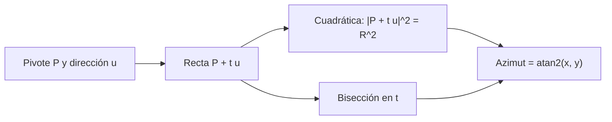

# B48-C08 — Automatización de cúpulas

<!-- nav:top -->
[🏠 Programa](../../../../README.md) · [📚 Bloque B48](../../../tronco-comun/B48-operaciones-de-observatorios-cientificos.md) · [← Anterior: B48-C07 — Seguridad en instalaciones remotas](../B48-C07-seguridad-en-instalaciones-remotas/CLASE.md) · [Siguiente: B48-C09 — Control remoto de telescopios →](../B48-C09-control-remoto-de-telescopios/CLASE.md)
<!-- /nav -->

## 1. Ubicación, nivel y alcance

Clase 8 del bloque B48. Nivel N3. La ranura de una cúpula debe apuntar a donde mira el telescopio, y si el telescopio no está en el centro, los azimuts no coinciden. Aquí calculas el azimut de cúpula por una cuadrática y por bisección. Usas [B43](../../../tronco-comun/B43-construccion-y-mecanica-de-telescopios.md). La geometría es ilustrativa.

## 2. Por qué esta clase existe

Una ranura mal orientada viñetea o bloquea el haz. La decisión central: **¿qué azimut debe tener la cúpula para un telescopio descentrado?**

## 3. Lo que podrás hacer al terminar

1. Escribir la recta del eje óptico desde el punto de pivote.
2. Cortarla con la esfera de la cúpula por una cuadrática.
3. Verificar con una bisección independiente.
4. Calcular la diferencia cúpula − telescopio.
5. Hallar el error máximo sin corrección.
6. Reconocer las simplificaciones de la esfera ideal.

La evidencia es la **ficha de la automatización de cúpulas** del ejercicio 12 (sección 20).

## 4. Con qué llegas y cómo comprobarlo

1. ¿Qué es una incertidumbre?
2. ¿Qué es una simulación Monte Carlo?
3. ¿Qué es una tabla de resultados?
4. ¿Qué es un valor ilustrativo?
5. ¿Qué es una verificación?

<details>
<summary>Ver respuestas</summary>

1. Un intervalo en que se espera el valor verdadero. 2. Repetir con números aleatorios de semilla fija. 3. Un resumen ordenado de cálculos. 4. Un valor propuesto para el ejemplo, no medido. 5. Comparar un cálculo con un caso independiente.
</details>

Con cuatro o cinco aciertos, sigue; si no, repasa los prerrequisitos.

## 5. Un caso de contexto y casos de referencia

Con cúpula de 3,0 m de radio y telescopio en (0,5; 0; 1,0) m, apuntar al azimut 0° a 45° de altitud exige la cúpula en 18,0861°; la diferencia llega a -18,433° (a azimut 190°). Es el **ejemplo conductor**.

## 6. Vocabulario

**Pivote**: punto donde se cruzan los ejes. **Eje óptico**: recta de apuntado. **Ranura**: abertura de la cúpula. **Descentrado**: distancia del pivote al centro. **Bisección**: búsqueda de una raíz por mitades.

## 7. Modelo mental: la sombra de una linterna en una pared curva

Es una linterna fuera del centro de una habitación redonda: el punto iluminado no está en el mismo azimut que la linterna mira.



*Descripción textual:* se corta la recta del eje con la esfera de la cúpula por dos vías y el azimut del punto de corte es el de la ranura.

Analogía: la sombra de una linterna en una pared curva. Límite: cúpula esférica y ejes concurrentes.

## 8. La explicación, paso a paso

### 8.1 Azimut de cúpula a 45° de altitud

| Azimut del telescopio | Azimut de cúpula | Diferencia | Distancia al centro |
|---|---|---|---|
| 0° | 18,0861° | 18,0861° | 3,000000 m |
| 90° | 90,0000° | 0,0000° | 3,000000 m |
| 180° | 161,9139° | -18,0861° | 3,000000 m |
| 270° | 270,0000° | 0,0000° | 3,000000 m |

### 8.2 Dos vías

La diferencia máxima entre la cuadrática y la bisección en 216 direcciones es 5.68e-14°. El punto está siempre a 3,000000 m del centro: pertenece a la esfera.

### 8.3 Lectura

El error es nulo al este y al oeste (el desplazamiento está en esa dirección y el telescopio ya mira a lo largo de él) y máximo cerca del eje norte-sur: 18,43° hacia el azimut 190°. Un seguimiento que copie el azimut del telescopio desalinea la ranura; hay que calcular la geometría. El modelo omite el movimiento del pivote con la altitud y la forma real de la cúpula.

## 9. Magnitudes, símbolos y unidades

| Símbolo | Qué es | Unidad | Valor / nota |
|---|---|---|---|
| `R` | radio de la cúpula | m | 3,0 (ilustrativo) |
| `P` | pivote | m | (0,5; 0; 1,0) |
| `u` | dirección del eje | — | vector unitario |
| `t` | distancia a lo largo del eje | m | raíz de la cuadrática |
| `Δ` | azimut cúpula − telescopio | ° | 18,086 (az 0°) |

## 10. Convenciones y referencias

Unidades del SI salvo donde se indique; coma decimal en el texto y punto decimal en las salidas del laboratorio; semilla 20261109; todo valor que no esté citado en la sección 11 es ilustrativo o sintético.

## 11. De dónde sale lo que afirmamos

| ID | Fuente | Localizador | Respalda | Estado |
|---|---|---|---|---|
| — | Sin fuente externa | — | relaciones estándar que verifica el laboratorio | No se consultó una fuente para esta clase |

Límites: no se consultó ninguna fuente externa para esta clase; los valores son ilustrativos o sintéticos y las relaciones son de libro, verificadas solo por el laboratorio.

## 12. Cómo ver los resultados

| Azimut | Diferencia (°) |
|---|---|
| 0 | 18,0861 |
| 90 | 0,0000 |
| 180 | -18,0861 |
| 270 | 0,0000 |

Descripción larga: la diferencia es simétrica y se anula en el eje este-oeste.

## 13. Ejemplo trabajado: azimut de cúpula para el telescopio al norte

**Paso 1.** `u = (0; cos 45°; sen 45°) = (0; 0,7071; 0,7071)`.

**Paso 2.** `b = P·u = 0,7071`; `c = |P|² − R² = 1,25 − 9 = −7,75`.

**Paso 3.** `t = −0,7071 + √(0,5 + 7,75) = 2,165` m.

**Paso 4.** Punto: `x = 0,5`, `y = 1,531`; `atan2(0,5; 1,531) = 18,0861°`.

## 14. Distintas formas de describir el resultado

**Por fórmula:** sección 8. **Por tabla:** sección 12. **Por código:** `domo_azimut.py`. **Por contraste:** el laboratorio compara dos vías independientes.

## 15. Práctica guiada

**Ejercicio 1 · con los pasos indicados.** `b` y `c` para el telescopio al norte a 45°.

<details><summary>Solución comentada</summary>

`0,7071` y `−7,75`.
</details>

**Ejercicio 2 · con una pista.** Distancia `t` al muro. *Pista:* `−b + √(b² − c)`.

<details><summary>Solución comentada</summary>

`2,165` m.
</details>

**Ejercicio 3 · casi autónomo.** Azimut de cúpula al norte.

<details><summary>Solución comentada</summary>

`18,0861°`.
</details>

## 16. Práctica autónoma, transferencia e integrador

**Ejercicio 4.** Diferencia al sur.

<details><summary>Solución comentada</summary>

`-18,0861°`.
</details>

**Ejercicio 5.** Diferencia al este.

<details><summary>Solución comentada</summary>

`0,0000°`.
</details>

**Ejercicio 6.** ¿Qué distancia al centro tiene el punto de corte?

<details><summary>Solución comentada</summary>

`3,000000` m.
</details>

**Ejercicio 7.** Error máximo sin corrección a 45°.

<details><summary>Solución comentada</summary>

`-18,433°`.
</details>

**Ejercicio 8.** Diferencia cuadrática − bisección máxima.

<details><summary>Solución comentada</summary>

`5.7e-14°`.
</details>

**Ejercicio 9 · transferencia.** **Transferencia.** ¿Qué pasa si el descentrado es cero?

<details><summary>Solución comentada</summary>

El azimut de cúpula iguala al del telescopio.
</details>

**Ejercicio 10 · transferencia.** **Transferencia.** ¿Y si la ranura es muy ancha?

<details><summary>Solución comentada</summary>

Tolera más error: la precisión requerida depende del ancho.
</details>

**Ejercicio 11 · transferencia.** **Transferencia.** ¿Por qué incluir un modo de seguridad?

<details><summary>Solución comentada</summary>

Porque un error de cúpula con el telescopio en movimiento puede causar daño; se agregan topes y verificaciones.
</details>

**Ejercicio 12.** **Integrador.** Elabora tu *ficha de la automatización de cúpulas*: geometría, dos vías, tabla de errores y límites.

<details><summary>Solución comentada</summary>

Secciones 8.1–8.3.
</details>

**Ejercicio 12 · integrador.** **Integrador.** Elabora tu *ficha de la automatización de cúpulas*: geometría, dos vías, tabla de errores y límites.

<details><summary>Solución modelo</summary>

Secciones 8.1–8.3.
</details>

## 17. Laboratorio: azimut de cúpula descentrada

El script [domo_azimut.py](domo_azimut.py) calcula el azimut por cuadrática y por bisección (**comprueba** diferencia menor que 1e-9° y punto sobre la esfera).

**Datos:** geometría de la cúpula **ilustrativa**. **Predice antes de ejecutar:** ¿cuánto se desalinea al norte? (≈ 18°.) **Ejecución del 2026-11-09 (Python 3.12.9):**

```text
Telescopio az   0° alt 45°: cúpula  18.0861°, diferencia +18.0861°, |punto| = 3.000000 m
Telescopio az  90° alt 45°: cúpula  90.0000°, diferencia  +0.0000°, |punto| = 3.000000 m
Telescopio az 180° alt 45°: cúpula 161.9139°, diferencia -18.0861°, |punto| = 3.000000 m
Telescopio az 270° alt 45°: cúpula 270.0000°, diferencia  +0.0000°, |punto| = 3.000000 m
Diferencia máxima cuadrática-bisección: 5.68e-14°
Error máximo sin corrección a 45°: -18.433° en az 190°
Pruebas superadas.
```

```bash
python programa/clases/B48/B48-C08-automatizacion-de-cupulas/domo_azimut.py
```

**Límites:** el modelo es de libro y sus parámetros son ilustrativos; no describe ningún observatorio ni instrumento real.

## 18. Errores frecuentes y cómo corregirlos

**Copiar el azimut del telescopio.** Se corrige con 8.3.

**Confundir azimut desde el norte con desde el este.** Se corrige con la sección 10.

**Olvidar la altitud del pivote.** Se corrige con 8.1.

**Suponer ejes concurrentes siempre.** Se corrige con 8.3.

## 19. Cómo sabrás que vas bien

Tras la sección 8: ¿qué resultado esperabas y cuál obtuviste? Si dudas, repasa el ejemplo 13. Tras el laboratorio: ¿qué comprueba? (ver la sección 17).

## 20. Qué entregas y cómo se evalúa

El producto es tu **ficha de la automatización de cúpulas** (ejercicio 12).

| Criterio | Inicial | En desarrollo | Logrado | Destacado |
|---|---|---|---|---|
| Conceptos | Los confunde | Parciales | conceptos de la clase | Explica los límites |
| Cálculo | Sin unidades | Con errores | Tablas completas | Calcula casos nuevos |
| Numérico | Sin comprobar | Un caso | Contraste con el análisis | Interpreta las diferencias |
| Fuentes | Sin fuente | Sin fecha | fuentes con fecha | Declara lo ilustrativo |
| Límites | No los nombra | Uno | Tres | Discute qué falta del modelo |

**Condiciones críticas (no se compensan con promedio):** rotular lo ilustrativo y lo sintético; no presentar el modelo como práctica de un observatorio real; citar solo lo consultado.

## 21. Ética, seguridad y límites

Clase educativa: los modelos son simplificados. Accesibilidad: tablas equivalentes a las gráficas, fórmulas en texto, ejercicios sin conexión.

## 22. Para cerrar y seguir

Al norte, la ranura debe estar 18,09° y no 0°. Queda una pregunta: ¿cómo se comanda todo esto a distancia?

**Glosario español–inglés.** cúpula · *dome*; ranura · *slit*; pivote · *pivot*; bisección · *bisection*; descentrado · *offset*.

**Continuidad.** [B48-C09](../B48-C09-control-remoto-de-telescopios/CLASE.md) estudia el control remoto de telescopios.

**Referencias:** ver sección 11.

<!-- nav:bottom -->
---

[← Anterior: B48-C07 — Seguridad en instalaciones remotas](../B48-C07-seguridad-en-instalaciones-remotas/CLASE.md) · [📚 Bloque B48](../../../tronco-comun/B48-operaciones-de-observatorios-cientificos.md) · [Siguiente: B48-C09 — Control remoto de telescopios →](../B48-C09-control-remoto-de-telescopios/CLASE.md)
<!-- /nav -->
